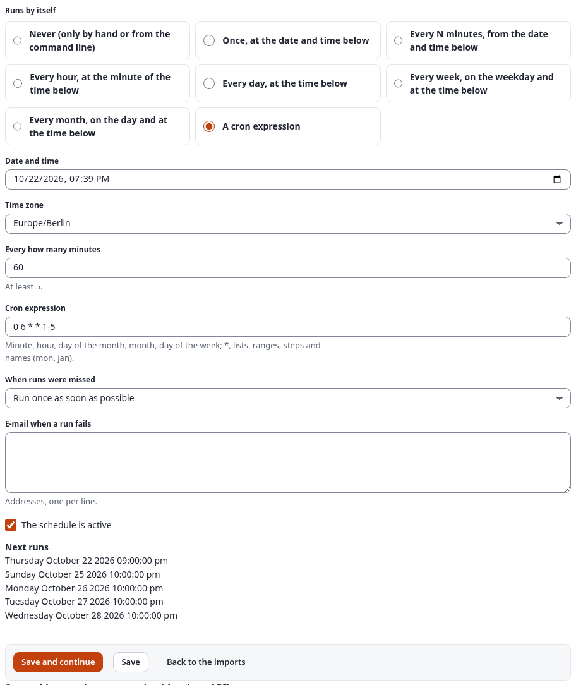

# The import editor

The import editor (`sqliimport/edit`) creates and changes imports in the administration, without PHP. It takes an
import through six steps: source, processing, mapping, preview, schedule and review. Each step is a form that is
saved on its own, so an import is never lost half-way, and every step can be opened again later.

German: [ger-de/editor.md](ger-de/editor.md).

This page describes every field. The same six steps, filled in for a real CSV import with a screenshot of each, are
in [getting-started.md](getting-started.md#your-first-csv-import).

## Table of contents

- [Opening the editor](#opening-the-editor)
- [The buttons of a step](#the-buttons-of-a-step)
- [When a step has errors: what you entered is kept](#when-a-step-has-errors-what-you-entered-is-kept)
- [Secrets: the field "New value" and the secret store](#secrets-the-field-new-value-and-the-secret-store)
- [Step 1: Source](#step-1-source)
- [Step 2: Processing](#step-2-processing)
- [Step 3: Mapping](#step-3-mapping)
- [Step 4: Preview](#step-4-preview)
- [Step 5: Schedule](#step-5-schedule)
- [Step 6: Review](#step-6-review)
- [Changing, copying and deleting](#changing-copying-and-deleting)

## Opening the editor

- **New import**: the button on the dashboard (`sqliimport/list`) or the link in the left menu of the Imports tab.
  It opens `sqliimport/edit/new`, which always starts with the source step.
- **Edit**: the button next to an import in the list. It opens `sqliimport/edit/<id>/(step)/source`.
- **Edit** on the Schedules page opens the schedule step of that import directly.

A step has its own address, `sqliimport/edit/<id>/(step)/<step>`; the bar of steps at the top of the page links
every step of a stored import.

The editor needs the policy `sqliimport/manage` (or `sqliimport/manageimports` of 1.x). With a handler limitation,
only imports of the allowed handlers can be opened ([permissions.md](permissions.md)).

Not every import has all six steps:

- the **mapping** step exists only for the handler `mapping`;
- the **preview** step does not exist for a 1.x handler, because a 1.x handler cannot run without publishing.

## The buttons of a step

| Button | Effect |
|---|---|
| **Save and continue** | Saves the step and opens the next one |
| **Save** | Saves the step and stays on it (source, processing, mapping and schedule) |
| **Back to the imports** | Returns to the dashboard; what was not saved is lost |

Every value is checked on the server: the source and handler options against their schemas, the mapping against the
content class, the schedule by its own rules. A step with errors is shown again with the fields marked and a list
of the points to check. Each save is a POST request with the form token and raises the version number of the
import; the change is recorded in the audit log.

## When a step has errors: what you entered is kept

A step that cannot be saved is shown again with **Please check these points:** at the top, each point a link to its
field, the fields marked, and **everything you entered still in place**. A file that was uploaded stays uploaded,
so you do not choose it again. Only the "New value" of a secret is never shown again (below).

Example: a new import with the name `Docs: error example`, the identifier `Docs Wrong Identifier!` and no file:

Correct the identifier to `docs-error-example`, choose the file, and save again. Nothing was stored by the failed
save: a new import exists only once its source step has been saved without errors.

## Secrets: the field "New value" and the secret store

Sources that sign in somewhere (a database, a mailbox, an API, a directory) never keep a password, token or key in
the import. Their option holds the **name** of a secret; the value lives in the site's secret store and is read only
when a run needs it. Below each such option the editor has a field **New value (stored in Setup, Secrets under this
name)**:

1. Give the secret a name, e.g. `docs_shop_api_token`.
2. Paste the value into **New value** and save the step. The value goes to the secret store (Exponential 6.0.15:
   **Setup, Secrets**, scope `sqliimport`, encrypted); the import keeps only the name.
3. Later saves leave **New value** empty: the stored value stays. Type a value only to replace it.

The value is never shown again, not in the form, not after an error, not in an export of the import, a run page or
a log. Other ways to provide a secret by name:

| Name | Where the value comes from |
|---|---|
| `docs_shop_api_token` | the kernel's secret store (Setup, Secrets), else `sqliimport.ini [SecretSettings] Secrets[docs_shop_api_token]` in the site's own settings |
| `env:SHOP_API_TOKEN` | the environment variable of the PHP process (the PHP-FPM pool, and the job queue's workers) |

The worked examples of the sources that need secrets are in [source-examples-apis.md](source-examples-apis.md) and
[source-examples-databases.md](source-examples-databases.md).

## Step 1: Source

| Field | Meaning |
|---|---|
| Name | Required. The name the administration shows |
| Identifier | Names the import on the command line (`./console ext:sqliimport:run <identifier>`). Lower case letters, digits, `_` and `-`, unique. Empty: made from the name. |
| Description | Free text |
| Source type | One card per format, grouped as the catalogue groups them: Data, NoSQL databases, Content, Platforms, Commerce, Media, Other; or "A 1.x handler that reads its own source". A card is grey when its driver is missing on this server. |
| Where the data comes from | An uploaded file, an address (`http` or `https`, read at every run) or a file on the server. Sources that read a database or a service themselves (SQL, MongoDB, the APIs ...) have no file: their options name the server or the account. |
| Options of the source | The options of the chosen source type, such as the delimiter of a CSV file or the sheet of a spreadsheet ([sources.md](sources.md)) |
| Test connection | For sources that read a database or a service: tries the connection and the query with the options as typed, before anything is saved, and lists the fields it found |
| Load a mapping (optional) | A mapping file (JSON) of another import or installation; its lines are used instead of the format's preset |

Worked examples of every source type, with the values of this step: [source-examples-files.md](source-examples-files.md),
[source-examples-feeds-web.md](source-examples-feeds-web.md), [source-examples-apis.md](source-examples-apis.md),
[source-examples-databases.md](source-examples-databases.md), [source-examples-platforms.md](source-examples-platforms.md).

Notes:

- An upload may be at most `[SourceSettings] MaxSourceMegabytes` large. Once a file is uploaded, the step names it;
  choose a file again only to replace it.
- "A file on the server" is offered only when `[SourceSettings] AllowedPaths[]` lists a directory, and the path must
  lie inside one of them.
- The options of another source type are shown after the step is saved with that type.
- A new import is created when the source step is saved for the first time. It stays disabled until the review step
  enables it.

For a 1.x handler, choose the handler here. It reads its own source, so the step has no file or address.

## Step 2: Processing

| Field | Meaning |
|---|---|
| How the records are processed | The no-code `mapping`, or another 2.x handler. A 2.x handler shows a form made from its options; a 1.x handler takes its options as text, one `name=value` per line, as in 1.x. |
| Parent node of new content | A node ID. A mapping can name another parent per record. |
| Section | A section ID; `0`: the section of the parent |
| Language | The language of the import; empty: the default language of the site |
| Run as user (robot) | A user ID; `0`: the user who starts or schedules the run. The permissions of that user apply. |
| Records per chunk | Between 1 and 5000 (one job of the job queue each) |
| At most this many records per run | `0`: no limit |
| Existing content | Create new, update existing (`update`); only create, leave existing as they are (`create_only`); only update existing (`update_only`) |
| When someone edited an object since the last run | The conflict rule: overwrite, merge, only fill empty fields, skip ([runs.md](runs.md#conflict-rules-when-an-editor-changed-an-imported-object)) |
| Days a run can be undone | Empty: `[RunSettings] UndoDays` (30); `0`: no undo ([runs.md](runs.md#undo-a-run)) |
| Notifications: Tell when a run | `failed or had errors` (default), `failed`, `ended (every run)`, `never` |
| A notice for the user who started the run | The bell in the header and the dashboard show it ([runs.md](runs.md#notifications)) |
| E-mail addresses | One per line; they get a mail with the counts and the first errors |
| Send sample values to the AI | Only with the AI assist ([ai.md](ai.md)); off by default. Off: the AI gets only the names and types of the fields. On: also a few sample values per field and the values of a failed row it explains, with e-mail, phone and IBAN-like values masked first. |

Instead of the mapping, the processing can be **Rows of a data table (a persistent class)**: the records fill a
module's own table instead of content ([datatables.md](datatables.md)). With that target and the AI assist,
**Suggest a data table with AI** shows the three data tables that fit the fields best; **Use this table** chooses one
in the form (saved with the step).

## Step 3: Mapping

The mapping step says which field of a record fills which attribute of a content class
([mappings.md](mappings.md)).

1. **Content class.** Choose the class and save the step to see its attributes. Choosing another class later starts
   a new grid; the lines of the old class do not apply.
2. **Language of the fields.** Empty: the language of the import.
3. **How a record finds its object.** Either by a remote ID made from the record, with a pattern such as
   `product-{sku}` (fields of the record in braces), or by the value of an attribute: the attribute and the source
   field to match on. Without a match, a new object is created.
4. **Where new objects go.** The parent node of new objects; optionally a field with the remote ID of the parent per
   record and a prefix put before it; and a field with more locations.
5. **The grid.** One line per attribute of the class, with its name, datatype and whether the class requires it:

   | Column | Meaning |
   |---|---|
   | Source field | The path of a field in the record (`title`, `author.name`). The fields of the sample are listed above the grid. |
   | Transforms | A chain in its one-line text, for example `trim \| date(format=d.m.Y)` ([mappings.md](mappings.md#the-one-line-text-of-a-chain)) |
   | Default | The value when the source value is empty after the transforms |
   | Required | The record fails when the value is still empty |

   A line with no source field, no transforms and no default is left out. The table "The transforms" below the grid
   lists every transform with its arguments.

**Auto-match by name** fills the lines that have no source field yet from the fields of the sample: the names of
the attribute (identifier and name) and of the field are compared without case, accents and punctuation, an exact
match first, then a name that contains the other. Each field is used once. A rich text attribute gets the transform
`richtext`, a date `date`, an image `image` and a checkbox `bool`. Auto-match uses no external service. It saves the
mapping and stays on the step with the message "Auto-match filled N lines. Check them, then save."; check the lines
before you continue.

**Suggest with AI** (with the AI assist, [ai.md](ai.md)) asks the model of the installation's expai for a source
field and transforms per attribute, from the attributes of the class and the names and types of the fields (sample
values only when the import opts in in the processing step, and then masked). The suggestions appear in an extra
column of the grid with a confidence badge and a short reason; suggestions that name an attribute, a field or a
transform that does not exist are left out. **Accept** fills one line into the form, **Accept all** every line with
a suggestion; nothing is saved until you save the step, and once a step with accepted lines is saved, the import
needs a dry run before its next real run. **Suggest a class with AI** next to the class shows the three classes that
fit the fields best; **Use this class** chooses one in the form.

The mapping is stored even when it is not complete yet, so nothing entered is lost; the errors are listed until they
are fixed.

Below the grid:

- **Translations by column**: per other language of the site, the column that holds that language's value
  ([mappings.md](mappings.md#translations-by-column)).
- **The transforms**: every transform with its arguments ([transforms.md](transforms.md)).
- **The fields of the sample**: the field paths of the first records, to copy into the grid.
- **Mapping file**: **Download mapping (JSON)** and **Load a mapping…**, to move a mapping to another import or
  installation ([transfer.md](transfer.md)).

## Step 4: Preview

The preview runs in the request itself; it starts no job and stores no run.

- **Sample of the source**: the first 20 records as a table (up to 30 columns), with what the source detected, such
  as the delimiter and encoding of a CSV file or the sheets of a spreadsheet.
- **Dry run of the first records**: the first `[RunSettings] DryRunRows` records (20 by default) through the
  mapping or the handler. For each record: what would happen (created, updated, unchanged, skipped, failed), the
  object, and the fields that would change with the current and the new value.

Nothing is published, and no image or file is downloaded: a dry run uses the address in place of the file. When the
source cannot be read, the step shows the message. Change the source or the mapping and open the preview again.

## Step 5: Schedule

| Field | Meaning |
|---|---|
| Runs by itself | Never (only by hand or from the command line); once; every N minutes; every hour; every day; every week; every month; a cron expression |
| Date and time | The first or only run; hourly, daily, weekly and monthly take its minute, time, weekday or day |
| Every how many minutes | At least 5 |
| Cron expression | Minute, hour, day of the month, month, day of the week ([schedules.md](schedules.md)) |
| Time zone | The time zone of the times above |
| When runs were missed | Run once as soon as possible (`one`), or wait for the next time (`skip`) |
| E-mail when a run fails | Addresses, one per line |
| The schedule is active | Off: the schedule is kept, but paused |

After saving, the step lists the next five run times. The editor keeps one schedule per import; choosing "Never"
removes it. Schedules are listed, paused and resumed on the Schedules page ([schedules.md](schedules.md)).

Example: weekdays at 06:00 in Berlin is the cron expression `0 6 * * 1-5` with the time zone `Europe/Berlin`:

Below the schedule, the section **Started by another system (webhook or API)** switches the import's trigger on or
off, chooses its run user, allows data in the call, shows a new signing secret or API key once, and rotates the secret
or revokes keys. Each of these is a form of its own ([triggers.md](triggers.md)).

## Step 6: Review

The review shows the import as a summary: name and identifier, source, processing, target and schedule. It also
lists what is still missing before the import can run, such as a mapping without a match rule.

- **The import is enabled**: an enabled import can run, and its schedule runs it. It cannot be enabled while
  something is missing.
- **Save** stores the import and returns to the dashboard.
- **Save and run** stores the enabled import, starts a run at once and opens its run page ([runs.md](runs.md)).
- Below the form: **Download as JSON**, **Copy to …** and **Save as template** ([definitions.md](definitions.md)).

## Changing, copying and deleting

The list of imports on the dashboard has these actions:

| Action | Policy | Effect |
|---|---|---|
| Run now | run or manage | Starts a run of an enabled import |
| Dry run | run or manage | Starts a run that publishes nothing (not for 1.x handlers) |
| Edit | manage | Opens the editor |
| More > Duplicate | manage | Makes a disabled copy named "Copy of ..." with the source, processing and mapping, without schedules or runs, and opens it in the editor |
| More > New data table from its fields | manage and setup/setup | Opens the kernel's module table wizard with the import's fields ([datatables.md](datatables.md)) |
| More > Download as JSON | manage | Saves the import as a definitions file for another installation, without its file, keys or secret values ([definitions.md](definitions.md)) |
| More > Copy to … | manage | A disabled copy with a name and identifier of your choice, its schedules on request (paused), never its trigger or keys |
| More > Save as template | manage | Keeps the import without its source data as a template for new imports |
| Export selected (JSON) | manage | One definitions file with the ticked imports |
| More > Enable / Disable | manage | Switches the import on or off |
| More > Delete | manage | Removes the import with its mapping and schedules, after a confirmation. Its runs stay in the history until they are purged. An import that runs now cannot be deleted; cancel the run first. |

To move imports from one installation to another, export them as JSON on the Settings page
([settings.md](settings.md#the-settings-page)).
