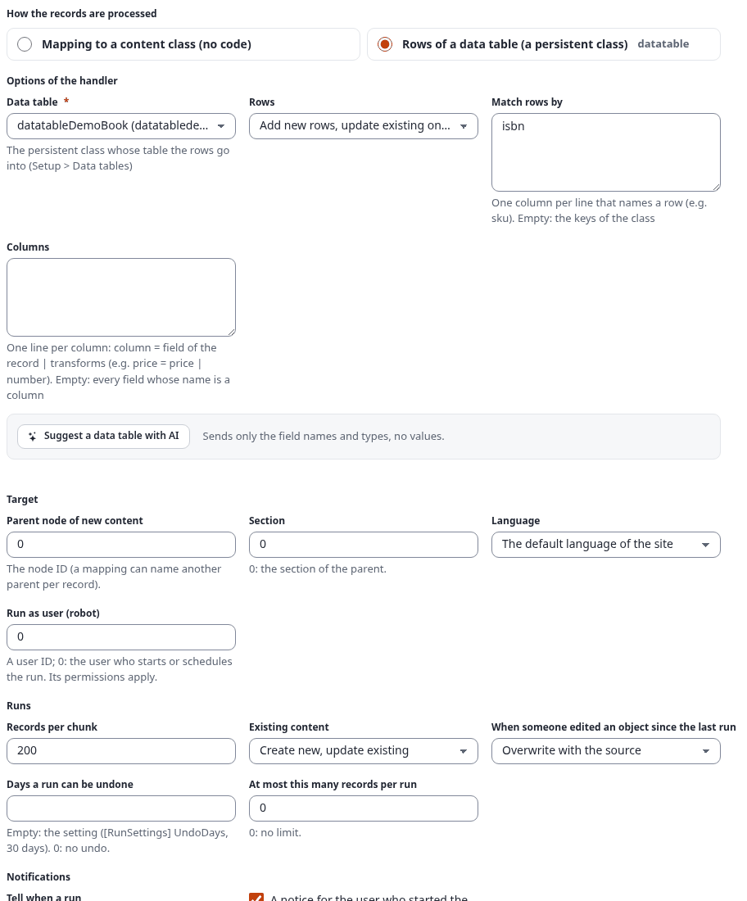
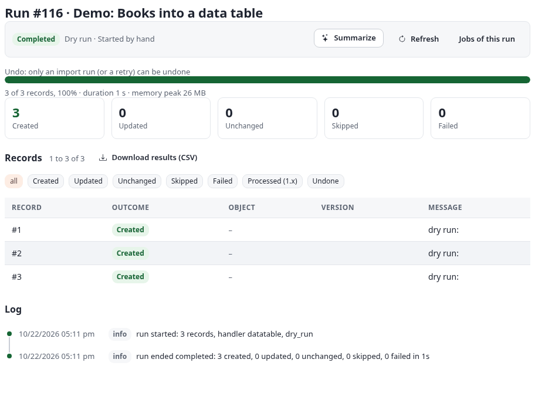
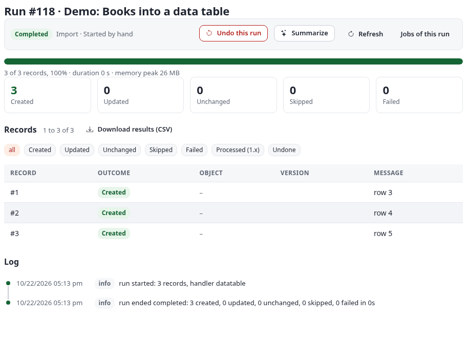
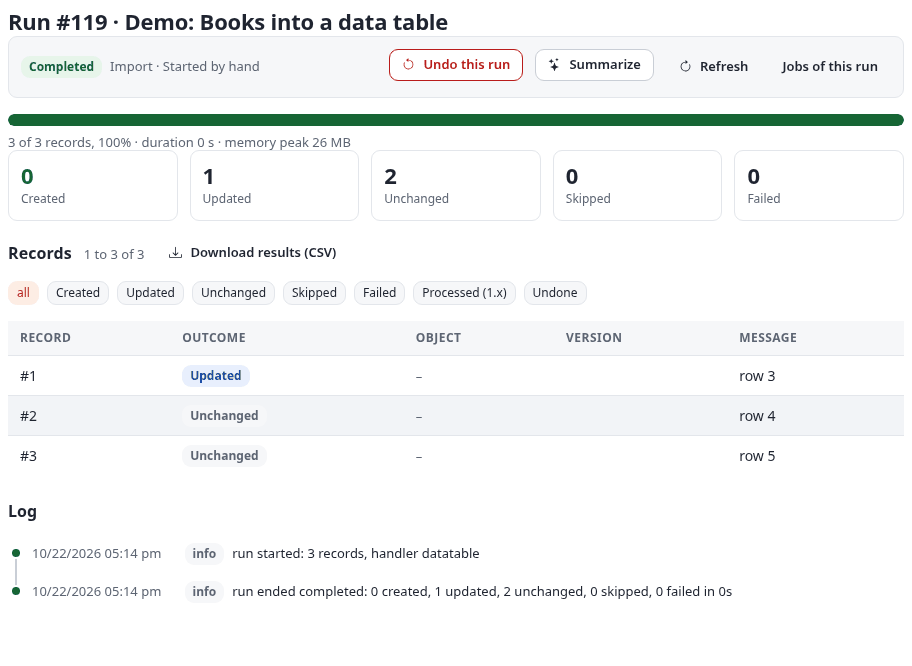
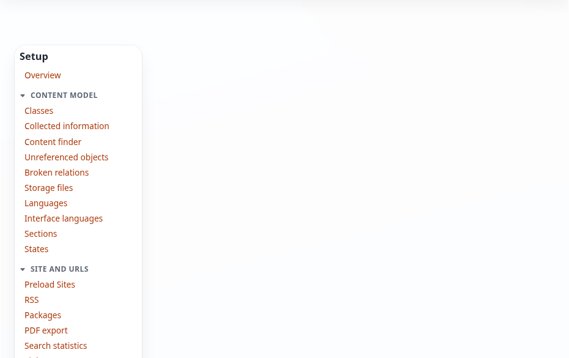
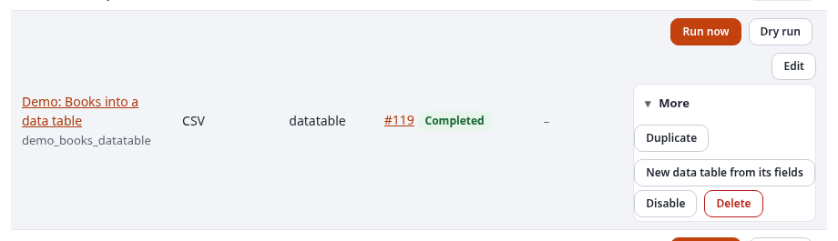
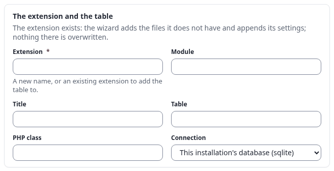

# Importe und Datentabellen

Eine **Datentabelle** ist die Tabelle einer persistenten Klasse: die eigene Tabelle eines Moduls oder einer
Erweiterung, etwa eine Bücherliste, ein Produktregister oder ein Protokoll, aufgeführt unter **Setup > Data tables**
(Datentabellen) ab Exponential 6.0.15. 7x SQLI Import kann eine solche Tabelle füllen, statt Inhaltsobjekte anzulegen,
hilft, aus den Feldern eines Imports eine neue anzulegen, und öffnet die Synchronisationen des Kernels zwischen
einer Tabelle und Inhalten. Diese Seite zeigt alle drei an einem echten Beispiel.

Die Oberfläche ist noch überwiegend auf Englisch; Schaltflächen und Felder stehen hier so, wie sie erscheinen.

English: [../datatables.md](../datatables.md).

## Inhalt

- [Was Sie brauchen](#was-sie-brauchen)
- [Die Gruppe Data tables im Katalog](#die-gruppe-data-tables-im-katalog)
- [Beispiel: Bücher in eine Datentabelle](#beispiel-bücher-in-eine-datentabelle)
  - [Die Datei](#die-datei)
  - [Schritt Verarbeitung: das Ziel und seine Optionen](#schritt-verarbeitung-das-ziel-und-seine-optionen)
  - [Der Probelauf](#der-probelauf)
  - [Der erste und ein zweiter Lauf](#der-erste-und-ein-zweiter-lauf)
  - [Die Zeilen in der Tabelle](#die-zeilen-in-der-tabelle)
- [Die Optionen des Ziels](#die-optionen-des-ziels)
- [Rückgängigmachen und Datentabellen](#rückgängigmachen-und-datentabellen)
- [Eine neue Tabelle aus einem Import: der Modultabellen-Assistent](#eine-neue-tabelle-aus-einem-import-der-modultabellen-assistent)
- [Inhalte und Tabellen abgleichen](#inhalte-und-tabellen-abgleichen)
- [Verwandte Seiten](#verwandte-seiten)

## Was Sie brauchen

- Exponential 6.0.15 oder neuer (die Datentabellen des Kernels, sein Schreiber `expDataTableWriter` und der
  Modultabellen-Assistent). Auf einem älteren Kernel werden das Ziel und die Gruppe nicht angeboten.
- Eine persistente Klasse mit Tabelle, aufgeführt unter **Setup > Data tables**. Das Beispiel nutzt das Demo-Modul
  `datatabledemo` mit der Klasse `datatableDemoBook` und ihrer Tabelle `datatabledemo_book`.
- Zum Füllen einer Tabelle: die Richtlinie **Manage imports**, um den Import einzurichten. Für eine neue Tabelle:
  `setup/setup`. Für eine Synchronisation: `datatable/sync`.

## Die Gruppe Data tables im Katalog

**Imports > Catalogue** (`sqliimport/catalogue`) endet mit der Gruppe **Data tables**: drei Karten, eine für jeden
Weg, auf dem Datentabellen und Importe zusammenarbeiten.


| Karte | Was sie öffnet |
|---|---|
| **Import into a data table** | Einen neuen Import. Im Schritt Verarbeitung wählen Sie das Ziel **Rows of a data table** ([unten](#beispiel-bücher-in-eine-datentabelle)) |
| **Create a new table from an import** | Den Modultabellen-Assistenten des Kernels (`setup/moduletable`), gefüllt mit den Feldern eines Imports ([unten](#eine-neue-tabelle-aus-einem-import-der-modultabellen-assistent)) |
| **Content and data tables in sync** | Die Synchronisationen des Kernels (`datatable/sync`), mit der gewählten Tabelle und Inhaltsklasse ausgefüllt ([unten](#inhalte-und-tabellen-abgleichen)) |

## Beispiel: Bücher in eine Datentabelle

Das ist der Demo-Import #76 „Demo: Books into a data table“ (Bezeichner `demo_books_datatable`) der
Testinstallation.

### Die Datei

`books-datatable-v2.csv`, drei erfundene Bücher:

```text
title,isbn,price,in_print,summary
The test garden (second edition),SQ688-0001,12.50,1,An invented book for the check
Tea for testers,SQ688-0002,9.90,1,Another invented book
Old test notes,SQ688-0003,4.00,0,Out of print
```

Die Spaltennamen sind dieselben wie die Spalten der Tabelle `datatabledemo_book` (`title`, `isbn`, `price`,
`in_print`, `summary`); keine Spalte braucht deshalb eine eigene Zeile.

### Schritt Verarbeitung: das Ziel und seine Optionen

1. **Imports > New import**. Schritt **Source** (Quelle): Name `Demo: Books into a data table`, Quelltyp **CSV and
   delimited text**, **An uploaded file**, die Datei oben. Trennzeichen und Kodierung bleiben `auto`. Speichern und
   weiter.
2. Schritt **Processing** (Verarbeitung): Wählen Sie unter **How the records are processed** das Ziel **Rows of a
   data table (a persistent class)**. Die Optionen des Ziels erscheinen:

   

   | Feld | Wert im Beispiel | Gespeicherte Option |
   |---|---|---|
   | **Data table** (Datentabelle) | `datatableDemoBook (datatabledemo, …)` | `class = datatableDemoBook` |
   | **Rows** (Zeilen) | Add new rows, update existing ones (neue anlegen, bestehende aktualisieren) | `mode = upsert` |
   | **Match rows by** (Zeilen erkennen an) | `isbn` (eine Spalte pro Zeile) | `keys = isbn` |
   | **Columns** (Spalten) | leer: jedes Feld, dessen Name eine Spalte ist | `columns =` (leer) |

   Speichern und weiter. Das Ziel hat keinen Schritt Zuordnung: Die Spalten sind die Zuordnung. **Target**, der
   Elternknoten und die Inhaltsklasse gelten für Zeilen nicht; die Felder unter **Runs** und **Notifications** schon.
3. Schritt **Preview** (Vorschau): die ersten Datensätze der Datei und was ein Probelauf mit ihnen täte. Dann
   **Schedule** (Never) und **Review**: **The import is enabled** anhaken und **Save**.

Heißen die Spalten der Datei anders oder braucht ein Wert eine Umwandlung, schreiben Sie unter **Columns** eine Zeile
pro Spalte, `Spalte = Feld des Datensatzes | Umwandlungen`, dieselbe einzeilige Kette wie im Zuordnungsraster
([transforms.md](transforms.md)):

```text
title = Title | trim
isbn = ISBN
price = Price (EUR) | number
in_print = Available | bool
summary = Description | strip_tags | truncate(length=250)
```

### Der Probelauf

**Dry run** (Probelauf) auf der Übersicht (Lauf #116) prüft jede Zeile mit dem Schreiber des Kernels und schreibt
nichts:



3 Zeilen würden angelegt. Ein Wert, den die Tabelle ablehnt (Text in einer Zahlenspalte, eine fehlende
Pflichtspalte), ließe seine Zeile hier fehlschlagen, mit Zeilennummer und Feld, bevor etwas geschrieben wird.

### Der erste und ein zweiter Lauf

**Run now** (Lauf #118) schreibt die drei Zeilen: **3 created** (angelegt).



Dann änderte sich ein Titel in der Datei („The test garden“ wurde „The test garden (second edition)“), und die Datei
wurde im Schritt Quelle erneut hochgeladen. **Run now** (Lauf #119) erkennt jede Zeile an ihrer `isbn`, schreibt nur
die eine, die abweicht, und lässt die anderen in Ruhe: **0 created, 1 updated, 2 unchanged**.



**Download results (CSV)** auf der Seite des Laufs listet jeden Datensatz mit seinem Ergebnis; bei einer
Datentabelle nennt die Meldung die Zeile.

### Die Zeilen in der Tabelle

Die Zeilen stehen jetzt in `datatabledemo_book`, auf der eigenen Listenseite des Moduls (`datatabledemo/list`, hier
mit zwei Zeilen der eigenen Demo des Moduls neben den drei importierten) und unter **Setup > Data tables**,
`datatable/rows/datatableDemoBook`:



Auf der Kommandozeile sind es dieselben Läufe:

```bash
./console ext:sqliimport:run demo_books_datatable --dry-run --wait
./console ext:sqliimport:run demo_books_datatable --wait
```

## Die Optionen des Ziels

| Option | Werte | Vorgabe |
|---|---|---|
| `class` (**Data table**) | eine persistente Klasse mit Tabelle, aus der Liste der Datentabellen der Website | Pflicht |
| `mode` (**Rows**) | `upsert` neue Zeilen anlegen, bestehende aktualisieren; `insert` nur anlegen; `update` nur bestehende aktualisieren; `replace` eine bestehende Zeile entfernen und neu schreiben | `upsert` |
| `keys` (**Match rows by**) | die Spalten, an denen eine Zeile erkannt wird, eine pro Zeile | die Schlüssel der Klasse |
| `columns` (**Columns**) | eine Zeile pro Spalte: `Spalte = Feld \| Umwandlungen`; leer: jedes Feld, dessen Name eine Spalte ist | leer |

- Die Zeilen schreibt der `expDataTableWriter` des Kernels: gegen die Definition der Klasse geprüft, über die eigene
  Verbindung der Klasse (die eine andere Datenbank sein kann), eine Transaktion pro Abschnitt, nie rohes SQL. Eine
  Zeile, die die Datenbank ablehnt, schlägt allein fehl; die anderen ihres Abschnitts werden geschrieben.
- Eine Beziehungsspalte (Objekt, Knoten oder Benutzer) nimmt statt einer Zahl einen Verweis auf Inhalte:
  `@object:<remote id>`, `@node:<remote id>` oder `@path:<url alias>`. Ein Verweis ins Leere lässt die Zeile
  fehlschlagen.
- Jede Quelle von 7x SQLI Import kann eine Tabelle füllen: eine Tabellenkalkulation, ein Feed, eine REST-API, eine
  andere Datenbank. Zeitpläne, der Webhook-Auslöser, Benachrichtigungen und Statistik arbeiten wie bei Inhalten.
- Die Konfliktregel im Schritt Verarbeitung (*When someone edited an object since the last run*) betrifft
  Inhaltsobjekte. Für Zeilen gilt sie nicht: Eine Zeile wird so geschrieben, wie die Datei sagt.

Mehr zum Ziel für Entwickler: [handlers.md](handlers.md).

## Rückgängigmachen und Datentabellen

Ein Rückgängigmachen stellt Inhalte zurück: Was ein Lauf angelegt hat, kommt in den Papierkorb, was er aktualisiert
hat, bekommt seine frühere Version. Eine Datentabelle hat weder Papierkorb noch Versionen, daher lässt sich ein Lauf
in eine Tabelle nicht rückgängig machen.

Was die Administration heute tut: Die Seite eines solchen Laufs zeigt trotzdem **Undo this run** (die Prüfung sieht
nur auf die Art des Laufs und seine Zähler). Ein dort gestarteter Rückgängig-Lauf ändert keine Zeile. Jeder seiner
Datensätze endet als **Skipped** (übersprungen) mit der Meldung „the object no longer exists“, weil eine Zeile kein
Inhaltsobjekt ist. Um Zeilen wieder zu entfernen, löschen Sie sie auf der eigenen Seite der Tabelle oder unter
**Setup > Data tables**. Um sie zurückzuändern, lassen Sie den Import mit der früheren Datei laufen.

## Eine neue Tabelle aus einem Import: der Modultabellen-Assistent

Gibt es noch keine Tabelle, lassen Sie den Import eine beschreiben. Öffnen Sie auf der Übersicht **More** neben dem
Import und wählen Sie **New data table from its fields** (Richtlinie `setup/setup`):



Der Modultabellen-Assistent des Kernels öffnet sich (`setup/moduletable/(source)/sqliimport/(ref)/76`). In seinem
ersten Abschnitt benennen Sie Erweiterung, Modul, Tabelle und PHP-Klasse und wählen die Verbindung:



Der Abschnitt **The fields** zeigt, was die Quelle des Imports vorschlägt. 7x SQLI Import liest eine Stichprobe der
Quelle (hier die drei Bücher) und schätzt für jedes Feld einen Namen, einen Typ (string, text, integer, float,
boolean, date, datetime, json), eine Länge und ob es Pflicht und eindeutig ist:


Die Schätzungen kennen nur die Stichprobe; prüfen Sie sie also, bevor der Assistent etwas schreibt. Mit drei Zeilen
sind sie zu streng und zu kurz:

| Geschätzt | Warum | Korrigieren zu |
|---|---|---|
| `title string(32) required unique` | der längste Titel der Stichprobe passt in 32 Zeichen, und die drei Titel unterscheiden sich | `title string(255) required` |
| `isbn string(32) required unique` | jeder Wert der Stichprobe ist anders | so lassen: `isbn string(32) required unique` (das ist der Schlüssel) |
| `price float required unique` | die drei Preise unterscheiden sich | `price float` |
| `in_print integer required` | die Werte sind `0` und `1` | `in_print boolean` |
| `summary string(32) required unique` | kurze, verschiedene Texte in der Stichprobe | `summary text` |

Die Regel dahinter: Ein Feld ist **eindeutig**, wenn alle Werte der Stichprobe verschieden sind, **Pflicht**, wenn
jeder Datensatz der Stichprobe einen Wert hat, und ein String bekommt die kleinste der Längen 32, 64, 128 und 255,
die den längsten Wert fasst. Eine größere Stichprobe (mehr Zeilen in der Datei) ergibt bessere Schätzungen.

So korrigieren Sie:

1. Klicken Sie auf **Copy its fields into the list**. Das Listenfeld enthält dann die geschätzten Felder, eins pro
   Zeile (`name type[(length)] [required] [unique]`). Bis dahin zeigt es die Beispielzeilen des Assistenten, nicht
   Ihren Import.
2. Bearbeiten Sie die Zeilen:

   ```text
   title string(255) required
   isbn string(32) required unique
   price float
   in_print boolean
   summary text
   ```

3. Legen Sie fest, ob jede Zeile an Inhalte gebunden wird (**Tie each row to content**), lassen Sie **Add created and
   modified** angehakt und lassen Sie den Assistenten seine Dateien zeigen und schreiben.

Ist die Tabelle installiert, stellen Sie das Ziel des Imports auf die neue Klasse
([oben](#schritt-verarbeitung-das-ziel-und-seine-optionen)) und lassen Zeilen an `isbn` erkennen. Was der Assistent
schreibt (die Klasse, das Schema für jede Datenbank, die Admin-Seiten, die Richtlinien, die Fetch-Funktionen und
einen JSON-Endpunkt), beschreibt die Kernel-Dokumentation „Datentabellen“, Abschnitt „Der Assistent für
Modultabellen“ (`doc/ger-de/funktionen/6.0/datentabellen.md`).

## Inhalte und Tabellen abgleichen

Ein Import liest von außen. Liegen die Daten schon in Exponential, als Inhaltsobjekte einer Klasse, kopieren die
**Synchronisationen** des Kernels sie zwischen Inhalten und einer Tabelle und halten beide abgeglichen. 7x SQLI
Import kopiert hier selbst nichts; seine dritte Karte öffnet nur das Formular mit Tabelle und Inhaltsklasse
ausgefüllt. Der Kernel führt die Synchronisationen aus und listet ihre Läufe im Laufverlauf aller Import- und
Exportwerkzeuge, als Werkzeug **Data tables**.


| Auswahl im Formular | Werte |
|---|---|
| **Direction** (Richtung) | Inhalte in die Tabelle; die Tabelle in Inhalte; beide Richtungen |
| **Runs** (Läufe) | When started (einmal, mit **Save and run now** oder **Run now** in der Liste); nach Zeitplan (alle N Sekunden, durch den Cronjob-Teil `datatable`); live (bei jedem Veröffentlichen, Verschieben und Entfernen eines Objekts der Klasse unter dem Knoten, und zusätzlich nach Zeitplan) |
| **Map** (Zuordnung) | eine Zeile pro Spalte, `Spalte = Quelle`; eine Quelle ist ein Attributbezeichner oder `@object_id`, `@node_id`, `@parent_node_id`, `@remote_id`, `@node_remote_id`, `@name`, `@published`, `@modified`, `@class`, `@section`, `@owner`, `@path`. **Propose the map** füllt sie aus den Spaltennamen |
| **Key column(s)** (Schlüsselspalten) | die zugeordneten Spalten, an denen eine Zeile erkannt wird, etwa `contentobject_id` oder `remote_id` |
| **When both sides changed** (wenn sich beide Seiten geändert haben) | die neuere Änderung gewinnt; die Inhalte gewinnen; die Tabelle gewinnt; nachfragen (der Konflikt wartet unter **Conflicts**) |

Die fünf Verwendungen, die die Karte nennt, und wie Sie sie einstellen:

| Verwendung | Richtung | Läufe |
|---|---|---|
| Inhalte in eine Tabelle exportieren | Inhalte in die Tabelle | When started |
| Inhalte in eine Tabelle migrieren | Inhalte in die Tabelle, einmal; das Entfernen der Inhalte danach ist ein eigener Schritt, nie die Vorgabe | When started |
| Eine Tabelle mit Inhalten abgleichen | Inhalte in die Tabelle | nach Zeitplan oder live |
| Eine Tabelle in Inhalte importieren | die Tabelle in Inhalte | When started oder nach Zeitplan |
| Abgleich in beide Richtungen | beide Richtungen, mit einer Regel für Konflikte | nach Zeitplan oder live |

Beispiel einer Zuordnung für Bücher, die als Ordner gepflegt werden, in beide Richtungen, für eine Tabelle, die der
Assistent mit **Tie each row to content** (der Spalte `contentobject_id`) und einer Spalte `remote_id` angelegt hat,
erkannt an `contentobject_id`:

```text
contentobject_id = @object_id
remote_id = @remote_id
title = name
```

Zur Veranschaulichung: Diese Synchronisation wurde auf der Testinstallation nicht gespeichert, daher sind ihre Läufe
nicht gezeigt. Die Regeln jeder Richtung, die Live-Spiegelung und die Warteschlange der Konflikte beschreibt die
Kernel-Dokumentation „Datentabellen“, Abschnitte „Synchronisation“, „Live-Spiegel“ und „Konflikte“.

## Verwandte Seiten

- [handlers.md](handlers.md): das Ziel für Entwickler
- [transfer.md](transfer.md): Importe unter den anderen Import- und Exportwerkzeugen
- [runs.md](runs.md): Laufseiten, Rückgängigmachen, der CSV-Bericht
- [editor.md](editor.md): die sechs Schritte des Editors
- [transforms.md](transforms.md): die Umwandlungen einer Spaltenzeile
