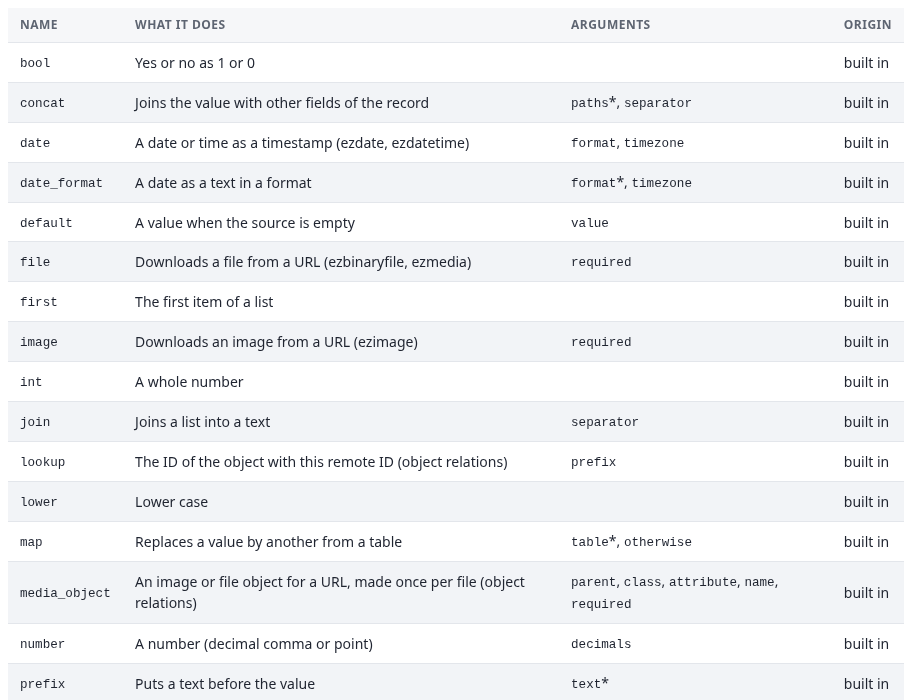

# Handler

Verwenden Sie den Handler `mapping` ohne Programmierung, wenn sich der Import als Zuordnung ausdrücken lässt
([mappings.md](mappings.md)). Schreiben Sie einen Handler, wenn das nicht geht: mehrere Objekte pro Datensatz,
Berechnungen über mehrere Datensätze, eine externe API pro Datensatz.

## Die Handler-Schnittstelle von 2.x

Ein Handler implementiert `expImportHandlerInterface`:

| Methode | Zweck |
|---|---|
| `static identifier()` | Die ID, die ein Import in `handler` speichert |
| `static label()` | Der Name im Katalog |
| `static schema()` | Die Optionen des Handlers als Schema von `expImportOptionSchema` |
| `open( expImportContext $context )` | Bereitet einen Abschnitt vor (Caches, einen Publisher) |
| `process( expImportRecord $record, expImportContext $context )` | Verarbeitet einen Datensatz und gibt ein `expImportRowResult` zurück |
| `close( expImportContext $context )` | Beendet einen Abschnitt |

Pro Abschnitt ruft die Engine einmal `open()`, für jeden Datensatz `process()` und einmal `close()` auf, in einem
Worker der Job-Warteschlange. Eine Ausnahme in `process()` lässt nur diesen Datensatz fehlschlagen; ihre Meldung
wird zur Meldung der Zeile, und der Lauf geht weiter.

Die Datensätze kommen aus der Quelle des Imports; ein Handler liest also keine Dateien. Der Kontext gibt ihm:

| Eigenschaft | Inhalt |
|---|---|
| `$context->import` | Der Import (`expImportDefinition`) |
| `$context->run` | Der Lauf (`expImportRun`) |
| `$context->options` | Die Optionen des Handlers, geprüft gegen `schema()` |
| `$context->target` | `parent_node_id`, `section_id`, `language`, `owner_id` |
| `$context->behaviour` | `chunk_size`, `update_policy`, `trash_policy`, `max_rows` |
| `$context->log` | Das Protokoll des Laufs (`expImportLogger`) |
| `$context->dryRun` | `true` in einem Probelauf: nichts veröffentlichen |

`$context->throwIfCancelled()` verlängert die Reservierung des Jobs und bricht den Datensatz ab, wenn der Lauf
abgebrochen wurde. Die Engine ruft es schon zwischen den Datensätzen auf; rufen Sie es in eigenen langen Schleifen
auf.

### Ergebnisse

`expImportRowResult` hat eine Fabrikmethode pro Ergebnis:

```php
expImportRowResult::created( $objectID, $versionAfter );
expImportRowResult::updated( $objectID, $versionBefore, $versionAfter );
expImportRowResult::unchanged( $objectID, $version );
expImportRowResult::skipped( 'the product is discontinued', $objectID );
expImportRowResult::failed( 'the price is missing' );
```

Füllen Sie in einem Probelauf `$result->diff` (`attribut => array( alt, neu )`), damit die Seite des Laufs zeigen
kann, was sich ändern würde.

### Optionstypen

Ein Schema ist ein Array `name => definition`. Typen: `string`, `text`, `int`, `float`, `bool`, `enum` (mit
`values`), `path`, `url`, `node`, `class`, `list`, `json` und `secret` (ein Verweis auf ein Geheimnis in den
Einstellungen, nie das Geheimnis selbst). Jede Definition kann `label`, `help`, `required`, `default`, `min`, `max`
und `pattern` enthalten. Unbekannte Schlüssel werden verworfen.

## Eigene Quelle, eigener Handler oder eigene Umwandlung

Wenn kein Format des Katalogs Ihre Daten liest, wenn eine Zuordnung nicht ausdrücken kann, was ein Import tun muss,
oder wenn ein Wert eine eigene Berechnung braucht, fügt eine Erweiterung eine **Quelle**, einen **Handler** oder eine
**Umwandlung** hinzu. Die drei Beispiele unten gehören zusammen: Eine Quelle liest eine Teeliste mit `|` als
Trennzeichen, eine Umwandlung macht aus einem Nettopreis den Text, den der Preis-Datentyp `ezprice` annimmt, und ein
Handler veröffentlicht jeden Tee als Produkt mit diesem Preis. Jede Klasse ist vollständig. Sie liefen auf dem Server
der Dokumentation genau so, wie sie hier stehen, und die Ausgaben unten sind das, was sie ausgaben (siehe
[So wurden die Beispiele geprüft](#so-wurden-die-beispiele-geprüft)).

Die Datei `teas.psv` der Beispiele:

```
sku|name|origin|net_price
TEA-SEN-100|Morning Sencha|Japan|6.50
TEA-HBL-100|Highland Black|India|5,90
TEA-SNE-050|Silver Needle|China|
```

Legen Sie die Klassen in Ihre eigene Erweiterung (zum Beispiel `extension/mytea/classes/`), nie in die von
sqliimport, registrieren Sie sie wie gezeigt und erzeugen Sie die Autoloads neu (`php bin/php/ezpgenerateautoloads.php
-e`). Nach einer Aktualisierung der Erweiterung oder neuen Klassen auch die langlebigen Worker neu starten:
`./console exp:velocity restart`, wo Velocity die Website ausliefert, und den PHP-FPM-Pool
([troubleshooting.md](troubleshooting.md#velocity-oder-php-fpm-führen-noch-den-alten-code-aus)).

### Eine eigene Quelle schreiben

Eine Quelle implementiert `expImportSourceInterface`; wer von `expImportAbstractSource` erbt, bekommt die gemeinsame
Option `key`, die Referenz eines Datensatzes (`refOf()`), die geprüfte lokale Datei (`file()`), `sample()` und die
Vorgaben des Katalogeintrags. Sie holt nie selbst etwas: Die Engine löst Upload, Adresse oder Serverpfad auf und gibt
der Quelle eine lokale Datei als `file` in ihrer Konfiguration, so liest jeder Abschnitt (Chunk) eines Laufs denselben
Schnappschuss.

| Methode | Zweck |
|---|---|
| `static identifier()`, `label()`, `extensions()`, `schema()` | Die ID, die ein Import in `source_type` speichert, der Name im Katalog, die Dateiendungen eines Uploads, die Optionen |
| `static description()`, `group()`, `examples()`, `preset()` | Der Katalogeintrag: was ein Datensatz ist, die Gruppe (`data`, `nosql`, `content`, `platform`, `commerce`, `media`, `other`), Beispieldateien, die Zuordnung als Ausgangspunkt |
| `records( array $cursor = array() )` | Die Datensätze, als `expImportRecord( $ref, $index, $data, $cursor )`, vom Anfang oder direkt nach einem Cursor, den ein früherer Datensatz trug |
| `count()` | Die Zahl der Datensätze, wenn sie billig zu ermitteln ist (Fortschritt und Restzeit), sonst `null` |
| `sample( $limit )` | Die ersten Datensätze und die Felder (geerbt) |

Der Cursor eines Datensatzes sagt, wo er endet. Ein Lauf wird in Abschnitte geteilt, und der nächste Abschnitt ruft
`records( $cursor )` mit dem Cursor des letzten Datensatzes des vorigen auf; eine Quelle muss also direkt danach
beginnen können.

```php
<?php
class myTeaPsvSource extends expImportAbstractSource
{
    public static function identifier()
    {
        return 'tea_psv';
    }

    public static function label()
    {
        return 'Pipe separated tea list (PSV)';
    }

    public static function extensions()
    {
        return array( 'psv', 'txt' );
    }

    public static function description()
    {
        return 'A text file with one tea per line and the fields separated by |; the first line names the fields.';
    }

    public static function group()
    {
        return 'data';
    }

    public static function schema()
    {
        return array(
            'header' => array( 'type' => 'bool', 'label' => 'The first line names the fields', 'default' => true ),
        ) + expImportAbstractSource::commonSchema();
    }

    public static function preset()
    {
        return array(
            'class' => 'product',
            'match' => array( 'type' => 'remote_id', 'pattern' => 'tea-{sku}' ),
            'fields' => array(
                array( 'source' => 'name', 'attribute' => 'name', 'transforms' => array( array( 'name' => 'trim' ) ) ),
                array( 'source' => 'sku', 'attribute' => 'product_number' ),
                array( 'source' => 'net_price', 'attribute' => 'price', 'transforms' => array( array( 'name' => 'vat', 'args' => array( 'rate' => 19 ) ) ) ),
            ),
        );
    }

    public function records( array $cursor = array() )
    {
        $handle = fopen( $this->file(), 'rb' );
        if ( !$handle )
            throw new expImportSourceException( 'the PSV file cannot be opened' );
        try
        {
            $withHeader = !isset( $this->config['header'] ) || !empty( $this->config['header'] );
            $after = isset( $cursor['line'] ) ? (int)$cursor['line'] : 0;
            $header = null;
            $line = 0;
            $index = -1;
            while ( ( $text = fgets( $handle ) ) !== false )
            {
                $line++;
                $text = rtrim( self::toUtf8( $text ), "\r\n" );
                if ( trim( $text ) === '' )
                    continue;
                $cells = array_map( 'trim', explode( '|', $text ) );
                if ( $header === null )
                {
                    if ( $withHeader )
                    {
                        $header = $cells;
                        continue;
                    }
                    $header = array_map( function ( $i ) { return 'column_' . ( $i + 1 ); }, array_keys( $cells ) );
                }
                $index++;
                if ( $line <= $after )
                    continue;
                $data = array();
                foreach ( $header as $i => $name )
                    $data[$name] = isset( $cells[$i] ) ? $cells[$i] : '';
                // the cursor is where this record ends: a later chunk starts right after it
                yield new expImportRecord( $this->refOf( $data, $index ), $index, $data, array( 'line' => $line ) );
            }
        }
        finally
        {
            fclose( $handle );
        }
    }

    public function count()
    {
        $lines = array_filter( file( $this->file(), FILE_IGNORE_NEW_LINES ) ?: array(), function ( $l ) { return trim( $l ) !== ''; } );
        $withHeader = !isset( $this->config['header'] ) || !empty( $this->config['header'] );
        return max( 0, count( $lines ) - ( $withHeader ? 1 : 0 ) );
    }
}
```

**Registrierung** in `extension/mytea/settings/sqliimport.ini.append.php`:

```ini
[SourceSettings]
Sources[]=tea_psv

[Source_tea_psv]
Class=myTeaPsvSource
Status=enabled
```

oder, ab Exponential 6.0.15, als Kernel-Dienst in `extension/mytea/settings/kernelservices.ini.append.php`:

```ini
[Service_mytea.source.tea_psv]
Class=expImportSourceEntry
Factory=expImportSourceEntry::of
Arguments[]=myTeaPsvSource
Scope=worker
Tags[]=sqliimport.source
Description=Tea list (PSV)
```

`Status=example` führt ein Format im Katalog, ohne dass Importe es nutzen können, `Status=disabled` blendet es aus.

**Der Katalogeintrag.** Der Katalog baut die Karte aus den statischen Methoden: Bezeichnung, Beschreibung, Gruppe,
Dateiendungen, Optionen, Beispiele und die Zuordnungsvorlage. Was die Registry aus der Klasse machte und was die
Quelle las:

```
label: Pipe separated tea list (PSV) | group: data | status: enabled | extensions: psv, txt | options: header, key
options valid: {"header":true,"key":"sku"}
count(): 3
TEA-SEN-100 {"sku":"TEA-SEN-100","name":"Morning Sencha","origin":"Japan","net_price":"6.50"} cursor {"line":2}
TEA-HBL-100 {"sku":"TEA-HBL-100","name":"Highland Black","origin":"India","net_price":"5,90"} cursor {"line":3}
TEA-SNE-050 {"sku":"TEA-SNE-050","name":"Silver Needle","origin":"China","net_price":""} cursor {"line":4}
--- records( {"line":2} ) resumes after the first record
TEA-HBL-100
TEA-SNE-050
```

### Einen eigenen Handler schreiben

Ein Handler implementiert `expImportHandlerInterface` ([die Schnittstelle](#die-handler-schnittstelle-von-2x)). Dieser
veröffentlicht ein Produkt je Datensatz über die Inhalts-API, berechnet seinen Bruttopreis mit der Umwandlung unten
und vergleicht in einem Probelauf mit dem, was das Objekt hat, damit die Seite des Laufs zeigt, was sich ändern würde.

```php
<?php
class myTeaImportHandler implements expImportHandlerInterface
{
    public static function identifier()
    {
        return 'teas';
    }

    public static function label()
    {
        return 'Teas with their gross price';
    }

    public static function schema()
    {
        return array(
            'parent_node_id' => array( 'type' => 'node', 'label' => 'Parent node', 'required' => true ),
            'vat_rate' => array( 'type' => 'float', 'label' => 'VAT rate in percent', 'default' => 19, 'min' => 0, 'max' => 100 ),
        );
    }

    public function open( expImportContext $context )
    {
    }

    public function process( expImportRecord $record, expImportContext $context )
    {
        $sku = trim( (string)$record->get( 'sku', '' ) );
        if ( $sku === '' )
            return expImportRowResult::failed( 'the record has no SKU' );
        $name = trim( (string)$record->get( 'name', '' ) );
        $rate = isset( $context->options['vat_rate'] ) ? (float)$context->options['vat_rate'] : 19.0;
        // a transform of the catalogue, here the site's own "vat"; an unreadable price fails this record only
        $price = expImportTransforms::applyChain( $record->get( 'net_price', '' ), array( array( 'name' => 'vat', 'args' => array( 'rate' => $rate ) ) ), $record );

        $remoteID = 'tea-' . $sku;
        $object = eZContentObject::fetchByRemoteID( $remoteID );
        if ( $context->dryRun )
        {
            // compare with what the object has now, in the fromString() form the publisher would write
            $now = array();
            if ( $object )
                foreach ( $object->dataMap() as $identifier => $attribute )
                    $now[$identifier] = (string)$attribute->toString();
            $diff = array();
            foreach ( array( 'name' => $name, 'product_number' => $sku, 'price' => $price ) as $field => $new )
            {
                $old = isset( $now[$field] ) ? $now[$field] : '';
                if ( $old !== (string)$new )
                    $diff[$field] = array( $old, (string)$new );
            }
            if ( !$object )
                $result = new expImportRowResult( expImportRowResult::CREATED, 'dry run: would be created' );
            else
            {
                $id = (int)$object->attribute( 'id' );
                $version = (int)$object->attribute( 'current_version' );
                $result = $diff ? expImportRowResult::updated( $id, $version, $version, 'dry run: would be updated' )
                                : expImportRowResult::unchanged( $id, $version, 'dry run: unchanged' );
            }
            $result->diff = $diff;
            return $result;
        }

        $before = $object ? (int)$object->attribute( 'current_version' ) : 0;
        $content = $object ? SQLIContent::fromContentObject( $object )
                           : SQLIContent::create( new SQLIContentOptions( array( 'class_identifier' => 'product', 'remote_id' => $remoteID ) ) );
        $isNew = $content->isNew();
        $content->fields->name = $name;
        $content->fields->product_number = $sku;
        $content->fields->price = $price;
        $publisher = SQLIContentPublisher::getInstance();
        $publisher->setOptions( new SQLIContentPublishOptions( array(
            'parent_node_id' => $isNew ? (int)$context->options['parent_node_id'] : null,
            'modification_check' => true,
        ) ) );
        $publisher->publish( $content );
        $id = (int)$content->id;
        $after = (int)$content->current_version;
        $content->flush();

        if ( $isNew )
            return expImportRowResult::created( $id, $after );
        return $after !== $before ? expImportRowResult::updated( $id, $before, $after ) : expImportRowResult::unchanged( $id, $after );
    }

    public function close( expImportContext $context )
    {
    }
}
```

**Registrierung** in `extension/mytea/settings/sqliimport.ini.append.php`:

```ini
[HandlerSettings]
Handlers[]=teas

[Handler_teas]
Class=myTeaImportHandler
Status=enabled
```

oder als Kernel-Dienst mit dem Tag `sqliimport.handler`:

```ini
[Service_mytea.handler.teas]
Class=myTeaImportHandler
Scope=worker
Tags[]=sqliimport.handler
Description=Teas with their gross price
```

Der Import wählt ihn im Schritt **Verarbeitung** (Processing, *How the records are processed*), der dann ein Formular
seiner Optionen zeigt (*Parent node*, *VAT rate in percent*).

**Was er tat.** Der Probelauf der Vorschau, bevor ein Produkt existierte:

```
TEA-SEN-100  created  dry run: would be created {"name":["","Morning Sencha"],"product_number":["","TEA-SEN-100"],"price":["","7.74|1|1"]}
TEA-HBL-100  created  dry run: would be created {"name":["","Highland Black"],"product_number":["","TEA-HBL-100"],"price":["","7.02|1|1"]}
TEA-SNE-050  failed   vat: the price is empty
```

Ein echter Lauf, zweimal: Der erste legt die Produkte an, der zweite findet nichts zu ändern (die Inhalts-API
veröffentlicht nur dann eine neue Version, wenn sich ein Feld geändert hat):

```
--- real run, pass 1
TEA-SEN-100  created   object 56638
TEA-HBL-100  created   object 56639
TEA-SNE-050  failed    object - vat: the price is empty
--- real run, pass 2
TEA-SEN-100  unchanged object 56638
TEA-HBL-100  unchanged object 56639
TEA-SNE-050  failed    object - vat: the price is empty
```

Nachdem der Nettopreis von Highland Black in der Datei auf `6,10` geändert wurde, zeigt der Probelauf genau diese
Änderung:

```
TEA-SEN-100  unchanged dry run: unchanged
TEA-HBL-100  updated  dry run: would be updated {"price":["7.02|1|1","7.26|1|1"]}
TEA-SNE-050  failed   vat: the price is empty
```

Der Datensatz ohne Preis schlägt allein fehl, mit der Meldung der Umwandlung, und der Lauf geht weiter.

<a id="writing-your-own-transform"></a>

### Eine eigene Umwandlung schreiben

Eine Umwandlung implementiert `expImportTransformInterface`: einen `name()`, den eine Zuordnungszeile nutzt, ein
`label()`, die Argumente als `schema()` und `apply( $value, $args, $record )`. Sie ist eine Funktion ihrer Eingabe:
Sie behält keinen Zustand zwischen Aufrufen. Eine `expImportTransformException` lässt den Datensatz mit ihrer Meldung
fehlschlagen. Diese macht aus einem Nettopreis den `ezprice`-Text des Bruttopreises, `Betrag|MwSt.-Typ|1` (der Preis
enthält die MwSt.):

```php
<?php
class myVatTransform implements expImportTransformInterface
{
    public function name()
    {
        return 'vat';
    }

    public function label()
    {
        return 'A net price as the ezprice text of its gross price, e.g. vat(rate=19)';
    }

    public function schema()
    {
        return array(
            'rate' => array( 'type' => 'float', 'label' => 'VAT rate in percent', 'default' => 19, 'min' => 0, 'max' => 100 ),
            'vat_type' => array( 'type' => 'int', 'label' => 'The VAT type ID of the shop', 'default' => 1, 'min' => 1 ),
        );
    }

    public function apply( $value, array $args, ?expImportRecord $record = null )
    {
        $text = str_replace( ',', '.', trim( (string)$value ) );
        if ( $text === '' )
            throw new expImportTransformException( 'vat: the price is empty' );
        if ( !is_numeric( $text ) )
            throw new expImportTransformException( "vat: '$value' is not a number" );
        $rate = isset( $args['rate'] ) ? (float)$args['rate'] : 19.0;
        $type = isset( $args['vat_type'] ) ? (int)$args['vat_type'] : 1;
        // in cents, so 6.50 at 19 % is 7.74 (773.5 cents rounded up), not 7.73 of a binary fraction
        $gross = round( (float)$text * ( 100 + $rate ) ) / 100;
        // amount|VAT type|1: the price includes VAT (ezprice's fromString() form). The amount as PHP writes the
        // number (7.1, not 7.10): that is how ezprice gives it back, so an unchanged price compares equal
        return (string)$gross . '|' . $type . '|1';
    }
}
```

**Registrierung** als Kernel-Dienst mit dem Tag `sqliimport.transform` (für Umwandlungen gibt es keine INI-Liste):

```ini
[Service_mytea.transform.vat]
Class=myVatTransform
Scope=worker
Tags[]=sqliimport.transform
Description=Net price to the ezprice text of the gross price
```

Eine Zuordnungszeile nutzt sie dann wie eine eingebaute Umwandlung, in der einzeiligen Form des Zuordnungsrasters:
`vat(rate=19)`, oder `vat(rate=7, vat_type=2)` für den ermäßigten Satz eines Shops, dessen MwSt.-Typ 2 7 % hat. Der
Zuordnungseditor bietet sie an, und die Tabelle Transforms des Katalogs listet sie. Was sie ergab:

```
vat(rate=19) on '6.50' => '7.74|1|1'
vat(rate=7, vat_type=2) on '5,90' => '6.31|2|1'
vat on 'n/a' => error: vat: 'n/a' is not a number
```

Die Tabelle Transforms des Katalogs, in der eine registrierte `vat` neben den
eingebauten erscheint:



Der Betrag wird so geschrieben, wie PHP die Zahl schreibt (`7.1`, nicht `7.10`), so wie `ezprice` einen gespeicherten
Preis zurückgibt; ein unveränderter Preis gilt dann als gleich, und das Objekt wird nicht bei jedem Lauf aktualisiert
([troubleshooting.md](troubleshooting.md#prices-are-0-or-every-run-updates-every-price)). Sie rundet in Cent, also sind
6,50 bei 19 % 7,74 und nicht die 7,73, die ein binärer Bruch ergäbe.

### So wurden die Beispiele geprüft

Die drei Klassen wurden in einem Skript außerhalb der Erweiterung definiert. Das Skript registrierte sie für den
eigenen Prozess mit `eZINI::setVariable()` und `expImportTransforms::register()` und führte sie auf dem Server der
Dokumentation mit `php bin/php/ezexec.php <Skript> -s admin` durch die Engine. Dabei nutzte es den Katalog der
Registry, `expImportPreview::preview()` für den Probelauf und `open()`, `process()` und `close()` des Handlers für den
echten Lauf. Die beiden Produkte wurden in einem versteckten Ordner veröffentlicht.

## Das Ziel „Eine Datentabelle“ (Exponential 6.0.15)

Außer der Zuordnung zu einer Inhaltsklasse kann ein Import die Tabelle einer **persistenten Klasse** füllen (die
eigene Tabelle eines Moduls oder einer Erweiterung, aufgeführt unter **Setup, Data tables**): im Schritt Processing
**Rows of a data table (a persistent class)** wählen. Die Zeilen schreibt der `expDataTableWriter` des Kernels: gegen
die Definition der Klasse geprüft, über die Verbindung der Klasse, über einen eindeutigen Schlüssel zugeordnet, eine
Transaktion je Abschnitt, nie rohes SQL. Es entsteht kein Inhalt, ein Lauf dieses Ziels kann also nicht rückgängig
gemacht werden; sein Bericht nennt den Schlüssel jeder Zeile.

| Option | Werte | Vorgabe |
|---|---|---|
| `class` | eine persistente Klasse mit Tabelle (eine Liste der Datentabellen der Website) | Pflicht |
| `mode` | `upsert` (neue Zeilen anlegen, bestehende ändern), `insert`, `update`, `replace` (eine bestehende Zeile wird entfernt und neu geschrieben) | `upsert` |
| `keys` | die Spalten, über die eine Zeile zugeordnet wird, eine je Zeile | die Schlüssel der Klasse |
| `columns` | eine Zeile je Spalte: `Spalte = Feld des Datensatzes \| Umwandlungen` (die einzeilige Kette des Rasters, z. B. `price = price \| number`); leer: jedes Feld, dessen Name eine Spalte ist | |

Eine Beziehungsspalte (Objekt, Knoten, Benutzer) nimmt statt einer ID einen Verweis auf Inhalt: `@object:<Remote-ID>`,
`@node:<Remote-ID>` oder `@path:<URL-Alias>`. Ein Probelauf prüft und zählt mit dem Writer und schreibt nichts.

**Eine neue Tabelle aus einem Import.** Jeder Import bietet unter More **New data table from its fields** an
(Richtlinie setup/setup). Das öffnet den Modultabellen-Assistenten des Kernels mit den Feldern des Imports, geschätzt
aus einer Stichprobe seiner Quelle: Spaltennamen, Typen (string, text, integer, float, boolean, date, datetime, json),
Längen, Pflicht- und eindeutige Spalten. Der Assistent legt Klasse, Tabelle und ihre Verwaltungsseiten in einer
Erweiterung an; der Import kann sie dann mit diesem Ziel füllen. Der Anbieter ist der Kernel-Dienst
`datatable.field_source.sqliimport`.

**Inhalte und Tabellen abgleichen.** Die Gruppe **Data tables** des Katalogs öffnet die Synchronisationen des Kernels
(Richtlinie datatable/sync) mit eingetragener Datentabelle und Inhaltsklasse: Inhalte in eine Tabelle exportieren,
Inhalte in eine Tabelle migrieren, eine Tabelle mit Inhalten synchron halten, eine Tabelle in Inhalte importieren,
oder beides mit einer Regel für Konflikte. Der Kernel führt sie aus und führt ihre Historie (Werkzeug
`transfer.datatable`); 7x SQLI Import kopiert selbst nichts.

## Handler, die ihre Datensätze selbst lesen

Ein Handler, der zusätzlich `expImportRecordProviderInterface` implementiert, liefert die Datensätze selbst statt
der Quelle des Imports:

| Methode | Zweck |
|---|---|
| `records( expImportContext $context, array $cursor = array() )` | Die Datensätze, nach einem Cursor |
| `count( expImportContext $context )` | Die Anzahl der Datensätze oder `null` |
| `resumable()` | Ob `records()` nach einem Cursor beginnen kann |

Gibt `resumable()` `false` zurück, ist der ganze Lauf ein Abschnitt, und eine Wiederholung beginnt von vorn.

## Die Kompatibilitätsschicht für 1.x

Jeder Handler von 1.x (`ISQLIImportHandler`, abgeleitet von `SQLIImportAbstractHandler`) läuft unverändert in der
Engine von 2.x, über `expImportLegacyHandlerAdapter`:

- Die Handler aus `[ImportSettings] AvailableSourceHandlers[]` mit ihren Blöcken `[<id>-HandlerSettings]`
  erscheinen im Katalog, als Legacy gekennzeichnet.
- Der Handler wird mit `SQLIImportHandlerOptions` erzeugt, gefüllt aus den Optionen des Imports. Sein
  `handlerConfArray` bekommt er wie bisher aus seinem Einstellungsblock.
- `initialize()`, `getProcessLength()`, `getNextRow()`, `process()` und `cleanup()` werden in dieser Reihenfolge
  aufgerufen. `getProgressionNotes()` geht in das Protokoll des Laufs.
- Ein Handler von 1.x liest seine Quelle selbst und kann nicht in der Mitte beginnen; sein Lauf ist daher ein
  Abschnitt.
- Was `process()` getan hat, kennt die Engine nicht. Seine Zeilen haben daher das Ergebnis `processed` oder
  `failed` mit der Meldung der Ausnahme.
- „Retry failed rows“ (fehlgeschlagene Zeilen wiederholen) gilt hier nicht, weil die Zeilen keinen Datensatz enthalten. Starten Sie den
  Import erneut; die Erkennung unveränderter Inhalte der Inhalts-API hält das günstig.

Die API von 1.x selbst (die Inhalts-API, `SQLICSVDoc`, `SQLIXMLParser`, die Handler-Methoden) beschreibt
[content-api-and-handlers-1x.md](../content-api-and-handlers-1x.md) (auf Englisch).
