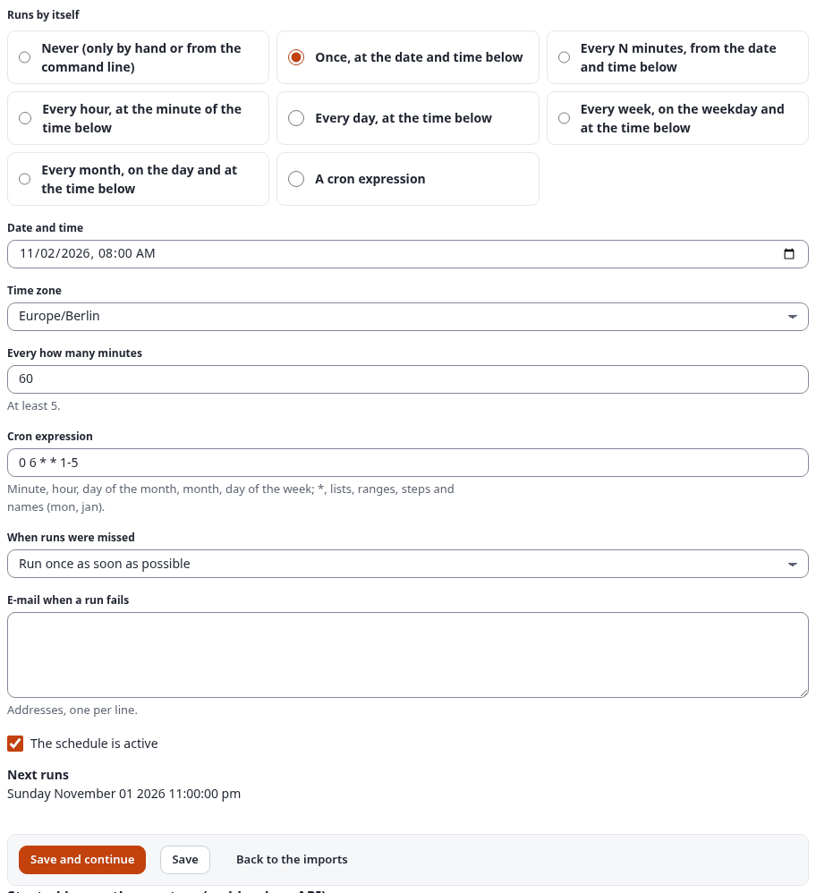
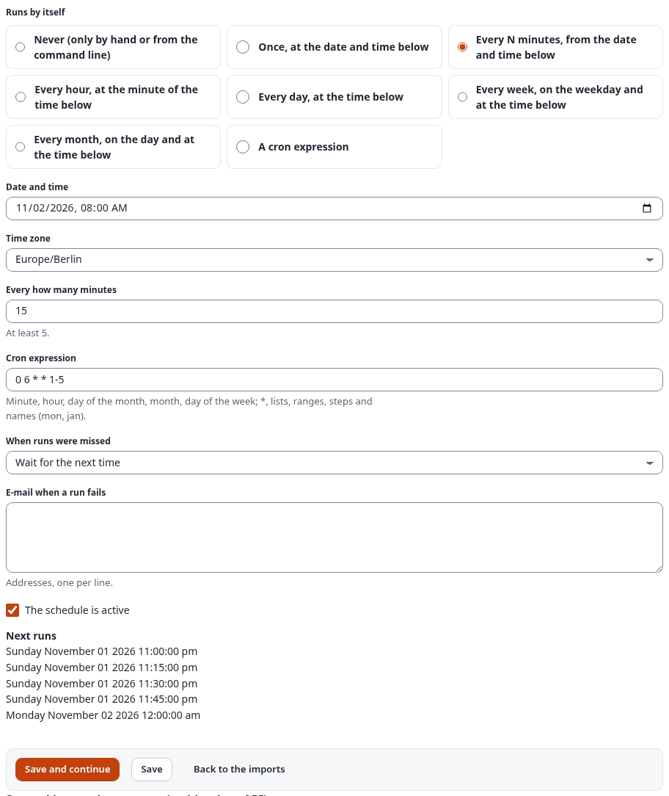
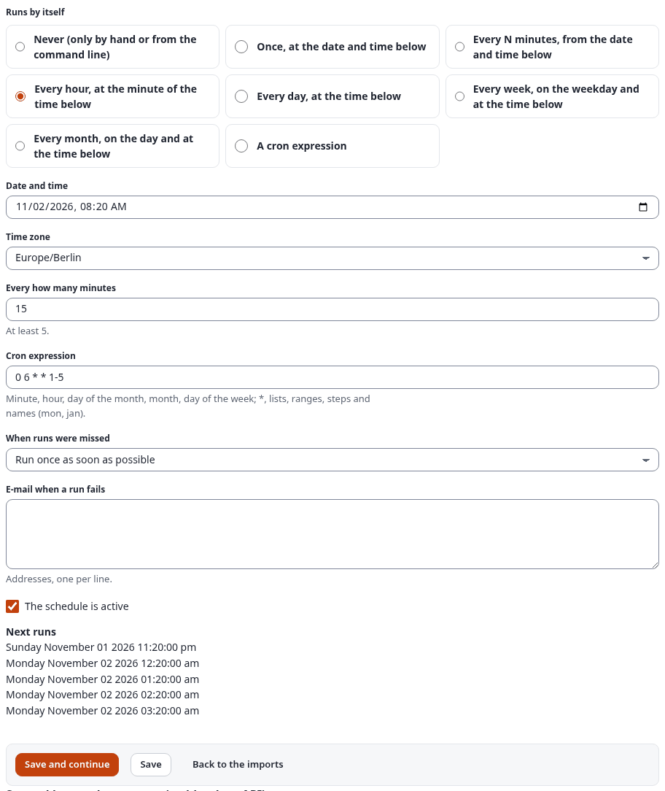
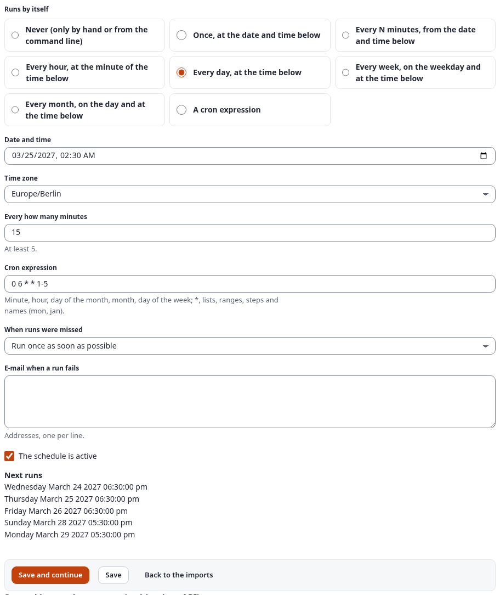
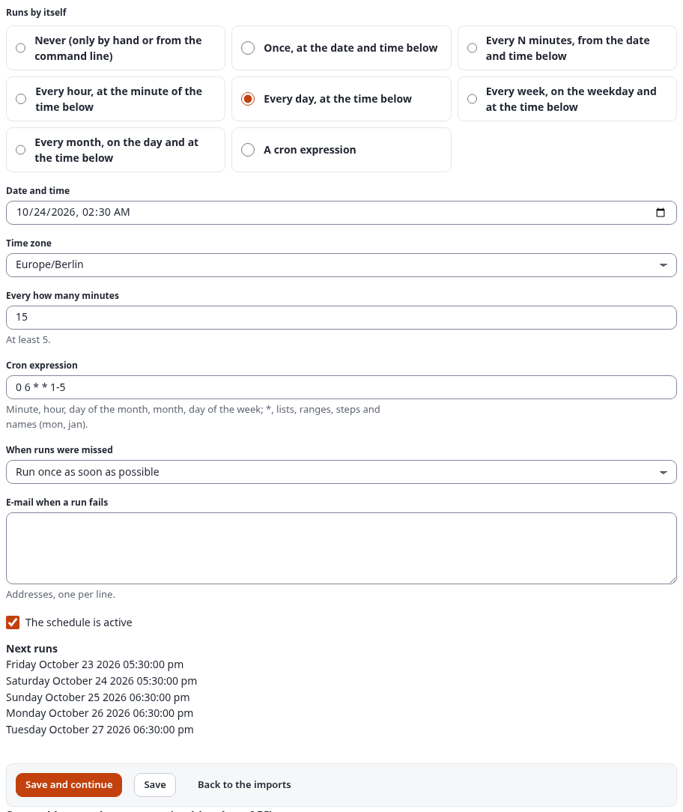
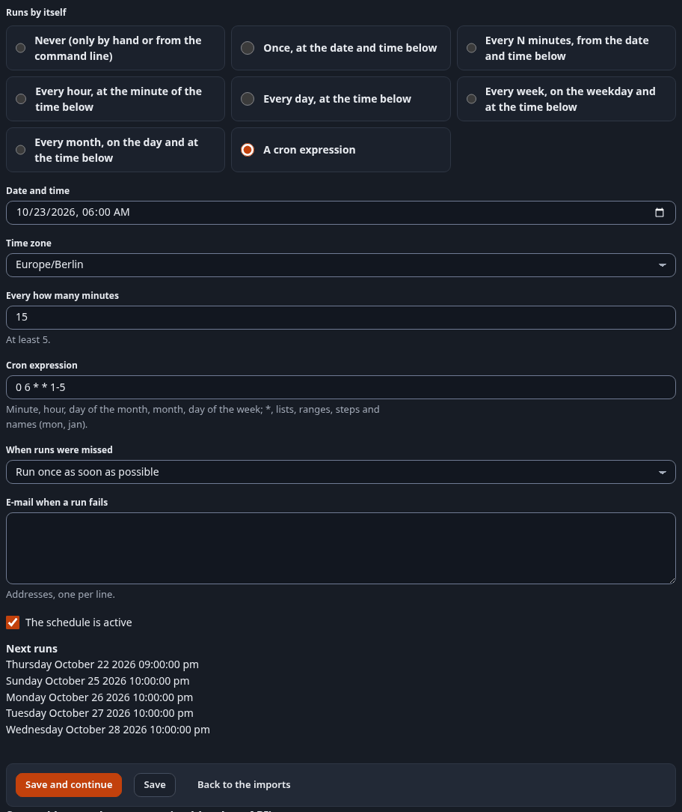
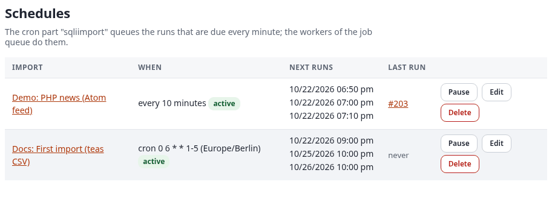
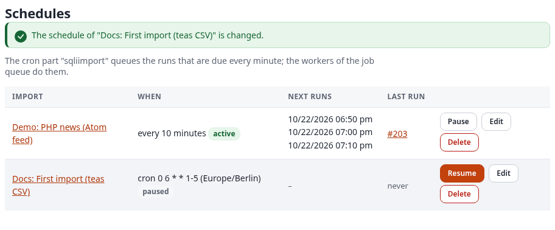
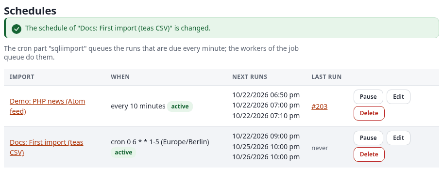

# Zeitpläne

Ein Zeitplan startet einen Import von selbst (Tabelle `sqliimport_schedule`, Klasse `expImportSchedule`). In der
Administration legen Sie einen Zeitplan im Schritt Zeitplan des Import-Editors fest
([editor.md](editor.md#schritt-5-zeitplan-schedule)), der einen Zeitplan pro Import führt; ein in PHP angelegter
Import kann mehrere haben.

Englisch: [../schedules.md](../schedules.md).

## Inhalt

- [Die Seite Schedules](#die-seite-schedules)
- [Arten](#arten)
- [Cron-Ausdrücke](#cron-ausdrücke)
- [Zeitzonen und Sommerzeit](#zeitzonen-und-sommerzeit)
- [Verpasste Läufe und Benachrichtigungen](#verpasste-läufe-und-benachrichtigungen)
- [Beispiele: ein Zeitplan jeder Art](#beispiele-ein-zeitplan-jeder-art)
  - [Einmal](#einmal)
  - [Alle N Minuten, mit „auf den nächsten Termin warten“](#alle-n-minuten-mit-auf-den-nächsten-termin-warten)
  - [Stündlich](#stündlich)
  - [Täglich über den Wechsel zur Sommerzeit (März)](#täglich-über-den-wechsel-zur-sommerzeit-märz)
  - [Täglich über den Wechsel zur Winterzeit (Oktober)](#täglich-über-den-wechsel-zur-winterzeit-oktober)
  - [Wöchentlich](#wöchentlich)
  - [Monatlich, am 31.](#monatlich-am-31)
  - [Ein Cron-Ausdruck, mit E-Mail bei Fehlern](#ein-cron-ausdruck-mit-e-mail-bei-fehlern)
- [Beispiel: Anhalten und Fortsetzen auf der Seite Schedules](#beispiel-anhalten-und-fortsetzen-auf-der-seite-schedules)
- [Warum die Zeiten nicht die des Zeitplans sind](#warum-die-zeiten-nicht-die-des-zeitplans-sind)
- [Der Cron-Teil](#der-cron-teil)
- [Einen Zeitplan in PHP anlegen](#einen-zeitplan-in-php-anlegen)

## Die Seite Schedules

**Schedules** im linken Menü des Reiters Importe (`sqliimport/schedules`) listet jeden Zeitplan der Importe von 2.x:

| Spalte | Zeigt |
|---|---|
| Import | Den Import, verlinkt mit seinen Läufen auf der Übersicht; „disabled“, wenn der Import ausgeschaltet ist |
| When | Den Zeitplan in Worten und ob er aktiv (active) oder angehalten (paused) ist |
| Next runs | Die nächsten drei Laufzeiten eines aktiven Zeitplans |
| Last run | Den letzten Lauf oder „never“ |

Benutzer mit der Richtlinie `manage` ([permissions.md](permissions.md)) bekommen außerdem diese Aktionen:

| Aktion | Wirkung |
|---|---|
| Pause | Hält den Zeitplan an; er bleibt mit seinen Einstellungen erhalten |
| Resume | Setzt ihn fort und berechnet seinen nächsten Lauf ab jetzt |
| Edit | Öffnet den Schritt Zeitplan des Imports im Editor |
| Delete | Entfernt den Zeitplan nach einer Rückfrage; der Import bleibt |

Jede Aktion ist eine POST-Anfrage mit dem Formular-Token und wird im Audit-Protokoll festgehalten. Ein
deaktivierter Import behält seinen Zeitplan, seine geplanten Läufe werden aber übersprungen, bis er wieder
aktiviert ist.

Darunter listet der Abschnitt **1.x scheduled imports** (früher `sqliimport/scheduledlist`) die geplanten Importe
von 1.x mit Handler, Optionen, Häufigkeit und nächstem Lauf: **Run now** (fordert einen Import mit ihren Optionen an;
run), **Edit**, **Enable** oder **Disable** und **Delete** (manage) sowie **New 1.x scheduled import**. Edit öffnet
das Formular `sqliimport/schedules/(legacy)/<id>` (oder `/new`; früher `sqliimport/addscheduled`) über den Listen:
Bezeichnung, Handler, Optionen, erster Lauf (Datum, Stunde, Minute), Häufigkeit (einmal, stündlich, täglich,
wöchentlich, monatlich, alle N Minuten, mindestens 5) und ob er aktiv ist. Ein migrierter verlinkt stattdessen den
Zeitplan seines Imports. Sie laufen weiter, bis `./console ext:sqliimport:migrate-1x --apply` sie hierher übernimmt
([migration-1x.md](migration-1x.md)).

## Arten

| `kind` | Läuft | Verwendet |
|---|---|---|
| `once` | Einmal, zu `run_at` | `run_at` |
| `interval` | Alle `interval_minutes` Minuten, gezählt ab `run_at` (mindestens 5 Minuten) | `run_at`, `interval_minutes` |
| `hourly` | Jede Stunde zur Minute von `run_at` | `run_at` |
| `daily` | Jeden Tag zur Uhrzeit von `run_at` | `run_at` |
| `weekly` | Jede Woche am Wochentag und zur Uhrzeit von `run_at` | `run_at` |
| `monthly` | Jeden Monat am Tag und zur Uhrzeit von `run_at`; in einem kürzeren Monat am letzten Tag | `run_at` |
| `cron` | Nach einem Cron-Ausdruck mit fünf Feldern | `cron_expr` |

## Cron-Ausdrücke

Fünf Felder: Minute, Stunde, Tag des Monats, Monat, Wochentag. Unterstützt werden:

- `*` und `?`, Listen (`1,15`), Bereiche (`1-5`), Schritte (`*/10`, `0-30/5`);
- Namen der Monate (`jan` bis `dec`) und der Tage (`sun` bis `sat`); Tag `0` und `7` sind Sonntag;
- die Kurzformen `@hourly`, `@daily`, `@midnight`, `@weekly`, `@monthly`, `@yearly` und `@annually`.

Sind sowohl der Tag des Monats als auch der Wochentag eingeschränkt, genügt einer von beiden, wie bei cron.

Beispiele:

| Ausdruck | Läuft |
|---|---|
| `30 2 * * *` | Jeden Tag um 02:30 |
| `0 */4 * * *` | Alle vier Stunden |
| `0 6 * * mon-fri` | Werktags um 06:00 |
| `15 3 1 * *` | Am Ersten jedes Monats um 03:15 |

## Zeitzonen und Sommerzeit

Jeder Zeitplan hat eine `timezone` (Vorgabe `UTC`). Uhrzeiten gelten in dieser Zeitzone, „täglich um 02:30“ bleibt
also auch beim Wechsel der Sommerzeit um 02:30 Ortszeit:

- Eine Uhrzeit, die es am Tag des Wechsels nicht gibt (02:30, wenn die Uhr von 02:00 auf 03:00 springt), wird an
  diesem Tag ausgelassen.
- Eine Uhrzeit, die es zweimal gibt (die Uhr wird zurückgestellt), läuft einmal.

## Verpasste Läufe und Benachrichtigungen

- `catch_up` regelt, was geschieht, wenn Läufe verpasst wurden, etwa weil cron nicht lief: `one` (Vorgabe) läuft
  jetzt einmal; `skip` wartet auf den nächsten Termin, wenn der Lauf mehr als zehn Minuten zu spät ist.
- `notify_json` ist eine Liste von E-Mail-Adressen. Sie bekommen eine Nachricht, wenn ein Lauf des Zeitplans
  fehlschlägt oder mit fehlgeschlagenen Datensätzen endet. Absender ist `site.ini [MailSettings] EmailSender`, sonst
  `AdminEmail`.
- Ein Zeitplan `once` schaltet sich nach seinem Lauf selbst ab.
- Ein Zeitplan, dessen Import entfernt wurde, wird abgeschaltet.
- Läuft der Import noch, wenn sein Zeitplan fällig ist, wird der neue Lauf nicht gestartet; der Cron-Teil meldet das,
  und der Zeitplan wartet auf seinen nächsten Termin.

## Beispiele: ein Zeitplan jeder Art

Jedes Beispiel wurde auf dem Server der Dokumentation im Schritt Zeitplan des Imports „Docs: First import (teas
CSV)“ gespeichert (`sqliimport/edit/132/(step)/schedule`), mit **Save**, das auf dem Schritt bleibt und die
**nächsten fünf Läufe** (*Next runs*) listet. Die Startdaten liegen in der Zukunft, keiner wurde also fällig, während
die Bildschirmfotos entstanden; danach wurde der Zeitplan des Imports auf seinen Cron-Ausdruck zurückgesetzt und
angehalten.

**Lesen Sie die Zeiten mit zwei Zeitzonen im Kopf.** *Date and time* und der Zeitplan gelten in der *Time zone* des
Zeitplans (hier Europe/Berlin). Die Liste **Next runs**, die Seite Schedules und jedes andere Datum der Administration
erscheinen in der Zeitzone, in der die Administration läuft: Der Server der Dokumentation läuft in
America/Los_Angeles, neun Stunden hinter Berlin (acht, solange nur einer der beiden Orte Sommerzeit hat). „08:00 in
Berlin“ steht daher als „11:00:00 pm“ des Vortags in der Liste. Siehe
[Warum die Zeiten nicht die des Zeitplans sind](#warum-die-zeiten-nicht-die-des-zeitplans-sind).

### Einmal

| Feld | Wert |
|---|---|
| Runs by itself | Once, at the date and time below |
| Date and time | `11/02/2026, 08:00 AM` |
| Time zone | `Europe/Berlin` |
| When runs were missed | Run once as soon as possible |

Nächste Läufe: **Sunday November 01 2026 11:00:00 pm** (08:00 am 2. November in Berlin). Ein Lauf, danach schaltet
sich der Zeitplan selbst ab.



### Alle N Minuten, mit „auf den nächsten Termin warten“

| Feld | Wert |
|---|---|
| Runs by itself | Every N minutes, from the date and time below |
| Date and time | `11/02/2026, 08:00 AM`, Europe/Berlin |
| Every how many minutes | `15` (mindestens 5) |
| When runs were missed | **Wait for the next time** (`skip`) |

Nächste Läufe: 1. November 2026 um 11:00, 11:15, 11:30 und 11:45 pm und 2. November um 12:00 am. Mit *Wait for the
next time* wird ein Lauf, der mehr als zehn Minuten zu spät ist (cron lief nicht, der Server war aus), nicht
nachgeholt: Der Zeitplan wartet auf seine nächste Viertelstunde. Mit *Run once as soon as possible* (`one`) läuft er
sofort einmal, wie viele Läufe auch verpasst wurden.



### Stündlich

Runs by itself: *Every hour, at the minute of the time below*; `11/02/2026, 08:20 AM`, Europe/Berlin. Nach dem ersten
Lauf zählt nur die Minute: Die nächsten Läufe sind 11:20 pm, 12:20 am, 01:20 am, 02:20 am und 03:20 am (Los Angeles).



### Täglich über den Wechsel zur Sommerzeit (März)

| Feld | Wert |
|---|---|
| Runs by itself | Every day, at the time below |
| Date and time | `03/25/2027, 02:30 AM` |
| Time zone | `Europe/Berlin` |

In Berlin springt die Uhr am Sonntag, dem 28. März 2027, von 02:00 auf 03:00; 02:30 gibt es an diesem Tag nicht. Die
nächsten Läufe:

```
Wednesday March 24 2027 06:30:00 pm    = Donnerstag, 25. März, 02:30 in Berlin
Thursday March 25 2027 06:30:00 pm     = Freitag, 26. März, 02:30
Friday March 26 2027 06:30:00 pm       = Samstag, 27. März, 02:30
Sunday March 28 2027 05:30:00 pm       = Montag, 29. März, 02:30 (Sommerzeit; Sonntag, der 28. März, fällt aus)
Monday March 29 2027 05:30:00 pm       = Dienstag, 30. März, 02:30
```

Der Lauf am Sonntag fällt aus, wie [Zeitzonen und Sommerzeit](#zeitzonen-und-sommerzeit) sagt, und ab Montag bleibt
der Lauf um 02:30 Berliner Zeit; in Los Angeles (schon seit dem 14. März auf Sommerzeit) rückt er von 06:30 pm auf
05:30 pm.



### Täglich über den Wechsel zur Winterzeit (Oktober)

Derselbe Zeitplan ab `10/24/2026, 02:30 AM`. In Berlin wird die Uhr am Sonntag, dem 25. Oktober 2026, von 03:00 auf
02:00 zurückgestellt; 02:30 gibt es in dieser Nacht zweimal, und der Lauf geschieht einmal, beim ersten 02:30 (noch
Sommerzeit):

```
Friday October 23 2026 05:30:00 pm     = Samstag, 24. Oktober, 02:30 in Berlin (Sommerzeit)
Saturday October 24 2026 05:30:00 pm   = Sonntag, 25. Oktober, das erste 02:30 (einmal)
Sunday October 25 2026 06:30:00 pm     = Montag, 26. Oktober, 02:30 (Winterzeit)
Monday October 26 2026 06:30:00 pm
Tuesday October 27 2026 06:30:00 pm
```



### Wöchentlich

*Every week, on the weekday and at the time below*: `11/04/2026, 07:00 AM` (ein Mittwoch), Europe/Berlin. Nächste
Läufe: Dienstag, 3., 10., 17. und 24. November und 1. Dezember 2026, jeweils 10:00 pm, also mittwochs 07:00 in Berlin.


### Monatlich, am 31.

*Every month, on the day and at the time below*: `01/31/2027, 06:00 AM`, Europe/Berlin. Ein Monat ohne 31. läuft an
seinem letzten Tag, und der nächste Monat kehrt zum 31. zurück:

```
Saturday January 30 2027 09:00:00 pm   = 31. Januar, 06:00 in Berlin
Saturday February 27 2027 09:00:00 pm  = 28. Februar (der letzte Tag)
Tuesday March 30 2027 09:00:00 pm      = 31. März (Sommerzeit in beiden Städten)
Thursday April 29 2027 09:00:00 pm     = 30. April (der letzte Tag)
Sunday May 30 2027 09:00:00 pm         = 31. Mai
```


### Ein Cron-Ausdruck, mit E-Mail bei Fehlern

| Feld | Wert |
|---|---|
| Runs by itself | A cron expression |
| Cron expression | `0 6 * * 1-5` (werktags 06:00) |
| Time zone | `Europe/Berlin` |
| E-mail when a run fails | `imports@example.invalid` (eine Adresse pro Zeile) |

Nächste Läufe: Donnerstag, 22. Oktober 2026, 09:00 pm (Freitag 06:00 in Berlin), dann Sonntag, 25. Oktober, 10:00 pm
(Montag; Berlin hat ab dieser Nacht Winterzeit, Los Angeles erst ab dem 1. November, der Abstand ist also acht
Stunden), Montag, 26., Dienstag, 27., und Mittwoch, 28. Oktober, 10:00 pm. Samstag und Sonntag haben keinen Lauf.

Schlägt ein geplanter Lauf fehl oder endet er mit fehlgeschlagenen Datensätzen, bekommen die Adressen eine Nachricht
mit dem Betreff `[<Name der Website>] Docs: First import (teas CSV): run #<ID> <Status>`, den Zählern des Laufs, seinen
ersten fünf Fehlern und dem Link zu seiner Seite. Absender ist `site.ini [MailSettings] EmailSender`, sonst
`AdminEmail`. Nehmen Sie eine Adresse des Teams, dem der Import gehört; `example.invalid` ist hier nur ein Platzhalter.


Derselbe Schritt im dunklen Design, ohne Adresse:



## Beispiel: Anhalten und Fortsetzen auf der Seite Schedules

Die Seite Schedules listet beide Zeitpläne des Servers der Dokumentation: die php.net-Demo alle 10 Minuten und den
Cron-Zeitplan von „Docs: First import (teas CSV)“:



**Pause** sendet die Aktion `schedule_pause` (ein POST an `sqliimport/action` mit Formular-Token, `ScheduleID` und der
Rücksprungadresse `RedirectURI=/sqliimport/schedules`). Die Seite kommt zurück mit „The schedule of "Docs: First
import (teas CSV)" is changed“: Die Zeile sagt *paused*, hat keine nächsten Läufe und bietet **Resume** an:



**Resume** sendet `schedule_resume`: Der Zeitplan ist wieder aktiv, und sein nächster Lauf wird ab jetzt berechnet;
Läufe, die während der Pause fällig gewesen wären, werden nicht nachgeholt:



Beide Aktionen stehen im Audit-Protokoll. Auf dem Server der Dokumentation wurde der Zeitplan danach wieder
angehalten, damit dieser Import nie von selbst läuft.

## Warum die Zeiten nicht die des Zeitplans sind

Ein Zeitplan wird mit seiner eigenen Zeitzone gespeichert, seine Laufzeiten sind Zeitpunkte (Unix-Zeitstempel). Die
Administration zeigt jeden Zeitpunkt als Datum der Zeitzone, in der sie läuft: der Zeitzone von PHP
(`date.timezone`), die die des Servers ist, wenn PHP keine setzt. Der Server der Dokumentation läuft in
America/Los_Angeles, deshalb steht der Berliner Zeitplan oben acht oder neun Stunden früher in der Liste, ohne Zone
neben der Uhrzeit; die Läufe geschehen trotzdem um 06:00 in Berlin, und eine Installation, deren PHP in
Europe/Berlin läuft, listet sie um 06:00. Das Feld *Date and time* des Schritts Zeitplan ist die Ausnahme: Es gilt in
der eigenen Zeitzone des Zeitplans, der daneben gewählten. Wirkt eine Liste Ende März oder Ende Oktober um eine Stunde
verschoben, prüfen Sie, welche der beiden Zonen die Uhr umgestellt hat.

## Der Cron-Teil

Der Cron-Teil `sqliimport` muss jede Minute laufen:

```bash
* * * * * cd /pfad/zu/exponential && php runcronjobs.php -q sqliimport
```

Jede Runde (`expImportScheduler::tick()`):

1. beendet Läufe, deren Jobs ohne sie beendet wurden;
2. stellt die Läufe fälliger Zeitpläne in die Warteschlange (die Läufe verarbeiten die Worker der
   Job-Warteschlange, Cron-Teil `expqueue`);
3. übergibt offene Importaufträge und fällige geplante Importe von 1.x an die Engine von 2.x;
4. entfernt beendete Läufe, die älter als `[RunSettings] KeepDays` sind.

`./console ext:sqliimport:tick` führt eine Runde von Hand aus und gibt aus, was sie getan hat.

Die Cron-Teile `sqliimport_run` und `sqliimport_cleanup` von 1.x sind veraltet und bleiben für eine Hauptversion
erhalten. Ist die Job-Warteschlange installiert, übergibt `sqliimport_run` die Importe von 1.x an die Engine von
2.x, wie es der Teil `sqliimport` tut; ohne sie führt er sie wie in 1.x aus. Ersetzen Sie sie durch `sqliimport`.

## Einen Zeitplan in PHP anlegen

Ein Skript, das Importe einrichtet, kann einen Zeitplan ohne den Editor hinzufügen:

```php
<?php
$import = expImportDefinition::fetchByIdentifier( 'news_feed' );
$zone = new DateTimeZone( 'Europe/Berlin' );
$schedule = new expImportSchedule( array(
    'import_id' => $import->attribute( 'id' ),
    'kind' => 'daily',
    'run_at' => ( new DateTime( '2026-11-01 02:30', $zone ) )->getTimestamp(),
    'interval_minutes' => 0,
    'cron_expr' => '',
    'timezone' => 'Europe/Berlin',
    'catch_up' => 'one',
    'notify_json' => json_encode( array( 'webmaster@example.com' ) ),
    'is_active' => 1,
    'last_run' => 0,
    'created' => time(),
    'modified' => time(),
    'creator_id' => eZUser::currentUserID(),
) );
$errors = expImportCron::validate( $schedule->calcArray() );   // leer, wenn der Zeitplan gültig ist
$schedule->computeNext();
$schedule->store();
```

Geplante Läufe laufen als der Ersteller des Zeitplans oder als Robot-Benutzer des Imports.
