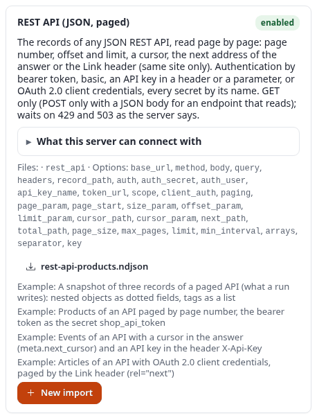
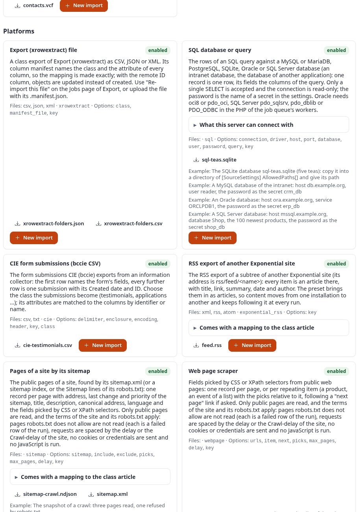
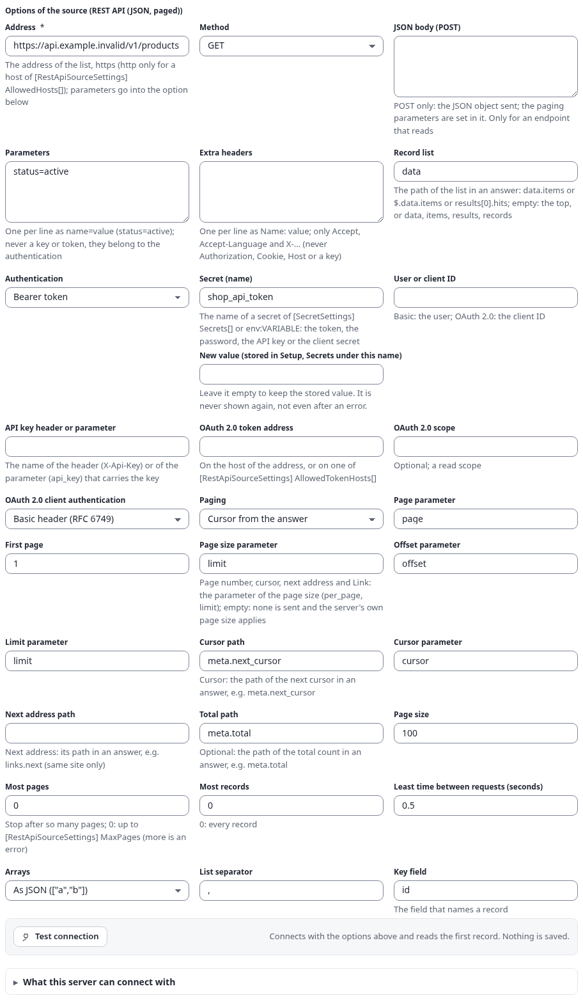
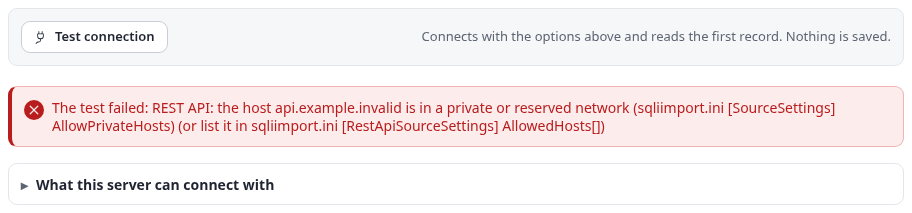
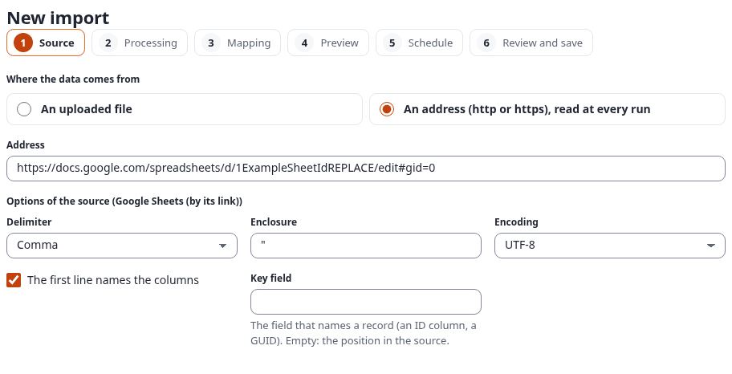
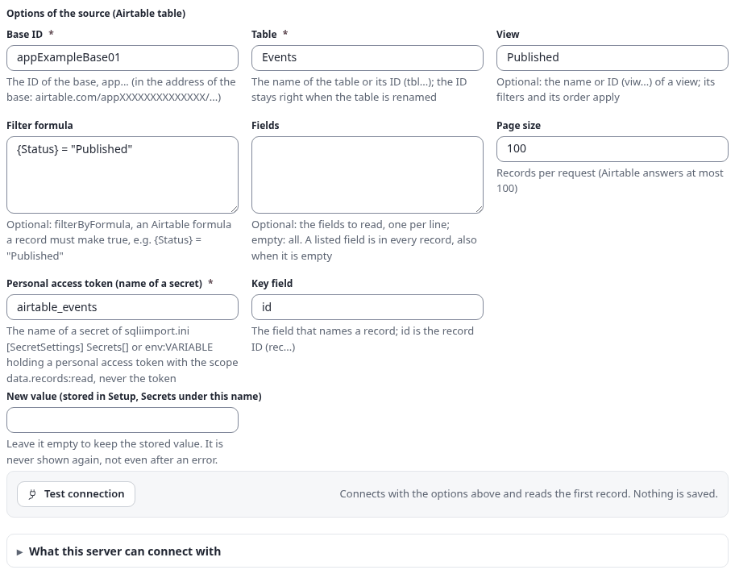

# Durchgespielte Beispiele: APIs und gehostete Dienste

Diese Seite zeigt für jede Quelle von 7x SQLI Import, die eine Web-API liest, einen vollständigen Import: eine
beliebige JSON-REST-API, ein Google Sheet über seinen Link, Airtable, Notion, Baserow, Supabase oder PostgREST, die
Firebase Realtime Database, Salesforce und HubSpot. Jedes Beispiel nennt sein Ziel, das Geheimnis, das es braucht,
die genauen Werte für den Import-Editor, die Anfrage der Quelle, einen Auszug dessen, was zurückkommt, die Zeilen
der Zuordnung und das Ergebnis.

Die Optionen selbst beschreibt [sources.md](sources.md); jedes Beispiel verlinkt auf seinen Abschnitt dort. Die
Schritte des Editors erklärt [editor.md](editor.md), die Zeilen der Zuordnung [mappings.md](mappings.md). Die anderen
durchgespielten Beispiele: [Datenbanken](source-examples-databases.md) und
[Plattformen, Handel und Dokumente](source-examples-platforms.md).

**Zur Veranschaulichung: Diese Beispiele liefen nicht gegen ein echtes Konto.** Mit dem Server der Dokumentation ist
kein Konto dieser Dienste verbunden. Die Konfigurationen sind vollständig und vom Editor geprüft, die Auszüge der
Datensätze sind die Beispiel-Schnappschüsse des Katalogs in `share/examples/` (das, was die Quelle in das Verzeichnis
des Laufs schreibt), und die Ergebnisse sind das, was ein Lauf mit diesen Datensätzen ergibt. Jede Adresse nutzt
`example.invalid`, jedes Token ist ein Platzhalter.

## Inhalt

- [Vorab: Geheimnisse](#vorab-geheimnisse)
- [Beliebige JSON-REST-API (`rest_api`)](#beliebige-json-rest-api-rest_api)
  - [Blättern mit Cursor und Bearer-Token](#blättern-mit-cursor-und-bearer-token)
  - [Blättern mit Offset und API-Schlüssel im Header](#blättern-mit-offset-und-api-schlüssel-im-header)
  - [Seitennummern mit Basic-Anmeldung](#seitennummern-mit-basic-anmeldung)
  - [Der Link-Header einer öffentlichen API ohne Anmeldung](#der-link-header-einer-öffentlichen-api-ohne-anmeldung)
- [Google Sheets über den Link (`google_sheets`)](#google-sheets-über-den-link-google_sheets)
- [Airtable (`airtable`)](#airtable-airtable)
- [Notion (`notion`)](#notion-notion)
- [Baserow (`baserow`)](#baserow-baserow)
- [Supabase oder PostgREST (`supabase`)](#supabase-oder-postgrest-supabase)
- [Firebase Realtime Database (`firebase_rtdb`)](#firebase-realtime-database-firebase_rtdb)
- [Salesforce SOQL (`salesforce`)](#salesforce-soql-salesforce)
- [HubSpot (`hubspot`)](#hubspot-hubspot)

Die REST-API und Google Sheets stehen im Katalog in der Gruppe *Data*, die gehosteten Dienste in der Gruppe
*Platforms*, neben der SQL-Quelle und den Lesern anderer Websites:





## Vorab: Geheimnisse

Ein Import enthält nie ein Token, ein Passwort oder einen Schlüssel. Seine Geheimnis-Optionen enthalten den **Namen**
eines Geheimnisses ([sources.md, Geheimnisse](sources.md#geheimnisse)). Es gibt zwei Wege, diesem Namen einen Wert zu
geben:

1. **Im Editor.** Den Namen in die Option tippen (zum Beispiel `shop_api_token`), das Token in das Feld **New value**
   darunter, und den Schritt speichern. Der Wert kommt in den Geheimnisspeicher des Kernels (Exponential 6.0.15,
   **Setup, Secrets**, Bereich `sqliimport`) unter diesem Namen. Das Feld ist danach immer leer; ein gespeicherter
   Wert wird nie wieder angezeigt. Dafür braucht es die Richtlinie *secrets/manage*.
2. **Unter Setup, Secrets** (auf älteren Installationen `sqliimport.ini [SecretSettings] Secrets[shop_api_token]=...`
   in `settings/override/`, nie in einem Repository) oder als `env:SHOP_API_TOKEN`, eine Umgebungsvariable des
   PHP-FPM-Pools und der Worker der Job-Queue.

**Importe, Einstellungen** listet, welche Geheimnisnamen gesetzt sind, nie einen Wert. Meldungen und Protokolle
zeigen `[secret <Name>]`. Die Bildschirmfotos dieser Seite zeigen ausgefüllte Formulare, die **nicht gespeichert**
wurden, mit Platzhalternamen und ohne Wert in **New value**.

Jedes Beispiel folgt dann denselben Schritten:

1. **Importe, Katalog** (Catalogue), die Karte des Formats, **New import** (oder **Importe, New import** und das
   Format unter *Source type*).
2. Schritt **Quelle** (Source): ein Name, dann die Optionen des Beispiels. **Verbindung testen** (Test connection)
   liest den ersten Datensatz oder die erste Seite und zeigt die Felder; nichts wird gespeichert.
3. Schritt **Zuordnung** (Mapping): die Klasse und die Zeilen des Beispiels (die Vorlage des Formats füllt die meisten,
   wenn der Import gespeichert wird).
4. Schritt **Vorschau** (Preview): die Stichprobe und ein Probelauf der ersten Datensätze; dann **Run** oder ein
   Zeitplan.

## Beliebige JSON-REST-API (`rest_api`)

Optionen: [sources.md, Beliebige JSON-REST-API](sources.md#beliebige-json-rest-api-rest_api). Die vier Beispiele lesen
dieselbe erfundene Produkt-API mit den vier Arten des Blätterns und den vier Arten der Anmeldung, jedes zeigt also eine
Art zu blättern und eine Art sich anzumelden. Alle gehen vom Schnappschuss `share/examples/rest-api-products.ndjson` aus.

Was zurückkommt, zu Datensätzen abgeflacht (Auszug des Schnappschusses):

```json
{"id":"P-1001","name":"Sencha tea, 100 g","sku":"TEA-SEN-100","price.amount":"8.90","price.currency":"EUR","in_stock":true,"tags":"[\"tea\",\"green\"]","category.name":"Green tea","updated_at":"2026-09-02T10:15:00Z"}
{"id":"P-1002","name":"Oolong tea, 50 g","sku":"TEA-OOL-050","price.amount":"11.50","price.currency":"EUR","in_stock":false,"tags":"[\"tea\",\"oolong\"]","category.name":"Oolong","updated_at":"2026-09-05T14:40:00Z"}
{"id":"P-1003","name":"Tea strainer","sku":"ACC-STR-001","price.amount":"4.20","price.currency":"EUR","in_stock":true,"tags":"[]","category":null,"updated_at":"2026-09-09T08:05:00Z"}
```

Die Zuordnung ist für alle vier dieselbe, in die Webshop-Klasse `product`:

| Quellfeld | Attribut | Umwandlungen (einzeilige Kette) |
|---|---|---|
| `name` | `name` | `trim` |
| `sku` | `product_number` | |
| `price.amount` | `price` | `template(text="{price.amount}\|1\|1")` (Betrag, MwSt.-Typ 1, Preis enthält MwSt.) |
| `tags` | `tags` | `join(separator=", ")` |

Zuordnen über die Remote-ID `shop-{id}`. **Erwartetes Ergebnis** des ersten Laufs: drei Produkte angelegt
(`shop-P-1001` bis `shop-P-1003`); ein zweiter Lauf ohne Änderung in der API: drei unverändert. Ändert die API einen
Preis, wird dieses Produkt aktualisiert, die beiden anderen bleiben unverändert.

### Blättern mit Cursor und Bearer-Token

**Ziel:** die aktiven Produkte einer Shop-API importieren, die mit einem Cursor blättert und sich mit einem
Bearer-Token anmeldet.

**Geheimnis:** `shop_api_token` (das nur lesende Token der API; in **New value** eintragen oder unter Setup, Secrets
setzen).

| Option | Wert |
|---|---|
| Address (`base_url`) | `https://api.example.invalid/v1/products` |
| Method | `GET` |
| Parameters (`query`) | `status=active` |
| Record list (`record_path`) | `data` |
| Authentication (`auth`) | `bearer` |
| Secret (`auth_secret`) | `shop_api_token` |
| Paging | `cursor` |
| Page size parameter (`size_param`) | `limit` |
| Cursor path (`cursor_path`) | `meta.next_cursor` |
| Cursor parameter (`cursor_param`) | `cursor` (die Vorgabe) |
| Total path (`total_path`) | `meta.total` |
| Page size | `100` |
| Least time between requests | `0.5` |
| Key field | `id` |



**Die Anfragen** der Quelle:

```
GET https://api.example.invalid/v1/products?status=active&limit=100
Authorization: Bearer <der Wert von shop_api_token>

GET https://api.example.invalid/v1/products?status=active&limit=100&cursor=eyJpZCI6IlAtMTAwMyJ9
```

Eine Antwort sieht aus wie `{"data": [ ...Datensätze... ], "meta": {"next_cursor": "eyJpZCI6IlAtMTAwMyJ9", "total": 3}}`;
die Quelle hört auf, wenn `meta.next_cursor` leer ist oder die Datensätze `meta.total` erreichen.

**Verbindung testen** liest nur die erste Seite und zeigt ihre Felder und die Gesamtzahl. Mit der Platzhalteradresse
dieses Beispiels zeigt der Test, was mit einem Host geschieht, der nicht auf eine öffentliche Adresse zeigt: Die
Quelle lehnt ihn ab, bevor etwas gesendet wird (der reservierte Name `.invalid` zählt als reserviertes Netz). Eine
API im Intranet wird durchgelassen, wenn sie in `[RestApiSourceSettings] AllowedHosts[]` steht. Ein Geheimnis
erscheint nie in einer solchen Meldung:



### Blättern mit Offset und API-Schlüssel im Header

**Ziel:** dieselben Produkte aus einer API, die mit `offset` und `limit` blättert und ihren Schlüssel in einem Header
erwartet.

**Geheimnis:** `shop_api_key`.

| Option | Wert |
|---|---|
| Address | `https://api.example.invalid/v2/catalog/items` |
| Record list | `items` |
| Authentication | `api_key_header` |
| Secret | `shop_api_key` |
| API key header or parameter (`api_key_name`) | `X-Api-Key` |
| Paging | `offset` |
| Offset parameter, Limit parameter | `offset`, `limit` (die Vorgaben) |
| Page size | `50` |
| Key field | `id` |

Anfragen: `GET .../items?offset=0&limit=50`, dann `offset=50`, `offset=100` ..., jede mit `X-Api-Key: <Wert>`. Das
Lesen endet bei einer Seite mit weniger als 50 Datensätzen. Mit `api_key_query` kommt der Schlüssel stattdessen in den
Parameter aus `api_key_name` (`?api_key=...`), auch auf den folgenden Seiten; Meldungen zeigen diesen Parameter nie.

### Seitennummern mit Basic-Anmeldung

**Ziel:** eine Veranstaltungs-API im Intranet mit Seitennummern, Benutzer und Passwort.

**Geheimnis:** `events_api_password`; der Benutzer ist eine Option.

| Option | Wert |
|---|---|
| Address | `https://events.example.invalid/api/events` |
| Parameters | `from=2026-10-01` |
| Authentication | `basic` |
| User or client ID (`auth_user`) | `import-reader` |
| Secret | `events_api_password` |
| Paging | `page` |
| Page parameter, First page | `page`, `1` |
| Page size parameter | `per_page` |
| Page size | `100` |

Anfragen: `GET .../events?from=2026-10-01&page=1&per_page=100`, `page=2` ..., jede mit `Authorization: Basic`. Ein Host
im Intranet muss in `[RestApiSourceSettings] AllowedHosts[]` stehen (und nur ein dort genannter Host darf `http`
nutzen).

### Der Link-Header einer öffentlichen API ohne Anmeldung

**Ziel:** die Releases einer öffentlichen Projekt-API, die mit dem `Link`-Header nach RFC 8288 blättert (so blättern
GitHub, GitLab und WordPress).

**Geheimnis:** keines.

| Option | Wert |
|---|---|
| Address | `https://api.example.invalid/repos/example/tea-tools/releases` |
| Extra headers | `Accept: application/json` |
| Authentication | `none` |
| Paging | `link` |
| Page size parameter, Page size | `per_page`, `30` |
| Most pages | `5` |

Die Quelle folgt `Link: <https://api.example.invalid/...&page=2>; rel="next"`, bis kein `next` mehr kommt, und nur auf
dem Host der Adresse. `next_url` arbeitet genauso mit einer Adresse in der Antwort (`next_path` `links.next`).

## Google Sheets über den Link (`google_sheets`)

Optionen: [sources.md, Google Sheets](sources.md#google-sheets-google_sheets).

**Ziel:** Ein Team führt seine Veranstaltungsliste in einem Google Sheet; die Website zeigt jede Zeile als
Veranstaltung, stündlich aktualisiert.

**Geheimnis:** keines. Das Sheet freigeben als *Jeder mit dem Link kann ansehen* (oder im Web veröffentlichen).

Schritte: Format **Google Sheets (by its link)**; *Woher die Daten kommen*: **An address**; die Adresse ist der Link
des Sheets, wie ihn der Browser zeigt:

```
https://docs.google.com/spreadsheets/d/1ExampleSheetIdREPLACE/edit#gid=0
```



Die Quelle macht aus dem Link den CSV-Export des Tabellenblatts des Links (`#gid=0`) und liest ihn als CSV mit Komma
und UTF-8; die erste Zeile benennt die Spalten. Ein Sheet mit den Spalten `id`, `Title`, `Date`, `Place`:

```
id,Title,Date,Place
E-1,Tea tasting evening,05.11.2026,Tea room
E-2,Garden walk,12.11.2026,Garden
```

| Quellfeld | Attribut (Klasse `event` oder `article`) | Umwandlungen |
|---|---|---|
| `Title` | `title` | `trim` |
| `Date` | `publish_date` | `date(format=d.m.Y, timezone=Europe/Berlin)` |
| `Place` | `intro` | `richtext` |

Zuordnen über die Remote-ID `sheet-event-{id}`. Zeitplan: stündlich. **Erwartetes Ergebnis:** zwei Objekte im ersten
Lauf; eine neue Zeile im Sheet wird beim nächsten Lauf ein neues Objekt, eine geänderte Zelle aktualisiert ihr Objekt.

## Airtable (`airtable`)

Optionen: [sources.md, Airtable](sources.md#airtable-airtable).

**Ziel:** die veröffentlichten Veranstaltungen einer Airtable-Base als Artikel.

**Geheimnis:** `airtable_events`, ein persönliches Zugriffstoken mit dem Scope `data.records:read` nur für diese Base.

| Option | Wert |
|---|---|
| Base ID | `appExampleBase01` |
| Table | `Events` |
| View | `Published` |
| Formula | `{Status} = "Published"` |
| Token | `airtable_events` |
| Page size | `100` |
| Key field | `id` |



Anfrage: `GET https://api.airtable.com/v0/appExampleBase01/Events?view=Published&filterByFormula=...&pageSize=100`,
dann mit dem `offset` jeder Antwort. Was zurückkommt (`share/examples/airtable-events.ndjson`, Auszug):

```json
{"id":"recExample000001","created_time":"2026-09-01T08:00:00.000Z","Name":"Tea tasting evening","Date":"2026-11-05","Status":"Published","Poster":["https://dl.airtable.example.invalid/poster-tasting.jpg"],"Poster_names":["poster-tasting.jpg"],"Notes":"An evening with five green teas.\nBooking needed.","Seats":40,"Featured":true}
```

| Quellfeld | Attribut (`article`) | Umwandlungen |
|---|---|---|
| `Name` | `title` | `trim` |
| `Notes` | `intro` | `richtext` |
| `Date` | `publish_date` (wo die Klasse es hat) | `date` |
| `Poster` | `image` | `first \| image` |

Zuordnen über `airtable-{id}`. **Erwartetes Ergebnis:** drei Artikel; das Plakat des ersten wird als Bild
heruntergeladen (die Dateiadressen von Airtable verfallen, darum lädt der Lauf sie sofort).

## Notion (`notion`)

Optionen: [sources.md, Notion](sources.md#notion-notion).

**Ziel:** die veröffentlichten Seiten einer Notion-Datenbank als Artikel, mit dem Inhalt der Seite als Text.

**Geheimnis:** `notion_articles`, das Token einer internen Integration, für die die Datenbank freigegeben ist (nur
Inhalte lesen).

| Option | Wert |
|---|---|
| Database ID | `11111111222243338444555555555500` (oder der Link der Datenbank) |
| Filter | `{"property": "Status", "status": {"equals": "Published"}}` |
| Sorts | `[{"property": "Date", "direction": "descending"}]` |
| Content | `html` |
| Token | `notion_articles` |

Anfrage: `POST https://api.notion.com/v1/databases/<id>/query` mit dem Filter (eine lesende Abfrage), dann
`GET .../blocks/<Seite>/children` für den Inhalt. Auszug aus `share/examples/notion-articles.ndjson`:

```json
{"id":"11111111-2222-4333-8444-555555555501","title":"Spring teas","Summary":"The first harvest of the year.","Date":"2026-10-01","Status":"Published","Tags":"Green, Japan","Author":["Sample Author"],"content":"# Spring teas\n\nThe first harvest is the **finest**.\n\n- Sencha\n- Gyokuro"}
```

| Quellfeld | Attribut (`article`) | Umwandlungen |
|---|---|---|
| `title` | `title` | |
| `Summary` | `intro` | `richtext` |
| `content` | `body` | `richtext` |
| `Tags` | `tags` (Schlagwörter, wo die Klasse sie hat) | |

Zuordnen über `notion-{id}`. **Erwartetes Ergebnis:** zwei Artikel; wird eine Seite in Notion bearbeitet, wird ihr
Artikel beim nächsten Lauf aktualisiert.

## Baserow (`baserow`)

Optionen: [sources.md, Baserow](sources.md#baserow-baserow).

**Ziel:** die veröffentlichten Veranstaltungen einer Baserow-Tabelle.

**Geheimnis:** `baserow_events`, ein Datenbank-Token mit Leserecht auf die Tabelle.

| Option | Wert |
|---|---|
| Address | `https://api.baserow.io` (oder das eigene Baserow) |
| Table ID | `4711` |
| Filters | `Published__boolean=1` |
| Order by | `-Date` |
| Include | `Name`, `Date`, `Seats`, `Topics`, `Venue` (eines pro Zeile) |
| Token | `baserow_events` |

Anfrage: `GET https://api.baserow.io/api/database/rows/table/4711/?user_field_names=true&filter__Published__boolean=1&order_by=-Date&size=100`.
Auszug aus `share/examples/baserow-events.ndjson`:

```json
{"id":1,"Name":"Autumn tasting","Date":"2026-10-10","Seats":"40","Status":"Published","Published":true,"Topics":"Green tea, Japan","Venue":"Tea room","Venue_ids":"7"}
```

Zuordnung: `Name` nach `title` (`trim`), `Topics` nach `intro` (`richtext`), `Date` nach `publish_date` (`date`).
Zuordnen über `baserow-{id}`. **Erwartetes Ergebnis:** die beiden veröffentlichten Zeilen des Schnappschusses werden
Artikel; die Entwurfszeile (`Published` falsch) wird nicht gelesen.

## Supabase oder PostgREST (`supabase`)

Optionen: [sources.md, Supabase oder PostgREST](sources.md#supabase-oder-postgrest-supabase).

**Ziel:** die veröffentlichten Artikel einer Supabase-Tabelle, mit dem Namen des Autors aus einer verbundenen Tabelle.

**Geheimnis:** `supabase_anon_key` (der anon key des Projekts, mit Row Level Security, die ihn nur veröffentlichte
Zeilen lesen lässt), oder `bearer` mit einem JWT einer nur lesenden Rolle.

| Option | Wert |
|---|---|
| Address | `https://exampleref.supabase.co` |
| Table | `articles` |
| Select | `id,title,slug,status,published_at,tags,word_count,author:authors(name,email)` |
| Filters | `status=eq.published` |
| Order | `published_at.desc,id` |
| Paging | `range` |
| Count | `exact` |
| API key (`api_key`) | `supabase_anon_key` |

Anfrage: `GET https://exampleref.supabase.co/rest/v1/articles?select=...&status=eq.published&order=published_at.desc,id`
mit `Range: 0-999` und `Prefer: count=exact`. Auszug aus `share/examples/supabase-articles.ndjson`:

```json
{"id":101,"title":"Brewing green tea at the right heat","slug":"brewing-green-tea","status":"published","published_at":"2026-09-01T08:00:00+00:00","tags":"[\"tea\",\"green\"]","word_count":840,"author.name":"Editorial desk","author.email":"desk@example.invalid"}
```

Zuordnung: `title` nach `title`, `slug` nach `short_title`, `author.name` nach `author`, `published_at` nach
`publish_date` (`date`). Die E-Mail-Adresse des Autors ist ein personenbezogenes Datum: nicht zuordnen, außer die
Website zeigt sie. Zuordnen über `supabase-{id}`. **Erwartetes Ergebnis:** drei Artikel. Jeder PostgREST-Server
arbeitet genauso, mit seiner eigenen Adresse und ohne Schlüssel.

## Firebase Realtime Database (`firebase_rtdb`)

Optionen: [sources.md, Firebase Realtime Database](sources.md#firebase-realtime-database-firebase_rtdb).

**Ziel:** die Kinder von `/articles` einer Firebase Realtime Database.

**Geheimnis:** `firebase_reader`, der JSON-Schlüssel eines Dienstkontos mit der Rolle *Firebase Realtime Database
Viewer* (`roles/firebasedatabase.viewer`); die ganze Schlüsseldatei ist der Wert des Geheimnisses.

| Option | Wert |
|---|---|
| Database address | `https://example-tea-default-rtdb.europe-west1.firebasedatabase.app` |
| Path | `articles` |
| Authentication | `service_account` |
| Service account key | `firebase_reader` |
| Shallow | an (ein großer Baum: erst die Schlüssel, dann die Kinder seitenweise) |
| Key field | `_key` |

Auszug aus `share/examples/firebase-articles.ndjson`:

```json
{"_key":"-Nx1aExampleKey0001","title":"Brewing green tea","status":"published","author.name":"Tea desk","tags":"[\"green\",\"brewing\"]","views":1250}
{"_key":"-Nx1aExampleKey0003","title":"Storing oolong","status":"draft","author.name":"Shop team","tags":"[\"oolong\",\"storage\"]","views":0}
```

Zuordnung: `title` nach `title`, `tags` nach `tags` (`join(separator=", ")`). Diese Quelle hat keinen Filter, darum
lässt die Zuordnung die Entwürfe mit einer Klasse je Datensatz weg ([mappings.md](mappings.md#eine-klasse-je-datensatz)):
die Klasse wird nach `status` gewählt, der Wert `draft` übersprungen:

```json
"class_from": "status",
"variants": { "draft": { "skip": true } }
```

Zuordnen über `firebase-{_key}`. **Erwartetes Ergebnis:** zwei Artikel angelegt; die Zeile des Entwurfs sagt
"not imported".

## Salesforce SOQL (`salesforce`)

Optionen: [sources.md, Salesforce](sources.md#salesforce-salesforce).

**Ziel:** die Kunden-Accounts aus Salesforce als Partnerliste der Website.

**Geheimnisse:** `salesforce_jwt_key`, der private PEM-Schlüssel des Zertifikats der Connected App (JWT Bearer Flow).
Mit `refresh_token` stattdessen: `salesforce_client_secret` und `salesforce_refresh_token`.

| Option | Wert |
|---|---|
| Login address | `https://login.salesforce.com` (`https://test.salesforce.com` für eine Sandbox) |
| Authentication | `jwt` |
| Consumer key (`client_id`) | `3MVG9Example.ConsumerKeyREPLACE` |
| User | `integration@example.invalid` |
| Private key | `salesforce_jwt_key` |
| Query | `SELECT Id, Name, Type, Industry, BillingAddress, Owner.Name, LastModifiedDate FROM Account WHERE Type = 'Customer' ORDER BY Name` |
| API version | `v61.0` |
| Key field | `Id` |

Die Quelle meldet sich an, sendet dann `GET /services/data/v61.0/query?q=...` und folgt `nextRecordsUrl`. Auszug aus
`share/examples/salesforce-accounts.ndjson`:

```json
{"Id":"001EX00000000001AA","Name":"Example Tea Traders","Type":"Customer","Industry":"Retail","BillingAddress.city":"Sampletown","BillingAddress.country":"Exampleland","Owner.Name":"Sales Desk","LastModifiedDate":"2026-09-20T14:05:00.000Z"}
```

Zuordnung in `folder`: `Name` nach `name`, `BillingAddress.city` nach `short_name`. Zuordnen über `salesforce-{Id}`.
**Erwartetes Ergebnis:** drei Ordner. Nur ein `SELECT` wird angenommen; geben Sie dem Integrationsbenutzer ein Profil,
das Accounts nur lesen darf.

## HubSpot (`hubspot`)

Optionen: [sources.md, HubSpot](sources.md#hubspot-hubspot).

**Ziel:** die Kunden-Firmen aus HubSpot, mit den IDs ihrer Kontakte.

**Geheimnis:** `hubspot_private_app`, das Zugriffstoken einer Private App mit dem Scope `crm.objects.companies.read`.

| Option | Wert |
|---|---|
| Object type | `companies` |
| Mode | `search` |
| Properties | `name`, `domain`, `industry`, `city` (eine pro Zeile) |
| Filter groups | `[{"filters": [{"propertyName": "lifecyclestage", "operator": "EQ", "value": "customer"}]}]` |
| Sort | `createdate DESCENDING` |
| Token | `hubspot_private_app` |

Mit dem Modus `list` und *Associations* `contacts` liest die Quelle stattdessen jede Firma mit den IDs ihrer Kontakte.
Auszug aus `share/examples/hubspot-companies.ndjson`:

```json
{"id":"9001","name":"Example Tea Traders","domain":"tea-traders.example.invalid","industry":"RETAIL","city":"Sampletown","createdate":"2026-08-01T10:00:00.000Z","associations.contacts":["501","502"]}
```

Zuordnung in `folder`: `name` nach `name`, `domain` nach `short_name`. Zuordnen über `hubspot-{id}`. **Erwartetes
Ergebnis:** drei Ordner; eine in HubSpot umbenannte Firma wird beim nächsten Lauf umbenannt.

## Siehe auch

- [Durchgespielte Beispiele: Datenbanken](source-examples-databases.md)
- [Durchgespielte Beispiele: Plattformen, Handel und Dokumente](source-examples-platforms.md)
- [Quellen](sources.md), [Der Import-Editor](editor.md), [Zuordnungen](mappings.md), [Zeitpläne](schedules.md)
