# Durchgespielte Beispiele: Datenbanken

Diese Seite zeigt für jede Datenbank-Quelle von 7x SQLI Import einen vollständigen Import: SQL (MySQL oder MariaDB,
PostgreSQL, SQLite, SQL Server, Oracle), die NoSQL- und Analyse-Speicher (MongoDB, Redis, Elasticsearch und
OpenSearch, CouchDB, Couchbase, DynamoDB, Firestore, Cosmos DB, Cassandra und ScyllaDB, Neo4j und Memgraph, ArangoDB,
ClickHouse, BigQuery, Snowflake, InfluxDB, DuckDB) sowie LDAP oder Active Directory. Jedes Beispiel nennt sein Ziel,
die Verbindung und das Geheimnis, die es braucht, die genauen Werte für den Import-Editor, die Abfrage, einen Auszug
dessen, was zurückkommt, die Zeilen der Zuordnung und das Ergebnis.

Jede Option beschreibt [sources.md](sources.md); jedes Beispiel verlinkt auf seinen Abschnitt dort. Die anderen
durchgespielten Beispiele: [APIs und gehostete Dienste](source-examples-apis.md) und
[Plattformen, Handel und Dokumente](source-examples-platforms.md).

**Was lief und was nicht.** Das [SQLite-Beispiel](#sqlite-auf-dem-server-der-dokumentation-ausgeführt) lief auf dem
Server der Dokumentation über eine benannte Verbindung; sein Verbindungstest, das abgelehnte `UPDATE` und sein
Probelauf sind so gezeigt, wie sie geschahen. Jedes andere Beispiel dient **zur Veranschaulichung: Es lief nicht
gegen einen echten Dienst**, weil kein solcher Server mit dem Server der Dokumentation verbunden ist. Die
Konfigurationen sind vollständig, die Auszüge der Datensätze sind die Beispiel-Schnappschüsse des Katalogs in
`share/examples/` (genau das, was die Quelle in das Verzeichnis des Laufs schreibt), und die Ergebnisse sind das, was
ein Lauf mit diesen Datensätzen ergibt. Hosts nutzen `example.invalid`, jedes Geheimnis ist ein Platzhaltername.

## Inhalt

- [So funktioniert jedes Datenbank-Beispiel](#so-funktioniert-jedes-datenbank-beispiel)
- [SQL-Datenbanken (`sql`)](#sql-datenbanken-sql)
  - [Treiber und der Katalog](#treiber-und-der-katalog)
  - [SQLite, auf dem Server der Dokumentation ausgeführt](#sqlite-auf-dem-server-der-dokumentation-ausgeführt)
  - [Die Schreibsperre lehnt ein UPDATE ab](#die-schreibsperre-lehnt-ein-update-ab)
  - [MySQL oder MariaDB](#mysql-oder-mariadb)
  - [PostgreSQL](#postgresql)
  - [Microsoft SQL Server](#microsoft-sql-server)
  - [Oracle: oci8 und eZOracleDB](#oracle-oci8-und-ezoracledb)
- [MongoDB (`mongodb`)](#mongodb-mongodb)
- [Redis (`redis`)](#redis-redis)
- [Elasticsearch oder OpenSearch (`elasticsearch`)](#elasticsearch-oder-opensearch-elasticsearch)
- [CouchDB (`couchdb`) und Couchbase (`couchbase`)](#couchdb-couchdb-und-couchbase-couchbase)
- [Amazon DynamoDB (`dynamodb`)](#amazon-dynamodb-dynamodb)
- [Firestore (`firestore`)](#firestore-firestore)
- [Azure Cosmos DB (`cosmosdb`)](#azure-cosmos-db-cosmosdb)
- [Cassandra oder ScyllaDB (`cassandra`)](#cassandra-oder-scylladb-cassandra)
- [Neo4j oder Memgraph (`neo4j`)](#neo4j-oder-memgraph-neo4j)
- [ArangoDB (`arangodb`)](#arangodb-arangodb)
- [ClickHouse (`clickhouse`)](#clickhouse-clickhouse)
- [BigQuery (`bigquery`)](#bigquery-bigquery)
- [Snowflake (`snowflake`)](#snowflake-snowflake)
- [InfluxDB (`influxdb`)](#influxdb-influxdb)
- [DuckDB über Parquet oder CSV (`duckdb`)](#duckdb)
- [LDAP oder Active Directory (`ldap`)](#ldap-oder-active-directory-ldap)

## So funktioniert jedes Datenbank-Beispiel

1. **Importe, Katalog** (Catalogue): Die SQL-Quelle steht in der Gruppe *Platforms*, die Speicher unten in *NoSQL
   databases*, LDAP in *Data*. *What this server can connect with* auf der Karte zeigt, ob dieser Server (und die
   Worker der Job-Queue) den Treiber hat. **New import** öffnet den Editor mit dem gewählten Format.
2. Schritt **Quelle** (Source): ein Name und die Optionen des Beispiels. Der Ursprung ist `remote`: Die Quelle liest
   die Datenbank einmal je Lauf selbst und schreibt die Zeilen in das Verzeichnis des Laufs, ein JSON-Objekt pro Zeile.
3. **Verbindung testen** (Test connection, unter den Optionen) verbindet sich mit den Werten des Formulars, liest die
   erste Zeile oder das erste Dokument und zeigt die Felder, oder den Fehler, mit jedem Geheimnis maskiert. **Nichts
   wird gespeichert.**
4. Schritt **Zuordnung** (Mapping), dann **Vorschau** (Preview: Stichprobe und Probelauf), dann **Run** oder ein
   Zeitplan.

**Geheimnisse.** Ein Passwort, Schlüssel oder Token ist nie der Wert einer Option. Die Option enthält den **Namen**
eines Geheimnisses; seinen Wert gibt man entweder im Feld **New value** direkt unter der Option ein (er wird unter
**Setup, Secrets** von Exponential 6.0.15 gespeichert, Bereich `sqliimport`, und nie wieder angezeigt) oder vorher
unter Setup, Secrets, in `sqliimport.ini [SecretSettings] Secrets[<Name>]` in `settings/override/` oder als
`env:<VARIABLE>` ([sources.md, Geheimnisse](sources.md#geheimnisse)). Die Bildschirmfotos dieser Seite zeigen
ausgefüllte, nicht gespeicherte Formulare ohne Wert in **New value**.

**Nur lesend.** Jede Datenbank-Quelle liest nur: ein einzelnes `SELECT` (oder der Lesebefehl des Speichers), eine
schreibgeschützte Sitzung, wo der Server eine hat, und ein Benutzer oder Schlüssel, der nur lesen darf. Geben Sie
jedem Import einen solchen Benutzer.

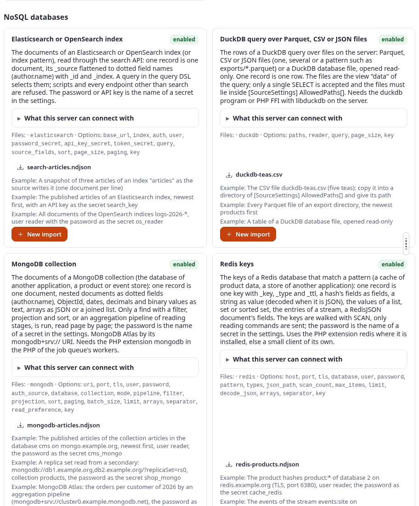

## SQL-Datenbanken (`sql`)

Optionen: [sources.md, SQL-Datenbank oder -Abfrage](sources.md#sql-datenbank-oder--abfrage-sql).

Alle SQL-Beispiele nutzen dieselbe Tabelle `teas` der Beispieldatenbank `share/examples/sql-teas.sqlite` (`id`,
`name`, `origin`, `kind`, `price`, `description`, `updated`), Abfrage, Zuordnung und Ergebnis sind also für jede
Datenbank dieselben. Das **Ziel**: die Tees, die keine Kräutertees sind, als Produkte der Webshop-Klasse `product`.

Die Abfrage:

```sql
SELECT id, name, origin, kind, price, description FROM teas WHERE kind <> 'herbal' ORDER BY id
```

Die Zuordnung (Klasse `product`, zugeordnet über die Remote-ID `sql-tea-{id}`):

| Quellfeld | Attribut | Umwandlungen (einzeilige Kette) |
|---|---|---|
| `name` | `name` | `trim` (Pflicht) |
| `id` | `product_number` | `template(text=TEA-{id})` |
| `description` | `description` | `richtext` |
| `price` | `price` | `template(text="{price}\|1\|1")` (Betrag, MwSt.-Typ 1, Preis enthält MwSt.) |
| `kind` | `tags` | |

### Treiber und der Katalog

Die SQL-Karte des Katalogs listet die Datenbanken, die dieser Server lesen kann, grün mit dem genutzten Treiber. Auf
dem Server der Dokumentation: MySQL oder MariaDB, PostgreSQL und SQLite über PDO, Oracle über `oci8` (und für
benannte Verbindungen über `eZOracleDB` der Erweiterung ezoracle) und SQL Server über `PDO_ODBC` mit FreeTDS:

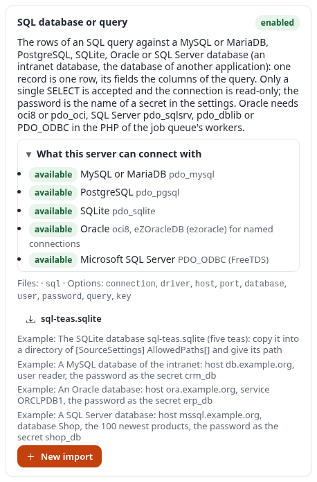

Eine graue Zeile nennt, was der Host braucht ([sources.md](sources.md#sql-datenbank-oder--abfrage-sql), *Treiber*).
Läufe lesen die Worker der Job-Queue, deren PHP sich von dem des Webservers unterscheiden kann; die Liste sagt "in the
workers", wenn nur sie einen Treiber haben.

### SQLite, auf dem Server der Dokumentation ausgeführt

**Ziel:** die vier Tees aus `sql-teas.sqlite`, die keine Kräutertees sind, als Produkte. Dieses Beispiel **lief** auf
dem Server der Dokumentation (Import "Docs: Teas from SQLite (named connection)", Probelauf #156).

**Verbindung.** Exponential 6.0.15 führt Datenbankverbindungen unter Namen in **Setup, Data tables, Connections**. Die
Beispieldatenbank wurde in das SQLite-Verzeichnis der Verbindungen kopiert (`var/datatable`, `[ConnectionSettings]
SQLiteDirectories[]` von `datatable.ini`), und dort wurde eine Verbindung angelegt:

| Feld | Wert |
|---|---|
| Identifier | `docs_teas` |
| Name | `Docs: teas (SQLite example)` |
| Engine | SQLite |
| Database | `var/datatable/docs-sql-teas.sqlite` |
| Password: the name of a secret | leer (eine SQLite-Datei hat keines) |
| More, Read only | an |

**Test connection** auf der Seite der Verbindung antwortete "Connected through ez in 11 ms: 3.34.1, 1 tables":

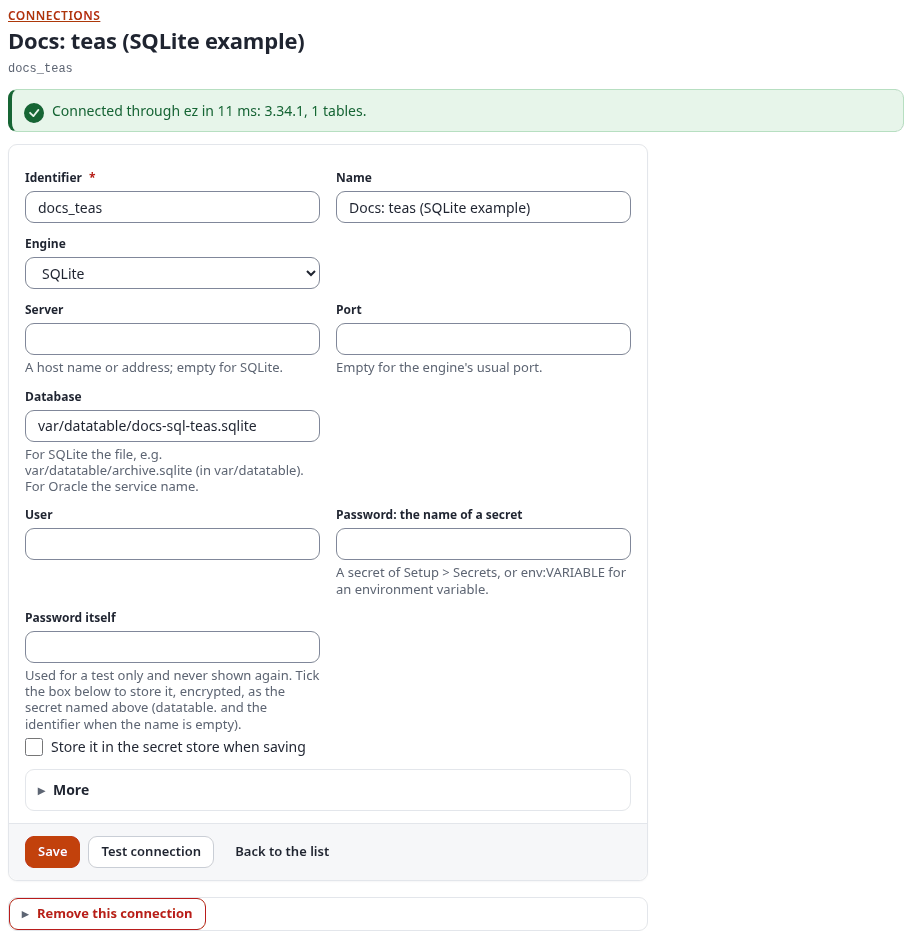

Für eine Verbindung zu MySQL, PostgreSQL, Oracle oder SQL Server nimmt dieselbe Seite Server, Port, Datenbank und
Benutzer, und **Password: the name of a secret** nennt das Geheimnis (mit **Store it in the secret store when saving**
wird ein für den Test eingetipptes Passwort unter diesem Namen gespeichert).

Ohne benannte Verbindung (eine Installation vor 6.0.15) nutzt derselbe Import den Treiber `sqlite` und den Pfad der
Datei als *Database*; die Datei muss dann in `[SourceSettings] AllowedPaths[]` von `sqliimport.ini` liegen.

**Schritte im Editor:**

1. **Importe, Katalog**, Karte *SQL database or query*, **New import**.
2. Name: `Docs: Teas from SQLite (named connection)`.
3. Optionen: *Named connection* `docs_teas`; *Query* die Abfrage oben; *Key column* `id`. Die Felder *Database* bis
   *Password* bleiben leer: Eine benannte Verbindung bringt sie mit.
4. **Verbindung testen**: "The connection works. Its fields: `id`, `name`, `origin`, `kind`, `price`, `description`".
   Darunter stehen die Treiber:

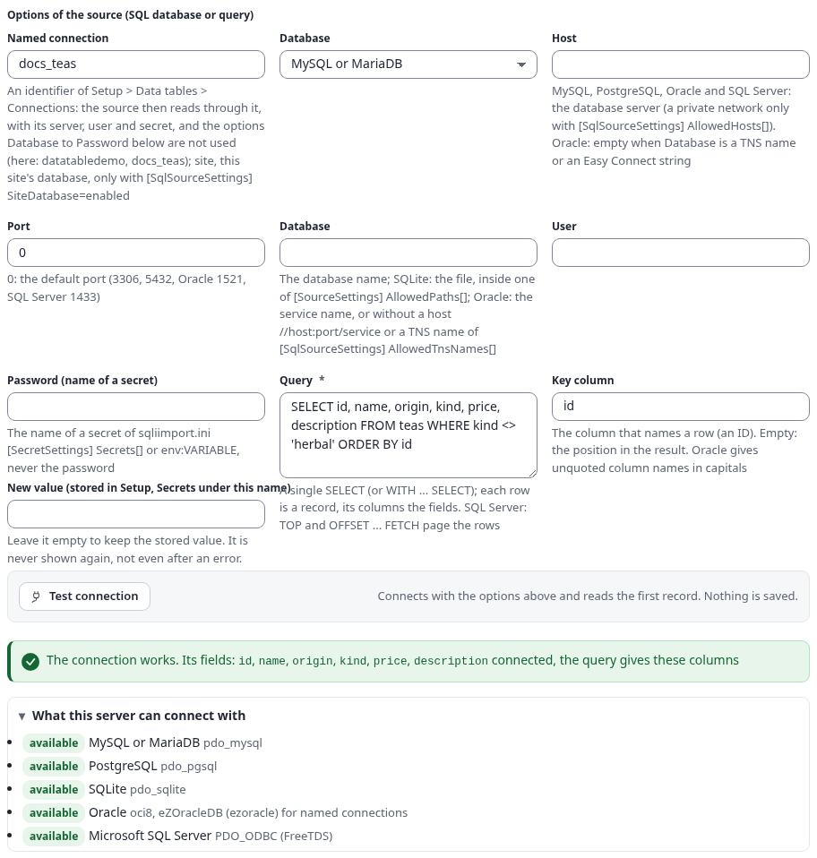

Derselbe Test bei 960 Pixel Breite und doppelter Skalierung:

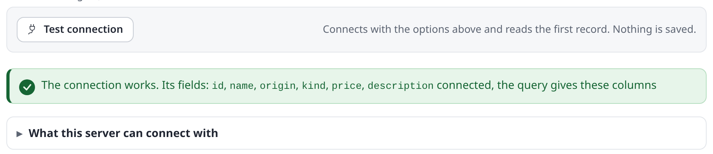

5. **Save and continue**; Schritt **Zuordnung**: die Klasse `product` und die Zeilen der Tabelle oben.
6. Schritt **Vorschau**: Die Stichprobe zeigt die vier Zeilen (Datensatz 4, der Kräutertee Red Bush Evening, ist
   nicht im Ergebnis der Abfrage), und der Probelauf sagt, was aus jeder würde:

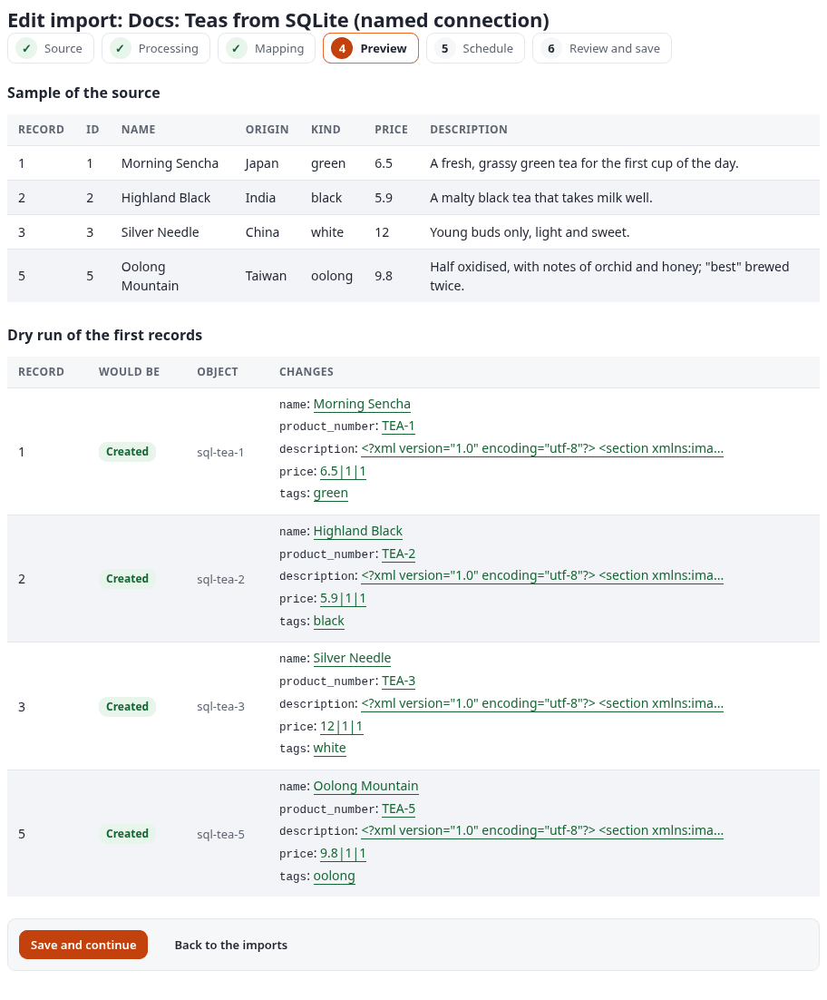

**Was zurückkommt** (die Zeilen, wie die Quelle sie schreibt):

```json
{"id":1,"name":"Morning Sencha","origin":"Japan","kind":"green","price":6.5,"description":"A fresh, grassy green tea for the first cup of the day."}
{"id":2,"name":"Highland Black","origin":"India","kind":"black","price":5.9,"description":"A malty black tea that takes milk well."}
{"id":3,"name":"Silver Needle","origin":"China","kind":"white","price":12,"description":"Young buds only, light and sweet."}
{"id":5,"name":"Oolong Mountain","origin":"Taiwan","kind":"oolong","price":9.8,"description":"Half oxidised, with notes of orchid and honey; \"best\" brewed twice."}
```

**Ergebnis.** Der Probelauf #156: 4 würden angelegt, 0 fehlgeschlagen, nichts veröffentlicht:

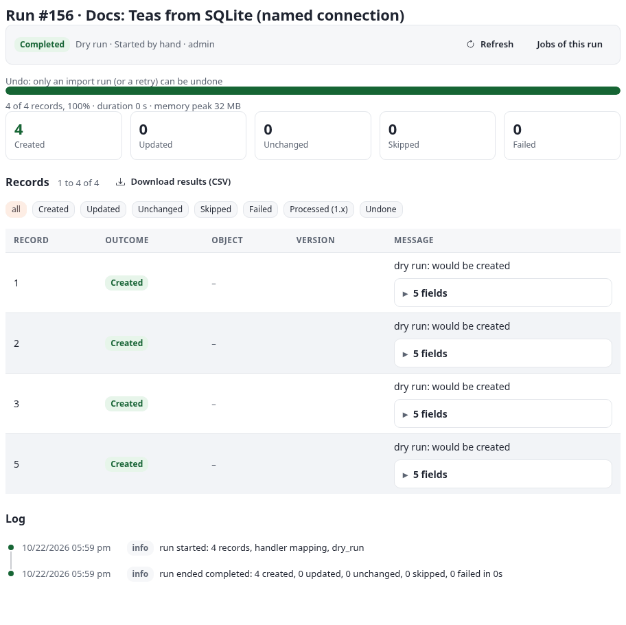

Ein echter Lauf legt die Produkte `sql-tea-1`, `sql-tea-2`, `sql-tea-3` und `sql-tea-5` an (Produktnummern `TEA-1`
..., Preise 6,50, 5,90, 12,00 und 9,80 inklusive MwSt.). Ändert sich ein Preis in der Datenbank, aktualisiert der
nächste Lauf dieses Produkt und lässt die anderen unverändert.

### Die Schreibsperre lehnt ein UPDATE ab

Dasselbe Formular mit der Abfrage

```sql
UPDATE teas SET price = 0 WHERE id = 1
```

wird abgelehnt, bevor etwas die Datenbank erreicht. Der Verbindungstest sagt es, und ein Lauf mit einer solchen
Abfrage hielte mit demselben Grund an:

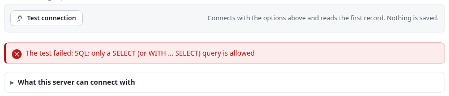

Dasselbe geschieht mit `SELECT ...; DELETE ...`, mit `SELECT ... INTO OUTFILE`, mit `SELECT ... FOR UPDATE` und mit den
anderen Wörtern und Funktionen aus [sources.md](sources.md#sql-datenbank-oder--abfrage-sql). Zusätzlich zur Prüfung
ist die Sitzung selbst schreibgeschützt (SQLite: nur lesend geöffnet mit `PRAGMA query_only`).

### MySQL oder MariaDB

Zur Veranschaulichung: lief nicht gegen einen echten Dienst.

**Ziel:** dieselben Tees aus der Shop-Datenbank eines MySQL-Servers im Intranet.

**Verbindung:** unter Setup, Data tables, Connections, Identifier `shop_mysql`, Engine MySQL / MariaDB, Server
`db.example.invalid`, Datenbank `shop`, Benutzer `import_reader` (ein Benutzer nur mit `SELECT`-Rechten), *Password:
the name of a secret* `shop_db`. Oder, ohne benannte Verbindung, in den Optionen des Imports:

| Option | Wert |
|---|---|
| Database (Treiber) | `mysql` |
| Host, Port | `db.example.invalid`, `0` (3306) |
| Database | `shop` |
| User | `import_reader` |
| Password (name of a secret) | `shop_db` (sein Wert in **New value**) |
| Query | die Abfrage oben |
| Key column | `id` |

Ein Server im Intranet muss in `[SqlSourceSettings] AllowedHosts[]` stehen. Die Sitzung führt `SET SESSION
TRANSACTION READ ONLY` und das Zeitlimit `MAX_EXECUTION_TIME` aus. **Erwartetes Ergebnis:** wie beim SQLite-Beispiel.

### PostgreSQL

Zur Veranschaulichung: lief nicht gegen einen echten Dienst.

Optionen: *Database* `pgsql`, Host `pg.example.invalid`, Datenbank `catalog`, Benutzer `import_reader`, Geheimnis des
Passworts `catalog_db`. PostgreSQL möchte die mit `AS` vergebenen Spaltennamen klein oder in Anführungszeichen:

```sql
SELECT id, name, origin, kind, price::text AS price, description FROM public.teas WHERE kind <> 'herbal' ORDER BY id
```

Die Sitzung führt `SET SESSION CHARACTERISTICS AS TRANSACTION READ ONLY` und `statement_timeout` aus. TimescaleDB wird
genauso gelesen ([sources.md](sources.md#sql-datenbank-oder--abfrage-sql)).

### Microsoft SQL Server

Zur Veranschaulichung: lief nicht gegen einen echten Dienst.

Optionen: *Database* `sqlsrv`, Host `mssql.example.invalid`, Datenbank `Shop`, Benutzer `import_reader` (Rolle
`db_datareader`), Geheimnis des Passworts `shop_db`. T-SQL mit `TOP` und Namen in eckigen Klammern:

```sql
SELECT TOP 100 [Id] AS id, [Name] AS name, [Origin] AS origin, [Kind] AS kind, [Price] AS price, [Description] AS description
FROM [dbo].[Teas] WHERE [Kind] <> 'herbal' ORDER BY [Id]
```

Die Verbindung fragt nach `ApplicationIntent=ReadOnly`; `EXEC`, `SELECT ... INTO`, `sp_...` und Sperrhinweise lehnt
die Prüfung der Abfrage ab.

### Oracle: oci8 und eZOracleDB

Zur Veranschaulichung: lief nicht gegen einen echten Dienst.

Zwei Treiber können Oracle lesen, und der Katalog zeigt, welcher genutzt wird:

- **Die eigenen Optionen der SQL-Quelle** (Host, Dienstname, Benutzer, Geheimnis) verbinden sich über die
  PHP-Erweiterung **oci8** (sonst `pdo_oci`; `[SqlSourceSettings] OracleDriver`), in einer eigenen Verbindung mit
  `SET TRANSACTION READ ONLY`, die nie bestätigt (committed) wird.
- **Eine benannte Verbindung** mit der Engine Oracle öffnet der Kernel: bei aktiver Erweiterung **ezoracle** über
  deren Handler **eZOracleDB**, sonst über PDO `oci`. Der Import nennt dann nur die Verbindung.

Optionen ohne benannte Verbindung: *Database* `oracle`, Host `ora.example.invalid`, Port `1521`, Datenbank (der
Dienstname) `ORCLPDB1`, Benutzer `IMPORT_READER` (`CREATE SESSION` und `SELECT` auf die Tabelle), Geheimnis des
Passworts `erp_db`. Oracle gibt Namen ohne Anführungszeichen in Großbuchstaben, darum die Spalten benennen:

```sql
SELECT id AS "id", name AS "name", origin AS "origin", kind AS "kind", TO_CHAR(price, 'FM9990.00') AS "price", description AS "description"
FROM shop.teas WHERE kind <> 'herbal' ORDER BY id
```

Easy Connect (`//ora.example.invalid:1521/ORCLPDB1` als *Database*, kein Host) geht ebenfalls, ein TNS-Name nur, wenn
er in `[SqlSourceSettings] AllowedTnsNames[]` steht.

## MongoDB (`mongodb`)

Optionen: [sources.md, MongoDB-Collection](sources.md#mongodb-collection-mongodb). Zur Veranschaulichung: lief nicht
gegen einen echten Dienst.

**Ziel:** die veröffentlichten Artikel einer Redaktionsdatenbank auf MongoDB Atlas, die neuesten zuerst.

**Geheimnis:** `mongo_reader`, das Passwort des Datenbankbenutzers `reader` (Rolle `read` auf die Datenbank
`newsroom`).

**Mit einer Suche (find)**, dem Standardmodus:

| Option | Wert |
|---|---|
| Server or URI | `mongodb+srv://cluster0.example.invalid/?retryWrites=true&w=majority` (ohne Benutzer und Passwort) |
| TLS | an (`mongodb+srv://` nutzt es immer) |
| User | `reader` |
| Password (name of a secret) | `mongo_reader` |
| Authentication database | `admin` |
| Database, Collection | `newsroom`, `articles` |
| Read | A find |
| Filter (JSON) | `{"status": "published"}` |
| Sort (JSON) | `{"published_at": -1}` |
| Paging | `skip` (nötig für eine andere Sortierung als `_id`) |
| Arrays | verbunden (`join`) |
| Key field | `_id` |

**Mit einer Aggregation** (*Read*: an aggregation): Filter, Projektion und Sortierung werden Stufen der Pipeline, und
das Blättern wird `cursor`:

```json
[{"$match": {"status": "published"}}, {"$sort": {"published_at": -1}},
 {"$project": {"title": 1, "intro": 1, "body": 1, "author.name": 1, "tags": 1, "published_at": 1}}]
```

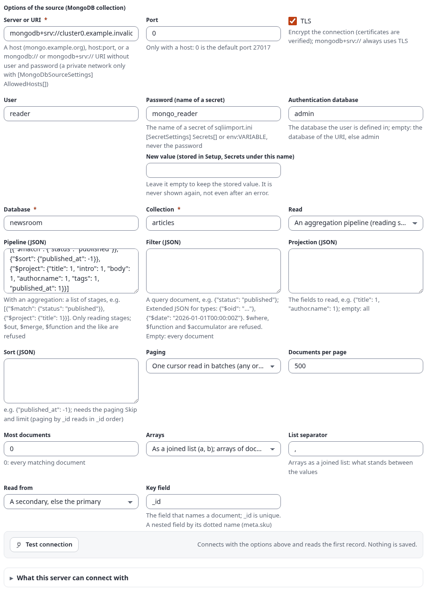

**Was zurückkommt** (`share/examples/mongodb-articles.ndjson`, das erste Dokument, abgeflacht):

```json
{"_id":"6717a1f0c2d4e5f601234561","title":"Green tea harvest begins","intro":"The first flush of the season is in.","body":"<p>Picking started this week in the high gardens.</p>","status":"published","author.name":"Editorial team","author.desk":"news","tags":"tea, harvest","published_at":"2026-04-02T08:30:00Z","price":"12.50","views":1450}
```

| Quellfeld | Attribut (`article`) | Umwandlungen |
|---|---|---|
| `title` | `title` | `trim` |
| `intro` | `intro` | `richtext` |
| `body` | `body` | `richtext` |
| `author.name` | `author` | |
| `published_at` | `publish_date` (wo die Klasse es hat) | `date` |

Zuordnen über `mongo-{_id}`. **Erwartetes Ergebnis:** drei Artikel; ein späterer Lauf aktualisiert die geänderten.

**`$out` wird abgelehnt.** Eine Pipeline, die schreibt, etwa `[{"$match": {...}}, {"$out": "articles_copy"}]`, wird
mit "MongoDB: the pipeline contains $out, only reading is allowed ($where, $function, $accumulator, $out and $merge
are refused)" abgelehnt, ebenso `$merge`, `$where` und `$function` in jeder Tiefe. Zuerst werden die Hosts geprüft:
Mit dem Platzhalter-Host dieser Seite hält der Verbindungstest schon bei der Adresse an, hier im dunklen Modus:

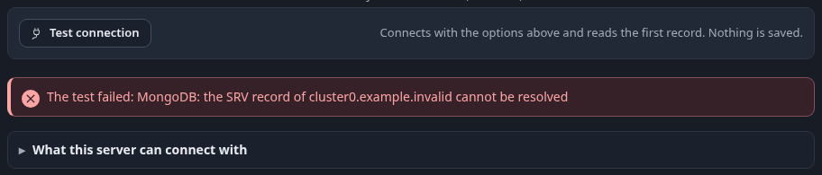

## Redis (`redis`)

Optionen: [sources.md, Redis-Schlüssel](sources.md#redis-schlüssel-redis). Zur Veranschaulichung: lief nicht gegen
einen echten Dienst.

**Ziel:** die Produkt-Hashes `product:*` eines Caches als Produkte.

**Geheimnis:** `redis_reader`, das Passwort des ACL-Benutzers `reader` (`ACL SETUSER reader on >... ~product:* +@read`).

| Option | Wert |
|---|---|
| Host, Port | `redis.example.invalid`, `6379` |
| TLS | an |
| User | `reader` |
| Password | `redis_reader` |
| Pattern | `product:*` |
| Types | `hash` |
| Key field | `_key` |

Die Quelle geht die Schlüssel mit `SCAN ... MATCH product:*` durch (nie `KEYS`) und liest jeden mit `HGETALL`. Auszug
aus `share/examples/redis-products.ndjson`:

```json
{"_key":"product:1001","_type":"hash","_ttl":-1,"sku":"TEA-SENCHA-100","name":"Sencha","price":"9.90","stock":"42"}
```

Zuordnung (`product`): `name` nach `name`, `sku` nach `product_number`, `price` nach `price`
(`template(text="{price}|1|1")`). Zuordnen über `redis-{sku}`. **Erwartetes Ergebnis:** ein Produkt je Hash.

## Elasticsearch oder OpenSearch (`elasticsearch`)

Optionen: [sources.md, Elasticsearch- oder OpenSearch-Index](sources.md#elasticsearch--oder-opensearch-index-elasticsearch).
Zur Veranschaulichung: lief nicht gegen einen echten Dienst.

**Ziel:** die veröffentlichten Artikel eines Suchindex, die neuesten zuerst.

**Geheimnis:** `search_api_key`, der kodierte API-Schlüssel mit dem Recht `read` auf `articles`.

| Option | Wert |
|---|---|
| Address | `https://search.example.invalid:9200` |
| Index | `articles` |
| Authentication | `api_key` |
| API key secret | `search_api_key` |
| Query | `{"query": {"term": {"status": "published"}}, "sort": [{"published_at": "desc"}]}` |
| Source fields | `title`, `body`, `author.*`, `published_at`, `tags` |
| Paging | `auto` |
| Key field | `_id` |

Auszug aus `share/examples/search-articles.ndjson`:

```json
{"_id":"a-1001","_index":"articles","title":"Green tea harvest begins","body":"<p>The first flush of the year is picked in the hills.</p>","author.name":"Editorial team","published_at":"2026-04-02T08:00:00Z","status":"published","tags":["tea","harvest"]}
```

Zuordnung (`article`): `title` nach `title`, `body` nach `body` und `intro` (`richtext`), `tags` nach `tags`
(`join(separator=", ")`). Zuordnen über `es-{_id}`. **Erwartetes Ergebnis:** drei Artikel. Eine Abfrage mit `aggs`
oder einem Skript wird abgelehnt.

## CouchDB (`couchdb`) und Couchbase (`couchbase`)

Optionen: [CouchDB](sources.md#couchdb-datenbank-couchdb), [Couchbase](sources.md#couchbase-abfrage-couchbase). Zur
Veranschaulichung: lief nicht gegen einen echten Dienst.

**Ziel bei CouchDB:** die veröffentlichten Artikel einer Datenbank über eine Mango-Abfrage. **Geheimnis:**
`couch_reader` (ein Mitglied der Datenbank, kein Admin).

| Option | Wert |
|---|---|
| Address | `https://couch.example.invalid:6984` |
| Database | `articles` |
| Authentication | `cookie`, Benutzer `reader`, Geheimnis des Passworts `couch_reader` |
| Mode | `mango` |
| Selector | `{"type": "article", "status": "published"}` |
| Sort | `[{"published_at": "desc"}]` |

Auszug (`share/examples/couchdb-articles.ndjson`):

```json
{"_id":"article-2001","_rev":"3-9c1f0e2b7a4d5e6f8091a2b3c4d5e6f7","type":"article","title":"Spring tea tasting","status":"published","author.name":"Tasting desk","published_at":"2026-03-12T09:00:00Z","tags":"[\"tea\",\"tasting\"]"}
```

Zuordnung: `title` nach `title`, `published_at` nach `publish_date` (`date`). Zuordnen über `couch-{_id}`.
**Erwartetes Ergebnis:** drei Artikel.

**Ziel bei Couchbase:** die aktiven Produkte eines Buckets über SQL++. **Geheimnis:** `couchbase_reader` (Rolle Query
Select).

| Option | Wert |
|---|---|
| Query service | `https://cb.example.invalid:18093` |
| User, Password secret | `reader`, `couchbase_reader` |
| Statement | ``SELECT META(p).id AS id, p.sku, p.name, p.price, p.stock FROM `shop`.`inventory`.`products` AS p WHERE p.active = true ORDER BY p.sku`` |
| Paging | `keyset`, Feld `sku` |
| Key field | `sku` |

Auszug (`share/examples/couchbase-products.ndjson`):

```json
{"sku":"TEA-301","name":"Sencha Asamushi","price":8.9,"active":true,"stock.store":14,"stock.warehouse":120,"tags":"[\"green\",\"japan\"]"}
```

Jede Anfrage trägt `readonly=true`, der Query-Dienst selbst lehnt also eine schreibende Anweisung ab. Zuordnung
(`product`): `name`, `sku` nach `product_number`, `price` (`template(text="{price}|1|1")`). **Erwartetes Ergebnis:**
drei Produkte.

## Amazon DynamoDB (`dynamodb`)

Optionen: [sources.md, Amazon-DynamoDB-Tabelle](sources.md#amazon-dynamodb-tabelle-dynamodb). Zur Veranschaulichung:
lief nicht gegen einen echten Dienst.

**Ziel:** die Produkte einer DynamoDB-Tabelle, die weniger als 20 kosten.

**Geheimnis:** `dynamo_reader_secret`, der geheime Zugriffsschlüssel eines IAM-Benutzers, dessen Richtlinie nur `Scan`,
`Query` und `DescribeTable` auf die Tabelle erlaubt (die Richtlinie steht in sources.md).

| Option | Wert |
|---|---|
| Region | `eu-central-1` |
| Access key ID | `AKIAEXAMPLEREPLACE01` |
| Secret access key | `dynamo_reader_secret` |
| Table | `products` |
| Operation | `scan` |
| Filter | `#s = :p AND price < :max` |
| Names | `{"#s": "status"}` |
| Values | `{":p": {"S": "published"}, ":max": {"N": "20"}}` |
| Key field | `sku` |

Auszug (`share/examples/dynamodb-products.ndjson`):

```json
{"sku":"tea-1001","title":"Sencha Morning","price":"12.50","in_stock":true,"tags":"green, japan","dimensions.weight_g":"100","dimensions.box":"tin","variants":"[{\"size\":\"50g\",\"price\":\"6.90\"},{\"size\":\"100g\",\"price\":\"12.50\"}]","discontinued":null}
```

Zuordnung (`product`): `title` nach `name`, `sku` nach `product_number`, `price` nach `price`
(`template(text="{price}|1|1")`), `tags` nach `tags`. Zuordnen über `dynamo-{sku}`. **Erwartetes Ergebnis:** drei
Produkte. Zahlen bleiben Dezimaltext (`12.50`).

## Firestore (`firestore`)

Optionen: [sources.md, Firestore-Collection](sources.md#firestore-collection-firestore). Zur Veranschaulichung: lief
nicht gegen einen echten Dienst.

**Ziel:** die veröffentlichten Artikel einer Firestore-Collection.

**Geheimnis:** `firestore_reader`, der JSON-Schlüssel eines Dienstkontos mit der Rolle *Cloud Datastore Viewer*
(`roles/datastore.viewer`); die ganze Schlüsseldatei ist der Wert des Geheimnisses.

| Option | Wert |
|---|---|
| Project | `example-tea-project` |
| Service account key | `firestore_reader` |
| Mode | `query` |
| Collection | `articles` |
| Where | `{"fieldFilter": {"field": {"fieldPath": "status"}, "op": "EQUAL", "value": {"stringValue": "published"}}}` |
| Order by | `published_at:desc` |
| Key field | `_id` |

Auszug (`share/examples/firestore-articles.ndjson`):

```json
{"_id":"a-2001","_path":"articles/a-2001","title":"Brewing green tea","status":"published","views":1250,"rating":4.6,"published_at":"2026-02-01T09:00:00Z","author.name":"Tea desk","author.ref":"authors/au-1","tags":"[\"green\",\"brewing\"]","location":"48.137,11.575"}
```

Zuordnung: `title` nach `title`, `author.name` nach `author`, `published_at` nach `publish_date` (`date`). Zuordnen über
`firestore-{_id}`. **Erwartetes Ergebnis:** drei Artikel.

## Azure Cosmos DB (`cosmosdb`)

Optionen: [sources.md, Azure-Cosmos-DB-Container](sources.md#azure-cosmos-db-container-cosmosdb). Zur
Veranschaulichung: lief nicht gegen einen echten Dienst.

**Ziel:** die offenen Bestellungen eines Cosmos-DB-Containers (API for NoSQL) als Liste für das Shop-Team.

**Geheimnis:** `cosmos_readonly_key`, der **nur lesende** Schlüssel des Kontos (Keys, Read-only keys).

| Option | Wert |
|---|---|
| Endpoint | `https://example-tea.documents.azure.com` |
| Database, Container | `shop`, `orders` |
| Authentication | `master_key` |
| Key secret | `cosmos_readonly_key` |
| Query | `SELECT c.id, c.customer.id, c.status, c.total, c.currency, c.lines FROM c WHERE c.status = 'open'` |
| Key field | `id` |

Auszug (`share/examples/cosmosdb-orders.ndjson`):

```json
{"id":"order-5001","customer.id":"c-17","status":"open","total":"42.80","currency":"EUR","lines":"[{\"sku\":\"TEA-301\",\"qty\":2},{\"sku\":\"TEA-302\",\"qty\":1}]","_ts":1775118600}
```

Zuordnung in eine Datentabelle oder einen `folder` je Bestellung: `id` nach `name`, `total` nach `short_name`. Die
E-Mail-Adresse des Kunden im Schnappschuss ist ein personenbezogenes Datum: nicht zuordnen. **Erwartetes Ergebnis:**
drei Datensätze. Ein Cosmos-DB-Konto der API for MongoDB wird stattdessen mit der MongoDB-Quelle gelesen.

## Cassandra oder ScyllaDB (`cassandra`)

Optionen: [sources.md, Cassandra- oder ScyllaDB-Abfrage](sources.md#cassandra--oder-scylladb-abfrage-cassandra). Zur
Veranschaulichung: lief nicht gegen einen echten Dienst.

**Ziel:** die Verkostungen eines Tages aus einer Cassandra-Tabelle.

**Geheimnis:** `cassandra_reader` (eine Rolle mit `SELECT` auf den Keyspace).

| Option | Wert |
|---|---|
| Hosts | `cassandra1.example.invalid, cassandra2.example.invalid:9142` |
| TLS | an |
| User, Password secret | `reader`, `cassandra_reader` |
| Keyspace | `events` |
| Query | `SELECT event_id, day, kind, title, starts_at, seats, price, tags FROM events_by_day WHERE day = '2026-05-04'` |
| Consistency | `LOCAL_QUORUM` |
| Key field | `event_id` |

Auszug (`share/examples/cassandra-events.ndjson`):

```json
{"event_id":"5b6e0f2a-1c3d-11f0-8de9-0242ac120002","day":"2026-05-04","kind":"tasting","title":"Spring tasting","starts_at":"2026-05-04T16:00:00Z","seats":24,"price":"15.00","tags":"[\"green\",\"tasting\"]","venue.city":"Example City"}
```

Zuordnung: `title` nach `title`, `starts_at` nach `publish_date` (`date`). Zuordnen über `cassandra-{event_id}`.
**Erwartetes Ergebnis:** drei Veranstaltungen. ScyllaDB wird genauso gelesen.

## Neo4j oder Memgraph (`neo4j`)

Optionen: [sources.md, Neo4j und Memgraph](sources.md#neo4j-und-memgraph-neo4j). Zur Veranschaulichung: lief nicht
gegen einen echten Dienst.

**Ziel:** die veröffentlichten Artikel-Knoten eines Graphen, mit ihren Schlagwörtern.

**Geheimnis:** `neo4j_reader` (ein Benutzer mit der Rolle reader).

| Option | Wert |
|---|---|
| Server | `neo4j` (oder `memgraph`, nur Bolt) |
| Address | `https://graph.example.invalid:7473` (oder `neo4j+s://graph.example.invalid:7687`) |
| Database | `neo4j` |
| User, Password secret | `reader`, `neo4j_reader` |
| Query | `MATCH (a:Article {status: $status}) RETURN a ORDER BY a.published_at DESC` |
| Parameters | `{"status": "published"}` |
| Key field | `id` |

Auszug (`share/examples/neo4j-articles.ndjson`):

```json
{"_element_id":"4:0f2c9a1e-7b3d-4c55-9e01-5a6b7c8d9e0f:11","_labels":["Article"],"id":"art-11","title":"Brewing green tea at the right temperature","status":"published","published_at":"2026-03-02T09:00:00Z","tags":["tea","brewing"]}
```

Zuordnung: `title` nach `title`, `tags` nach `tags` (`join(separator=", ")`). Zuordnen über `graph-{id}`. Eine Abfrage
mit `CREATE`, `MERGE`, `SET` oder `DELETE` wird abgelehnt. **Erwartetes Ergebnis:** drei Artikel.

## ArangoDB (`arangodb`)

Optionen: [sources.md, ArangoDB](sources.md#arangodb-arangodb). Zur Veranschaulichung: lief nicht gegen einen echten
Dienst.

**Ziel:** die veröffentlichten Artikel einer ArangoDB-Collection.

**Geheimnis:** `arango_reader` (ein Benutzer mit Lesezugriff auf die Datenbank).

| Option | Wert |
|---|---|
| Address | `https://arango.example.invalid:8529` |
| Database | `newsroom` |
| Authentication | `basic`, Benutzer `reader`, Geheimnis des Passworts `arango_reader` |
| Query | `FOR a IN articles FILTER a.status == @status SORT a.published_at DESC RETURN a` |
| Bind variables | `{"status": "published"}` |
| Key field | `_key` |

Auszug (`share/examples/arangodb-articles.ndjson`):

```json
{"_key":"1001","_id":"articles/1001","_rev":"_hX2kQ3a---","title":"A guide to white tea","status":"published","author.name":"Tea desk","tags":["white tea","guide"],"published_at":"2026-02-11T08:30:00Z"}
```

Zuordnung: `title` nach `title`, `author.name` nach `author`. Zuordnen über `arango-{_key}`. `INSERT`, `UPDATE`,
`REPLACE`, `REMOVE` und `UPSERT` werden abgelehnt. **Erwartetes Ergebnis:** drei Artikel.

## ClickHouse (`clickhouse`)

Optionen: [sources.md, ClickHouse](sources.md#clickhouse-clickhouse). Zur Veranschaulichung: lief nicht gegen einen
echten Dienst.

**Ziel:** die meistgelesenen Seiten von gestern aus einer ClickHouse-Tabelle der Seitenaufrufe, als Liste "meistgelesen".

**Geheimnis:** `clickhouse_reader` (ein Benutzer mit gesetztem `readonly`).

| Option | Wert |
|---|---|
| Address | `https://clickhouse.example.invalid:8443` |
| Database | `analytics` |
| User, Password secret | `reader`, `clickhouse_reader` |
| Query | `SELECT concat(toString(day), ':', path) AS id, path, day, count() AS views, uniq(visitor) AS visitors FROM page_views WHERE day = yesterday() GROUP BY day, path ORDER BY views DESC LIMIT 20` |
| Read-only | `2` |
| Key field | `id` |

Auszug (`share/examples/clickhouse-page-views.ndjson`):

```json
{"id":"2026-05-01:/tea/green","path":"/tea/green","day":"2026-05-01","views":412,"visitors":"388"}
```

Die Zeilen gehören am besten in eine Datentabelle (Ziel *Rows of a data table*); mit einer Zuordnung `path` nach
`name` und `views` in ein Zahlenattribut. **Erwartetes Ergebnis:** bis zu zwanzig Zeilen, täglich durch einen Zeitplan
erneuert.

## BigQuery (`bigquery`)

Optionen: [sources.md, BigQuery-Abfrage](sources.md#bigquery-abfrage-bigquery). Zur Veranschaulichung: lief nicht
gegen einen echten Dienst.

**Ziel:** die bezahlten Bestellungen der letzten Woche aus BigQuery.

**Geheimnis:** `bigquery_reader`, der JSON-Schlüssel eines Dienstkontos mit `roles/bigquery.jobUser` auf dem Projekt
und `roles/bigquery.dataViewer` auf dem Dataset.

| Option | Wert |
|---|---|
| Project | `example-tea-project` |
| Service account key | `bigquery_reader` |
| Location | `EU` |
| Query | ``SELECT order_id, customer.name AS customer_name, customer.country, total, created_at, paid FROM `example-tea-project.shop.orders` WHERE paid AND created_at > TIMESTAMP_SUB(CURRENT_TIMESTAMP(), INTERVAL 7 DAY) ORDER BY created_at`` |
| Maximum bytes billed | `0` (die 1 GiB der Einstellung) |
| Key field | `order_id` |

Der Verbindungstest ist ein kostenloser Probelauf, der die Spalten und die Bytes zeigt, die die Abfrage verarbeiten
würde. Auszug (`share/examples/bigquery-orders.ndjson`):

```json
{"order_id":"9000001","customer.country":"DE","total":"42.30","created_at":"2026-04-02T08:30:00Z","items":"[{\"sku\":\"tea-1001\",\"qty\":\"2\"},{\"sku\":\"tea-1002\",\"qty\":\"1\"}]","paid":true}
```

**Erwartetes Ergebnis:** ein Datensatz je Bestellung; `NUMERIC` bleibt Dezimaltext (`42.30`).

## Snowflake (`snowflake`)

Optionen: [sources.md, Snowflake](sources.md#snowflake-snowflake). Zur Veranschaulichung: lief nicht gegen einen
echten Dienst.

**Ziel:** die Bestellungen eines Snowflake-Warehouses.

**Geheimnisse:** `snowflake_key`, der private PEM-Schlüssel des Schlüsselpaars des Benutzers (und
`snowflake_key_passphrase`, wenn der Schlüssel verschlüsselt ist).

| Option | Wert |
|---|---|
| Account | `exampleorg-teaaccount` |
| User | `IMPORT_READER` |
| Private key secret | `snowflake_key` |
| Warehouse, Database, Schema, Role | `READ_WH`, `SHOP`, `PUBLIC`, `READER` |
| Query | `SELECT order_id, customer_ref, total, ordered_at, items FROM orders WHERE ordered_at >= DATEADD(day, -7, CURRENT_TIMESTAMP()) ORDER BY order_id` |
| Key field | `ORDER_ID` (Snowflake benennt Spalten in Großbuchstaben) |

Auszug (`share/examples/snowflake-orders.ndjson`):

```json
{"ORDER_ID":"1001","CUSTOMER_REF":"C-0042","TOTAL":"48.50","ORDERED_AT":"2026-04-01T10:15:00Z","ITEMS":[{"sku":"TEA-GRN-100","qty":2},{"sku":"TEA-OOL-50","qty":1}]}
```

**Erwartetes Ergebnis:** drei Datensätze; zugeordnet werden sie über ihre Namen in Großbuchstaben (`ORDER_ID`, `TOTAL`).

## InfluxDB (`influxdb`)

Optionen: [sources.md, InfluxDB](sources.md#influxdb-influxdb). Zur Veranschaulichung: lief nicht gegen einen echten
Dienst.

**Ziel:** Temperatur und Luftfeuchte des Teelagers stündlich, eine Zeile je Zeitpunkt.

**Geheimnis:** `influx_read_token`, ein API-Token mit Lesezugriff auf den Bucket.

| Option | Wert |
|---|---|
| Address | `https://influx.example.invalid:8086` |
| Language | `flux` |
| Organization | `example-tea` |
| Authentication | `token`, Geheimnis `influx_read_token` |
| Query | `from(bucket: "climate") \|> range(start: -1d) \|> filter(fn: (r) => r._measurement == "climate" and r.room == "store") \|> aggregateWindow(every: 1h, fn: mean)` |
| Pivot | an (eine Zeile je Zeitpunkt mit einer Spalte je Feld) |

Auszug (`share/examples/influxdb-climate.ndjson`):

```json
{"_start":"2026-06-01T00:00:00Z","_stop":"2026-06-02T00:00:00Z","_time":"2026-06-01T08:00:00Z","_measurement":"climate","room":"store","humidity":48.5,"temperature":19.2}
```

**Erwartetes Ergebnis:** vierundzwanzig Zeilen am Tag, am besten in einer Datentabelle. InfluxQL (`language`
`influxql`) geht mit einem `SELECT` gegen InfluxDB 1.x.

<a id="duckdb"></a>

## DuckDB über Parquet oder CSV (`duckdb`)

Optionen: [sources.md, DuckDB-Abfrage über Dateien](sources.md#duckdb-abfrage-über-dateien-duckdb).

**Ziel:** die Tees eines nächtlichen Exports, den ein anderes System als Parquet-Dateien schreibt, oder die
Beispiel-CSV.

**Geheimnis:** keines; die Dateien müssen in `[SourceSettings] AllowedPaths[]` liegen (zum Beispiel `var/import`).

**Auf dem Server der Dokumentation nicht ausgeführt:** Er hat weder das Programm duckdb noch PHP FFI mit libduckdb,
und der Katalog sagt das in Grau, mit dem, was der Host braucht:

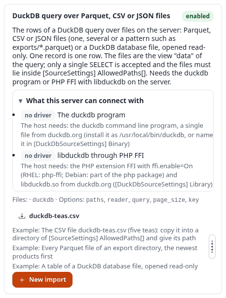

| Option | Wert (Parquet) | Wert (das CSV-Beispiel) |
|---|---|---|
| Files | `var/import/exports/teas-*.parquet` | `var/import/duckdb-teas.csv` |
| File type | `parquet` | `auto` (nach dem Namen) |
| Query | `SELECT id, name, origin, kind, price FROM data WHERE kind <> 'herbal' ORDER BY id` | dieselbe |
| Page size | `10000` | `10000` |
| Key column | `id` | `id` |

Die Dateien sind die Sicht `data` der Abfrage; ein Muster liest jede passende Datei als eine Tabelle.

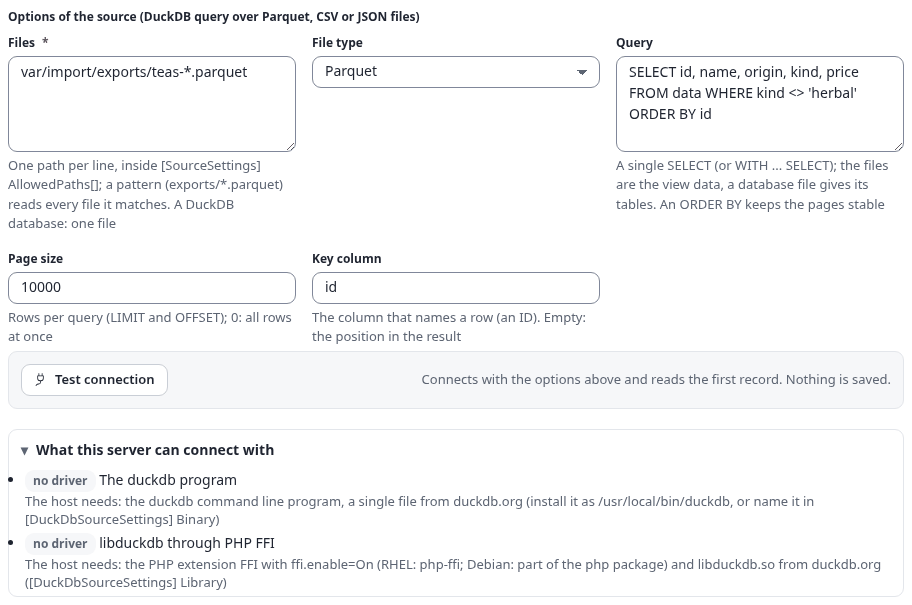

Die Beispieldatei `share/examples/duckdb-teas.csv`:

```
id,name,origin,kind,price
1,Sencha,Japan,green,6.50
2,Darjeeling First Flush,India,black,9.80
3,Tie Guan Yin,China,oolong,8.20
4,Rooibos,South Africa,herbal,4.10
5,Gyokuro,Japan,green,14.00
```

Zuordnung (`product`): `name` nach `name`, `id` nach `product_number` (`template(text=TEA-{id})`), `price` nach `price`
(`template(text="{price}|1|1")`). **Erwartetes Ergebnis:** vier Produkte (Rooibos ist ein Kräutertee). Eine Abfrage
mit `COPY`, `ATTACH`, `read_csv(...)` oder `FROM 'andere.csv'` wird abgelehnt: Die Abfrage liest nur die Dateien des
Imports.

## LDAP oder Active Directory (`ldap`)

Optionen: [sources.md, LDAP-Verzeichnis](sources.md#ldap-verzeichnis-ldap). Zur Veranschaulichung: lief nicht gegen
einen echten Dienst.

**Ziel:** das Mitarbeiterverzeichnis als Kontaktseiten: Name, Funktion und E-Mail-Adresse von allen unter `ou=Staff`.

**Geheimnis:** `ldap_reader`, das Passwort des Dienstkontos `cn=reader,ou=Services,dc=example,dc=org` (Lesezugriff
nur auf `ou=Staff`).

| Option | Wert |
|---|---|
| URI | `ldaps://ldap.example.invalid` (Active Directory: `ldaps://dc1.example.invalid`) |
| Bind DN | `cn=reader,ou=Services,dc=example,dc=org` (Active Directory auch `reader@example.invalid`) |
| Password | `ldap_reader` |
| Base DN | `ou=Staff,dc=example,dc=org` |
| Filter | `(&(objectClass=inetOrgPerson)(title=*))` (Active Directory: `(&(objectCategory=person)(objectClass=user)(!(userAccountControl:1.2.840.113556.1.4.803:=2)))`, die aktiven Benutzer) |
| Attributes | `uid`, `cn`, `givenName`, `sn`, `mail`, `title` (eines pro Zeile) |
| Scope | `sub` |
| Page size | `500` |
| Key field | `uid` (Active Directory: `objectGUID_text`) |

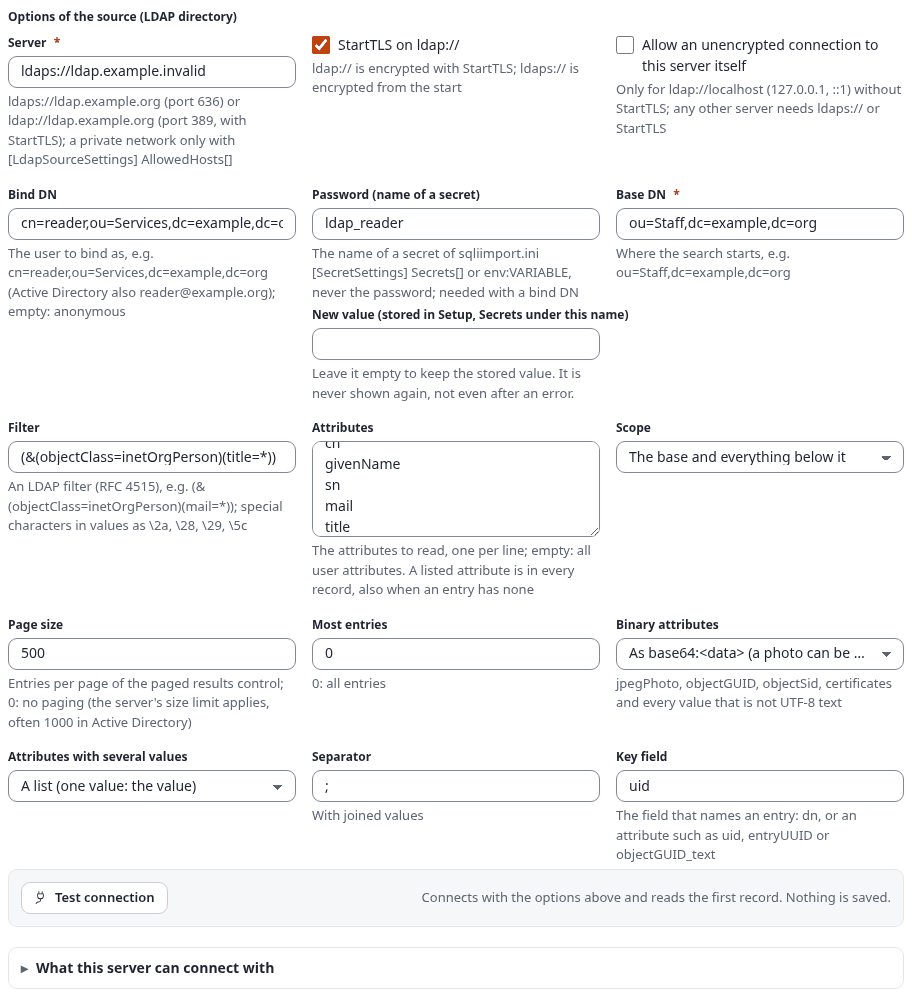

Auszug (`share/examples/ldap-staff.ndjson`, erfundene Einträge):

```json
{"dn":"uid=sample.one,ou=Staff,dc=example,dc=org","uid":"sample.one","cn":"Sample One","givenName":"Sample","sn":"One","mail":"sample.one@example.invalid","title":"Editor"}
```

Zuordnung (eine Kontaktklasse oder `folder`): `cn` nach `name`, `title` nach `short_name`. Das sind
**personenbezogene Daten**: Ordnen Sie nur zu, was die Website zeigen darf. Zuordnen über `ldap-{uid}`. **Erwartetes
Ergebnis:** ein Objekt je Person; wer das Verzeichnis verlässt, wird nicht mehr gelesen (solche Objekte von Hand oder
mit einem Rückgängigmachen entfernen).

## Siehe auch

- [Durchgespielte Beispiele: APIs und gehostete Dienste](source-examples-apis.md)
- [Durchgespielte Beispiele: Plattformen, Handel und Dokumente](source-examples-platforms.md)
- [Quellen](sources.md), [Der Import-Editor](editor.md), [Zuordnungen](mappings.md), [Läufe](runs.md)
