# Durchgespielte Beispiele: Feeds und Webseiten

Diese Seite zeigt für jede Quelle von 7x SQLI Import, die Feeds oder Webseiten liest, einen vollständigen Import:
RSS- und Atom-Feeds, Podcast-Feeds mit ihren Folgen, YouTube- und Vimeo-Kanal-Feeds, die YouTube Data API, den
Opt-in-Scraper für youtube.com-Seiten, die Seiten einer Website über ihre Sitemap und den Webseiten-Scraper mit CSS-
und XPath-Picks. Jedes Beispiel sagt, was es erreicht, zeigt echte Zeilen der Beispieldatei, die genauen Werte für
den Import-Editor, die Zeilen der Zuordnung und was der Probelauf oder der Lauf ergab, mit Bildschirmfotos vom Server
der Dokumentation.

Jede Option beschreibt [sources.md](sources.md); jedes Beispiel verlinkt auf seinen Abschnitt dort. Die anderen
durchgespielten Beispiele: [Dateien](source-examples-files.md), [Datenbanken](source-examples-databases.md),
[APIs und gehostete Dienste](source-examples-apis.md) und
[Plattformen, Handel und Dokumente](source-examples-platforms.md). Englisch:
[../source-examples-feeds-web.md](../source-examples-feeds-web.md).

**Was lief, und was nicht abgerufen wurde.** Den News-Feed von php.net liest der Demo-Import „Demo: PHP news (Atom
feed)“ alle zehn Minuten von seiner öffentlichen Adresse. Jedes andere Beispiel lief als Probelauf eines Imports
namens „Docs: ...“, mit der Beispieldatei des Katalogs (`share/examples/`) als Upload statt der Netzadresse; für dieses
Handbuch wurde also keine Website gecrawlt. Eine so hochgeladene Sitemap- oder Webseiten-Datei wird ohne jede Anfrage
gelesen; das Beispiel der YouTube Data API dient **zur Veranschaulichung: Es lief nicht gegen ein echtes Konto**,
seine Datensätze sind der Schnappschuss des Katalogs mit drei erfundenen Videos.

Die Beschriftungen der Oberfläche stehen hier so, wie die Administration sie zeigt (in Englisch).

## Inhalt

- [So funktionieren die Feed- und Web-Beispiele](#so-funktionieren-die-feed--und-web-beispiele)
- [RSS und Atom (`rss`)](#rss-und-atom-rss)
  - [Eine Feed-Adresse, bei jedem Lauf gelesen](#eine-feed-adresse-bei-jedem-lauf-gelesen)
  - [Eine RSS-Datei](#eine-rss-datei)
- [Podcast-Feed (`podcast`)](#podcast-feed-podcast)
- [YouTube-Kanal-Feed (`video_feed`)](#youtube-kanal-feed-video_feed)
- [Vimeo-Kanal-Feed (`video_feed`)](#vimeo-kanal-feed-video_feed)
- [YouTube Data API (`youtube`)](#youtube-data-api-youtube)
- [Scraper für youtube.com-Seiten (`youtube_page`, Opt-in)](#scraper-für-youtubecom-seiten-youtube_page-opt-in)
- [Seiten einer Website über ihre Sitemap (`sitemap`)](#seiten-einer-website-über-ihre-sitemap-sitemap)
- [Webseiten-Scraper (`webpage`)](#webseiten-scraper-webpage)
- [Siehe auch](#siehe-auch)

## So funktionieren die Feed- und Web-Beispiele

Die Schritte sind die jedes Imports ([source-examples-files.md](source-examples-files.md#so-funktioniert-jedes-datei-beispiel)):
**Imports, Catalogue**, **New import** auf der Karte, dann die Schritte Quelle, Verarbeitung, Zuordnung, Vorschau,
Zeitplan und Überprüfung. Bei einem Feed ist *Where the data comes from* meist **An address (http or https), read at
every run**, mit einem Zeitplan, damit die Website dem Feed folgt. Drei Dinge sind diesen Quellen eigen:

- **Adressen werden geprüft.** Nur `http` und `https`; Adressen privater Netze werden abgelehnt, außer mit
  `[SourceSettings] AllowPrivateHosts=enabled`; Zeit- und Größenlimit der Einstellungen gelten
  ([sources.md](sources.md#woher-die-daten-kommen)).
- **Ein Probelauf lädt nichts herunter.** Die Umwandlungen `image` und `file` behalten in der Vorschau die Adresse;
  die Datei der Folge oder das Vorschaubild holt erst der echte Lauf.
- **Gecrawlt wird höflich.** Die Quellen Sitemap und Webseite befolgen robots.txt, halten Abstand zwischen ihren
  Anfragen, senden keine Cookies und führen kein JavaScript aus ([sources.md](sources.md#sitemap)). Lesen Sie nur
  öffentliche Seiten, die Sie nutzen dürfen.

## RSS und Atom (`rss`)

Optionen: [sources.md, RSS / Atom](sources.md#rss--atom-rss).

RSS 2.0 und Atom werden an der Datei erkannt und ergeben dieselben Felder (`id`, `title`, `link`, `summary`,
`content`, `date`, `author`, `categories`, `enclosure`); eine Zuordnung passt also für beide.

### Eine Feed-Adresse, bei jedem Lauf gelesen

Demo-Import „Demo: PHP news (Atom feed)“: Lauf #5, 15 angelegt; ein Zeitplan alle 10 Minuten hält ihn aktuell.

**Ziel:** die Nachrichten von php.net auf der Website, als Artikel, die sich selbst aktualisieren.

**Eingabe** (der öffentliche Feed `https://www.php.net/feed.atom`, ein Atom-Eintrag, gekürzt):

```xml
<entry xmlns="http://www.w3.org/2005/Atom" xml:base="entries/2026-10-21-4.xml">
  <title>PHP 8.5.12 Released!</title>
  <id>https://www.php.net/archive/2026.php#2026-10-21-4</id>
  <published>2026-10-21T00:24:52+00:00</published>
  <updated>2026-10-21T00:24:52+00:00</updated>
  <link href="https://www.php.net/index.php#2026-10-21-4" rel="alternate" type="text/html"/>
  <category term="releases" label="New PHP release"/>
  <content type="xhtml"> ... </content>
</entry>
```

**Schritte im Editor:**

| Schritt, Feld | Wert |
|---|---|
| Quelltyp | *RSS / Atom feed* (Gruppe Content) |
| Where the data comes from | An address: `https://www.php.net/feed.atom` |
| Key field | `id` |
| Verarbeitung, höchstens so viele Datensätze pro Lauf | `15` |
| Zuordnung | Klasse `article`, Remote-ID `sq688-demo-news-{id}` |
| Zeitplan | alle 10 Minuten |

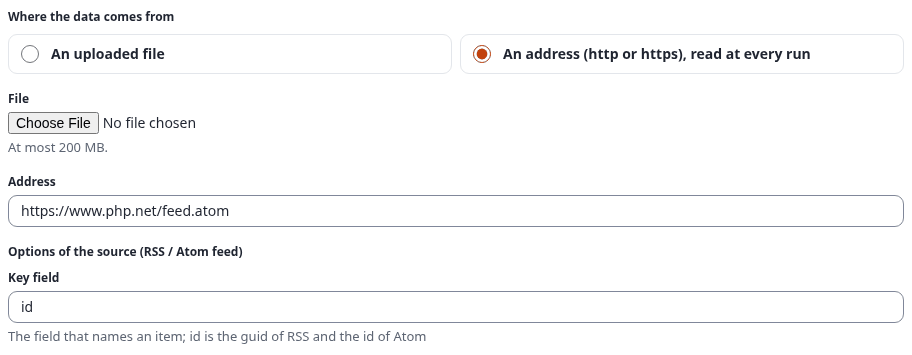

| Attribut | Quellfeld | Umwandlungen | Pflicht |
|---|---|---|---|
| `title` | `title` | `strip_tags \| trim` | ja |
| `intro` | `summary` | `default(value="PHP news") \| richtext` | |
| `body` | `content` | `richtext` | |

Ein Atom-Eintrag von php.net hat keine Zusammenfassung; der Schritt `default` gibt dem verlangten Intro einen Text.

**Ergebnis:** Der erste Lauf legte 15 Artikel an; jeder spätere Lauf des Zeitplans lässt sie unverändert und legt nur
an, was im Feed neu ist.

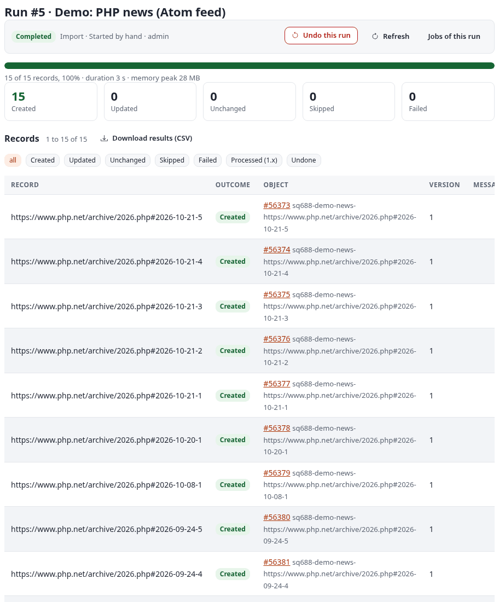

### Eine RSS-Datei

Docs-Import „Docs: News (RSS file)“: Probelauf #139, 2 würden angelegt.

**Eingabe** (`share/examples/feed.rss`, der erste Eintrag):

```xml
<item>
  <guid>https://example.org/news/1</guid>
  <title>Spring opening hours</title>
  <link>https://example.org/news/1</link>
  <description>From April the shop opens at 8 am.</description>
  <content:encoded><![CDATA[<p>From April the shop opens at <b>8 am</b>.</p>]]></content:encoded>
  <pubDate>Fri, 20 Mar 2026 09:00:00 GMT</pubDate>
  <category>News</category>
</item>
```

**Schritte im Editor:** Quelltyp *RSS / Atom feed*, eine hochgeladene Datei `feed.rss`, *Key field* `id`. Die
Vorlage: Klasse `article`, Remote-ID `feed-{id}` (hier `sq688doc-feed-{id}`), die Zeilen oben ohne die Vorgabe.

**Ergebnis:** Zwei Artikel würden angelegt, der erste mit einem Intro aus `description` und einem Haupttext aus
`content:encoded`. Die Stichprobe zeigt `format: rss` und die rohen Elemente als `raw.*`:

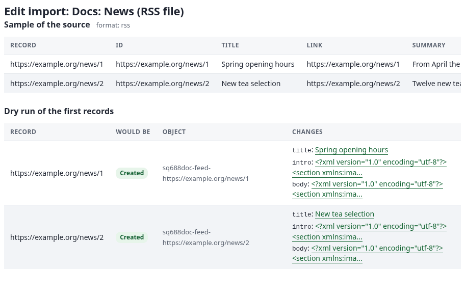

## Podcast-Feed (`podcast`)

Optionen: [sources.md, Podcast-Feeds und YouTube- oder Vimeo-Kanal-Feeds](sources.md#podcast-feeds-podcast-und-youtube--oder-vimeo-kanal-feeds-video_feed).
Docs-Import „Docs: Podcast episodes“: Probelauf #140, 2 würden angelegt.

**Ziel:** jede Folge des Podcasts des Shops als Datei-Objekt mit der Audiodatei, Staffel- und Folgennummer und Länge.

**Eingabe** (`share/examples/podcast.rss`, der erste Eintrag):

```xml
<item>
  <guid isPermaLink="false">tea-talk-2</guid>
  <title>Episode 2: Green teas</title>
  <description>Sencha, gyokuro and how to brew them.</description>
  <pubDate>Thu, 02 Apr 2026 06:00:00 GMT</pubDate>
  <enclosure url="https://podcast.example.org/audio/episode-2.mp3" length="18734012" type="audio/mpeg"/>
  <itunes:duration>38:21</itunes:duration>
  <itunes:episode>2</itunes:episode>
  <itunes:season>1</itunes:season>
  <itunes:explicit>false</itunes:explicit>
  <itunes:image href="https://podcast.example.org/episode-2.jpg"/>
</item>
```

**Schritte im Editor:** Quelltyp *Podcast feed* (Gruppe Media), eine hochgeladene Datei `podcast.rss` (im Betrieb:
die Adresse des Feeds, mit einem täglichen Zeitplan), *Key field* `id`. Die Vorlage: Klasse `file`, Remote-ID
`podcast-{id}` (hier `sq688doc-podcast-{id}`).

| Attribut | Quellfeld | Umwandlungen | Pflicht |
|---|---|---|---|
| `name` | `title` | | ja |
| `description` | `summary` | `template(text="<p>{value}</p><p>Season {season}, episode {episode}, {duration} seconds.</p>") \| richtext` | |
| `file` (Binärdatei) | `enclosure` | `file` | |

**Ergebnis:** Zwei Datei-Objekte würden angelegt. Die Quelle las `enclosure` (die MP3-Adresse), `enclosure_type`
`audio/mpeg`, `enclosure_length` `18734012`, `duration` `2301` (aus `38:21`; `1:02:03` ergibt `3723`), `episode`
`2`, `season` `1`, `explicit` und `image` (das iTunes-Bild der Folge). Der Probelauf behält in der Zeile `file` die
Adresse; der echte Lauf lädt die Folge in das Dateiattribut.

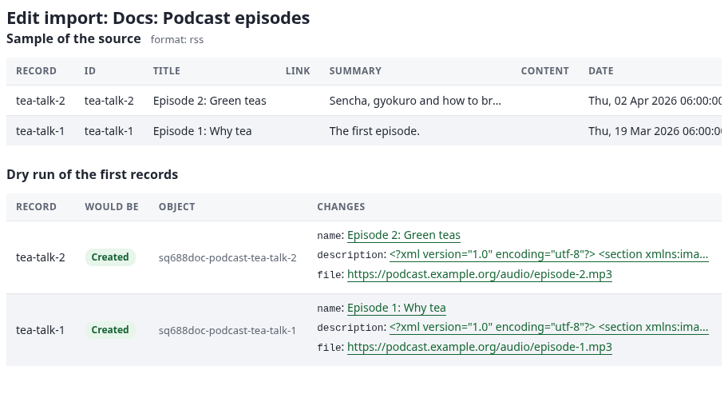

## YouTube-Kanal-Feed (`video_feed`)

Optionen: [sources.md, Podcast-Feeds und YouTube- oder Vimeo-Kanal-Feeds](sources.md#podcast-feeds-podcast-und-youtube--oder-vimeo-kanal-feeds-video_feed).
Docs-Import „Docs: YouTube channel feed“: Probelauf #141, 1 würde angelegt.

**Ziel:** die neuesten Videos eines Kanals als Link-Objekte, ohne API-Schlüssel.

**Eingabe** (`share/examples/youtube.xml`, der Atom-Feed, den YouTube unter
`https://www.youtube.com/feeds/videos.xml?channel_id=<Kanal-ID>` veröffentlicht, gekürzt):

```xml
<entry>
  <id>yt:video:EXAMPLE0001</id>
  <yt:videoId>EXAMPLE0001</yt:videoId>
  <yt:channelId>UCexample0000000000000000</yt:channelId>
  <title>How to brew sencha</title>
  <link rel="alternate" href="https://www.youtube.com/watch?v=EXAMPLE0001"/>
  <media:group>
    <media:thumbnail url="https://i.ytimg.com/vi/EXAMPLE0001/hqdefault.jpg" width="480" height="360"/>
    <media:description>Water at 70 degrees, one minute.</media:description>
    <media:community><media:statistics views="4321"/></media:community>
  </media:group>
</entry>
```

**Schritte im Editor:** Quelltyp *YouTube or Vimeo channel feed*, eine hochgeladene Datei `youtube.xml` (im Betrieb:
die Feed-Adresse des Kanals), *Key field* `id`. Die Vorlage: Klasse `link`, Remote-ID `video-{video_id}` (hier
`sq688doc-video-{video_id}`).

| Attribut | Quellfeld | Umwandlungen | Pflicht |
|---|---|---|---|
| `name` | `title` | | ja |
| `description` | `media_description` | `richtext` | |
| `location` | `link` | | |

**Ergebnis:** Ein Link würde angelegt, `sq688doc-video-EXAMPLE0001`. Der Datensatz hat außerdem `video_id`,
`channel_id`, `embed_url` (`https://www.youtube.com/embed/EXAMPLE0001`), `image` (das Vorschaubild) und `views`
(`4321`). Der Feed listet nur die letzten 15 Videos; für den ganzen Kanal nutzen Sie die Data API unten.

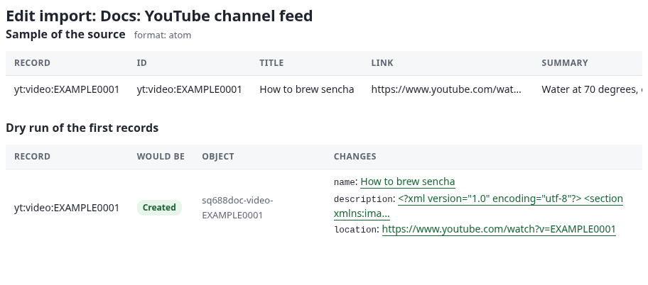

## Vimeo-Kanal-Feed (`video_feed`)

Optionen: [sources.md, Podcast-Feeds und YouTube- oder Vimeo-Kanal-Feeds](sources.md#podcast-feeds-podcast-und-youtube--oder-vimeo-kanal-feeds-video_feed).
Docs-Import „Docs: Vimeo channel feed“: Probelauf #142, 1 würde angelegt.

**Ziel:** die Videos eines Vimeo-Nutzers (`https://vimeo.com/<Nutzer>/videos/rss`) als Link-Objekte, mit derselben
Zuordnung wie bei YouTube.

**Eingabe** (`share/examples/vimeo.rss`, der Eintrag):

```xml
<item>
  <title>Tea harvest</title>
  <link>https://vimeo.com/123456789</link>
  <guid isPermaLink="false">tag:vimeo,2026-05-10:clip123456789</guid>
  <description>Picking tea leaves in the morning.</description>
  <media:content>
    <media:player url="https://player.vimeo.com/video/123456789"/>
    <media:thumbnail url="https://i.vimeocdn.com/video/example_640.jpg"/>
  </media:content>
</item>
```

**Schritte im Editor:** wie bei YouTube, mit dem Upload `vimeo.rss`; die Zeile `description` nimmt `summary`
(`richtext`), weil ein Vimeo-Feed kein `media:description` hat.

**Ergebnis:** Ein Link würde angelegt, `sq688doc-video-123456789` (`video_id` ist die Vimeo-ID aus der guid), mit
`embed_url` `https://player.vimeo.com/video/123456789` und `location` `https://vimeo.com/123456789`. Weil beide Feeds
`video-{video_id}` verwenden, können YouTube- und Vimeo-Videos einen Ordner teilen.

## YouTube Data API (`youtube`)

Optionen: [sources.md, YouTube Data API](sources.md#youtube-data-api-youtube).
**Zur Veranschaulichung: Dieses Beispiel lief nicht gegen ein echtes Konto.** Die Konfiguration ist der Docs-Import
„Docs: YouTube channel (Data API, illustrative)“, nie ausgeführt (sein Geheimnis ist ein Platzhalter); die
Datensätze sind der Schnappschuss des Katalogs `share/examples/youtube-videos.ndjson`, gelesen vom Docs-Import „Docs:
YouTube videos (snapshot of the Data API)“, Probelauf #143, 3 würden angelegt.

**Ziel:** jedes Video eines Kanals (nicht nur die letzten 15 seines Feeds), mit Länge, Tags und Aufrufzahlen.

**Vorher:** Legen Sie in der Google Cloud Console einen API-Schlüssel an, aktivieren Sie die YouTube Data API v3 und
beschränken Sie den Schlüssel darauf. Speichern Sie den Schlüssel als Geheimnis ([sources.md, Geheimnisse](sources.md#geheimnisse))
oder geben Sie ihn einmal unter *New value* im Schritt Quelle ein; die Option enthält nur den **Namen** des
Geheimnisses.

**Schritte im Editor:**

| Feld | Wert |
|---|---|
| Quelltyp | *YouTube channel, playlist or search (Data API)* (Gruppe Media) |
| Where the data comes from | Read by the source itself |
| Read | The uploads of a channel |
| Channel | `@exampletea` (ein Handle, eine `UC...`-ID oder die Adresse des Kanals) |
| Order | Newest first (nur für eine Suche) |
| Page size | `50` |
| Most videos | `100` (`0`: alle) |
| API key (name of a secret) | `sq-demo-youtube-key` |
| Key field | `id` |
| Zuordnung | die Vorlage: Klasse `link`, Remote-ID `youtube-{id}` (hier `sq688doc-youtube-{id}`) |

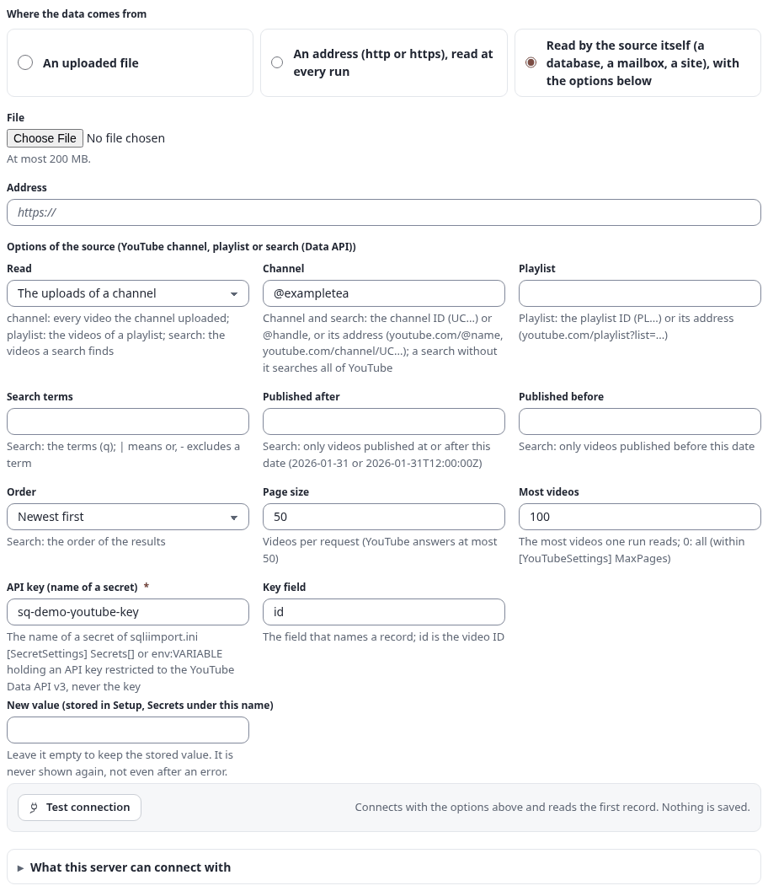

**Test connection** stellt eine Anfrage für eine Quota-Einheit (`channels.list`) und meldet den Kanal; ein Kanal mit
500 Videos kostet etwa 21 Einheiten pro Lauf (eine Suche kostet 100 pro Seite). Sonst wird nichts gesendet: nur
`GET`-Anfragen an `channels`, `playlistItems`, `search` und `videos`, mit dem Schlüssel in einem Header, nie in einer
Adresse.

| Attribut | Quellfeld | Umwandlungen | Pflicht |
|---|---|---|---|
| `name` | `title` | `trim` | ja |
| `description` | `description` | `richtext` | |
| `location` | `url` | | |

Bei einer Klasse mit einem Bildattribut `image` ergänzt die Vorlage `thumbnail` mit `image`, bei `publish_date` die
Zeile `published` mit `date`.

**Was zurückkommt** (die erste Zeile des Schnappschusses, gekürzt):

```json
{"id":"Ex4mpleVid1","url":"https://www.youtube.com/watch?v=Ex4mpleVid1","embed_url":"https://www.youtube-nocookie.com/embed/Ex4mpleVid1","title":"Brewing green tea at the right temperature","published":"2026-09-14T08:00:00Z","channel_title":"Example Tea Channel","tags":["tea","green tea","brewing"],"duration_seconds":754,"duration":"0:12:34","thumbnail":"https://i.ytimg.com/vi/Ex4mpleVid1/maxresdefault.jpg","view_count":1234,"like_count":56,"comment_count":7,"privacy":"public","live_broadcast_content":"none"}
```

**Erwartetes Ergebnis:** drei Links. Das dritte Video ist ein angekündigter Livestream (`duration_seconds` `0`,
`live_broadcast_content` `upcoming`, `privacy` `unlisted`); ordnen Sie `live_broadcast_content` einem Attribut zu,
wenn die Website solche Videos unterscheiden soll.

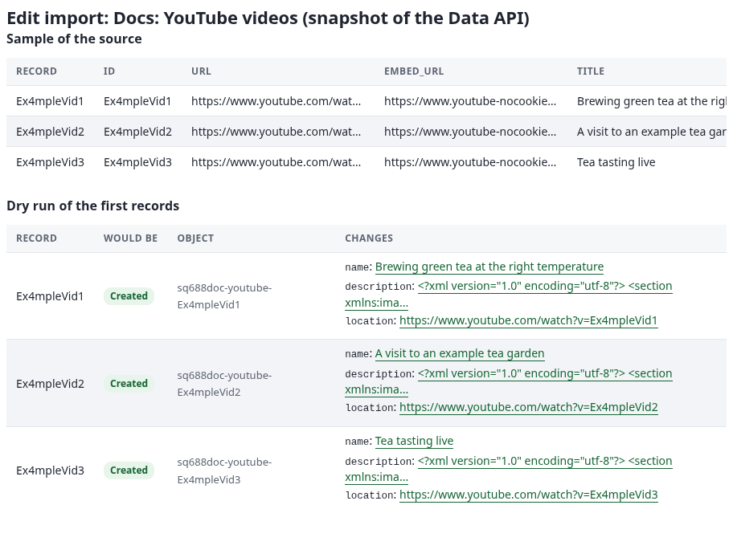

## Scraper für youtube.com-Seiten (`youtube_page`, Opt-in)

Optionen: [sources.md, YouTube-Kanal- oder Playlist-Seite](sources.md#youtube-kanal--oder-playlist-seite-youtube_page-opt-in).
**Nicht ausgeführt, und auf dem Server der Dokumentation ausgeschaltet.**

**Nutzungsbedingungen:** youtube.com-Seiten mit einem Programm zu lesen, verstößt gegen die Nutzungsbedingungen von
YouTube, und diese Quelle kann brechen, sobald YouTube seine Seiten ändert. Nutzen Sie sie nur, wo Sie es dürfen, und
ziehen Sie die Data API oder den Kanal-Feed oben vor. Sie liest nicht mehr als den ersten Block Videos einer Seite
(etwa 30 auf einer Kanalseite, 100 auf einer Playlist) und ruft nie die interne API von YouTube auf.

**Standardmäßig ausgeschaltet.** Bis ein Administrator sie einschaltet, führt der Katalog das Format als deaktiviert
mit dem Grund, der Editor bietet es nicht an, und ein Lauf oder Test eines vorhandenen Imports wird abgelehnt:

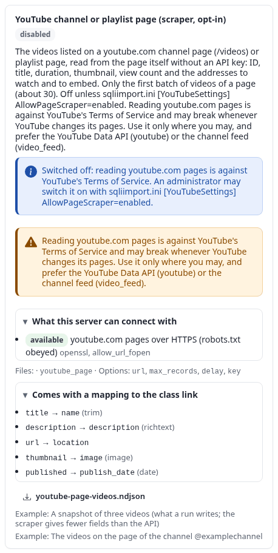

**So wird sie eingeschaltet** (nur, wo das Lesen der Seiten erlaubt ist): in
`settings/override/sqliimport.ini.append.php`

```ini
[YouTubeSettings]
AllowPageScraper=enabled
```

danach den INI-Cache leeren (`php bin/php/ezcache.php --clear-tag=ini`). Die Karte zeigt das Format dann als
aktiviert, mit der Warnung.

**Konfiguration:**

| Feld | Wert |
|---|---|
| Quelltyp | *YouTube channel or playlist page (scraper, opt-in)* |
| Page | `https://www.youtube.com/@exampletea/videos` (oder `/streams`, `/shorts`, oder `https://www.youtube.com/playlist?list=...`) |
| Most videos | `30` |
| Pause (seconds) | `2` (ein längeres `Crawl-delay` aus robots.txt gewinnt) |
| Key field | `id` |
| Zuordnung | die Vorlage der Data API: Klasse `link`, Remote-ID `youtube-{id}` |

**Erwartetes Ergebnis** (der Schnappschuss des Katalogs `share/examples/youtube-page-videos.ndjson`, die erste Zeile,
gekürzt):

```json
{"id":"Ex4mpleVid1","url":"https://www.youtube.com/watch?v=Ex4mpleVid1","title":"Brewing green tea at the right temperature","description":"","published":null,"published_text":"5 weeks ago","duration_seconds":754,"duration":"0:12:34","thumbnail":"https://i.ytimg.com/vi/Ex4mpleVid1/hqdefault.jpg","view_count":1234,"like_count":null}
```

Die Seite gibt weniger Felder als die API: keine Veröffentlichungszeit (nur das relative `published_text`), keine
Beschreibung, Tags oder Likes. Weil beide die Remote-ID `youtube-{id}` verwenden, aktualisiert ein späterer Wechsel
zur Data API dieselben Objekte.

## Seiten einer Website über ihre Sitemap (`sitemap`)

Optionen: [sources.md, `sitemap`](sources.md#sitemap).
Docs-Importe „Docs: Pages of a sitemap (file)“ (Probelauf #144, 4 würden angelegt) und „Docs: Sitemap crawl
(snapshot)“ (Probelauf #145, 3 würden angelegt, 1 fehlgeschlagen).

**Ziel:** die News-Seiten einer alten Website in Artikel übernehmen, mit Titel, Meta-Beschreibung und Haupttext jeder
Seite.

**Eingabe** (`share/examples/sitemap.xml`, gekürzt):

```xml
<urlset xmlns="http://www.sitemaps.org/schemas/sitemap/0.9">
  <url><loc>https://example.org/</loc><lastmod>2026-10-01</lastmod><changefreq>weekly</changefreq><priority>1.0</priority></url>
  <url><loc>https://example.org/news/green-tea-harvest</loc><lastmod>2026-09-28T09:30:00+00:00</lastmod><priority>0.8</priority></url>
  <url><loc>https://example.org/news/new-tea-room</loc><lastmod>2026-09-12</lastmod><priority>0.8</priority></url>
  <url><loc>https://example.org/about/</loc><lastmod>2026-01-05</lastmod><changefreq>yearly</changefreq><priority>0.5</priority></url>
</urlset>
```

**Schritte im Editor** (für die echte Website; die Docs-Importe verwenden die Beispieldateien als Uploads):

| Feld | Wert |
|---|---|
| Quelltyp | *Pages of a site by its sitemap* (Gruppe Platforms) |
| Sitemap | `https://example.org/sitemap.xml` (ein Sitemap-Index oder die Wurzel der Website gehen auch) |
| Only addresses like | `/news/*` |
| Never addresses like | leer |
| Picks | `body=article .content` und `image=meta[property=og:image]::attr(content)`, einer pro Zeile |
| Pages at most | `50` |
| Pause between requests | `1` |
| Key field | `url` |
| Zuordnung | die Vorlage: Klasse `article`, Remote-ID `page-{url_hash}` |

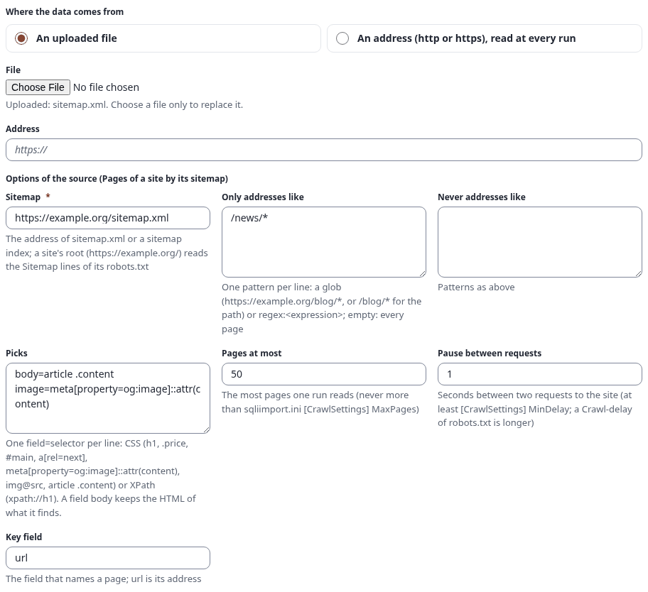

| Attribut | Quellfeld | Umwandlungen | Pflicht |
|---|---|---|---|
| `title` | `title` | `strip_tags \| trim` | ja |
| `intro` | `description` | `richtext` | |
| `body` | `body` | `richtext` | |

**Eine Sitemap-Datei als Upload** listet ihre Seiten und liest keine davon: Die Datensätze haben nur `url`,
`url_hash`, `lastmod`, `priority` und `changefreq`. Das tat der Docs-Import (Probelauf #144: vier Datensätze). Die
Muster von *Only addresses like* gelten nicht für eine hochgeladene Sitemap, daher stehen alle vier Seiten in der
Liste; sie filtern die Seiten eines Crawls.

**Was ein Crawl schreibt**, ist ein Schnappschuss, ein JSON-Objekt pro Seite; `share/examples/sitemap-crawl.ndjson`
ist so ein Schnappschuss, gelesen vom zweiten Docs-Import:

```json
{"url":"https://example.org/news/green-tea-harvest","url_hash":"8b77441c1aa08ca95f4c978f3f9a5df1e1061504","lastmod":"2026-09-28T09:30:00+00:00","status":200,"title":"The green tea harvest","description":"This year's first flush has arrived.","language":"en","image":"https://example.org/images/harvest.jpg","body":"<p>This year's <em>first flush</em> has arrived.</p><p>Taste it in the tea room.</p>"}
{"url":"https://example.org/about/","url_hash":"1f20ccbf9c009a2c3e088d352a812cc59c1ddb63","lastmod":"2026-01-05","status":0,"_error":"robots.txt of the site does not allow reading https://example.org/about/"}
```

**Ergebnis:** Drei Artikel würden angelegt; die Seite, die robots.txt nicht erlaubt, wurde nie angefragt und ist
eine fehlgeschlagene Zeile mit dem Grund, der Lauf endet daher *completed with errors*:

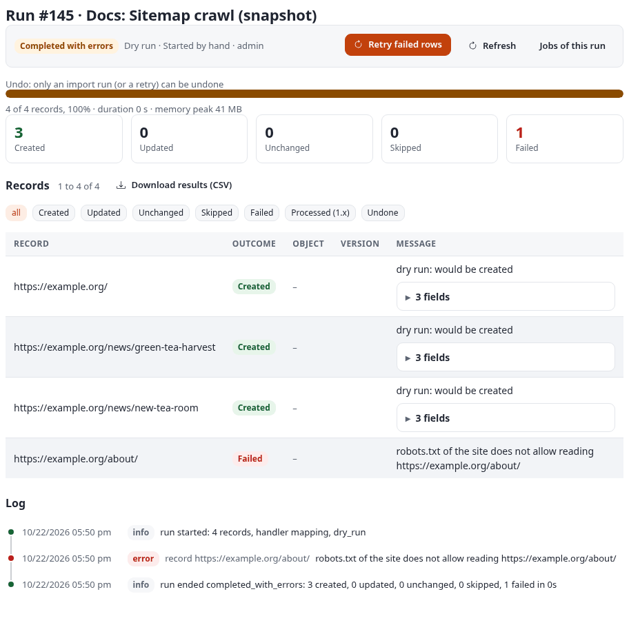

## Webseiten-Scraper (`webpage`)

Optionen: [sources.md, `webpage`](sources.md#webpage).
Docs-Import „Docs: Products of a web page“: Probelauf #174, 3 würden angelegt.

**Ziel:** die Produkte einer Listenseite eines alten Shops (kein Export, kein Feed) als Ordner, einer pro Produkt,
mit CSS- und XPath-Picks.

**Eingabe** (`share/examples/page-products.html`, gelesen, als wäre es `https://example.org/products/`; einer von
drei Einträgen):

```html
<main id="list">
  <article class="product featured" data-sku="T-100">
    <h2>Sencha Kyoto</h2>
    
    <p class="price">12.50 EUR</p>
    <div class="description"><p>A <strong>fresh</strong> green tea from Kyoto.</p><p>Steep for two minutes.</p></div>
    <ul class="tags"><li>green</li><li>japan</li></ul>
    <a class="more" href="sencha-kyoto">Details</a>
  </article>
  ...
</main>
<nav class="pager"><a rel="next" href="?page=2">Next</a></nav>
```

**Schritte im Editor:**

| Feld | Wert |
|---|---|
| Quelltyp | *Web page scraper* (Gruppe Platforms) |
| Addresses | `https://example.org/products/` (eine pro Zeile) |
| Repeating item | `.product` |
| Next page | `a[rel=next]` |
| Picks | siehe unten |
| Pages at most | `3` |
| Pause between requests | `1` |
| Key field | `id` |

```
title=h2
sku=@data-sku
price=.price
image=img@src
body=.description
tags=.tags li
link=a.more@href
heading=xpath:.//h2
```

Jeder Pick ist `feld=selektor`, relativ zum Eintrag: `@data-sku` ist ein Attribut des Eintrags selbst, `img@src` ein
Attribut eines Elements darin, `.tags li` findet zwei Elemente und ergibt eine Liste, `body` behält das innere HTML
(und ergänzt `body_text`), und `xpath:` beginnt einen XPath-Ausdruck. Relative Adressen (`/images/sencha.jpg`,
`sencha-kyoto`) werden absolut gemacht.

Der Schritt Quelle im dunklen Design:

![Die Optionen der Quelle des Webseiten-Scrapers im dunklen Design: die Adresse, der wiederkehrende Eintrag .product, die nächste Seite a[rel=next], die Picks, höchstens 3 Seiten, eine Pause von 1 Sekunde](../images/src-scraper-source-dark.png)

Zuordnung: Klasse `folder`, Remote-ID `sq688doc-scrape-{sku}` (die Artikelnummer, die bleibt, wenn die Liste neu
sortiert wird).

| Attribut | Quellfeld | Umwandlungen | Pflicht |
|---|---|---|---|
| `name` | `title` | `trim` | ja |
| `short_description` | `price` | `trim \| richtext` | |
| `description` | `body` | `richtext` | |
| `tags` | `tags` | `join(separator=", ")` | |

**Ergebnis:** Drei Ordner würden angelegt (Sencha Kyoto, Darjeeling First Flush, Rooibos Vanilla), mit `image`
`https://example.org/images/sencha.jpg` und `link` `https://example.org/products/sencha-kyoto`. Das Skript der Seite
lief nie, und das `onclick`-Attribut des zweiten Eintrags wurde vor den Picks entfernt. Eine erste Fassung dieser
Zuordnung schickte `price` durch `number`, was jeden Datensatz mit „number: '12.50 EUR' is not a number“ scheitern
ließ; `regex_replace(pattern="/[^0-9.]/", replace="") | number(decimals=2)` behielte nur den Betrag.

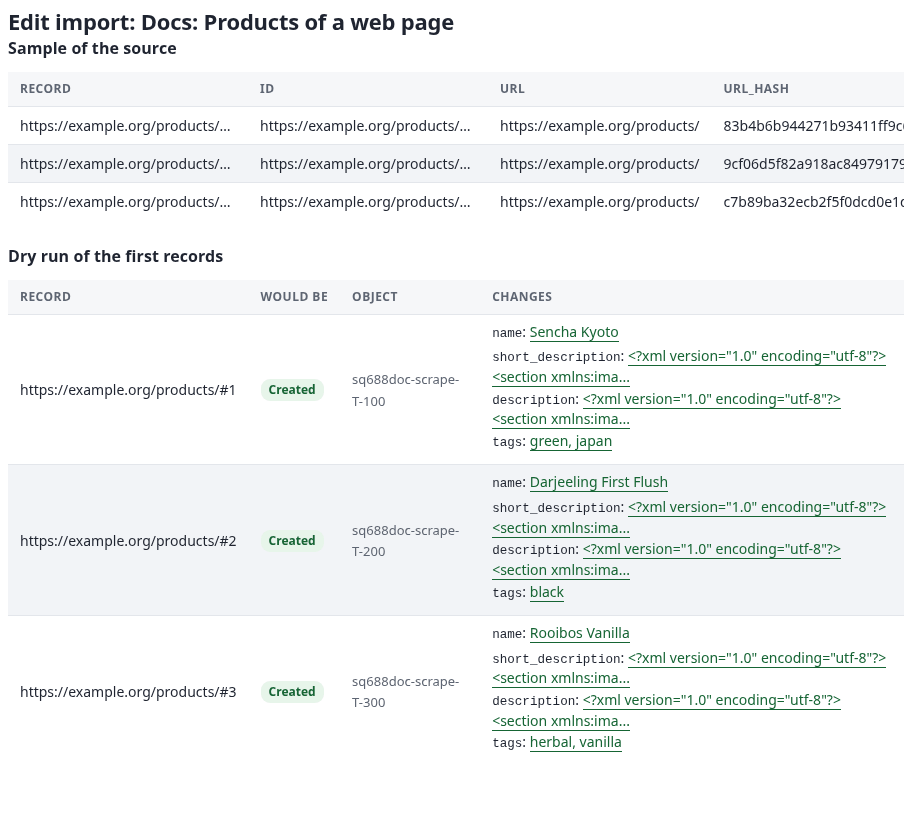

Auf einer echten Website wird dem Link `next` gefolgt, solange *Pages at most* es erlaubt, robots.txt wird zuerst
gelesen, und jede Anfrage wartet die Pause ab.

## Siehe auch

- [sources.md](sources.md): jede Option jedes Formats.
- [Dateien](source-examples-files.md): CSV, Tabellen, JSON, XML, YAML, TOML, OPML, Avro, Arrow, Medien, Markdown,
  WordPress, iCalendar und vCard.
- [schedules.md](schedules.md): einen Feed-Import alle N Minuten oder zu einer Uhrzeit laufen lassen.
- [runs.md](runs.md): die Seite des Laufs, fehlgeschlagene Zeilen wiederholen und einen Lauf rückgängig machen.
