# Durchgespielte Beispiele: Dateien

Diese Seite zeigt für jedes Dateiformat von 7x SQLI Import einen vollständigen Import: Text mit Trennzeichen (CSV,
TSV), Tabellen (XLSX, ODS), JSON und JSON Lines, XML, YAML, TOML, OPML, Apache Avro und Arrow, ein ZIP mit Fotos und
ihren EXIF- und IPTC-Feldern, einen Ordner mit Markdown-Dateien, einen WordPress-Export, eine iCalendar- und eine
vCard-Datei. Jedes Beispiel sagt, was es erreicht, zeigt echte Zeilen der Beispieldatei, die genauen Werte für den
Import-Editor, die Zeilen der Zuordnung und was der Probelauf oder der Lauf ergab, mit Bildschirmfotos vom Server der
Dokumentation.

Jede Option beschreibt [sources.md](sources.md); jedes Beispiel verlinkt auf seinen Abschnitt dort. Die anderen
durchgespielten Beispiele: [Feeds und Webseiten](source-examples-feeds-web.md),
[Datenbanken](source-examples-databases.md), [APIs und gehostete Dienste](source-examples-apis.md) und
[Plattformen, Handel und Dokumente](source-examples-platforms.md). Englisch:
[../source-examples-files.md](../source-examples-files.md).

**Was lief.** Jedes Beispiel dieser Seite lief auf dem Server der Dokumentation als Import mit dem Namen
„Docs: ...“, mit der Beispieldatei des Katalogs (`share/examples/` der Erweiterung, auch auf jeder Karte unter
**Imports, Catalogue** zum Herunterladen) als Upload. Die meisten liefen als **Probelauf**, der nichts veröffentlicht;
das CSV- und das Medien-Beispiel liefen außerdem echt in einen verborgenen Ordner, damit das Ergebnis im Inhaltsbaum
gezeigt werden kann.

Die Beschriftungen der Oberfläche stehen hier so, wie die Administration sie zeigt (in Englisch).

## Inhalt

- [So funktioniert jedes Datei-Beispiel](#so-funktioniert-jedes-datei-beispiel)
- [CSV (`csv`)](#csv-csv)
- [TSV (`tsv`)](#tsv-tsv)
- [Tabellen: XLSX und ODS (`spreadsheet`)](#tabellen-xlsx-und-ods-spreadsheet)
- [JSON Lines (`ndjson`)](#json-lines-ndjson)
- [JSON (`json`)](#json-json)
- [XML (`xml`)](#xml-xml)
- [YAML (`yaml`)](#yaml-yaml)
- [TOML (`toml`)](#toml-toml)
- [OPML (`opml`)](#opml-opml)
  - [Die Einträge als Link-Objekte](#die-einträge-als-link-objekte)
  - [Ein Feed-Import pro Eintrag](#ein-feed-import-pro-eintrag)
- [Apache Avro (`avro`) und Apache Arrow (`arrow`)](#apache-avro-avro-und-apache-arrow-arrow)
- [Parquet, über DuckDB](#parquet-über-duckdb)
- [Fotos in einem ZIP mit EXIF und IPTC (`media`)](#fotos-in-einem-zip-mit-exif-und-iptc-media)
- [Ein Ordner mit Markdown-Dateien (`markdown`)](#ein-ordner-mit-markdown-dateien-markdown)
- [WordPress-Export (`wxr`)](#wordpress-export-wxr)
- [iCalendar (`ical`)](#icalendar-ical)
- [vCard (`vcard`)](#vcard-vcard)
- [Siehe auch](#siehe-auch)

## So funktioniert jedes Datei-Beispiel

1. **Imports, Catalogue** listet jedes Format mit seinen Beispieldateien. **New import** auf einer Karte öffnet den
   Editor mit diesem Format ([editor.md](editor.md)).
2. Schritt **Quelle** (Source): ein Name, unter *Where the data comes from* **An uploaded file** (oder eine Adresse,
   die bei jedem Lauf gelesen wird), die Datei und die Optionen des Formats. Die Werte jedes Beispiels stehen in einer
   Tabelle.
3. Schritt **Verarbeitung** (Processing): der Elternknoten neuer Inhalte; die Beispiele behalten die Vorgaben
   (vorhandene Inhalte aktualisieren, 200 Datensätze pro Abschnitt, `[RunSettings] ChunkSize`).
4. Schritt **Zuordnung** (Mapping): die Inhaltsklasse, *How a record finds its object* (ein Muster für die Remote-ID
   mit Feldern des Datensatzes in geschweiften Klammern) und eine Zeile pro Attribut: das Quellfeld, die
   Umwandlungen als eine Zeile Text ([transforms.md](transforms.md)), eine Vorgabe und *Required*. Ein Format mit
   Vorlage füllt die Zeilen, wenn der Import zum ersten Mal gespeichert wird; prüfen Sie sie hier.
5. Schritt **Vorschau** (Preview): die Stichprobe der Quelle (*Sample of the source*, die ersten Datensätze, wie die
   Quelle sie liest, mit dem, was sie erkannt hat) und der Probelauf der ersten Datensätze (*Dry run of the first
   records*: was angelegt, aktualisiert oder unverändert bliebe, Feld für Feld).
6. **Dry run** oder **Run now** in der Liste der Importe, oder **Save and run** im Schritt Überprüfung. Die Seite des
   Laufs zählt die Datensätze ([runs.md](runs.md)).

In den Tabellen der Zuordnung unten ist *Umwandlungen* der einzeilige Text, genau so, wie er in das Raster
eingetippt wird. Eine leere Zelle heißt: Die Zeile hat keine.

## CSV (`csv`)

Optionen: [sources.md, CSV, TSV und Text mit Trennzeichen](sources.md#csv-tsv-und-text-mit-trennzeichen-csv-tsv).
Docs-Import „Docs: Products (CSV)“: Lauf #164 (echt), 3 angelegt.

**Ziel:** Die drei Produkte aus dem CSV-Export eines Shops werden drei Ordner mit dem Preis in der Zusammenfassung,
und ein zweiter Lauf derselben Datei ändert nichts.

**Eingabe** (`share/examples/products.csv`, die ganze Datei; beachten Sie das Komma in Anführungszeichen in Zeile 3):

```
id,title,price,active
1,Café crème,9.50,1
2,"Tea, green",4.20,1
3,Hot chocolate,5.00,0
```

**Schritte im Editor:**

| Schritt, Feld | Wert |
|---|---|
| Quelle, Quelltyp | *CSV and delimited text* (Gruppe Data) |
| Where the data comes from | An uploaded file: `products.csv` |
| Delimiter | Detect (die Vorschau meldet `delimiter: ,`) |
| Enclosure | `"` |
| Encoding | Detect |
| The first line names the columns | an |
| Key field | `id` |
| Zuordnung, Inhaltsklasse | `folder` |
| How a record finds its object | Remote-ID, Muster `sq688doc-csv-{id}` |

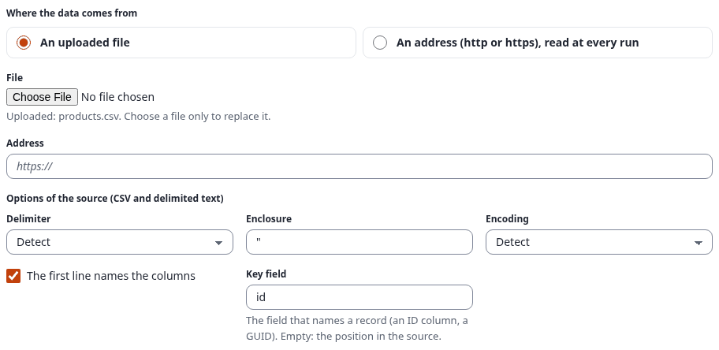

**Zeilen der Zuordnung:**

| Attribut | Quellfeld | Umwandlungen | Pflicht |
|---|---|---|---|
| `name` (Name) | `title` | `trim` | ja |
| `short_description` (Summary) | `price` | `number(decimals=2) \| suffix(text=" EUR") \| richtext` | |
| `show_children` (Display sub items) | `active` | `bool` | |

**Ergebnis.** Der echte Lauf #164 legte unter dem Elternknoten des Imports drei Ordner an: „Café crème“, „Tea,
green“ und „Hot chocolate“, mit den Remote-IDs `sq688doc-csv-1` bis `sq688doc-csv-3`:

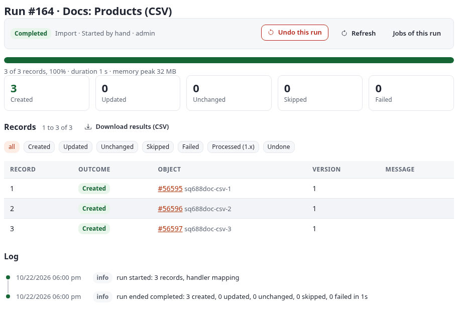

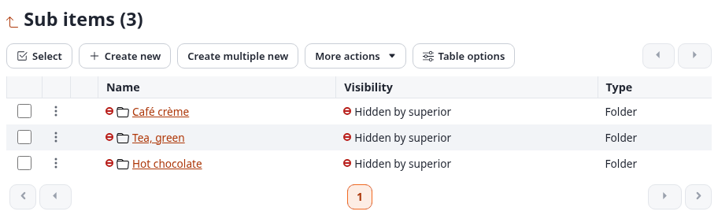

Danach erneut geöffnet, zeigt die Vorschau dieselben drei Datensätze und meldet jeden als **Unchanged**: Die
Inhalts-API veröffentlicht nur dann eine neue Version, wenn sich ein Feld wirklich geändert hat; ein nächtlicher Lauf
einer unveränderten Datei kostet also nichts.

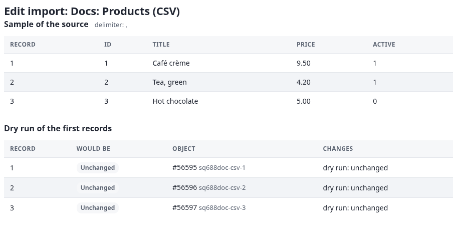

## TSV (`tsv`)

Optionen: [sources.md, CSV, TSV und Text mit Trennzeichen](sources.md#csv-tsv-und-text-mit-trennzeichen-csv-tsv).
Docs-Import „Docs: Products (TSV)“: Probelauf #124, 3 würden angelegt.

**Ziel:** dieselben Produkte aus einer Datei mit Tabulatoren, wie Tabellenprogramme sie als „Text (Tab-getrennt)“
exportieren.

**Eingabe** (`share/examples/products.tsv`; die Spalten trennt ein Tabulator, das Komma in „Tea, green“ braucht daher
keine Anführungszeichen):

```
id	title	price	active
1	Café crème	9.50	1
2	Tea, green	4.20	1
```

**Schritte im Editor:** Quelltyp *TSV file (tab separated)*, eine hochgeladene Datei `products.tsv`, *Delimiter*
**Tab** (die Vorgabe dieses Formats; in einer von Hand geschriebenen Quellkonfiguration ist es `"delimiter": "tab"`,
nicht `"\t"`), *Key field* `id`. Inhaltsklasse `folder`, Remote-ID `sq688doc-tsv-{id}`.

| Attribut | Quellfeld | Umwandlungen | Pflicht |
|---|---|---|---|
| `name` | `title` | `trim` | ja |
| `short_name` | `price` | `number(decimals=2)` | |

**Ergebnis:** der Probelauf der Vorschau: Drei Ordner würden angelegt, mit ihren Namen und Kurznamen.

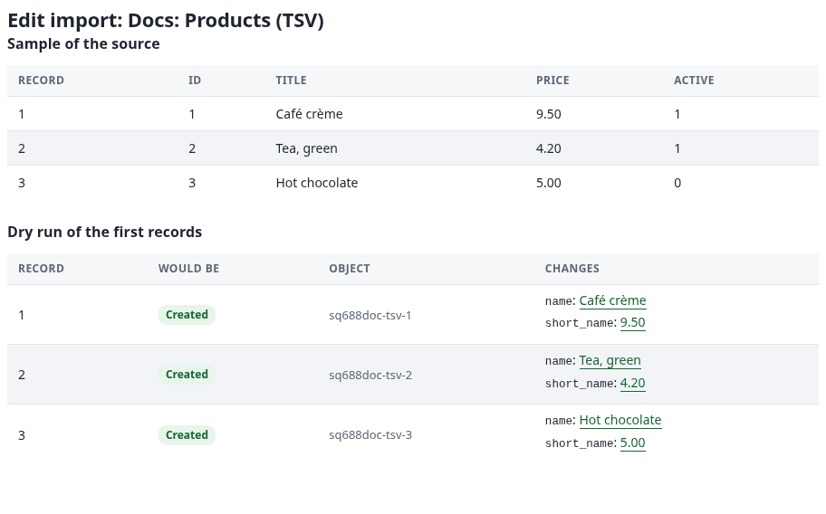

## Tabellen: XLSX und ODS (`spreadsheet`)

Optionen: [sources.md, Tabellen](sources.md#tabellen-spreadsheet).
Docs-Importe „Docs: Products (XLSX)“ (Probelauf #165) und „Docs: Products (ODS)“ (Probelauf #166), je 3 würden
angelegt.

**Ziel:** das Produkt-Tabellenblatt einer Excel-Arbeitsmappe, ohne sie vorher als CSV zu speichern.

**Eingabe** (`share/examples/products.xlsx`): eine Arbeitsmappe mit zwei Blättern, *Products* und *Other*. Das erste
Blatt:

| id | title | price | active |
|---|---|---|---|
| 1 | Café crème | 9.5 | 1 |
| 2 | Second | 0 | |
| 3 | Inline | 12 | |

**Schritte im Editor:**

| Schritt, Feld | Wert |
|---|---|
| Quelltyp | *Spreadsheet (XLSX, ODS)* |
| Where the data comes from | An uploaded file: `products.xlsx` (oder `products.ods`) |
| Sheet | `1` (das erste; der Name `Products` wirkt genauso) |
| The first row names the columns | an |
| Key field | `id` |
| Inhaltsklasse, Abgleich | `folder`, Remote-ID `sq688doc-xlsx-{id}` |

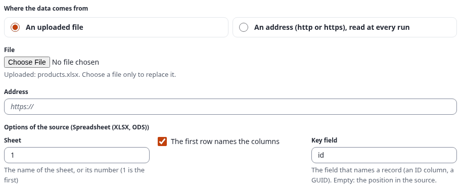

| Attribut | Quellfeld | Umwandlungen | Pflicht |
|---|---|---|---|
| `name` | `title` | `trim` | ja |
| `short_description` | `price` | `number(decimals=2) \| richtext` | |

**Ergebnis.** Die Vorschau nennt das Format und die Blätter der Datei (`format: xlsx · sheets: Products, Other`);
ein Blattname, den es nicht gibt, würde mit dieser Liste abgelehnt. Die Werte sind die in den Zellen gespeicherten:
`9.5`, nicht das Anzeigeformat der Zelle. Drei Ordner würden angelegt.

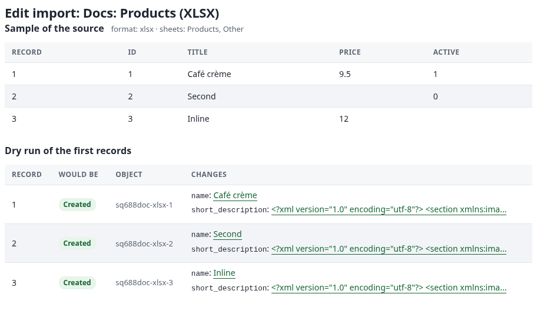

Die ODS-Datei ergibt dieselben Datensätze (`format: ods`); dort kommt eine Datumszelle als ISO-Text (`2026-10-21`),
den `date` ohne Format liest, während ein Excel-Datum eine Tageszahl für `date(format=excel)` ist.

## JSON Lines (`ndjson`)

Optionen: [sources.md, JSON und JSON Lines](sources.md#json-und-json-lines-json-ndjson).
Docs-Import „Docs: Articles (NDJSON)“: Probelauf #167, 2 würden angelegt.

**Ziel:** ein Export mit einem JSON-Objekt pro Zeile, als Strom gelesen (für Exporte jeder Größe), mit einem
verschachtelten Feld, einer Liste und einem Datum.

**Eingabe** (`share/examples/articles.ndjson`, beide Zeilen):

```json
{"id":"a-100","title":"Spring opening hours","published":"2026-03-20T09:00:00Z","author":{"name":"Desk"},"tags":["news","opening"],"body":"<p>From April the shop opens at <b>8 am</b>.</p>"}
{"id":"a-101","title":"New tea selection","published":"2026-04-02T12:30:00Z","author":{"name":"Shop"},"tags":["products"],"body":"<p>Twelve new teas are in.</p>"}
```

**Schritte im Editor:** Quelltyp *JSON Lines (NDJSON)*, eine hochgeladene Datei `articles.ndjson`, *Format*
**NDJSON (one object per line)**, *Record list* leer, *Key field* `id`. Inhaltsklasse `folder`, Remote-ID
`sq688doc-ndjson-{id}`.

| Attribut | Quellfeld | Umwandlungen | Pflicht |
|---|---|---|---|
| `name` | `title` | `trim` | ja |
| `short_description` | `author.name` | `prefix(text="By ") \| richtext` | |
| `description` | `body` | `richtext` | |
| `tags` (Schlagwörter) | `tags` | `join(separator=", ")` | |
| `publish_date` | `published` | `date` | |

Ein verschachtelter Wert wird über seinen Pfad benannt (`author.name`); die Stichprobe listet die gefundenen Pfade
(`tags.0`, `tags.1` und die ganze Liste `tags`).

**Ergebnis:** Zwei Ordner würden angelegt; der Probelauf zeigt `tags : news, opening` und
`publish_date : 1773997200` (20. März 2026, 09:00 UTC).

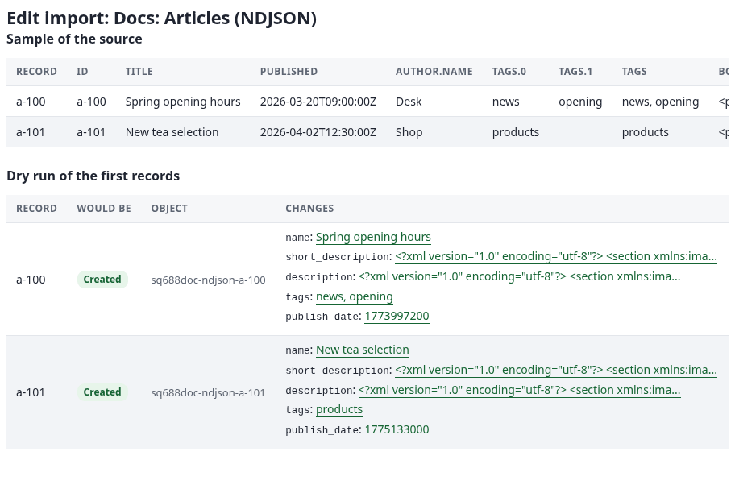

## JSON (`json`)

Optionen: [sources.md, JSON und JSON Lines](sources.md#json-und-json-lines-json-ndjson).
Docs-Import „Docs: Articles (JSON)“: Probelauf #168, 2 würden angelegt.

**Ziel:** die Antwort einer REST-API, die ihre Datensätze einpackt, als Artikel.

**Eingabe** (`share/examples/articles.json`): dieselben zwei Artikel, in `data.items`:

```json
{
  "data": {
    "items": [
      { "id": "a-100", "title": "Spring opening hours", "published": "2026-03-20T09:00:00Z", "author": { "name": "Desk" }, ... },
      { "id": "a-101", "title": "New tea selection", ... }
    ]
  }
}
```

**Schritte im Editor:** Quelltyp *JSON file or REST answer*; eine hochgeladene Datei `articles.json` (oder *An
address*, um die API bei jedem Lauf zu lesen); *Format* **JSON (a list of objects)**; *Record list* `data.items`;
*Key field* `id`. Inhaltsklasse `article`, Remote-ID `sq688doc-json-{id}`.

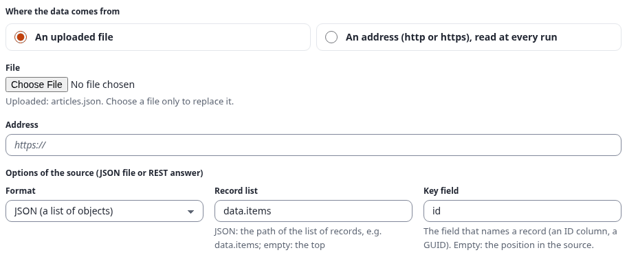

| Attribut | Quellfeld | Umwandlungen | Pflicht |
|---|---|---|---|
| `title` | `title` | `trim` | ja |
| `intro` (Rich Text, von der Klasse verlangt) | `body` | `richtext` | |

**Ergebnis:** Zwei Artikel würden angelegt. Ohne `data.items` sähe die Quelle einen einzigen Datensatz (die ganze
Antwort). Für eine API mit Seiten, Schlüsseln und Ratenbegrenzung nutzen Sie die REST-Quelle aus
[source-examples-apis.md](source-examples-apis.md).

## XML (`xml`)

Optionen: [sources.md, XML](sources.md#xml-xml).
Docs-Import „Docs: Books (XML)“: Probelauf #175, 2 würden angelegt.

**Ziel:** die Bücher einer Katalogdatei, mit einem Attribut, einem Element mit Namensraum und einem Element, das
Text und ein Attribut hat.

**Eingabe** (`share/examples/books.xml`):

```xml
<catalog xmlns:dc="http://purl.org/dc/elements/1.1/">
  <book id="b1">
    <title>Dune</title>
    <dc:creator>Frank Herbert</dc:creator>
    <year>1965</year>
    <price currency="EUR">12.90</price>
  </book>
  ...
```

**Schritte im Editor:** Quelltyp *XML file*, eine hochgeladene Datei `books.xml`, *Record element* `book`, *XSD
schema* leer, *Key field* `@id`. Inhaltsklasse `folder`, Remote-ID `sq688doc-xml-{@id}`.

| Attribut | Quellfeld | Umwandlungen | Pflicht |
|---|---|---|---|
| `name` | `title` | `trim` | ja |
| `short_description` | `dc:creator` | `template(text="{dc:creator} ({year}), {price.#text} {price.@currency}") \| richtext` | |

Die Pfade folgen dem Element: `@id` ist das Attribut von `<book>`, `dc:creator` das Element mit seinem Präfix, und
`<price currency="EUR">12.90</price>` ergibt `price.@currency` und `price.#text`.

**Ergebnis:** zwei Ordner, „Dune“ und „The Left Hand of Darkness“, deren Zusammenfassung „Frank Herbert (1965),
12.90 EUR“ lautet.

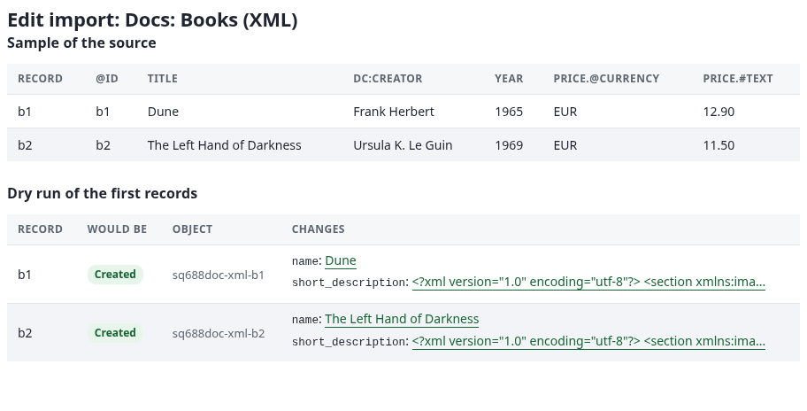

## YAML (`yaml`)

Optionen: [sources.md, YAML- und TOML-Datendateien](sources.md#yaml--und-toml-datendateien-yaml-toml).
Docs-Import „Docs: Teas (YAML)“: Probelauf #176, 3 würden angelegt.

**Ziel:** ein von Hand geschriebener YAML-Katalog mit verschachtelten Preisen, Listen in zwei Schreibweisen und
einem Textblock.

**Eingabe** (`share/examples/teas.yaml`, die ersten zwei Datensätze):

```yaml
shop: Example Tea Shop
teas:
  - id: sencha
    name: Sencha
    origin: Japan
    price:
      amount: 9.50
      currency: EUR
    tags: [green, steamed]
    notes: |
      Steep at 70 °C
      for one minute.
  - id: darjeeling
    name: "Darjeeling: first flush"
    price: {amount: 11.00, currency: EUR}
    tags:
      - black
      - spring
```

**Schritte im Editor:** Quelltyp *YAML data file*, eine hochgeladene Datei `teas.yaml`, *Format* Detect by the file
name, *Record list* `teas`, *Key field* `id`. Inhaltsklasse `folder`, Remote-ID `sq688doc-yaml-{id}`.

| Attribut | Quellfeld | Umwandlungen | Pflicht |
|---|---|---|---|
| `name` | `name` | `trim` | ja |
| `short_description` | `price.amount` | `number(decimals=2) \| suffix(text=" EUR") \| richtext` | |
| `description` | `notes` | `richtext` | |
| `tags` | `tags` | `join(separator=", ")` | |

**Ergebnis:** Drei Ordner würden angelegt: Sencha (Schlagwörter „green, steamed“), „Darjeeling: first flush“ (der
Doppelpunkt in Anführungszeichen gehört zum Namen) und Rooibos (keine Schlagwörter). `shop` oben ist kein Datensatz:
Gelesen wird nur die Liste unter `teas`.

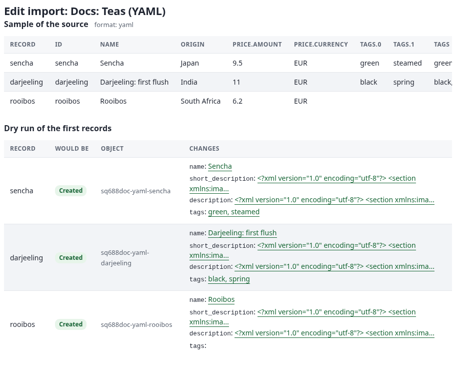

## TOML (`toml`)

Optionen: [sources.md, YAML- und TOML-Datendateien](sources.md#yaml--und-toml-datendateien-yaml-toml).
Docs-Import „Docs: Teas (TOML)“: Probelauf #171, 3 würden angelegt.

**Ziel:** dieselben Tees als TOML, ein Array von Tabellen, mit einer Inline-Tabelle und einer Untertabelle.

**Eingabe** (`share/examples/teas.toml`, Auszug):

```toml
[[teas]]
id = "sencha"
name = "Sencha"
tags = ["green", "steamed"]
price = { amount = 9.50, currency = "EUR" }

[[teas]]
id = "darjeeling"
name = "Darjeeling: first flush"
[teas.price]
amount = 11.00
currency = "EUR"
```

**Schritte im Editor:** Quelltyp *TOML data file* (*Format* TOML), eine hochgeladene Datei `teas.toml`, *Record
list* `teas`, *Key field* `id`. Inhaltsklasse `folder`, Remote-ID `sq688doc-toml-{id}`.

| Attribut | Quellfeld | Umwandlungen | Vorgabe | Pflicht |
|---|---|---|---|---|
| `name` | `name` | `trim` | | ja |
| `short_description` | `price.amount` | `number(decimals=2) \| richtext` | `on request` | |
| `tags` | `tags` | `join(separator=", ")` | | |

**Ergebnis:** Drei Ordner würden angelegt. Rooibos hat in dieser Datei keinen Preis, seine Zusammenfassung ist
daher die Vorgabe „on request“. Dieselbe Vorschau im dunklen Design:

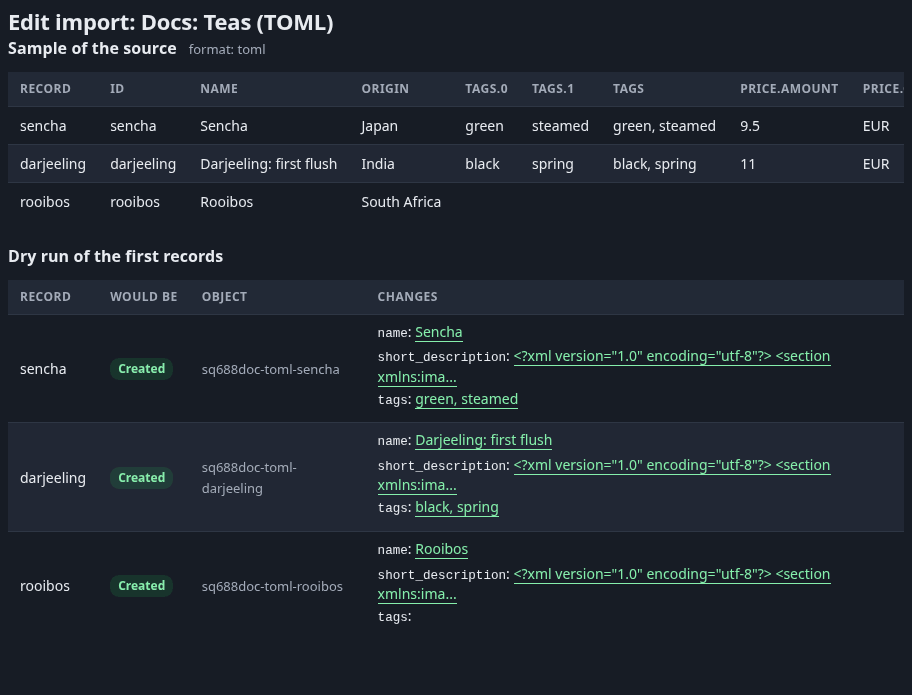

## OPML (`opml`)

Optionen: [sources.md, OPML](sources.md#opml-opml).

Eine OPML-Datei ist eine Feed-Liste, wie Feedreader und Podcast-Apps ihre Abonnements exportieren. Sie dient auf zwei
Arten: Die Einträge werden Objekte (eine Liste von Links auf der Website), oder jeder Eintrag wird ein eigener Import,
der diesem Feed folgt.

**Eingabe** (`share/examples/feeds.opml`):

```xml
<body>
  <outline text="News" title="News">
    <outline type="rss" text="Example news" title="Example news" xmlUrl="https://example.org/feed.rss" htmlUrl="https://example.org/" description="The news of example.org"/>
    <outline type="rss" text="Example blog" xmlUrl="https://example.org/blog/atom.xml" htmlUrl="https://example.org/blog/"/>
  </outline>
  <outline text="Tech">
    <outline type="rss" text="Example releases" xmlUrl="https://example.net/releases.rss" category="Tech/Releases"/>
    <outline type="link" text="Example documentation" url="https://example.net/docs/"/>
  </outline>
</body>
```

### Die Einträge als Link-Objekte

Docs-Import „Docs: Feed list (OPML)“: Probelauf #133, 3 würden angelegt.

**Ziel:** eine Seite „Unsere Feeds“ mit einem Link-Objekt pro abonniertem Feed.

**Schritte im Editor:** Quelltyp *OPML outline / feed list*, eine hochgeladene Datei `feeds.opml`, *Outlines*
**Only feeds (outlines with a feed address)**, *Key field* `id`. Die Vorlage füllt die Zuordnung: Klasse `link`,
Remote-ID `opml-{id}` (hier `sq688doc-opml-{id}`).

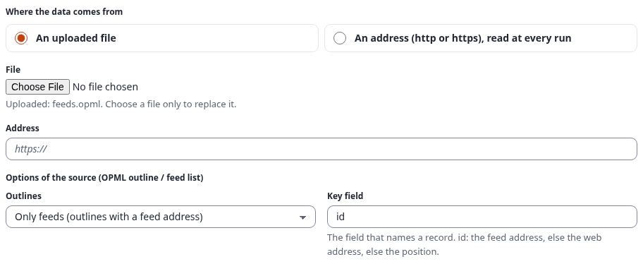

| Attribut | Quellfeld | Umwandlungen | Pflicht |
|---|---|---|---|
| `name` | `title` | | ja |
| `description` | `description` | `richtext` | |
| `location` (URL) | `xml_url` | | |

**Ergebnis:** drei Links (Example news, Example blog, Example releases). Die Kategorien News und Tech und der Link
zur Dokumentation fallen durch *Only feeds* weg; mit **Every outline** sind auch sie Datensätze, mit `depth`, `path`
und `parent_id`, um den Baum nachzubauen. Die Stichprobe zeigt `category` (`News`, oder `Tech/Releases` aus dem
Attribut) und `position` (`1.1`, `1.2`, `2.1`).

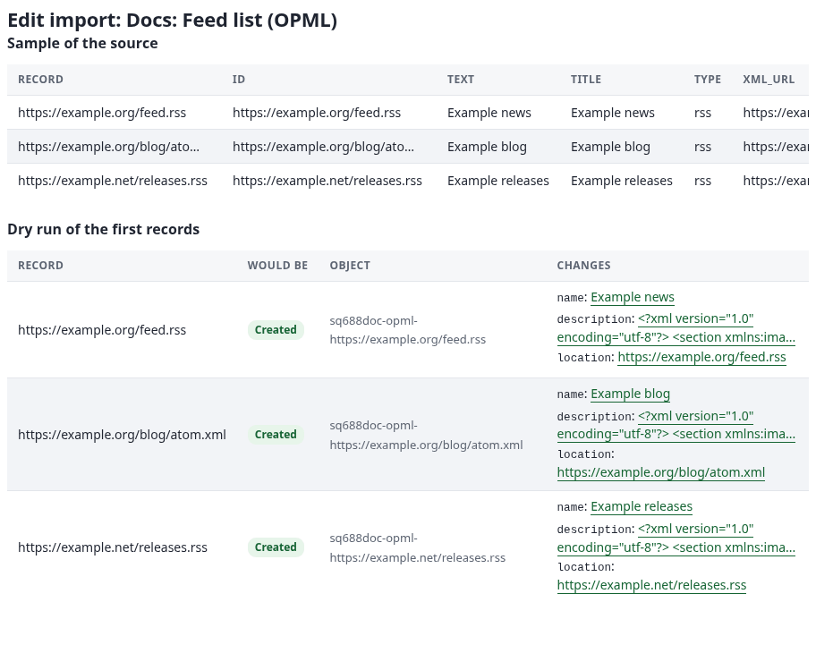

### Ein Feed-Import pro Eintrag

**Ziel:** jedem Feed der Liste folgen: ein RSS-Import pro Eintrag, der seinen Feed jeweils in Artikel liest.

Der Befehl liest die Einträge eines OPML-Imports und legt pro Feed-Adresse einen `rss`-Import an, mit dem Feed als
Adresse, der RSS-Vorlage als Zuordnung und dem Elternknoten des OPML-Imports (oder `--parent=<Knoten-ID>`) als Ziel:

```bash
./console ext:sqliimport:opml-feeds docs-files-opml
```

```
PASS created docs-files-opml-example-news https://example.org/feed.rss
PASS created docs-files-opml-example-blog https://example.org/blog/atom.xml
PASS created docs-files-opml-example-releases https://example.net/releases.rss
The feed imports are disabled: check their mapping in the administration, then enable them.
```

Die Bezeichner beginnen mit dem Bezeichner des OPML-Imports (oder `--prefix=`). Die neuen Importe sind
**deaktiviert**: Öffnen Sie jeden im Editor, prüfen Sie die Zuordnung (Klasse `article`, Remote-ID `feed-{id}`),
aktivieren Sie ihn im Schritt Überprüfung und geben Sie ihm einen Zeitplan. Ein zweiter Aufruf legt nur die Importe
an, die es noch nicht gibt, und kann so einer wachsenden Liste folgen.

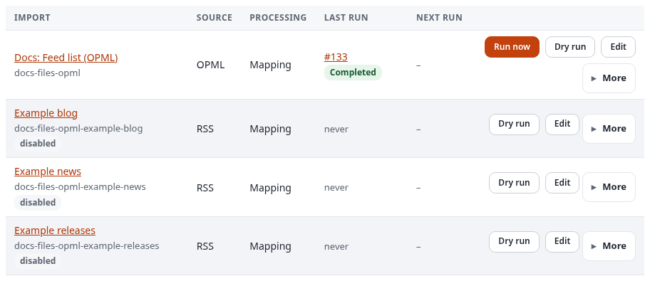

## Apache Avro (`avro`) und Apache Arrow (`arrow`)

Optionen: [sources.md, Apache Avro und Apache Arrow oder Feather](sources.md#apache-avro-avro-und-apache-arrow-oder-feather-arrow).
Docs-Importe „Docs: Teas (Avro)“ (Probelauf #172) und „Docs: Teas (Arrow)“ (Probelauf #173), je 5 würden
angelegt.

**Ziel:** die Tees aus dem Export einer Datenpipeline, geschrieben von einem Kafka-Connector (Avro) oder von pandas
oder Polars (Arrow oder Feather), mit einem verschachtelten Datensatz, einer Liste, einer Dezimalzahl und
Zeitstempeln.

**Eingabe:** `share/examples/teas.avro` (eine Object-Container-Datei, Codec deflate, zwei Blöcke) und
`share/examples/teas.arrow` (dieselben fünf Datensätze als Arrow-IPC-Datei, zwei Record-Batches). Beide sind binär;
der erste Datensatz, wie die Quelle ihn liest:

```json
{"id": 1, "name": "Sencha Asamushi", "origin.country": "Japan", "origin.region": "Shizuoka", "kind": "green",
 "tags": "steamed, grassy", "price": "12.50", "harvested": "2026-05-02", "updated": "2026-09-14T08:30:00.000Z",
 "organic": true, "rating": 4.5}
```

**Schritte im Editor:** Quelltyp *Apache Avro file* (oder *Apache Arrow or Feather file*), eine hochgeladene Datei,
*Arrays* **As a joined list (a, b)**, *List separator* `, `, *Key field* `id`. Inhaltsklasse `folder`, Remote-ID
`sq688doc-avro-{id}`.

| Attribut | Quellfeld | Umwandlungen | Pflicht |
|---|---|---|---|
| `name` | `name` | | ja |
| `short_description` | `origin.country` | `template(text="{origin.country}, {price} EUR") \| richtext` | |
| `tags` | `tags` | | |
| `publish_date` | `updated` | `date` | |

Der verschachtelte Datensatz `origin` wird zu `origin.country` und `origin.region` abgeflacht; die Dezimalzahl kommt
als Text `12.50` mit ihren Nachkommastellen, nie als Gleitkommazahl; die Liste `tags` wird wegen der Option *Arrays*
verbunden.

**Ergebnis:** Fünf Ordner würden angelegt. Die Vorschau der Avro-Datei nennt den Codec (`codec: deflate`), die der
Arrow-Datei `format: file`:

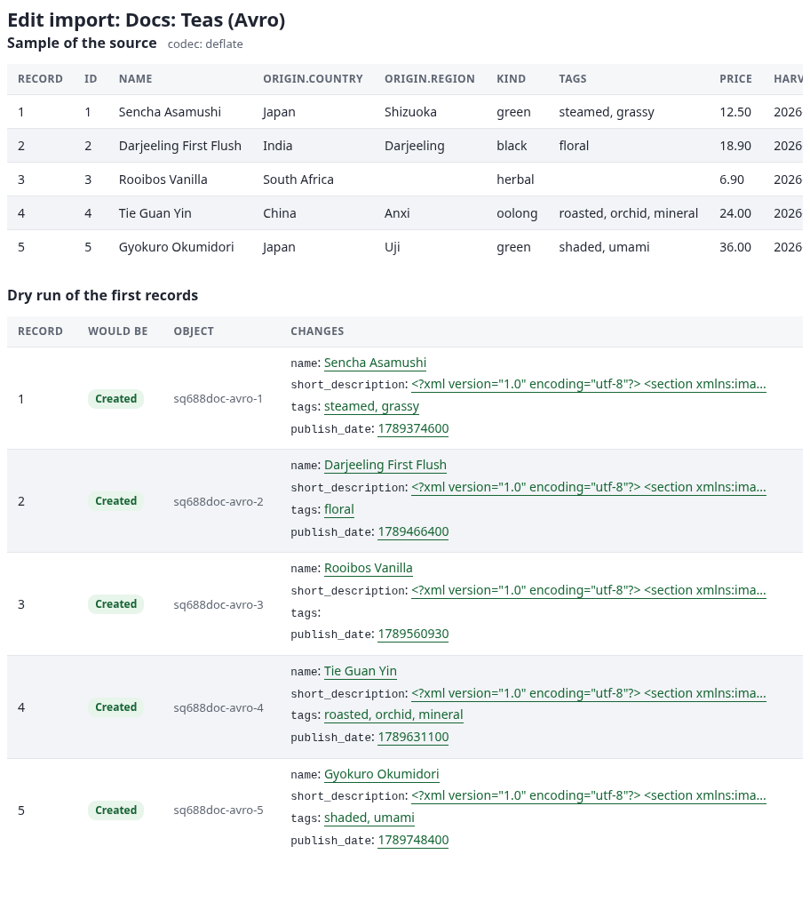

## Parquet, über DuckDB

Parquet-Dateien liest kein eigenes Dateiformat: Das Format DuckDB liest sie mit einer Abfrage (`SELECT ... FROM
data`), die das Programm `duckdb` oder libduckdb auf dem Server braucht. Das durchgespielte Beispiel steht auf der
Seite der Datenbanken: [DuckDB über Parquet oder CSV](source-examples-databases.md#duckdb). Eine Arrow-Datei dagegen
wird hier ohne DuckDB gelesen.

## Fotos in einem ZIP mit EXIF und IPTC (`media`)

Optionen: [sources.md, Mediendateien](sources.md#mediendateien-media).
Docs-Import „Docs: Photos (media ZIP)“: Lauf #134 (echt), 3 angelegt; Lauf #150 (echt, dieselbe Datei noch einmal),
3 unverändert.

**Ziel:** Ein Fotograf liefert ein ZIP mit Fotos; jedes wird ein Bild-Objekt mit Name und Bildunterschrift aus den
IPTC-Feldern, und ein Foto, das noch einmal kommt, wird nicht doppelt importiert.

**Eingabe** (`share/examples/media.zip`):

```
media/Shop/storefront.jpg
media/Shop/teapot.jpg
media/Shop/price-list.txt
media/leaves.jpg
```

Die JPEG-Dateien tragen EXIF- und IPTC-Metadaten, zum Beispiel `storefront.jpg`: Objektname „Storefront“,
Bildunterschrift „The front of the example tea shop with its new awning.“, Schlagwörter shop, spring, street, Stadt
Hamburg, aufgenommen am 2026-03-21T10:15:00 mit „ExampleCam X100“, GPS 53.5511, 9.9937.

**Schritte im Editor:** Quelltyp *Media files (folder as ZIP) with EXIF and IPTC*, eine hochgeladene Datei
`media.zip`, *Files* **Images only**, *Only this folder* leer, *Key field* `path`. Zuordnung aus der Vorlage: Klasse
`image`, Remote-ID `sq688doc-media-{sha1}` (der Hash des Dateiinhalts: Dasselbe Foto wird wiedergefunden, wo immer es
im ZIP liegt).

| Attribut | Quellfeld | Umwandlungen | Pflicht |
|---|---|---|---|
| `name` | `name` | | ja |
| `caption` | `caption` | `richtext` | |
| `image` | `media` | `image` | |

`media` ist die Datei selbst (`source:media/Shop/storefront.jpg`); die Umwandlung `image` nimmt sie aus dem ZIP des
Laufs. Bei einer Klasse mit einem Attribut für Schlagwörter oder Tags ergänzt die Vorlage `keywords` mit
`join(separator=", ")`.

**Ergebnis.** Die Stichprobe listet jedes Feld, das die Quelle las: Pfad, Ordner, Größe, `sha1`, Name,
Bildunterschrift, die Schlagwörter, Autor, Copyright, Stadt, Land, `date_taken`, Breite und Höhe, Kamera, `gps_lat`
und `gps_lon` und die rohen `exif.*`-Felder. `price-list.txt` ist kein Bild und fällt weg. Der echte Lauf legte drei
Bild-Objekte an:

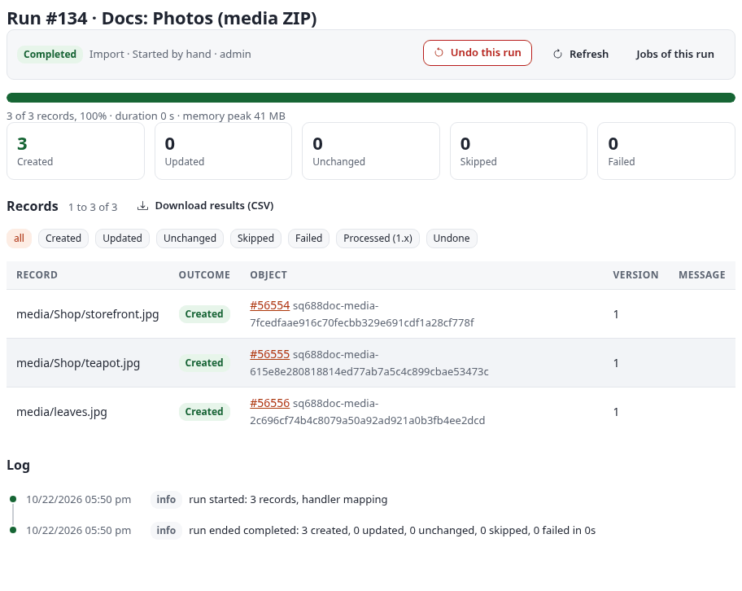

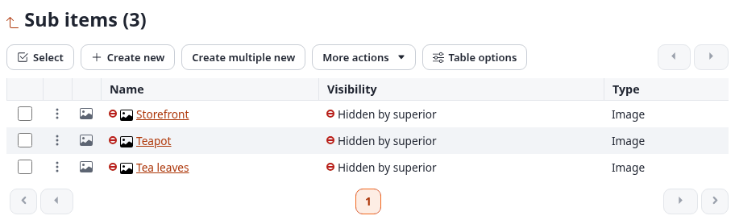

Ein zweiter echter Lauf desselben ZIP (Lauf #150) ließ alle drei **unverändert**. Die nach dem ersten Lauf geöffnete
Vorschau sagt für jedes Bild *Updated* voraus, mit der gespeicherten Datei und der `source:`-Adresse als Änderung; das
ist eine Grenze des Probelaufs, der die Datei nie öffnet, und der echte Lauf entscheidet richtig:

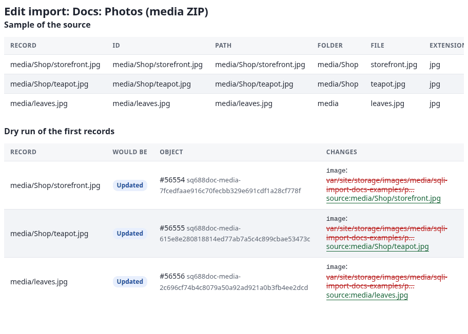

## Ein Ordner mit Markdown-Dateien (`markdown`)

Optionen: [sources.md, Markdown-Dateien](sources.md#markdown-dateien-markdown).
Docs-Import „Docs: Site (Markdown ZIP)“: Probelauf #135, 3 würden angelegt.

**Ziel:** eine kleine Jekyll- oder Hugo-Website oder einen Obsidian-Vault in Artikel übernehmen, mit dem Front Matter
als Feldern.

**Eingabe** (`share/examples/markdown-site.zip`):

```
site/_posts/2026-03-20-spring-opening-hours.md   YAML-Front-Matter, ein Jekyll-Beitrag
site/content/teas/sencha.md                       TOML-Front-Matter (+++), eine Hugo-Seite mit einer Tabelle
site/notes/Tea brewing.md                         Obsidian: [[Links]], Aufgabenliste, ![[teapot.png]]
site/_layouts/default.md                          ein Layout (fällt weg)
site/_drafts/coffee.md                            ein Entwurf (fällt ohne die Option drafts weg)
site/.obsidian/workspace.md                       Einstellungen des Vaults (fällt weg)
```

Die Hugo-Seite:

```
+++
title = "Sencha"
date = 2026-04-02T12:30:00Z
tags = ["tea", "green"]
description = "A Japanese green tea."
+++

# Sencha

Steep at 70 °C for **one minute**.
```

**Schritte im Editor:** Quelltyp *Markdown files (folder as ZIP)*, eine hochgeladene Datei `markdown-site.zip`,
*Read drafts too* aus, *Leave out README and index files* aus, *Only this folder* leer, *Address of [[links]]* leer
(die Links behalten nur ihren Text), *Key field* `id`. Zuordnung aus der Vorlage: Klasse `article`, Remote-ID
`md-{id}` (hier `sq688doc-md-{id}`).

| Attribut | Quellfeld | Umwandlungen | Pflicht |
|---|---|---|---|
| `title` | `title` | | ja |
| `intro` | `summary` | `richtext` | |
| `body` | `html` | `richtext` | |

**Ergebnis:** Drei Artikel würden angelegt: „Spring opening hours“ (`id` `_posts/2026-03-20-spring-opening-hours`,
Datum aus dem Dateinamen), „Sencha“ (Zusammenfassung aus `description`, die Tabelle als HTML) und „Tea brewing“ (der
Titel aus der ersten Überschrift). Das Layout, der Entwurf und der Ordner `.obsidian` sind keine Datensätze.

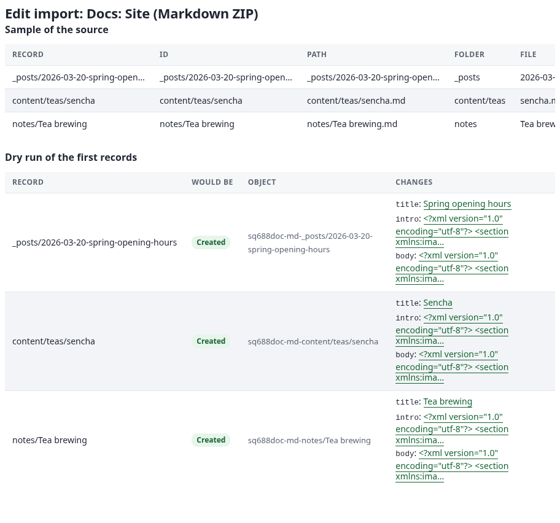

## WordPress-Export (`wxr`)

Optionen: [sources.md, WordPress-Export](sources.md#wordpress-export-wxr).
Docs-Import „Docs: Blog (WordPress WXR)“: Probelauf #136, 3 würden angelegt.

**Ziel:** die veröffentlichten Beiträge und Seiten eines WordPress-Blogs (Werkzeuge, Daten exportieren, Alle Inhalte)
als Artikel, mit ihrem Beitragsbild.

**Eingabe** (`share/examples/wordpress.xml`, ein Eintrag, gekürzt):

```xml
<item>
  <title><![CDATA[New tea selection]]></title>
  <link>https://blog.example.org/2026/04/new-tea-selection/</link>
  <dc:creator><![CDATA[editor]]></dc:creator>
  <content:encoded><![CDATA[Twelve new teas are in.

Come and taste them
on Saturday.
...]]></content:encoded>
  <excerpt:encoded><![CDATA[Twelve new teas are in.]]></excerpt:encoded>
  <wp:post_id>11</wp:post_id>
  <wp:status><![CDATA[publish]]></wp:status>
  <wp:post_type><![CDATA[post]]></wp:post_type>
  <wp:postmeta><wp:meta_key><![CDATA[_thumbnail_id]]></wp:meta_key><wp:meta_value><![CDATA[10]]></wp:meta_value></wp:postmeta>
</item>
```

Die Datei enthält außerdem einen Anhang (das Foto mit der ID 10), eine Seite „About us“ und einen Entwurf „Draft
about coffee“.

**Schritte im Editor:**

| Feld | Wert |
|---|---|
| Quelltyp | *WordPress export (WXR)* |
| Where the data comes from | An uploaded file: `wordpress.xml` |
| Records | Posts and pages |
| Post types | `post` und `page`, einer pro Zeile |
| Status | Only published |
| Key field | `id` |
| Inhaltsklasse, Abgleich | `article`, Remote-ID `sq688doc-wp-{type}-{id}` (die Vorlage: `wp-{type}-{id}`) |

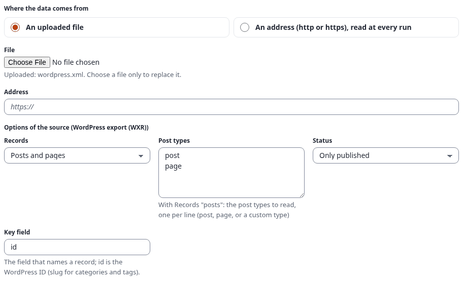

| Attribut | Quellfeld | Umwandlungen | Pflicht |
|---|---|---|---|
| `title` | `title` | | ja |
| `intro` | `excerpt` | `richtext` | |
| `body` | `content_html` | `richtext` | |
| `image` (Objektbeziehung) | `featured_image` | `media_object` | |

`content_html` hat die Absätze, die WordPress aus Leerzeilen macht; `featured_image` ist die Adresse des Anhangs, den
`_thumbnail_id` nennt. Die Klasse `article` verknüpft ihr Bild (`ezobjectrelation`), deshalb wählt die Vorlage
`media_object`, das das Bild als Bild-Objekt importiert und verknüpft; eine Klasse mit einem Bildattribut
(`ezimage`) bekommt stattdessen `image`.

**Ergebnis:** Drei Artikel würden angelegt: die Beiträge 11 „New tea selection“ und 12 „Spring opening hours“ und die
Seite 13 „About us“. Der Entwurf fällt durch *Only published* weg, der Anhang, weil die Datensätze Beiträge und
Seiten sind (wählen Sie *Records* **Media (attachments)**, um zuerst die Mediathek zu importieren).

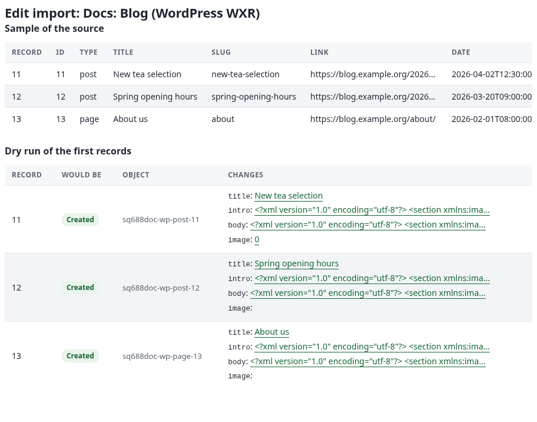

## iCalendar (`ical`)

Optionen: [sources.md, iCalendar](sources.md#icalendar-ical).
Docs-Import „Docs: Events (iCalendar)“: Probelauf #137, 4 würden angelegt.

**Ziel:** die Termine aus dem Kalender-Abonnement eines Buchungssystems als Veranstaltungs-Objekte, in der richtigen
Zeitzone.

**Eingabe** (`share/examples/events.ics`, der erste Termin, gekürzt):

```
BEGIN:VEVENT
UID:weekly-meetup-1@example.org
SUMMARY:Weekly user group meetup
DESCRIPTION:Talks\, demos and questions.\nBring your laptop\; the room has
  power outlets.
LOCATION:Example Hall\, Room 2\, 1 Example Street
DTSTART;TZID=Europe/Berlin:20261105T190000
DTEND;TZID=Europe/Berlin:20261105T210000
RRULE:FREQ=WEEKLY;BYDAY=TH;COUNT=8
EXDATE;TZID=Europe/Berlin:20261126T190000
CATEGORIES:Meetup,Community
END:VEVENT
```

Die Datei hat außerdem einen geänderten Termin dieser Serie (`RECURRENCE-ID`, verlegt in Raum 5), einen ganztägigen
Tag der offenen Tür, ein Online-Webinar in UTC und eine Aufgabe (`VTODO`).

**Schritte im Editor:** Quelltyp *iCalendar (.ics)*, eine hochgeladene Datei `events.ics` (oder *An address*: der
Link des Abonnements, bei jedem Lauf gelesen), *Records* **Events (VEVENT)**, *Time zone* `Europe/Berlin`, *Key
field* `id`. Zuordnung aus der Vorlage: Klasse `event`, Remote-ID `ical-{id}` (hier `sq688doc-ical-{id}`).

| Attribut | Quellfeld | Umwandlungen | Pflicht |
|---|---|---|---|
| `short_title` (von der Klasse verlangt) | `summary` | `trim \| truncate(length=60)` | ja |
| `title` | `summary` | `trim` | |
| `text` | `description` | `richtext` | |
| `category` (Schlagwörter) | `categories` | `join(separator=", ")` | |
| `from_time` | `start_timestamp` | `date` | ja |
| `to_time` | `end_timestamp` | `date` | |

Das Raster des Schritts Zuordnung mit diesen Zeilen:

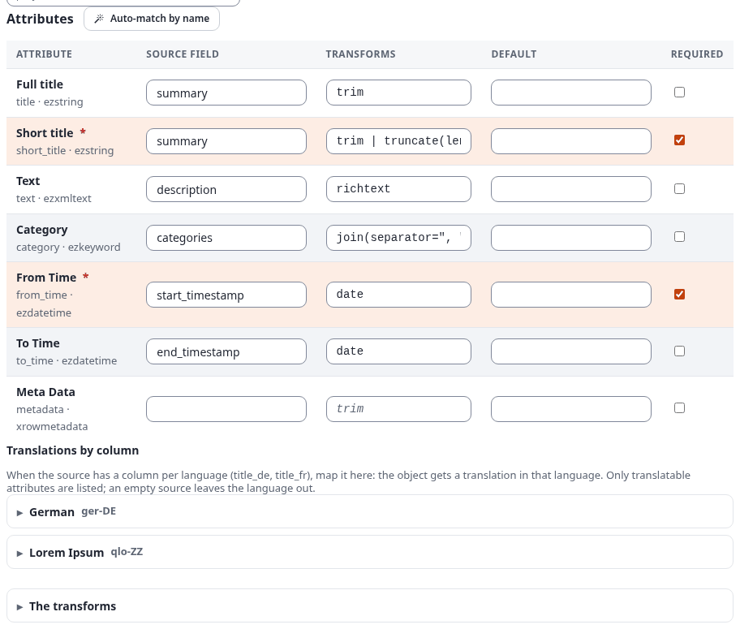

**Ergebnis:** Vier Veranstaltungen würden angelegt; die Aufgabe fällt durch *Events (VEVENT)* weg. Das Treffen
beginnt um `1793901600` (5. November 2026, 19:00 in Berlin, 18:00 UTC); der verlegte Termin hat die ID
`weekly-meetup-1@example.org@2026-11-12T18:00:00Z` und ist damit ein eigenes Objekt neben der Serie; der Tag der
offenen Tür ist ganztägig (`start_iso` `2026-11-21`). Die Wiederholungsregel wird nicht aufgelöst: Ordnen Sie `rrule`
einem Textattribut zu, wenn die Website sie zeigt.

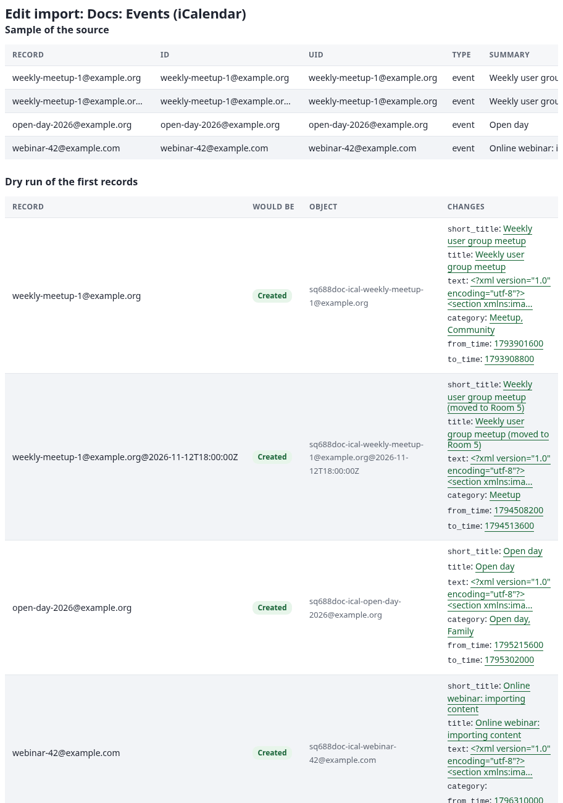

## vCard (`vcard`)

Optionen: [sources.md, vCard](sources.md#vcard-vcard).
Docs-Import „Docs: Contacts (vCard)“: Probelauf #138, 3 würden angelegt.

**Ziel:** die Personen einer Team-Seite, aus einem Adressbuch exportiert, als Personen-Objekte. Die Beispieldatei
enthält erfundene Personen mit Adressen unter `example.com` und 555-Nummern; importieren Sie echte Kontaktdaten nur,
wo die Personen zugestimmt haben.

**Eingabe** (`share/examples/contacts.vcf`, die erste Karte, gekürzt):

```
BEGIN:VCARD
VERSION:4.0
UID:urn:uuid:4fbe8971-0bc3-424c-9c26-36c3e1eff6b1
FN:Alex Example
N:Example;Alex;J.;Dr.;
ORG:Example Corp;Research
TITLE:Head of Research
EMAIL;TYPE=work;PREF=1:alex@example.com
NOTE:Met at the example conference\, 2026.\nLikes long
  walks in example parks.
PHOTO:https://example.com/photos/alex.jpg
END:VCARD
```

Die zweite Karte ist vCard 3.0 ohne UID, die dritte hat ein eingebettetes Foto.

**Schritte im Editor:** Quelltyp *vCard contacts (.vcf)*, eine hochgeladene Datei `contacts.vcf`, *Key field* `id`.
Eine Vorlage gibt es nicht (eine Standardinstallation hat keine Kontakt-Klasse); diese Website hat die Klasse
`ng_person`. Remote-ID `sq688doc-vcard-{id}`.

| Attribut | Quellfeld | Umwandlungen | Pflicht |
|---|---|---|---|
| `name` | `fn` | | ja |
| `cv` | `note` | `richtext` | |
| `image` | `photo` | `image` | |

**Ergebnis:** Drei Personen würden angelegt. Die erste wird über ihre UID ohne `urn:uuid:` gefunden; die Karte ohne
UID bekommt `vcard-` und einen Hash (`vcard-ef66682dd84e7825`), der gleich bleibt, solange Name und E-Mail-Adresse es
tun; das eingebettete Foto der dritten Karte wird nicht übernommen (`photo_embedded` ist `1`, `photo` leer). Die
Vorschau bei 960 Pixeln und doppelter Skalierung:

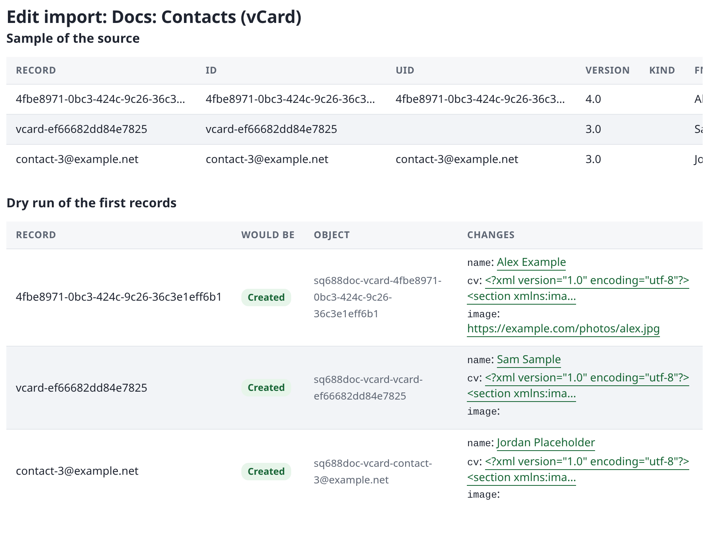

## Siehe auch

- [sources.md](sources.md): jede Option jedes Formats.
- [Feeds und Webseiten](source-examples-feeds-web.md): RSS und Atom, Podcasts, YouTube und Vimeo, Sitemaps und der
  Webseiten-Scraper.
- [mappings.md](mappings.md) und [transforms.md](transforms.md): was eine Zuordnung speichert, und jede Umwandlung.
- [editor.md](editor.md): die sechs Schritte des Editors. [runs.md](runs.md): die Seite des Laufs, Wiederholen und
  Rückgängigmachen.
