# Getting started: your first import, step by step

This page takes you from an installation without imports to five products published from a CSV file, then through
a second run that updates two of them, adds two and stops a broken line before it reaches the site. Every screenshot
and every number on this page comes from that real import, "Docs: First import (teas CSV)", made on a test
installation.

German: [ger-de/getting-started.md](ger-de/getting-started.md).

## Table of contents

- [Before you start](#before-you-start)
  - [Activate the extension](#activate-the-extension)
  - [Who may do what: Manage imports and Run imports](#who-may-do-what-manage-imports-and-run-imports)
  - [The Imports tab](#the-imports-tab)
  - [The catalogue: every format the site can read](#the-catalogue-every-format-the-site-can-read)
- [Your first CSV import](#your-first-csv-import)
  - [The file](#the-file)
  - [Step 1: Source](#step-1-source)
  - [Step 2: Processing](#step-2-processing)
  - [Step 3: Mapping](#step-3-mapping)
  - [Step 4: Preview](#step-4-preview)
  - [Step 5: Schedule](#step-5-schedule)
  - [Step 6: Review and save](#step-6-review-and-save)
  - [The run](#the-run)
  - [What appears in the content tree](#what-appears-in-the-content-tree)
- [The second run: changes, a new product and a broken line](#the-second-run-changes-a-new-product-and-a-broken-line)
- [What to read next](#what-to-read-next)

## Before you start

### Activate the extension

7x SQLI Import needs two other extensions: **expqueue** (the job queue that does the work of every run) and
**expui** (the shared parts of the administration). [install.md](install.md) has every detail; the short version:

```bash
composer require se7enxweb/sqliimport:^2.0
```

```ini
# settings/override/site.ini.append.php
[ExtensionSettings]
ActiveExtensions[]=expqueue
ActiveExtensions[]=expui
ActiveExtensions[]=sqliimport
```

```bash
php bin/php/ezpgenerateautoloads.php -e
./console ext:expqueue:install-schema
./console ext:sqliimport:install-schema
php bin/php/ezcache.php --clear-tag=ini
```

And two cron lines, every minute: `php runcronjobs.php -q expqueue` (the workers that process the runs) and
`php runcronjobs.php -q sqliimport` (the schedules and the clean-up).

To offer imports only in the administration, list the three extensions under `ActiveAccessExtensions[]` in the
`site.ini.append.php` of the admin siteaccesses instead. A siteaccess whose `menu.ini.append.php` resets
`[TopAdminMenu] Tabs[]` must add `Tabs[]=sqliimport` itself, or the tab is missing there
([troubleshooting.md](troubleshooting.md#the-imports-tab-is-missing)).

### Who may do what: Manage imports and Run imports

The module `sqliimport` has two policies. Give them in **Users, Roles** like any other policy:

| Policy | Shown as | What the user can do |
|---|---|---|
| `sqliimport/manage` | Manage imports | Everything: create, edit, copy, enable, disable and delete imports, schedules and triggers, the Settings page, and all that Run imports allows |
| `sqliimport/run` | Run imports | See the Imports tab, run imports (Run now, Dry run), cancel runs, retry failed rows, undo runs |

Both take the limitation **Handler** (`SQLIImport_Type`): a role with *Run imports* limited to `mapping` runs only
the no-code imports. Typical roles are in [permissions.md](permissions.md#typical-roles). The user who runs an
import also needs the content policies for what it creates (content/create below the parent, content/edit).

### The Imports tab

With the extension active, the header has the tab **Imports**:


Its left menu lists the pages of the tool, and below them the other import and export tools of the site:

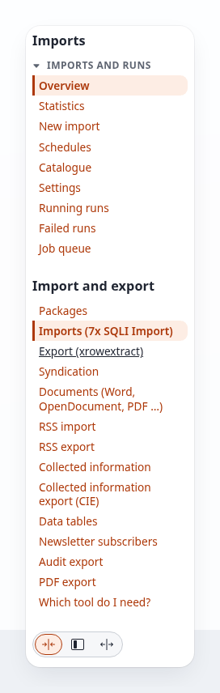

The **Overview** is the dashboard: the key figures, a Run now toolbar, the imports and the runs.

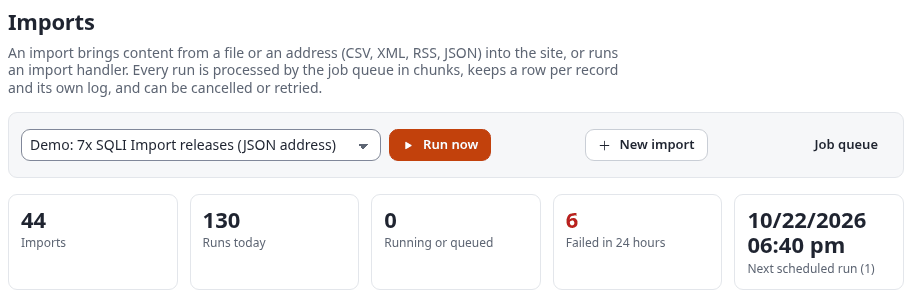

The same page in dark mode, as it looks at 960 pixels wide and 200% zoom:

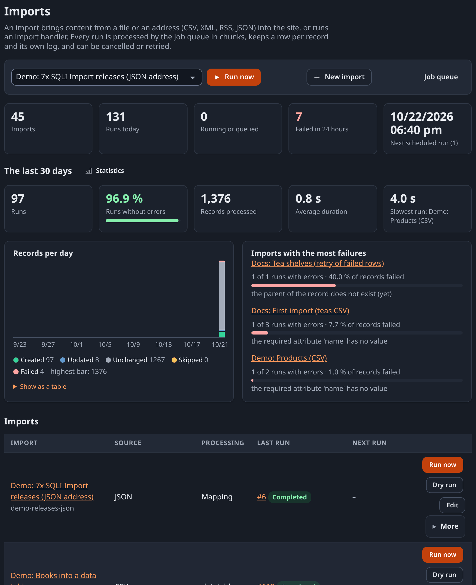

The admin dashboard (**Dashboard** in the header) also gets a block **Imports** with the latest runs:

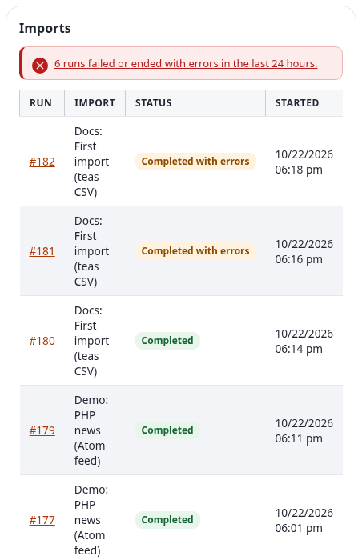

### The catalogue: every format the site can read

**Catalogue** lists every source type of the site, grouped as files and data, NoSQL databases, content, platforms,
commerce, media and other. Each card says what the format reads, offers an example file and the button
**New import** that opens the editor with that format chosen:

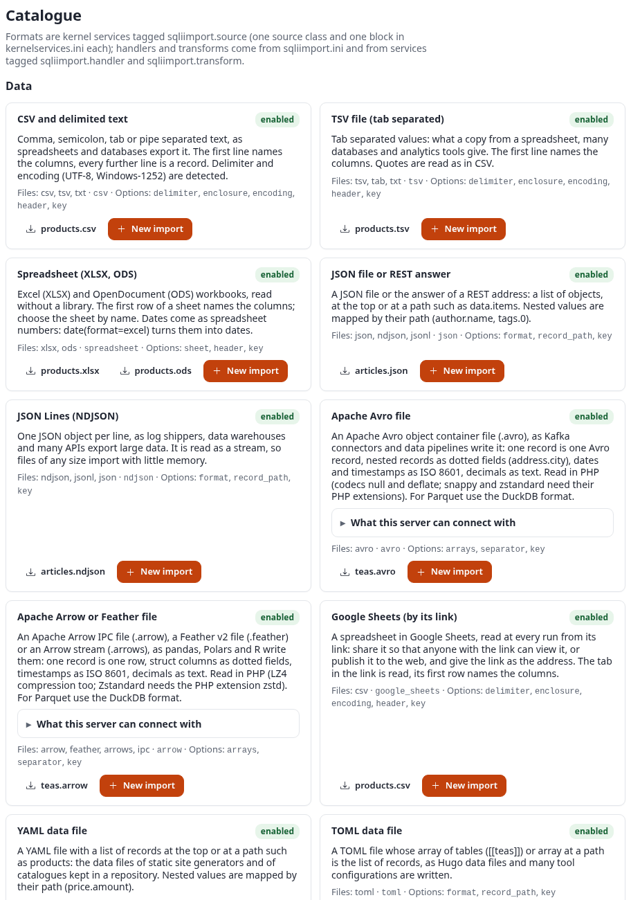

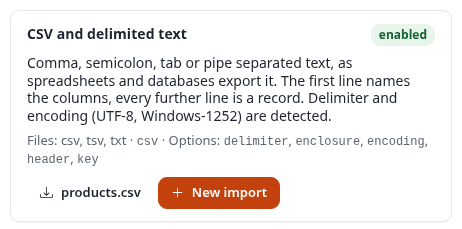

Worked examples of every source are in [source-examples-files.md](source-examples-files.md),
[source-examples-feeds-web.md](source-examples-feeds-web.md), [source-examples-apis.md](source-examples-apis.md),
[source-examples-databases.md](source-examples-databases.md) and [source-examples-platforms.md](source-examples-platforms.md).

## Your first CSV import

Goal: five teas from a spreadsheet export become **Product** objects (the webshop's class `product`) in a folder,
with their name, product number, short description and price. Running the import again must update the products,
not create them twice.

### The file

`teas.csv`, as a spreadsheet saves it (comma separated, a header line, UTF-8):

```text
id,name,code,description,price,harvest
101,Assam Breakfast,TEA-101,"A strong, malty black tea from the Brahmaputra valley.",6.95,2026-04-12
102,Darjeeling First Flush,TEA-102,"Light and floral, picked in spring.",12.45,2026-03-28
103,Sencha Asahi,TEA-103,"A grassy Japanese green tea, steamed.",9.85,2026-05-02
104,Earl Grey Blue Flower,TEA-104,"Black tea with bergamot and cornflower petals.",7.45,2026-02-15
105,White Peony,TEA-105,"A mild white tea with silver buds.",11.25,2026-04-20
```

The column `id` is the key: it names each tea, and the import makes each product's remote ID from it, so a later
run finds the same product again.

### Step 1: Source

Open **Imports, New import** (or **New import** on the catalogue card CSV). Fill in:

| Field | Value |
|---|---|
| Name | `Docs: First import (teas CSV)` |
| Identifier | `docs-first-import` (the name on the command line; empty: made from the name) |
| Description | `Five teas from a CSV file as products: the worked example of the manual.` |
| Source type | **CSV and delimited text** |
| Where the data comes from | **An uploaded file**, then choose `teas.csv` |
| Delimiter | **Comma** (Detect also works) |
| Enclosure | `"` |
| Encoding | **Detect** |
| The first line names the columns | checked |
| Key field | `id` |

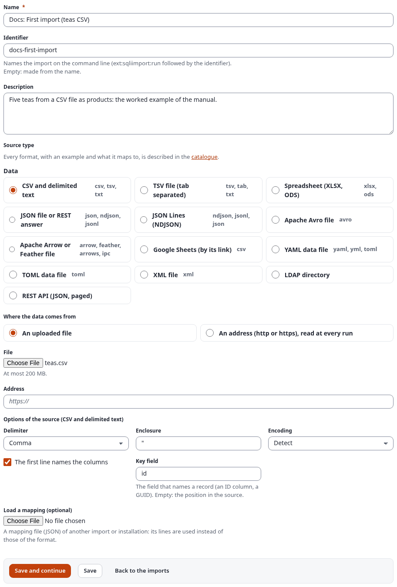

Choose **Save and continue**. The import now exists (still disabled), and the steps above the form become links.

### Step 2: Processing

| Field | Value |
|---|---|
| How the records are processed | **Mapping to a content class (no code)** |
| Parent node of new content | the node ID of the folder the products go to (here `54990`, the folder "First import (teas)") |
| Section, Language, Run as user | left as they are: the parent's section, the site's language, the user who starts the run |
| Records per chunk | `200` (the default) |
| Existing content | **Create new, update existing** |
| When someone edited an object since the last run | **Overwrite with the source** (the other rules are shown in [runs.md](runs.md#conflict-rules-when-an-editor-changed-an-imported-object)) |
| Days a run can be undone | empty: the setting, 30 days |
| Notifications | **failed or had errors**, a notice for the user who started the run |

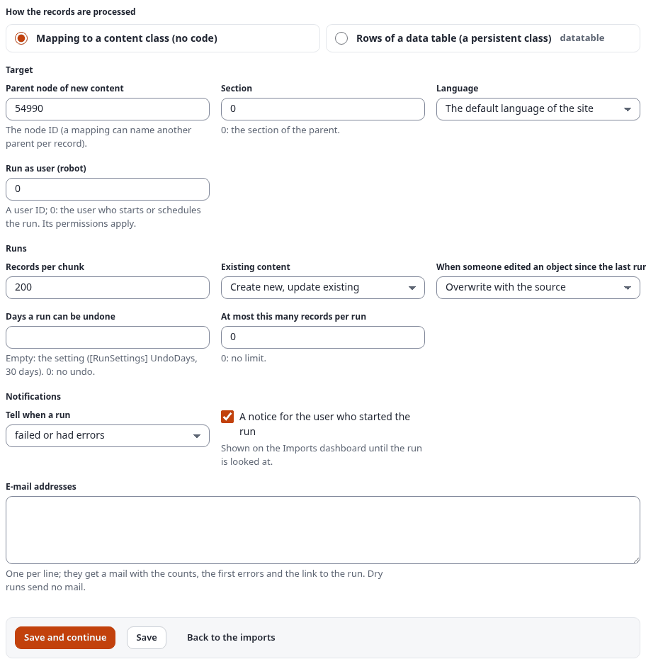

The node ID of a folder is shown in the content tree (hover over the folder, or open it: the address ends with
`/content/view/full/<node id>`). Choose **Save and continue**.

### Step 3: Mapping

First choose the **Content class** `Product (product)` and the remote ID pattern `docs-tea-{id}`, then choose
**Save**: the grid of the class's attributes appears.

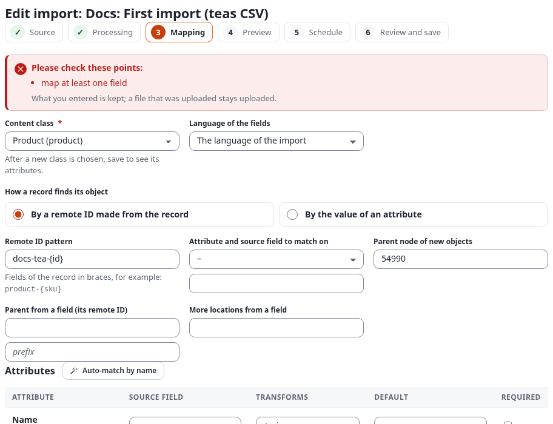

**Auto-match by name** fills what it can find by itself: here `name`, `description` (with `richtext`, because short
description is a rich text attribute) and `price`. It says "Auto-match filled 3 lines. Check them, then save.":

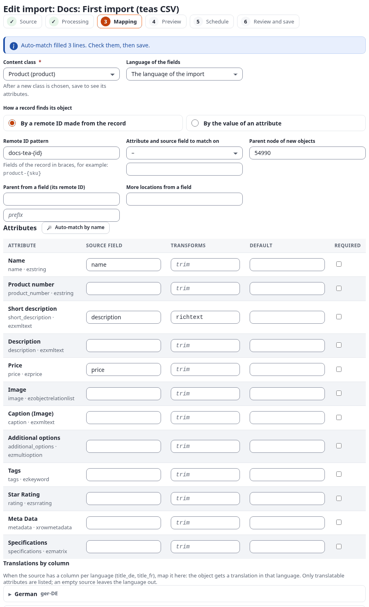

Check and complete the lines:

| Attribute | Source field | Transforms | Required |
|---|---|---|---|
| Name (`name`) | `name` | `trim` | checked |
| Product number (`product_number`) | `code` | | |
| Short description (`short_description`) | `description` | `richtext` | |
| Price (`price`) | `price` | `number \| template(text="{value}\|1\|1")` | |

The price needs its own text: the price datatype reads `amount|VAT type|price includes VAT`, so the chain first
reads the number and then writes `6.95|1|1` (VAT type 1, price includes VAT). A plain amount without this form gets the
default VAT of the class attribute ([transforms.md](transforms.md#datatypes-that-need-a-special-text)).

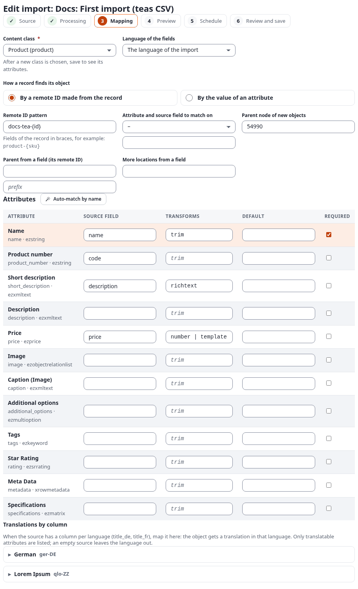

Choose **Save and continue**. The same mapping as a mapping file (**Download mapping (JSON)** at the bottom of the
step) reads:

```json
{
  "class": "product",
  "match": { "type": "remote_id", "pattern": "docs-tea-{id}" },
  "fields": [
    { "source": "name", "attribute": "name", "transforms": [ { "name": "trim" } ], "required": true },
    { "source": "code", "attribute": "product_number" },
    { "source": "description", "attribute": "short_description", "transforms": [ { "name": "richtext" } ] },
    { "source": "price", "attribute": "price",
      "transforms": [ { "name": "number" }, { "name": "template", "args": { "text": "{value}|1|1" } } ] }
  ]
}
```

### Step 4: Preview

The preview reads the file and runs the first records through the mapping **without publishing anything**: the
sample of the source above, a dry run below, with what each record would become.

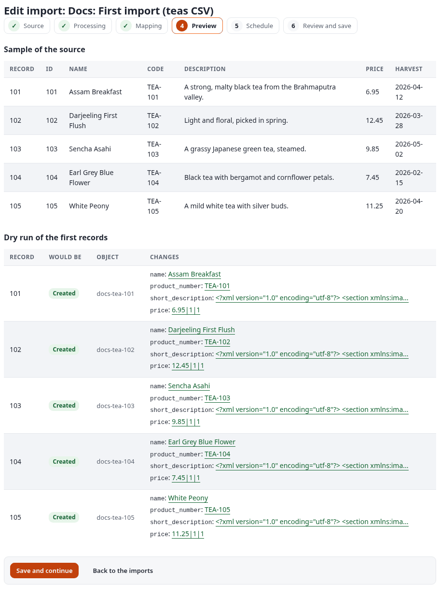

Every record says **Created**, with the remote ID it gets and the values of its fields. If something is wrong here
(a column that is empty, a price that reads 0), go back to step 3, fix the line and open the preview again.

### Step 5: Schedule

For a first import, leave **Runs by itself** at **Never (only by hand or from the command line)**. Schedules are
explained in [schedules.md](schedules.md); the trigger for other systems below it in [triggers.md](triggers.md).

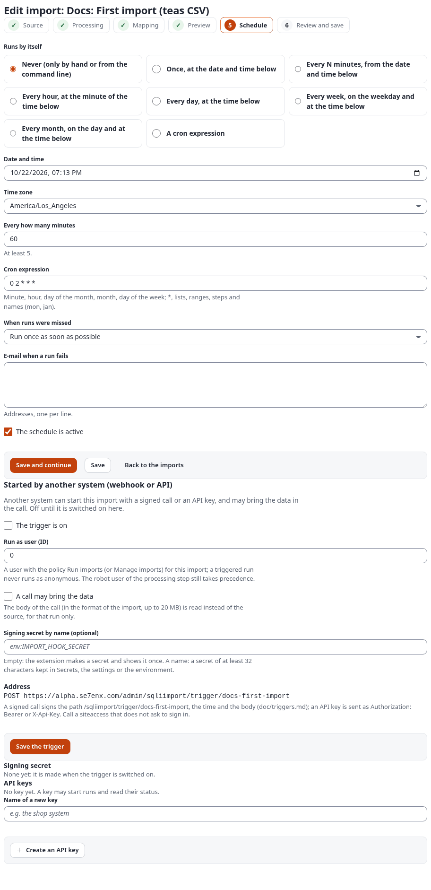

### Step 6: Review and save

The review sums up the import. Check **The import is enabled (it can run and its schedule runs it)** and choose
**Save and run**:

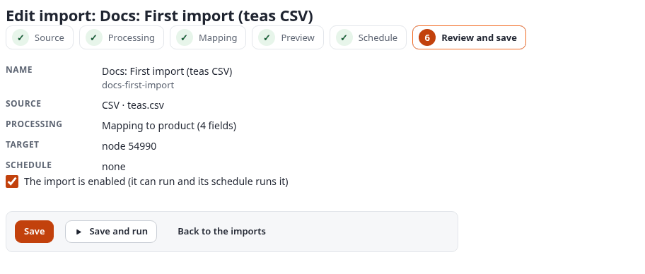

### The run

**Save and run** queues a run and opens its page. The page follows the run live (every two seconds) until it ends:

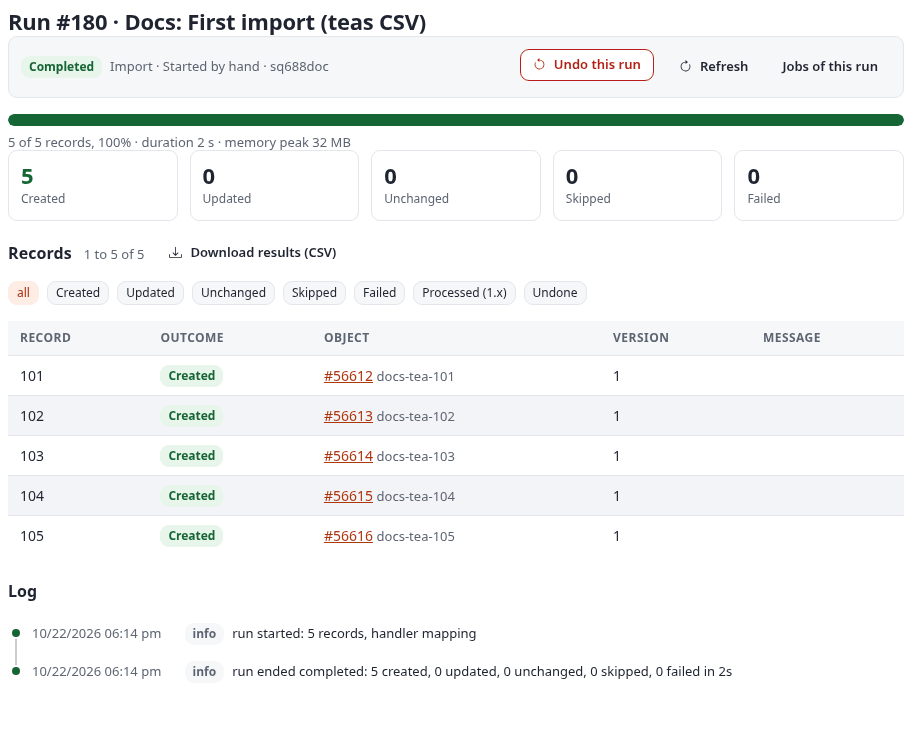

Five records, five **Created**, each with its object (`#56612` ...) and its remote ID. The log says
`run ended completed: 5 created, 0 updated, 0 unchanged, 0 skipped, 0 failed`. **Undo this run** would take the
five products back (to the trash) within 30 days ([runs.md](runs.md#undo-a-run)).

### What appears in the content tree

The folder "First import (teas)" now has five products:

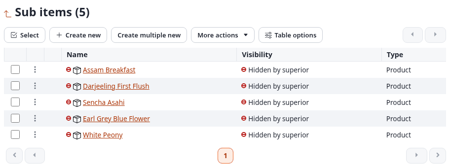

(They show "Hidden by superior" only because the documentation's example folder is hidden; your products are
visible as their folder is.)

## The second run: changes, a new product and a broken line

A week later, the spreadsheet has changed. `teas-v2.csv` differs from `teas.csv` in four lines:

```diff
-102,Darjeeling First Flush,TEA-102,"Light and floral, picked in spring.",12.45,2026-03-28
+102,Darjeeling First Flush,TEA-102,"Light and floral, picked in spring.",13.95,2026-03-28
-104,Earl Grey Blue Flower,TEA-104,"Black tea with bergamot and cornflower petals.",7.45,2026-02-15
+104,Earl Grey Blue Flower (organic),TEA-104,"Black tea with bergamot and cornflower petals.",7.45,2026-02-15
+106,Genmaicha,TEA-106,"Green tea with roasted rice.",5.65,2026-05-10
+107,,TEA-107,"Smoky black tea, its name is missing in this file.",8.15,2026-03-02
```

1. **Replace the file.** **Edit** the import, step 1: choose the new file under **File** and **Save**. The step
   says which file is in use ("Uploaded: teas-v2.csv. Choose a file only to replace it.").
2. **Dry run first.** On the dashboard, **Dry run** next to the import. The dry run reads the whole file, publishes
   nothing, and lists for each record what would happen, with the fields that would change:

   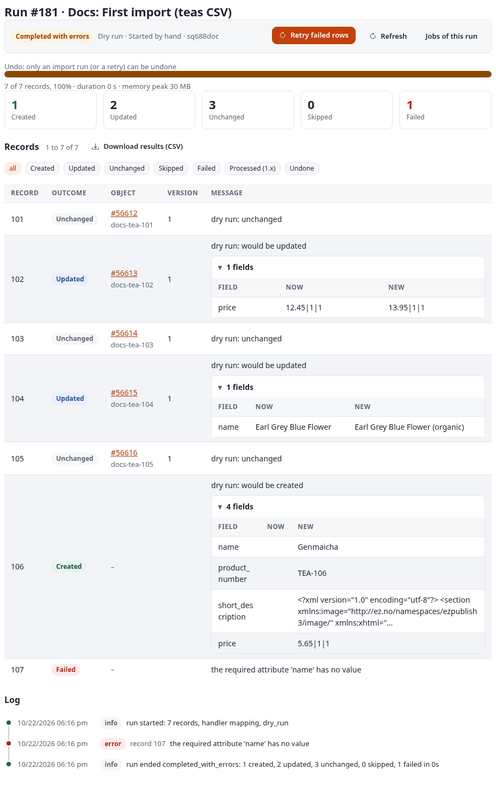

   Line 107 has no name, and the line `name` is required, so it fails with "the required attribute 'name' has no
   value". It would not have been published in a real run either, but the dry run shows it before anything
   changes.
3. **Fix the file and run.** The corrected `teas-v3.csv` has the name `Lapsang Souchong` in line 107. Upload it as
   in 1., then **Run now**:

   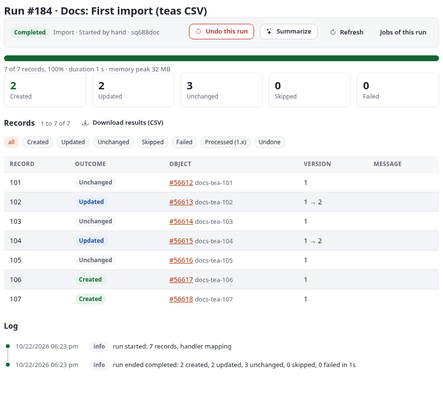

   Only what changed got a new version: 102 and 104 went from version 1 to 2; 101, 103 and 105 are **Unchanged**
   (no new version, nothing to re-index); 106 and 107 are new.

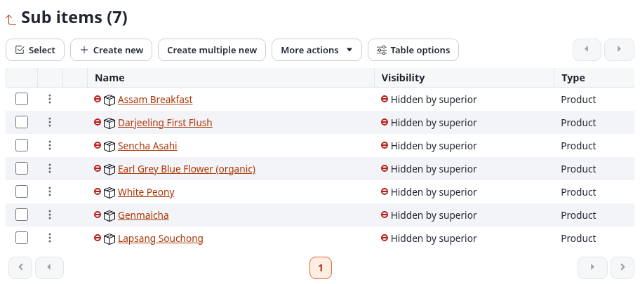

**Download results (CSV)** on the run page gives one line per record (`sqliimport/report/184`):

```text
run_id,row,ref,outcome,status,object_id,node_id,remote_id,version_before,version_after,changed_fields,message,time
184,0,101,unchanged,ok,56612,54991,docs-tea-101,1,1,,,2026-10-23T01:23:02Z
184,1,102,updated,ok,56613,54992,docs-tea-102,1,2,,,2026-10-23T01:23:03Z
184,2,103,unchanged,ok,56614,54993,docs-tea-103,1,1,,,2026-10-23T01:23:03Z
184,3,104,updated,ok,56615,54994,docs-tea-104,1,2,,,2026-10-23T01:23:03Z
```

Why "fix the file and run" and not **Retry failed rows**: a retry processes the failed records as the failed run
stored them, so a record that failed because of its own data fails again. Retry is for causes outside the record,
such as a parent that did not exist yet ([runs.md](runs.md#retry-failed-rows)).

## What to read next

| You want to | Read |
|---|---|
| Know every field of the six steps | [editor.md](editor.md) |
| Map other datatypes, dates, images, translations, relations | [mappings.md](mappings.md), [transforms.md](transforms.md) |
| Read another format | the source examples, starting with [source-examples-files.md](source-examples-files.md) |
| Stop, retry, undo runs, handle edits by editors, get notified | [runs.md](runs.md) |
| Run imports by themselves | [schedules.md](schedules.md) |
| Start an import from another system | [triggers.md](triggers.md) |
| Fill a data table instead of content | [datatables.md](datatables.md) |
| Fix a problem | [troubleshooting.md](troubleshooting.md) |
