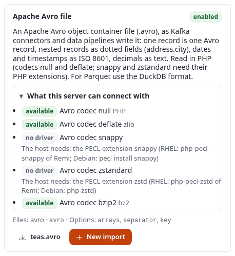

# Installation

This page installs 7x SQLI Import 2.0 on an Exponential installation, checks that it works, and says what to do
after a deploy. A first import, step by step, follows in [getting-started.md](getting-started.md).

German: [ger-de/install.md](ger-de/install.md).

## Table of contents

- [Requirements](#requirements)
- [Install](#install)
- [The Imports tab](#the-imports-tab)
- [Check the installation](#check-the-installation)
- [After a deploy: PHP-FPM and Velocity](#after-a-deploy-php-fpm-and-velocity)
- [Print or write the schema](#print-or-write-the-schema)
- [Upgrading from 1.x](#upgrading-from-1x)

## Requirements

- Exponential 6.0.14 or later.
- PHP 8.0 or later, with `json`, `mbstring`, `dom` and `xmlreader`.
- The extension **expqueue** (the job queue). Every run is processed by its workers.
- The extension **expui** (the shared components of the administration).
- MySQL/MariaDB, PostgreSQL, SQLite or Oracle.

Optional (suggested in `composer.json`):

- `zip` (`ext-zip`) reads spreadsheet sources (XLSX and ODS). Without it, every other source type works, and a
  spreadsheet import fails with a message that names the missing extension.
- `pcntl` lets a 1.x run started by the old cron part be stopped safely with SIGTERM or SIGINT.

## Install

```bash
composer require se7enxweb/sqliimport:^2.0@alpha
```

1. Activate the extensions in `settings/override/site.ini.append.php`:

   ```ini
   [ExtensionSettings]
   ActiveExtensions[]=expqueue
   ActiveExtensions[]=expui
   ActiveExtensions[]=sqliimport
   ```

   To use the extension only in the administration, list it in `ActiveAccessExtensions[]` of the admin
   siteaccesses instead, for example:

   ```ini
   # settings/siteaccess/admin/site.ini.append.php
   [ExtensionSettings]
   ActiveAccessExtensions[]=expqueue
   ActiveAccessExtensions[]=expui
   ActiveAccessExtensions[]=sqliimport
   ```

   The test installation of this manual works that way: Imports, its pages and its webhook address exist only below
   `/admin`. A cron part runs with the settings of the siteaccess it is started for, so when the extension is not
   active everywhere, start the cron parts for an admin siteaccess with `-s admin`.

2. Regenerate the autoloads:

   ```bash
   php bin/php/ezpgenerateautoloads.php -e
   ```

3. Create the tables of the job queue and of 7x SQLI Import. Both commands are idempotent; the second one also
   upgrades the tables of 1.x:

   ```bash
   ./console ext:expqueue:install-schema
   ./console ext:sqliimport:install-schema
   ```

4. Run the cron part of the job queue every minute:

   ```bash
   * * * * * cd /path/to/exponential && php runcronjobs.php -q expqueue
   ```

   The part `expqueue` runs the workers that process the runs (expqueue can also run as a systemd service), and it
   also runs the **tick** of 7x SQLI Import: it queues the runs of due schedules and of pending 1.x import requests,
   ends runs whose jobs ended, and removes old runs. The extension's own part does only the tick; add it when the
   job queue's workers run as a service instead of from cron:

   ```bash
   * * * * * cd /path/to/exponential && php runcronjobs.php -q sqliimport
   ```

   Both may run: a lock keeps two ticks from overlapping. The test installation of this manual has a single line,
   for its admin siteaccess:

   ```bash
   * * * * * cd /path/to/exponential && php runcronjobs.php -q -s admin expqueue >> var/log/cronjob-expqueue.log 2>&1
   ```

5. Clear the caches:

   ```bash
   php bin/php/ezcache.php --clear-tag=ini
   php bin/php/ezcache.php --clear-id=template,template-override
   ```

## The Imports tab

The extension adds the tab **Imports** to the top menu of the administration (`menu.ini [TopAdminMenu] Tabs[]`).

**Important:** a siteaccess that resets `[TopAdminMenu] Tabs[]` in its own `menu.ini.append.php` (a line `Tabs[]`
without a value) must list `Tabs[]=sqliimport` there itself. Otherwise the tab does not show in that siteaccess.

```ini
[TopAdminMenu]
Tabs[]
Tabs[]=content
Tabs[]=media
Tabs[]=users
Tabs[]=setup
Tabs[]=sqliimport
```

The left menu of the tab has these pages:

| Page | Address | See |
|---|---|---|
| Overview (the dashboard) | `sqliimport/list` | [runs.md](runs.md#the-dashboard) |
| Statistics | `sqliimport/statistics` | [statistics.md](statistics.md) |
| New import (the import editor) | `sqliimport/edit/new` | [editor.md](editor.md) |
| Running runs, Failed runs | `sqliimport/list/(status)/active`, `.../failed` | [runs.md](runs.md#the-dashboard) |
| Schedules | `sqliimport/schedules` | [schedules.md](schedules.md#the-schedules-page) |
| Job queue | `expqueue/dashboard` | the manual of expqueue |
| Catalogue | `sqliimport/catalogue` | the source types, handlers and transforms of the site |
| Settings | `sqliimport/settings` | [settings.md](settings.md#the-settings-page) |

A link is shown only to users who may open its page ([permissions.md](permissions.md)). The extension also adds the
block "Imports" to the admin dashboard (`dashboard.ini [DashboardBlock_sqliimport]`).

Give the editors who work with imports a role with `sqliimport/run` or `sqliimport/manage`
([permissions.md](permissions.md)).

## Check the installation

Three commands tell whether everything is in place. The first two only read; the output below is from the test
installation of this manual.

```bash
./console ext:sqliimport:install-schema --check
```

```text
database engine: sqlite
PASS the tables sqliimport_definition, sqliimport_item, sqliimport_mapping, sqliimport_mapping_field, sqliimport_notice, sqliimport_run, sqliimport_run_log, sqliimport_run_row, sqliimport_schedule, sqliimport_scheduled, sqliimport_trigger, sqliimport_trigger_call, sqliimport_trigger_key exist with every column and index
```

A missing table, column or index is named on a line of its own; then run `./console ext:sqliimport:install-schema`
without `--check`, which creates what is missing and nothing else.

```bash
./console ext:sqliimport:list
```

```text
   3  demo-releases-json             json   mapping              last run #6 completed
  76  demo_books_datatable           csv    datatable            last run #119 completed
   4  demo-feeds-opml                opml   mapping              last run #7 completed
   2  demo-php-news-atom             rss    mapping              last run #258 completed
   1  demo-products-csv              csv    mapping              last run #4 completed
 132  docs-first-import              csv    mapping              last run #215 completed
  71  sa1a                           webpage mapping              never run (disabled)
```

(shortened: the test installation has 55 imports). Each line is the import's id, identifier, source type, handler
and last run. After a fresh install the list is empty, unless 1.x handlers are configured or you migrated from 1.x.

```bash
./console ext:sqliimport:tick
```

does one round of the tick by hand and prints what it did (it queues due runs, so it is not read-only).

Then open **Imports** in the administration. If the dashboard warns that the tables or the job queue are missing,
run the matching `install-schema` command. The **Settings** page shows the settings as they stand, and each card of
the **Catalogue** says which drivers this server has for its format:

![The Settings page: the settings of sqliimport.ini as they stand, such as [RunSettings] ChunkSize 200, DryRunRows 20, KeepDays 90, [SourceSettings] MaxSourceMegabytes 200 and the trigger and SQL settings](images/inst-settings-top.png)



A card marked **no driver** names the PHP extension the host needs; every other format works without it. Then
create a first import ([getting-started.md](getting-started.md)).

## After a deploy: PHP-FPM and Velocity

A web server that keeps PHP processes alive keeps the old code until its processes are renewed. After installing or
upgrading the extension:

1. Regenerate the autoloads and clear the INI cache (steps 2 and 5 above).
2. Reload PHP-FPM, so its workers load the new classes.
3. On Exponential Velocity, restart it (`./console exp:velocity restart`): its workers inherit the classes of its
   warm-up and see a new class only after a restart. Where the installation has it, `./console exp:velocity deploy`
   does all of these steps in order.

A symptom of a missing restart is `unknown handler '...'` or "Class ... not found" on one server and not the
other. The details: [troubleshooting.md](troubleshooting.md#velocity-or-php-fpm-still-run-the-old-code).

## Print or write the schema

`install-schema` creates what is missing in the current database. It can also print the SQL for one engine or
rewrite the schema files of the extension:

```bash
./console ext:sqliimport:install-schema --print=postgresql
./console ext:sqliimport:install-schema --write-files
```

## Upgrading from 1.x

Install 2.x over 1.x, run `install-schema`, then follow [migration-1x.md](migration-1x.md).
