# Mappings

The handler `mapping` (class `expImportMappingHandler`) imports without PHP. A mapping says which source field
fills which attribute of a content class. The handler publishes through the content API of 1.x (`SQLIContent`,
`SQLIContentPublisher`), which publishes a new version only when a field really changed.

In the administration, the mapping step of the import editor sets every part of a mapping in a form, with a grid of
one line per attribute ([editor.md](editor.md#step-3-mapping)). This page describes what the form stores.

## A mapping

As an array (`expImportMapper`, stored by `expImportMapping::saveArray()`):

| Key | Meaning |
|---|---|
| `class` | The content class identifier |
| `language` | The language of the fields; empty: the import's target language, else the site's default |
| `match` | How a record finds its object (see below) |
| `fields` | The lines: `source` (a path in the record), `attribute`, `transforms` (a chain), `default`, `required`, `language` (empty: the mapping's) |
| `location` | Where new objects go: `parent_node_id`, `parent_from`, `parent_prefix`, `extra_parents_from` |

### Matching

| `match` | The record's object is |
|---|---|
| `array( 'type' => 'remote_id', 'pattern' => 'news-{id}' )` | The object with this remote ID. The pattern needs at least one `{field}` of the record. A remote ID longer than 100 characters is shortened with an MD5 hash. |
| `array( 'type' => 'attribute', 'attribute' => 'isbn', 'source' => 'isbn' )` | The object of the class whose attribute has the record's value |

If no object matches, a new one is created. Prefer a remote ID: it is indexed, and it travels with the content.

### Fields

- A list value (from `split`, a CSV list or a JSON array) is joined with `|`, which is the text form of object
  relation lists and similar datatypes.
- `default` is used when the source value is empty after the transforms.
- `required` makes the record fail when the value is still empty.
- A line with its own `language` writes a translation of the object.

### Location

- `parent_from` names a record field with the parent's remote ID; `parent_prefix` is put before it. If the record
  has no such value, `parent_node_id` is used.
- `extra_parents_from` names a field with more parents' remote IDs (a list, or a comma-separated text). They become
  additional locations of a new object.
- Records are processed in their order, so a parent that is imported in the same run must come before its
  children.
- The chunks of a run run one after the other, never side by side: the next chunk is queued only when the one
  before it has ended. A folder record that comes before its documents is therefore published before them, however
  large the run. A record whose parent is missing all the same fails with "the parent of the record does not exist
  (yet)"; **Retry failed rows** after the run places it.

### A class per record

Some sources give records of several kinds: ezodf's documents give folders and documents, a feed may give
episodes and notes. `class_from` names the record field that chooses the class, and `variants` gives a class and
lines per value; match and location stay the mapping's, so a tree of folders and documents shares the remote ID
pattern and the parent rule. A value without a variant uses the mapping's own class and lines; `skip` leaves those
records out (their rows say "not imported").

```json
"class_from": "kind",
"variants": {
  "folder": { "class": "folder", "fields": [ { "source": "title", "attribute": "name" } ] },
  "note":   { "skip": true }
}
```

A format's preset can bring them, and so can a mapping file (download, edit, load). The step Mapping shows them
above the grid, which is the mapping of every other record; they are kept when the grid is saved, unless **Remove
the class per record when saving** is checked.

## Behavior

The import's `behaviour_json` decides what happens to existing objects:

| `update_policy` | Effect |
|---|---|
| `update` (default) | New objects are created; existing ones get a new version when a field changed |
| `create_only` | Existing objects are skipped |
| `update_only` | Records without an object are skipped |

An object in the trash is skipped and reported. The section (`section_id`) and owner (`owner_id`) of the target
apply to new objects.

In a dry run nothing is written. Each row says what would happen and lists the changed fields with the current and
the new value.

## Transforms

A chain is a list of steps: `array( array( 'name' => 'trim' ), array( 'name' => 'date', 'args' => array( 'format'
=> 'd.m.Y' ) ) )`. The arguments are validated. A transform that fails makes the record fail with its message. The
built-in transforms (`expImportTransforms::builtins()`):

| Name | What it does | Arguments |
|---|---|---|
| `trim` | Removes spaces at both ends | |
| `lower` | Lower case | |
| `upper` | Upper case | |
| `title` | Upper case first letter of each word | |
| `strip_tags` | Removes HTML tags and decodes entities | |
| `prefix` | Puts a text before the value | `text` (required) |
| `suffix` | Puts a text after the value | `text` (required) |
| `replace` | Replaces a text | `search` (required), `replace` |
| `regex_replace` | Replaces what a regular expression matches | `pattern` (required), `replace` |
| `truncate` | Cuts the value to a length | `length` (required, at least 1) |
| `default` | A value when the source is empty | `value` |
| `map` | Replaces a value by another from a table | `table` (required, JSON), `otherwise` (empty: keep the value) |
| `split` | Splits a text into a list | `separator` (default `,`) |
| `join` | Joins a list into a text | `separator` (default `, `) |
| `first` | The first item of a list | |
| `concat` | Joins the value with other fields of the record | `paths` (required, a list), `separator` (default a space) |
| `template` | Builds a text from fields of the record: `{title} ({year})`; `{value}` is the current value | `text` (required) |
| `number` | A number; reads `1.234,56` and `1,234.56` | `decimals` (default -1: as given) |
| `int` | A whole number (rounded) | |
| `bool` | `1` for 1, true, yes, y, on, ja, oui, x; else `0` | |
| `date` | A date or time as a timestamp (ezdate, ezdatetime) | `format` (PHP date format; `excel`: a spreadsheet date; empty: any form `strtotime()` reads), `timezone` (default `UTC`) |
| `date_format` | A date as a text in a format | `format` (required), `timezone` (default `UTC`) |
| `slug` | A URL-friendly identifier | |
| `richtext` | HTML to the rich text (ezxmltext) of the attribute; its pictures of the run become embedded image objects | `images` (`embed`, default, or `drop`), `image_parent`, `image_size` (default `medium`) |
| `lookup` | The ID of the object with this remote ID (object relations) | `prefix` |
| `image` | Downloads an image from a URL (ezimage) | |
| `file` | Downloads a file from a URL (ezbinaryfile, ezmedia) | |

`image` and `file` follow the same address rules as a `url` source ([sources.md](sources.md)). In a dry run, and
so in the preview of the editor, they download nothing: the address stands for the file.

**Files of the run and of the source.** Besides an address, `image`, `file` and `media_object` take
`source:<path>` (a file of the run's ZIP or package) and `run:<path>`: a file a source wrote next to its snapshot
in the run's directory, such as a document a remote source downloaded or a picture taken out of a document
(ezodf's document formats). A `run:` path never leaves that directory (no `..`, no link pointing out of it) and
is at most `[SourceSettings] MaxSourceMegabytes`; in the editor's sample it is read from the import's preview
directory.

**Pictures in rich text.** `richtext` turns every `` whose `src` is `run:` or `source:` into an image object
(made once per file, as `media_object` does, below `image_parent` or the import's parent; the `alt` text as its
name) and embeds it where the picture was, at the size `image_size`. A picture that cannot be had is left out
with a note in the row. `images=drop` leaves all of them out; an `` of any other address is dropped by the
XML parser as before. A dry run makes no object and leaves the pictures out.

### Dates from spreadsheets

An Excel file stores a date as a number of days since 30 December 1899, with the time of day as a fraction
(`45231.5` is 1 November 2023, 12:00). `date(format=excel)` turns such a number into a timestamp; the time zone
argument says in which zone the date and time are meant:

```text
date(format=excel, timezone=Europe/Berlin)
```

A value that is not a number makes the record fail with "date: '...' is not a spreadsheet date". An ODS file gives
dates as ISO text (`2023-11-01`), which `date` reads without a format.

### The one-line text of a chain

The mapping grid of the editor shows and reads a chain as one line of text. The same text is what
`expImportTransforms::formatChain()` writes and `expImportTransforms::parseChain()` reads:

- the steps are separated by a vertical bar `|`;
- a step without arguments is its name: `trim`;
- the arguments follow in parentheses as `name=value`, separated by commas: `truncate(length=80)`;
- a value that contains a comma, a parenthesis, a vertical bar, a quote, braces or brackets, or that is empty, is
  written as JSON: a text in double quotes (`""` for an empty text), a table in braces, a list in brackets.

Examples:

| Text | Chain |
|---|---|
| `trim` | Removes spaces |
| `trim \| upper` | Removes spaces, then upper case |
| `date(format=d.m.Y, timezone=Europe/Berlin)` | Reads `31.12.2025` as midnight of that day in Berlin |
| `date(format=excel)` | Reads a spreadsheet date |
| `map(table={"D":"Germany","A":"Austria"}, otherwise=Other)` | Replaces country codes by names |
| `split(separator=;) \| first` | The first item of a list separated by semicolons |
| `concat(paths=["first_name","last_name"])` | Joins the value with two more fields |
| `replace(search=",", replace=.)` | Reads `12,50` as `12.50`; the comma is quoted because it would end the argument |

A text that cannot be read, such as an unknown argument form or invalid JSON, is reported on the line of its
attribute when the mapping step is saved, and the line keeps no transforms until it is fixed. The arguments are
then checked as for every chain.

A site adds its own transform as a kernel service tagged `sqliimport.transform`, implementing
`expImportTransformInterface` (`name()`, `label()`, `schema()`, `apply( $value, $args, $record )`). A mapping can
only name registered transforms; it never carries code.

## Translations by column

A source with a column per language (`title`, `title_de`, `title_fr`) gives one object with its translations. The
mapping step lists, under **Translations by column**, every language of the site other than the mapping's own, with
the translatable attributes of the class: give each the column of that language (and transforms, as in the grid). A
line keeps its language in the mapping (`"language": "ger-DE"`); the run publishes the object with a translation per
language that has a value. An emptied source removes the line. Attributes that are not translatable take the value of
the main language.

## Worked examples

Each example below ran on a test installation: an import of a small file, below a hidden folder, with a dry run or
a small real run. The files, run numbers, object IDs and outputs are the real ones. Every example shows the input,
the mapping (as the mapping step stores it), what the run said, and what was published.

- [Remote ID patterns](#remote-id-patterns)
- [Match by the value of an attribute](#match-by-the-value-of-an-attribute)
- [Parent from a field, and more locations](#parent-from-a-field-and-more-locations)
- [A class per record](#a-class-per-record-worked-example)
- [Translations by column](#translations-by-column-worked-example)
- [Images and related image objects](#images-and-related-image-objects)

### Remote ID patterns

A pattern puts fields of the record in braces: `{sku}`. Several fields are allowed; `{_ref}` is the record's own
reference (its key field, else its position `#3`). A remote ID longer than 100 characters keeps its first 60
characters and gets a dash and the MD5 hash of the whole ID, so it stays unique. What the mapper made of three
records (the first with the key field `sku`, the second without a `sku`, the third with a long name):

```
tea-{sku}                  with key sku   => tea-TEA-SEN-100 (15 chars)
tea-{sku}                  without key    => error: the remote ID needs sku, which the record does not have
docs-map-{origin}-{sku}    with key sku   => docs-map-Japan-TEA-SEN-100 (26 chars)
docs-map-{origin}-{sku}    long name      => docs-map-Taiwan-TEA-LNG-001 (27 chars)
tea-{_ref}                 with key sku   => tea-TEA-SEN-100 (15 chars)
tea-{_ref}                 without key    => tea-#3 (6 chars)
tea-{name}                 with key sku   => tea-Morning Sencha (18 chars)
tea-{name}                 long name      => tea-Long product name Long product name Long product name Lo-bb44102a90a3656d20d9f147a84f3b95 (93 chars)
```

- Prefer a field that never changes (an ID, a SKU) over a name: when the name changes, `tea-{name}` makes a new
  object.
- `{_ref}` names a record without a key by its position. That is stable only as long as the order of the source
  stays the same.

The import "Docs: remote ID from two fields" (#146) uses `docs-map-{origin}-{sku}` on this CSV:

```
sku,origin,name
TEA-SEN-100,Japan,Morning Sencha
TEA-HBL-100,India,Highland Black
,China,Silver Needle
```

Its dry run #217: 2 would be created (`docs-map-Japan-TEA-SEN-100`, `docs-map-India-TEA-HBL-100`), and record `#3`
failed with "the remote ID needs sku, which the record does not have":

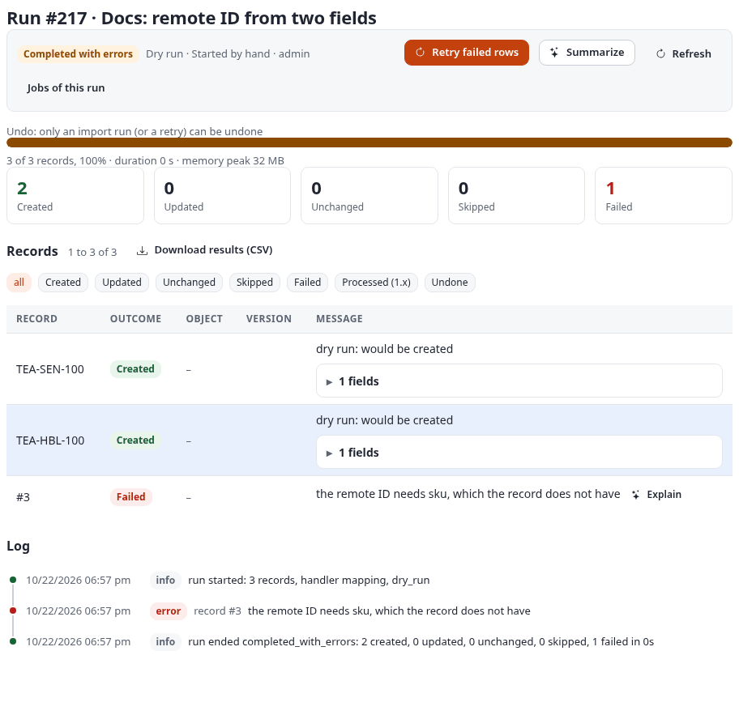

### Match by the value of an attribute

When the other system has no stable ID of its own but the objects already carry one (a product number, an ISBN),
match by that attribute instead of a remote ID. The import "Docs: match products by product number" (#147), class
`product`:

```
product_number,name,price
DOCS-MAP-1,Tea caddy,"14.5|1|1"
DOCS-MAP-2,Tea strainer,"4.2|1|1"
```

| Setting | Value |
|---|---|
| How a record finds its object | **By the value of an attribute** |
| Attribute and source field to match on | `product_number`, `product_number` |
| Lines | `name` to `name` (required), `product_number` to `product_number`, `price` to `price` |

As stored: `"match": {"type": "attribute", "attribute": "product_number", "source": "product_number"}`.

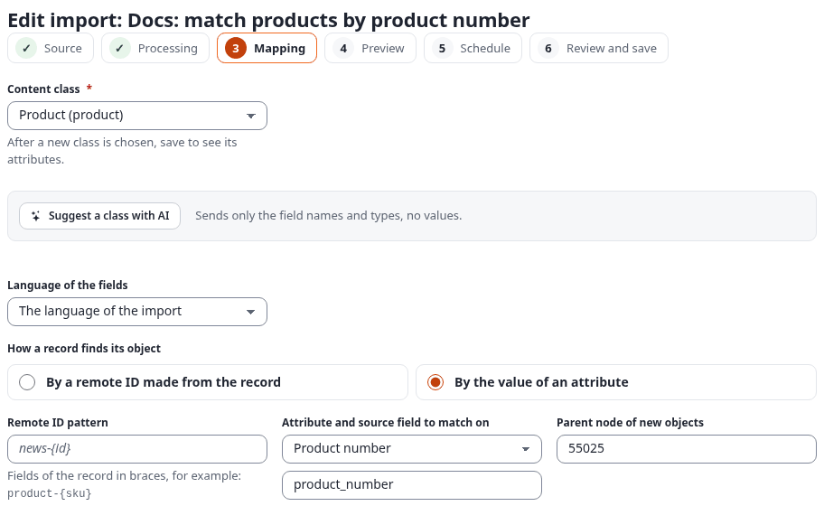

The real run #218 created the two products (objects 56648 and 56649). A new object gets a generated remote ID
(`9ded5562b529a52f926696fafa3e5460`); it is found again by its product number. The dry run #225 afterwards found
both and reported them unchanged:

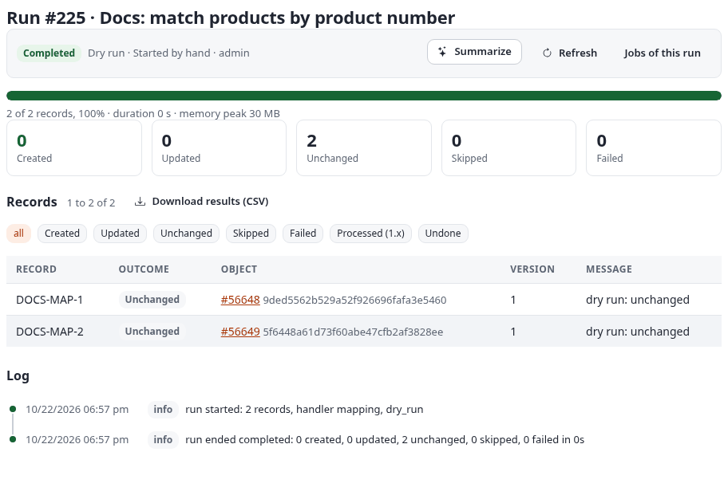

A record whose match field is empty fails with "the match field 'product_number' is empty". Matching by an attribute
looks the value up among the objects of the class, which can be slower than a remote ID on large classes; prefer a remote ID when you can.

### Parent from a field, and more locations

`parent_from` names a field with the **remote ID of the parent** (with `parent_prefix` put before it);
`extra_parents_from` names a field with more parents (a list, or a comma-separated text), which become additional
locations of a new object. A record without a parent goes below the import's parent node. The import "Docs: parents
and more locations from fields" (#148), class `folder`, remote IDs `docs-map-tree-{id}`:

```
id,title,parent,also_in
shelf-a,Shelf A,,
shelf-b,Shelf B,,
tea-1,Sencha,shelf-a,shelf-b
tea-2,Assam,shelf-b,
```

| Setting | Value |
|---|---|
| Parent from a field (its remote ID) | `parent`, prefix `docs-map-tree-` |
| More locations from a field | `also_in` |

As stored: `"location": {"parent_from": "parent", "parent_prefix": "docs-map-tree-", "extra_parents_from": "also_in", "parent_node_id": 55028}`.

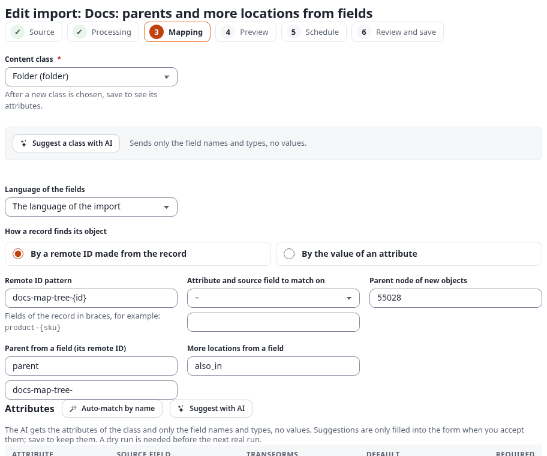

The real run #219 created 4 folders, the shelves first, so they exist when the teas need them:

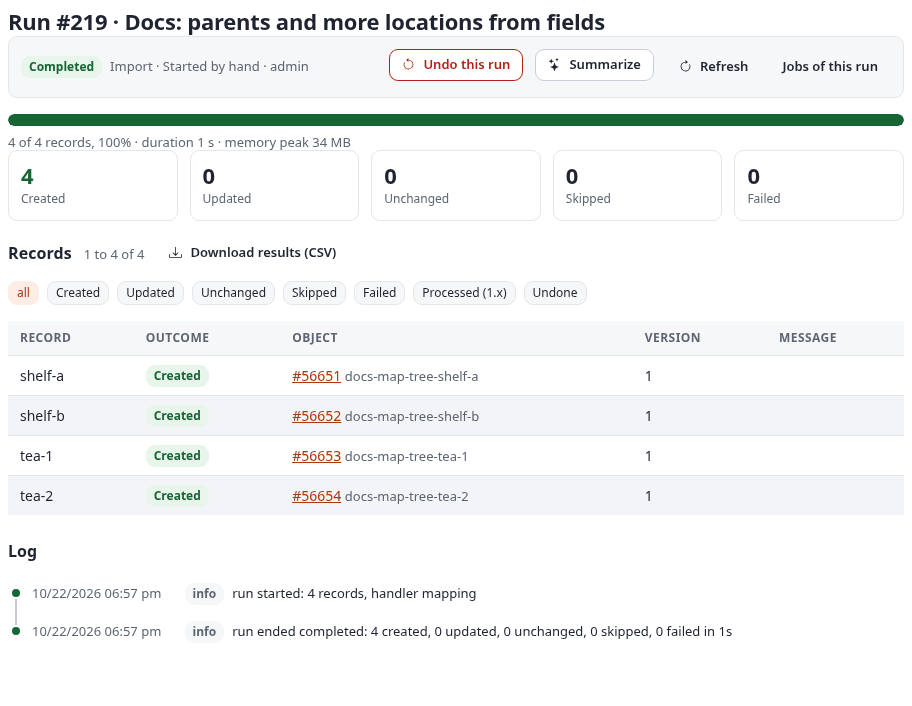

What was published:

```
docs-map-tree-shelf-a: object 56651, class folder, "Shelf A"; node 55029 (main) below "Map: tree"
docs-map-tree-shelf-b: object 56652, class folder, "Shelf B"; node 55030 (main) below "Map: tree"
docs-map-tree-tea-1: object 56653, class folder, "Sencha"; node 55031 (main) below "Shelf A", node 55046 below "Shelf B"
docs-map-tree-tea-2: object 56654, class folder, "Assam"; node 55032 (main) below "Shelf B"
```

Sencha has a second location below Shelf B, from `also_in`. The more locations are added right after the object is
published, for a new object and for one that exists already, and a run that only adds a location counts the object
as updated ("1 more location(s) added" in its row). The locations are added as the import, whoever starts the run
(also a run of the command line, which has no user). Undo removes the locations a run added; the main location stays.
Run #219 of this example was made before this was fixed and gave Sencha no second location; the later run #264 added
it (node 55046).

<a id="a-class-per-record-worked-example"></a>

### A class per record

One source, several kinds of records. The NDJSON of the import "Docs: a class per record" (#149):

```json
{"id":"sec-1","kind":"folder","title":"Green teas"}
{"id":"art-1","kind":"article","title":"Brewing Sencha","parent":"sec-1","intro":"<p>Use water at 70 to 80 degrees.</p>"}
{"id":"note-1","kind":"note","title":"Reorder in May","parent":"sec-1"}
```

The mapping's own class is `article` (lines `title` to `title`, `intro` to `intro` with `richtext`), remote IDs
`docs-map-mixed-{id}`, parent from `parent` with the prefix `docs-map-mixed-`. Its class per record:

```json
"class_from": "kind",
"variants": {
  "folder": { "class": "folder", "fields": [ { "source": "title", "attribute": "name", "required": true } ] },
  "note":   { "skip": true }
}
```

A record of the kind `folder` becomes a folder with its own line; `note` is left out; every other kind (here
`article`) uses the class and lines of the grid. The mapping step says so above the grid:

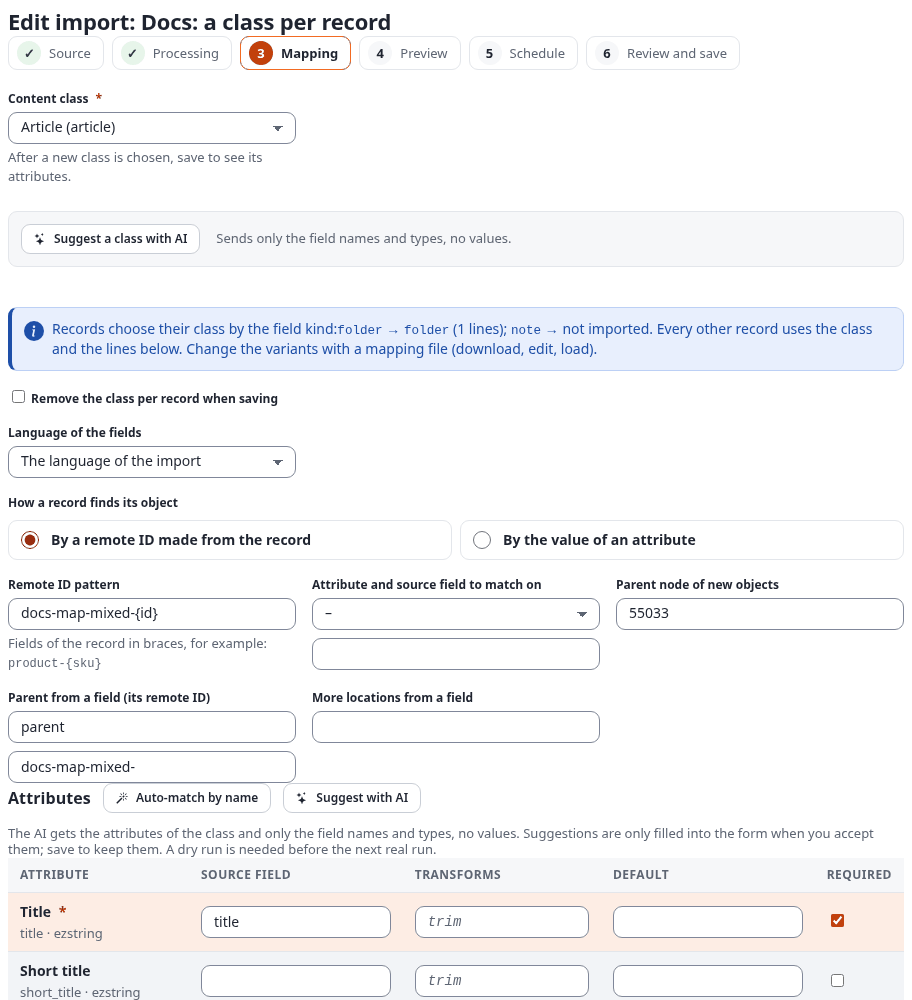

The real run #220: 2 created, 1 skipped ("not imported: its kind is note"):

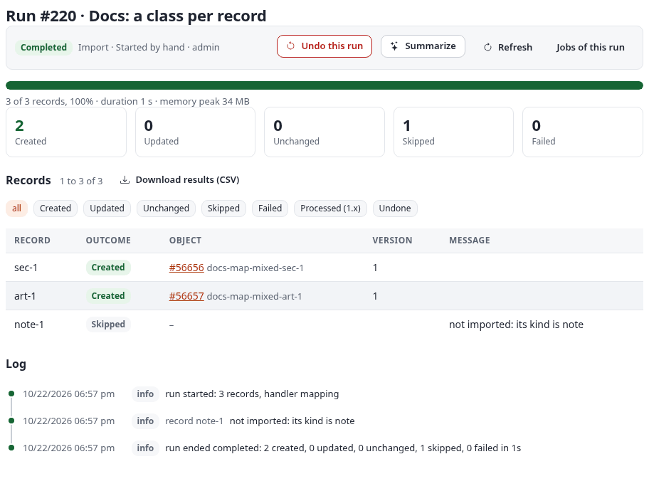

```
docs-map-mixed-sec-1: object 56656, class folder, "Green teas"; node 55034 (main) below "Map: class per record"
docs-map-mixed-art-1: object 56657, class article, "Brewing Sencha"; node 55035 (main) below "Green teas"
docs-map-mixed-note-1: missing
```

The variants are set in a mapping file (download, edit, load in the step Mapping); the grid edits the lines of the
mapping's own class.

<a id="translations-by-column-worked-example"></a>

### Translations by column

A source with a column per language gives one object with its translations. The import "Docs: translations by
column" (#150), class `article`:

```
id,title,title_de,intro,intro_de
t-1,Morning Sencha,Morgen-Sencha,"<p>A fresh green tea.</p>","<p>Ein frischer gruener Tee.</p>"
```

The grid maps `title` and `intro` (the main language); under **Translations by column**, the section **German
(ger-DE)** maps `title_de` to `title` and `intro_de` to `intro` (with `richtext`):

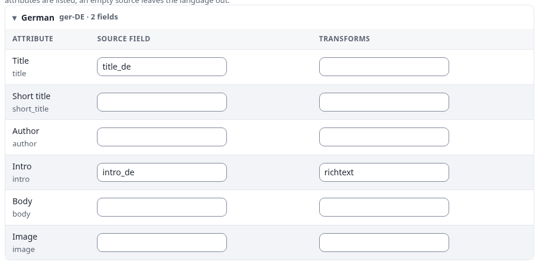

As stored, the two lines carry their language:

```json
{ "source": "title_de", "attribute": "title", "language": "ger-DE" },
{ "source": "intro_de", "attribute": "intro", "language": "ger-DE", "transforms": [ { "name": "richtext" } ] }
```

The real run #221 created one article with both languages:

```
docs-map-tr-t-1: object 56659, class article, "Morning Sencha", languages eng-US,ger-DE
  eng-US: title "Morning Sencha", intro "A fresh green tea."
  ger-DE: title "Morgen-Sencha", intro "Ein frischer gruener Tee."
```

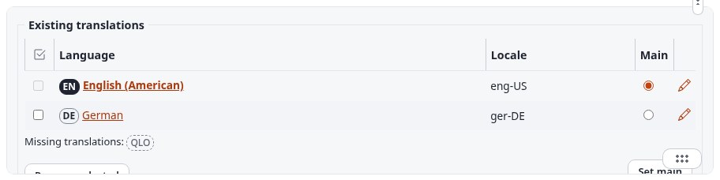

A record whose `title_de` is empty gets no German translation; an attribute that is not translatable takes the value
of the main language.

### Images and related image objects

**An image attribute (`image`).** The import "Docs: images into an image attribute" (#151) makes objects of the
class `image`; the line `image_url` to `image` with `image(required=true)` downloads each address into the `ezimage`
attribute:

```
id,title,image_url
img-1,Illustration,https://alpha.se7enx.com/design/mysite/images/mysite-illustration.jpg
img-2,Front page illustration,https://alpha.se7enx.com/design/mysite/images/mysite-illustration-frontpage.jpg
```

The real run #222 created both, with the pictures stored:

```
docs-map-img-img-1: object 56661, class image, "Illustration"
  image: illustration.jpg, 700x55, image/jpeg, 11433 bytes
docs-map-img-img-2: object 56662, class image, "Front page illustration"
  image: front-page-illustration.jpg, 700x125, image/jpeg, 24745 bytes
```

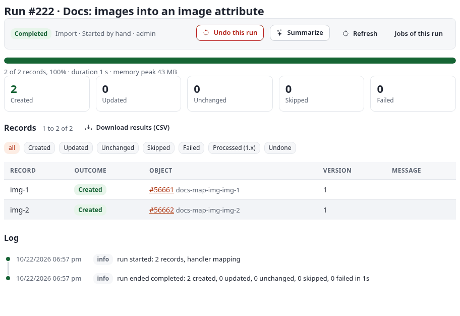

**An object relation (`media_object`).** The webshop's `product` keeps its picture as a relation to an image object.
`media_object` makes one image object per address and gives its ID; the same address later, in the same run or the
next, reuses that object. The import "Docs: product images as related image objects" (#152), with two products that
share one picture:

```
product_number,name,image_url
DOCS-MAP-IMG-1,Gift box,https://alpha.se7enx.com/design/mysite/images/mysite-illustration.jpg
DOCS-MAP-IMG-2,Gift box large,https://alpha.se7enx.com/design/mysite/images/mysite-illustration.jpg
```

The line: `image_url` to `image` with `media_object(class=image, attribute=image, name=name)` (the image object is
named after the record's `name`, placed below the import's parent). The real run #223 created the two products and
**one** image object, which both relate to:

```
docs-map-prod-DOCS-MAP-IMG-1: object 56665, class product, "Gift box"
  image relation: 56664
    object 56664, class image, "Gift box", remote ID sqliimport-media-f6f5c1dacc0515c39afcdedb143ce1e55df1bd9a
docs-map-prod-DOCS-MAP-IMG-2: object 56666, class product, "Gift box large"
  image relation: 56664
```

The image object's remote ID is made from a hash of the address (`sqliimport-media-...`), which is how it is found again.
The second run #224 of the same file: 2 unchanged, no new image object:

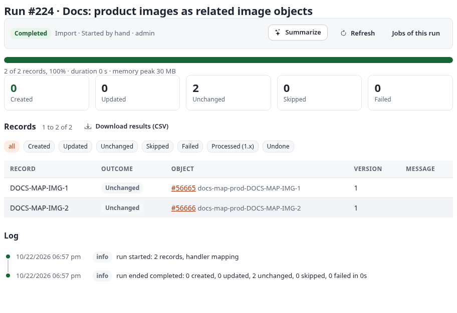

In a dry run, and in the editor's preview, `image` and `media_object` download nothing: the address stands for the
file. Addresses follow the rules of an address source (no private networks unless allowed).

## Creating an import in PHP

The import editor is the usual way to create an import ([editor.md](editor.md)). A script that sets up imports,
for example during the installation of a site, can create one in PHP and run it with
`php bin/php/ezexec.php <script> --allow-root-user`:

```php
<?php
$import = expImportDefinition::create( array(
    'identifier' => 'news_feed',
    'name' => 'News from the partner feed',
    'source_type' => 'rss',
    'source_config' => json_encode( array( 'origin' => 'url', 'url' => 'https://www.example.com/news.rss' ) ),
    'handler' => 'mapping',
    'target_json' => json_encode( array( 'parent_node_id' => 2 ) ),
    'behaviour_json' => json_encode( array( 'update_policy' => 'update' ) ),
) );
$import->store();

$mapping = expImportMapping::saveArray( array(
    'class' => 'article',
    'language' => '',
    'match' => array( 'type' => 'remote_id', 'pattern' => 'partner-news-{id}' ),
    'fields' => array(
        array( 'source' => 'title', 'attribute' => 'title', 'transforms' => array( array( 'name' => 'trim' ) ), 'required' => true ),
        array( 'source' => 'summary', 'attribute' => 'intro', 'transforms' => array( array( 'name' => 'richtext' ) ) ),
        array( 'source' => 'content', 'attribute' => 'body', 'transforms' => array( array( 'name' => 'richtext' ) ) ),
        array( 'source' => 'date', 'attribute' => 'publish_date', 'transforms' => array( array( 'name' => 'date' ) ) ),
    ),
    'location' => array( 'parent_node_id' => 2 ),
), $import->attribute( 'id' ) );

$import->setAttribute( 'mapping_id', $mapping->attribute( 'id' ) );
$import->store();
```

Check a mapping before you store it: `expImportMapper::validate( $mapping, expImportMappingHandler::classAttributes( 'article' ) )`
returns a list of errors (empty when the mapping is valid). Then try it with
`./console ext:sqliimport:run news_feed --dry-run --wait`.
