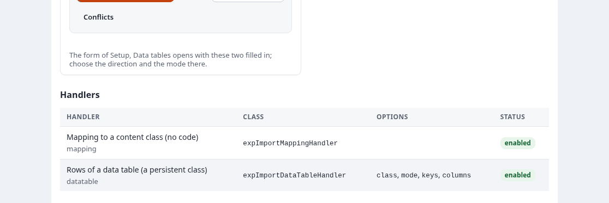

# Upgrading from SQLI Import 1.x

Release 2 keeps every 1.x handler, setting, table, policy and page working. The upgrade adds the 2.x tables and
moves the 1.x schedules to the 2.x engine. Nothing of 1.x is deleted.

## Steps

1. Back up the database.
2. Install 2.x over 1.x and activate expqueue and expui ([install.md](install.md)).
3. Regenerate the autoloads and create the tables:

   ```bash
   php bin/php/ezpgenerateautoloads.php -e
   ./console ext:expqueue:install-schema
   ./console ext:sqliimport:install-schema
   ```

4. See what the migration would do. This changes nothing:

   ```bash
   ./console ext:sqliimport:migrate-1x
   ```

   Each line starts with what it is about (`handlers`, `schedules`, `history`, `roles`) and `WOULD` for a change
   that `--apply` makes.

5. Migrate:

   ```bash
   ./console ext:sqliimport:migrate-1x --apply
   ```

   Add `--roles` to give every role that holds `sqliimport/manageimports` the 2.x policy `sqliimport/manage`
   ("Manage imports") with the same handler limitation ([permissions.md](permissions.md)):

   ```bash
   ./console ext:sqliimport:migrate-1x --apply --roles
   ```

6. Replace the 1.x cron parts with the new ones, both every minute:

   ```bash
   * * * * * cd /path/to/exponential && php runcronjobs.php -q expqueue
   * * * * * cd /path/to/exponential && php runcronjobs.php -q sqliimport
   ```

7. Open **Imports** in the administration and check the imports and the next scheduled runs.

## What the migration does

| Part | Result |
|---|---|
| handlers | Each 1.x handler of `[ImportSettings] AvailableSourceHandlers[]` becomes an import with the identifier `legacy-<handler>` |
| schedules | Each row of `sqliimport_scheduled` becomes an import with its options (the `key=value` text as JSON options) and a schedule of the same frequency. The 1.x row is switched off, not removed. |
| history | Each row of `sqliimport_item` that is not pending becomes a read-only run (status, time, user; no rows or log). A request that was still marked running becomes a failed run. |
| roles | With `--roles`: a role with `manageimports` gets `manage` next to it, with the same handler limitation. A role with `listimports` only needs nothing new: `listimports` still lets it look at the Imports tab. A role with `sqliimport/*` is left alone. |

The 1.x frequencies map as follows: `none` to `once`, `hourly`, `daily`, `weekly` and `monthly` to the same kind,
and `manual` (every N minutes) to `interval` with at least 5 minutes. The schedule's time zone is the server's PHP
time zone. A schedule whose next time has passed gets its next time computed from now.

The migration is idempotent. What was migrated before is recognized and left alone, so you can run it again after
adding a handler.

Pending 1.x import requests are not turned into history. The cron part `sqliimport` starts them as real runs of
the import `legacy-<handler>`.

## After the upgrade

- **Imports are edited in the import editor** (`sqliimport/edit`, [editor.md](editor.md)). A migrated import of a
  1.x handler has the steps source, processing, schedule and review; its options are the `key=value` text of 1.x.

- **1.x handlers run untouched** in the 2.x engine. Their rows have the outcome `processed`, and their progression
  notes go to the run's log ([handlers.md](handlers.md)).
- **The 1.x pages are part of the 2.x pages.** No page of 1.x is needed any more, and the left menu no longer
  has a group "sqliimport 1.x":

  | 1.x page | Where its function is now |
  |---|---|
  | `sqliimport/items` (the import requests) | The dashboard `sqliimport/list`, section "1.x import requests": status, progress, progression notes, the run of each request, **Cancel** (pending), **Interrupt** (running); paged by `(legacyoffset)` |
  | `sqliimport/addimport` (request an import) | The dashboard, the form **Request import** of that section (a 1.x handler and its `name=value` options) |
  | `sqliimport/purgelist` | The dashboard, **Purge history** in that section |
  | `sqliimport/alterimport/<cancel\|interrupt>/<id>` | The dashboard, **Cancel** or **Interrupt** of the request; it also cancels the request's 2.x run |
  | `sqliimport/scheduledlist` | `sqliimport/schedules`, section "1.x scheduled imports": **Run now**, **Edit**, **Enable** or **Disable**, **Delete** |
  | `sqliimport/addscheduled[/<id>]` | `sqliimport/schedules/(legacy)/<id>` (or `/new`): label, handler, options, first run, frequency, active; a migrated one opens its import's schedule in the editor |
  | `sqliimport/removescheduled/<id>` | `sqliimport/schedules`, **Delete** |
  | the progress of a request | the run page `sqliimport/run/<id>` (progress, counters, log) |

- **The old addresses keep working.** A GET of a 1.x page goes to the 2.x page above, with its ids and offset
  (`sqliimport/addscheduled/12` to `sqliimport/schedules/(legacy)/12`). A POST with the fields of 1.x
  (`RequestImportButton`, `ImportHandler`, `ImportOptions`; `RequestScheduledImportButton` and the `Scheduled*`
  fields; the POST of `alterimport`, `removescheduled`, `purgelist`) still does what it did, checked by the form
  token and the handler limitation `SQLIImport_Type` as before, and then goes to the 2.x page. Scripts and 1.x
  handlers that post there need no change. These addresses show no page of their own.
- **The 1.x list moved:** `sqliimport/list` is the 2.x dashboard. Update bookmarks of `sqliimport/items` if you like;
  they redirect.
- **One import no longer blocks all others.** 1.x had one global lock (`SQLIImportToken`); 2.x runs different
  imports in parallel and each import once at a time.
- **`sqlidoimport.php` and the 1.x cron parts are kept** but deprecated.

## Worked example: a 1.x handler in the 2.x engine

This example takes a handler written the way 1.x handlers are, the fixture handler of the extension's tests
(`tests/fixtures/legacy/sqlifixturecsvhandler.php`, class `SQLIFixtureCSVHandler`). It reads a CSV with the columns
`id` and `name` through `SQLICSVDoc` and publishes one folder per line with `SQLIContent` and
`SQLIContentPublisher`. A line whose name is `FAIL` throws, as a broken record would. The example shows the
handler's settings, what the catalogue lists, its options as `name=value` lines, a run's rows, and the migration
report. Everything below ran on the documentation server, with the settings set for that one process; the outputs are
real (the path of the CSV is shortened, and node 54916 is the hidden folder the example published into).

**The settings**, as a 1.x site has them in `settings/override/sqliimport.ini.append.php` (or an extension's
`sqliimport.ini.append.php`):

```ini
[ImportSettings]
AvailableSourceHandlers[]=fixturecsv

[fixturecsv-HandlerSettings]
Enabled=true
Name=Fixture CSV handler (1.x style)
ClassName=SQLIFixtureCSVHandler
DefaultParentNodeID=54916
CSVFile=var/import/legacy-folders.csv
```

The CSV:

```
id,name
1,Spring news
2,FAIL
3,Autumn news
```

**What the catalogue lists.** **Imports, Catalogue**, section *Handlers*, lists every handler with its class, its
options and its status. A 1.x handler is a row of its own, marked with the badge **1.x handler**, and its options
column says *free name=value options*. On the documentation server no 1.x handler is configured, so the table shows
only the two 2.x handlers:



With the settings above, the registry behind that table gave:

```
mapping      Mapping to a content class (no code) 2.x    enabled
datatable    Rows of a data table (a persistent class) 2.x    enabled
fixturecsv   Fixture CSV handler (1.x style)    legacy enabled
```

**The import and its options.** `migrate-1x --apply` makes the import `legacy-fixturecsv` (or create one in the
editor: *Source type*, *A 1.x handler that reads its own source*, and the handler). A 1.x handler's options are the
`name=value` text of 1.x, one option per line, in the step Processing:

```
csv=var/import/legacy-folders.csv
```

The handler reads them as before, through its `SQLIImportHandlerOptions` (`$this->options->attribute( 'csv' )`),
and its settings block as `handlerConfArray`. An import of a 1.x handler has no step Mapping and no Preview: a 1.x
handler cannot run without publishing.

**A run.** The engine wraps the handler in `expImportLegacyHandlerAdapter`. It calls `initialize()`,
`getProcessLength()`, `getNextRow()` and `process()` for every row, then `cleanup()`, in one chunk, because a 1.x
handler cannot start in the middle. The run's rows:

```
handler class: expImportLegacyHandlerAdapter, resumable: false
count(): 3
#1   processed     record {"id":"1","name":"Spring news"}
#2   failed     the fixture line 2 fails on purpose   record {"id":"2","name":"FAIL"}
#3   processed     record {"id":"3","name":"Autumn news"}
fixturecsv-1: object 56640 "Spring news", node 55019
fixturecsv-3: object 56641 "Autumn news", node 55020
```

- The rows are named by their position (`#1`, `#2` ...), and the record shown is a readable copy of the 1.x row.
- The outcome is `processed`: the engine does not know whether `process()` created, updated or left an object
  alone, so it does not claim to. The run page's filter *Processed (1.x)* lists them.
- The exception of line 2 fails that row only, with its message; the run goes on.
- What the handler returns from `getProgressionNotes()` goes into the run's log (`line 3: Autumn news`).
- **Retry failed rows** does not apply, and **Undo** has nothing to undo: the rows carry no record and no object the
  engine made. Fix the data and run the import again.

**The migration report.** `./console ext:sqliimport:migrate-1x` without `--apply` only reports. On the
documentation server, which has no 1.x handler, schedule or history, it printed:

```
history   WOULD the 1.x history is migrated
PASS dry run: nothing was changed (--apply to migrate)
```

With the handler above configured, the same report (`expImportMigration::run()` without apply) gave:

```
handlers  WOULD fixturecsv (Fixture CSV handler (1.x style)): becomes the import legacy-fixturecsv
history   WOULD the 1.x history is migrated
```

Every line of a dry run starts with `WOULD`, also a line that has nothing to do: "the 1.x history is migrated" means
that no history is left to migrate. A 1.x scheduled import adds a line such as `schedules WOULD scheduled import #4
"Nightly products" (products): becomes an import with the schedule daily`.

**Moving it to a mapping.** This handler only copies two CSV columns into a folder, so it is a candidate for the next
section: the CSV source with the key `id`, the class `folder`, the line `name` to `name`, and the match by the remote
ID `fixturecsv-{id}`, the pattern the handler used. The existing folders are then updated and not created again.

## Fixed 1.x bugs

On Exponential 6, release 2 fixes these bugs of 1.x:

- The fields of a 1.x import request and of a 1.x scheduled import read as empty, because their getter bypassed the
  kernel's persistent storage. The 1.x list and cron job saw nothing.
- Options serialized with NUL bytes were cut on SQLite. They are now stored with a marker on every database, and
  only the options class is unserialized.
- A scheduled 1.x import replaced its options by empty ones when they were read twice.
- Option text with a line without `=` warned on PHP 8, and `=` inside a value was split on the command line.
- The values the 1.x templates show (labels, handler names, options, error messages) are escaped.

## Moving a 1.x handler to the mapping

Many 1.x handlers only read a CSV, XML or RSS file and copy fields into one content class. Such an import can be
replaced by a source and a mapping, without PHP ([mappings.md](mappings.md)). Keep the remote ID scheme of the
1.x handler in the mapping's pattern, so the existing objects are updated and not created again.
