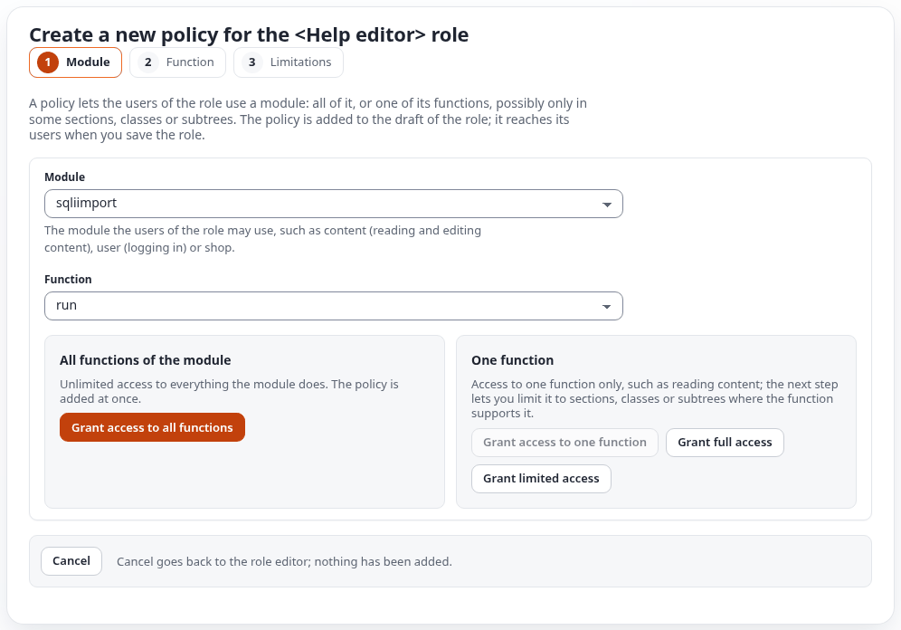
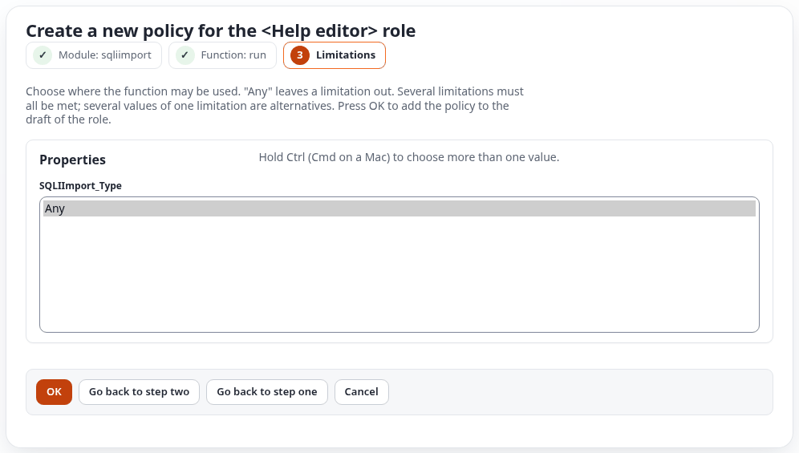

# Permissions

The module `sqliimport` has two policies in 2.x and keeps the two functions of 1.x, so roles made for 1.x keep
working. This page lists what each policy allows, shows how a policy is given to a role, and ends with typical roles.

German: [ger-de/permissions.md](ger-de/permissions.md).

## Table of contents

- [The two policies](#the-two-policies)
- [Worked example: a role that may run imports](#worked-example-a-role-that-may-run-imports)
- [The handler limitation](#the-handler-limitation)
- [How 1.x policies count](#how-1x-policies-count)
- [Typical roles](#typical-roles)
- [Security notes](#security-notes)

## The two policies

| Function | Name | Limitation | Allows |
|---|---|---|---|
| `manage` | Manage imports | `SQLIImport_Type` | Everything: create, edit, copy, enable, disable and delete imports, change and pause their schedules, the Settings page with the export and import of definitions, and everything `run` allows |
| `run` | Run imports | `SQLIImport_Type` | Looking at the Imports tab and running imports: Run now, Dry run, Cancel, Retry failed rows and Undo this run |

Either policy opens the Imports tab: the dashboard (`sqliimport/list`), the run pages (`sqliimport/run`), the
Schedules page (`sqliimport/schedules`) and the Catalogue (`sqliimport/catalogue`). The editor (`sqliimport/edit`)
and the Settings page (`sqliimport/settings`) need `manage`.

| Page or action | `run` | `manage` |
|---|---|---|
| Dashboard, run pages, Schedules, Catalogue (looking) | yes | yes |
| Run now, Dry run, Cancel, Retry failed rows, Undo this run | yes | yes |
| Download results (CSV), the Statistics page, the bell's notices | yes | yes |
| New import, Edit (the editor) | | yes |
| Duplicate, Enable, Disable, Delete | | yes |
| Pause, Resume, Edit and Delete of a schedule | | yes |
| Settings, export and import of import definitions | | yes |
| Download as JSON, Export selected, Import definitions, Copy to …, Save as template, New import from a template | | yes |
| The trigger of an import (switch on, keys, secret) | | yes |
| More > New data table from its fields | | yes, and `setup/setup` |

A run started by the trigger runs as the trigger's run user, who needs `run` or `manage` for the import's handler
([triggers.md](triggers.md)).

## Worked example: a role that may run imports

Goal: the editors of the news desk may start and follow imports, but not change them. They get the policy **Run
imports** (`sqliimport/run`).

1. **Users, Roles**: open the role the editors have (or create a role for them), then **Edit**. Exponential edits a
   draft of the role; nothing reaches its users until **Save**.
2. **New policy**. In the policy wizard, choose the module `sqliimport` and the function `run`:

   

3. **Grant full access** gives Run imports for every import. **Grant limited access** opens step 3, the
   limitation `SQLIImport_Type` (see the next section):

   

4. **OK** adds the policy to the draft; **Save** on the role applies it to everyone who has the role. The users see
   the Imports tab after their next sign-in.

The screenshots come from the test installation, where the wizard was opened on a role and left with **Cancel**:
no role was changed. For a role that may also create and change imports, choose the function `manage` instead.

The 2.x functions `view`, `edit`, `rollback`, `ai` and `settings` of release 2.0.0-alpha.1 are gone. A role that
still holds one of them grants nothing through it; give it `manage` or `run` instead.

## The handler limitation

The limitation `SQLIImport_Type` lists handlers by their identifier (`mapping`, a 2.x handler, or a 1.x handler).
With it, a user may run or manage only the imports that use those handlers:

- the buttons of other imports are not shown, and their actions are refused;
- the editor opens only imports of the allowed handlers, and the processing step refuses a handler outside the
  limitation;
- the Run imports policy with the limitation `mapping` allows running the no-code imports only.

What the policy wizard offers: the list of values of `SQLIImport_Type` is filled from the 1.x setting
`sqliimport.ini [ImportSettings] AvailableSourceHandlers[]`, so it names the 1.x handlers of the site. The 2.x
handlers (`mapping`, `datatable` and the handlers of extensions) are not in that list yet; on an installation without
1.x handlers it offers only **Any**, as in the picture above. A policy without the limitation covers every handler.

## How 1.x policies count

`expImportAdmin::can()` accepts the 1.x functions next to the 2.x ones:

| 2.x function | Also granted by |
|---|---|
| looking at the Imports tab | `listimports` or `manageimports` |
| `run` | `manageimports` (with its handler limitation) |
| `manage` | `manageimports` (with its handler limitation) |

So a role with `sqliimport/manageimports` can already do everything in 2.x, and a role with
`sqliimport/listimports` can look. `./console ext:sqliimport:migrate-1x --apply --roles` adds `sqliimport/manage`
with the same handler limitation to every role that has `manageimports`, so these roles keep working when the 1.x
functions are retired ([migration-1x.md](migration-1x.md)). A role with `listimports` needs nothing new, and a role
with `sqliimport/*` is left alone.

## Typical roles

| Role | Policies |
|---|---|
| Runs the news imports | `sqliimport/run` limited to the handler of the news imports |
| Editor who runs every import | `sqliimport/run` |
| Import administrator | `sqliimport/manage` (or `sqliimport/*`) |

The left menu of the Imports tab shows a link only to users who may open its page (`menu.ini [MenuAccessSettings]
CheckViewAccess`). The link to the job queue needs the policies of expqueue. The block "Imports" on the admin
dashboard is shown to users who may open the Imports tab.

## Security notes

- Every change in the 2.x pages and through the old addresses of the 1.x pages is a POST request with the form token (ezformtoken). A GET
  request changes nothing. The live run page reads its updates by POST with the form token as well.
- The run is processed as the user who started it, or as the robot user of the import. That user needs the content
  policies to create and edit the objects of the import.
- An export of import definitions contains no runs, no uploaded file, no API key, no signing salt and no secret
  value (only the names of secrets), but it does contain the source addresses, queries and options. Treat the file
  as you would treat the settings of the site; exporting needs Manage imports ([definitions.md](definitions.md)).
