# Runs

A run is one execution of an import (`expImportRun`, table `sqliimport_run`). It is processed by the job queue
(expqueue), not by the request or the command that starts it.

## How a run works

Starting a run (`expImportRunner::start()`) stores the run with the status `queued` and puts its first job into the
queue. Every run has its own job group and the queue resource `sqliimport:<import id>`.

| Job | What it does |
|---|---|
| `sqliimport.run` | Makes the snapshot of the source, counts the records, queues the first chunk |
| `sqliimport.chunk` | Processes up to `ChunkSize` records from a cursor, then queues the next chunk or the finish |
| `sqliimport.finish` | Clears the view caches of the changed objects, indexes them, writes the summary and notifies the schedule's addresses about failures |

Rules that follow from this:

- **One run per import at a time.** A new run of an import is refused while another one is queued or running.
- **Different imports run in parallel**, each in its own resource. This replaces the single global lock of 1.x.
- **The chunks of a run run one after another**, so records are processed in their order.
- **Checkpoints:** a chunk saves its cursor every 20 records. If a worker dies, the next attempt continues after
  the last checkpoint, and a record that already has its row is not processed twice.
- **Memory stays flat:** the kernel's in-memory caches are emptied between chunks. The peak is recorded on the run.
- The run is processed as the user who started it, or as the robot user of the import (`owner_id` of the target).
- **Started from another system:** the webhook / API trigger of an import starts a run with a signed call or an API
  key, as the trigger's run user, and may bring the run's data in the call (trigger `rest`, [triggers.md](triggers.md)).

The job types and their time limits are set in `expqueue.ini [JobType_sqliimport.*]` (timeout 900 seconds for the
start, 1800 for a chunk and the finish, three attempts each).

## Statuses

| Status | Meaning |
|---|---|
| `queued` | Waiting for a worker |
| `running` | A worker is processing it |
| `completed` | Ended, no record failed |
| `completed_with_errors` | Ended, some records failed |
| `failed` | The run stopped: the source could not be read, the mapping is invalid, or a job failed every attempt |
| `cancelled` | Cancelled by a user, or its job group was cancelled in the job queue |

The cron part `sqliimport` ends runs whose jobs ended without them (a job in the dead letter list, a job group
cancelled on the job queue's page).

## Kinds

| Kind | What it does |
|---|---|
| `import` | Processes all records (or `max_rows`) |
| `dry_run` | Publishes nothing. Reads the first `[RunSettings] DryRunRows` records and records what would happen, with the changed fields. A disabled import can still have a dry run. Images and files are not downloaded. The preview step of the editor does the same in the request, without storing a run. |
| `retry` | Processes only the failed rows of an earlier run, from the records stored on those rows |

## Rows and log

Each record of a run gets one row: its reference, outcome (`created`, `updated`, `unchanged`, `skipped`, `failed`,
`processed`), object, version before and after, nodes added and a message. A failed row also keeps the record, so it
can be retried. The log keeps lines from `[RunSettings] LogLevel` upward (`debug`, `info`, `notice`, `warning`,
`error`), each with the record it is about.

## In the administration

The left menu of the Imports tab links the pages of the extension:

| Page | Address | What it shows |
|---|---|---|
| Overview | `sqliimport/list` | The dashboard (below) |
| New import | `sqliimport/edit/new` | The import editor ([editor.md](editor.md)) |
| Running runs, Failed runs | `sqliimport/list/(status)/active`, `sqliimport/list/(status)/failed` | The dashboard filtered by status |
| Schedules | `sqliimport/schedules` | Every schedule with its next runs ([schedules.md](schedules.md#the-schedules-page)) |
| Job queue | `expqueue/dashboard` | The job queue of expqueue |
| Catalogue | `sqliimport/catalogue` | The source types, handlers and transforms the site offers, with their options and status |
| Settings | `sqliimport/settings` | The settings as they stand, export and import of definitions ([settings.md](settings.md#the-settings-page)) |

The pages of 1.x are part of these: the 1.x import requests are on the dashboard, the 1.x scheduled imports on
Schedules; their old addresses redirect there ([migration-1x.md](migration-1x.md#after-the-upgrade)).

### The dashboard

**Imports** (`sqliimport/list`) is the dashboard:

- Key figures: imports, runs today, runs running or queued, runs failed in the last 24 hours, the next scheduled run.
- A **Run now** toolbar: choose an import and start it, and the **New import** button.
- The imports with their source, handler, last run and next run. **Run now** (for an enabled import) and **Dry run**
  are shown to users who may run the import; **Edit** and, under **More**, **Duplicate**, **Enable** or
  **Disable** and **Delete** to users who may manage it ([editor.md](editor.md#changing-copying-and-deleting)).
- The runs, newest first, filtered by status: `sqliimport/list/(status)/active`, `failed`, `completed` or
  `cancelled`, and by import: `sqliimport/list/(import)/<id>`.
- **1.x import requests** (shown when 1.x handlers are configured or requests exist; it was `sqliimport/items`):
  the form **Request import** (a 1.x handler and its options, one `name=value` per line; it was
  `sqliimport/addimport`), **Purge history** (the ended requests; manage), and each request with its status,
  progress and progression notes, a link to its run, and **Cancel** (pending) or **Interrupt** (running) for users
  who may run its handler. Older requests: `sqliimport/list/(legacyoffset)/<n>`.

The admin dashboard (`content/dashboard`) has a block **Imports** with the latest runs and their status, and a
warning with a link when runs failed or ended with errors in the last 24 hours (`dashboard.ini
[DashboardBlock_sqliimport]`, `NumberOfItems=5`).

### The run page

**The run page** (`sqliimport/run/<id>`) shows:

- The status, the progress, the duration and the memory peak, and a link to the run's jobs in the job queue.
- The outcomes as figures. Each one filters the records: `sqliimport/run/<id>/(outcome)/failed`.
- The records with their object, version and message. In a dry run, each record lists its changed fields with the
  current and the new value.
- The log.
- **Cancel** while the run has not ended, and **Retry failed rows** when it ended with failed rows.
- **Refresh**, which loads the page again.

While a run is queued or running, the page follows it live: every two seconds it fetches the status, the progress,
the counters and the new log lines, and shows them without loading the page again. When the run ends, the page loads
once more with the final records. If an update gets no answer (a network error, a restart of the server), the page
tries again a few times and then stays as it is; **Refresh** brings it up to date. The updates come from the ezjscore
server function `sqliimport::runstatus`, which only answers POST requests with the form token from users who may
see the imports.

Every change (run, dry run, cancel, retry) is a POST request to `sqliimport/action` with the form token.

## Cancel and retry

- **Cancel** removes the run's queued jobs at once and stops the running chunk between two records. Records already
  processed stay as they are.
- **Retry failed rows** starts a run of kind `retry` that processes only the failed records of the ended run. It is
  not available for 1.x handlers; run their import again instead.

From the command line: `./console ext:sqliimport:cancel <run id>` and `./console ext:sqliimport:retry <run id>`
([cli.md](cli.md)).

## Dry run, Run now, live progress and stop

The four ways to start a run from the administration, with the import "Docs: First import (teas CSV)" of
[getting-started.md](getting-started.md):

| Where | Button | What starts |
|---|---|---|
| Dashboard, a row of the imports | **Run now** | a run of kind `import` (an enabled import only) |
| Dashboard, a row of the imports | **Dry run** | a run of kind `dry_run`: reads the source, publishes nothing |
| Dashboard, the toolbar at the top | choose the import, **Run now** | the same as the row's Run now |
| Editor, step 6 | **Save and run** | stores the import, starts a run and opens its page |

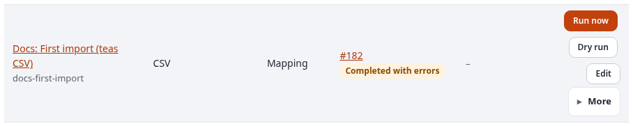

None of them does the work in the request: the run is queued, and the job queue's workers process it in the
background. The dashboard lists it at once with the status **Queued**, then **Running**. Its page
(`sqliimport/run/<id>`) follows it live: every two seconds it asks the server for the status, the progress, the
counters and the new log lines (the ezjscore call `sqliimport::runstatus`, a POST with the form token), and shows
them without reloading. While the run has not ended, the page has the button **Cancel**: it removes the run's
queued jobs at once and stops the running chunk between two records; what was processed stays. The run ends as
**Cancelled**.

A dry run is the safe first step after every change of the source or the mapping: its rows say what *would* happen,
with the fields that would change, as in run #181 of the getting-started example:


## Retry failed rows

**Retry failed rows** (on the page of a run that ended with failed rows) starts a run of kind `retry` that processes
only those records, **as the failed run stored them**. So a retry helps when the cause was outside the record:
a parent, a related object or a file that did not exist yet, a time-out, a database that was not reachable. A record
that failed because of its own data (an empty required field) fails again; correct the source and use **Run now**
instead, as in [getting-started.md](getting-started.md#the-second-run-changes-a-new-product-and-a-broken-line).

**Worked example: children before their parent.** The import "Docs: Tea shelves (retry of failed rows)" puts teas
below their shelf. Its `shelves.csv` lists two teas before the shelf they belong to:

```text
id,name,shelf
sencha,Sencha Asahi,green
assam,Assam Breakfast,black
green,Green teas,
black,Black teas,
genmaicha,Genmaicha,green
```

Its mapping: class `folder`; remote ID pattern `docs-shelf-{id}`; **Parent from a field** `shelf` with the prefix
`docs-shelf-` (so `green` means the object with the remote ID `docs-shelf-green`), else the import's parent node;
`name` to `name`, required.

Run #188 processes the records in their order. `sencha` and `assam` come first, and their shelves do not exist yet:

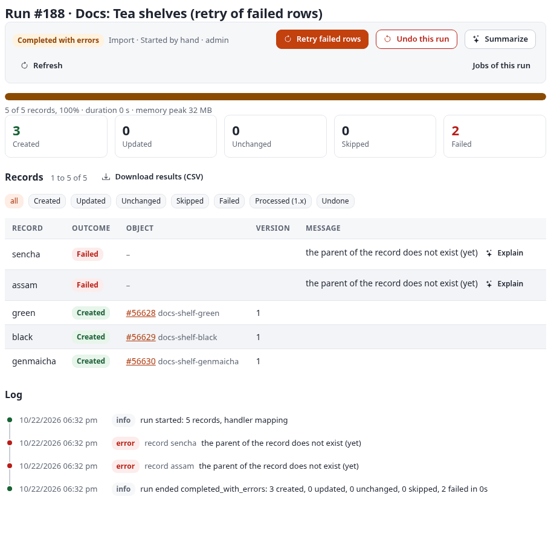

`genmaicha` comes after `green`, so it was placed. **Retry failed rows** then starts run #191, a retry of #188 that
reads only the two failed records; now their shelves exist:

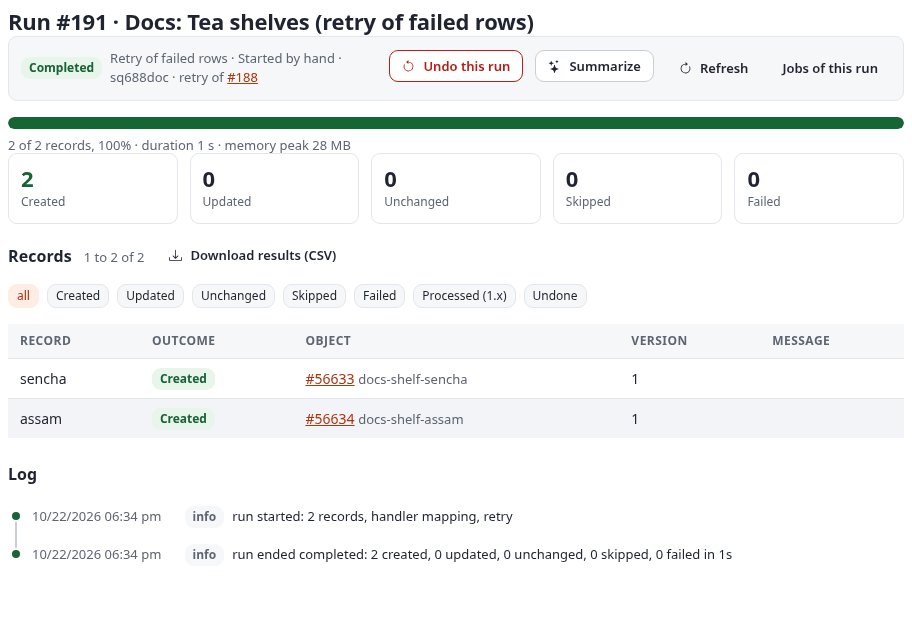

From the command line: `./console ext:sqliimport:retry 188`. A retry can be undone like any import run.

## Undo a run

**Undo this run** (on the page of an ended import or retry run) takes back what that run did:

| What the run did | What the undo does |
|---|---|
| created an object | moves it to the trash (all its locations), from where it can be restored like any object |
| updated an object | publishes the version from before the run again, as a new version |

It skips, with the reason on the row, what would destroy someone's work:

- an object that changed after the run (its current version is not the one the run published) is left alone;
- an object the run created, below which other content has been put since, is left alone;
- an object that no longer exists, or is already in the trash, is skipped.

An undo is possible once per run, for `[RunSettings] UndoDays` days (30 by default; the import's own number is the
field **Days a run can be undone** in the step Processing, `0` for no undo). The cron part marks older runs, so they
no longer offer it. Dry runs and undo runs cannot be undone. The undo is itself a run (kind `undo`) with its rows
and its log; it needs the policy Run imports.

**Worked example.** Run #200 of "Docs: First import (teas CSV)" updated one product, `docs-tea-103`, from version 2
to version 3 (the conflict example below). **Undo this run** on its page started run #201:

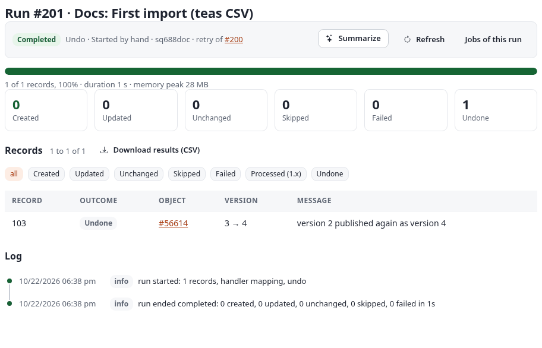

The undo did not delete version 3: it published version 2 again as version 4, so the history of the object keeps
both. From the command line: `./console ext:sqliimport:undo 200 --wait`.

## Conflict rules: when an editor changed an imported object

An import that runs again and again (a nightly sync) meets objects an editor has changed in the administration in
the meantime. The import remembers, per object and field, what it wrote last; a field whose value differs from that
was edited. **When someone edited an object since the last run**, in the step Processing, decides what happens:

| Rule | What the run does with an edited object |
|---|---|
| **Overwrite with the source** (`overwrite`, default) | writes every field from the source; the editor's change is replaced |
| **Merge: keep the fields that were edited** (`merge`) | writes the fields nobody edited, keeps the edited ones |
| **Only fill empty fields** (`fill_empty`) | writes only fields that are empty in the object |
| **Skip the object** (`skip`) | leaves the object as it is; the row is **Skipped** with the edited fields named |

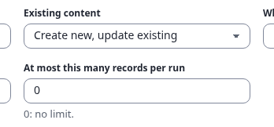

**Worked example.** After the second run of the getting-started import, an editor renamed `Sencha Asahi` to
`Sencha Asahi (staff pick)`. Then the spreadsheet changed the price and the description of the same tea:

```diff
-103,Sencha Asahi,TEA-103,"A grassy Japanese green tea, steamed.",9.85,2026-05-02
+103,Sencha Asahi,TEA-103,"A grassy Japanese green tea, steamed. New harvest.",10.45,2026-05-02
```

A dry run under each rule shows what each would do with record 103 (the other six records are unchanged under all
four):

| Rule | Dry run | Record 103 |
|---|---|---|
| overwrite | #192: 1 updated, 6 unchanged | name back to `Sencha Asahi`, new description, price `10.45` |
| merge | #193: 1 updated, 6 unchanged | name kept, new description, price `10.45` |
| fill_empty | #194: 7 unchanged | nothing: no field is empty |
| skip | #196: 1 skipped, 6 unchanged | skipped: "edited since the last run: name (conflict rule: skip)" |

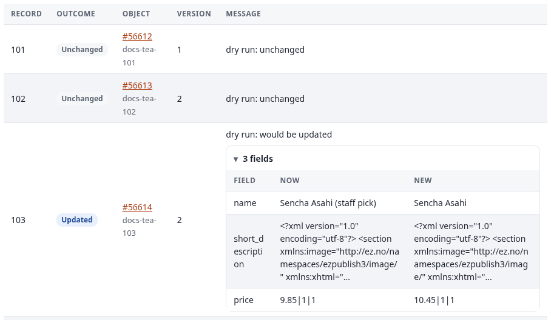

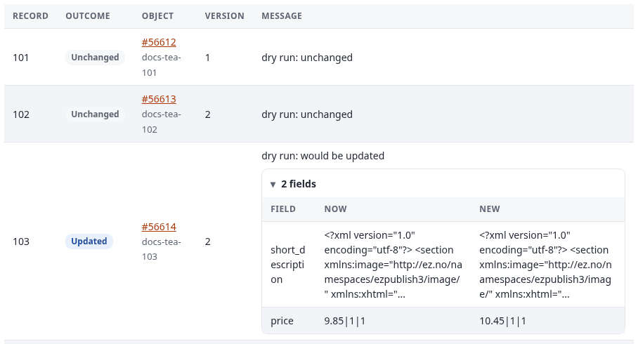

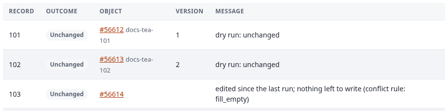

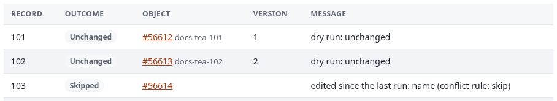

With **Merge** chosen, run #200 updated only 103 (version 2 to 3), and the editor's name stayed:

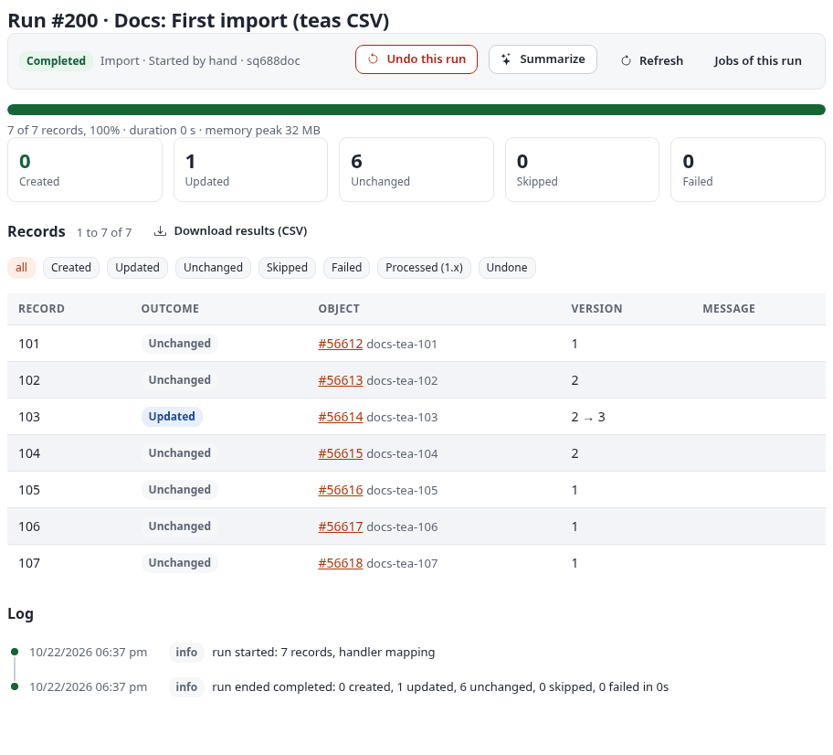

The rules apply to updates only; a new object is always created from the source. Where nobody edited anything, all
four rules behave the same.

## The run history and the CSV report

The dashboard lists every run, newest first, with filters: **all**, **Running or queued**, **Failed**,
**Completed**, **Cancelled**, and per import with `sqliimport/list/(import)/<id>` (the link on the import's name).
When the kernel's shared run history is installed (Exponential 6.0.15), the same list has a filter by tool, so the
runs of Export, Packages, Syndication and the other transfer tools appear next to the imports
([transfer.md](transfer.md)).

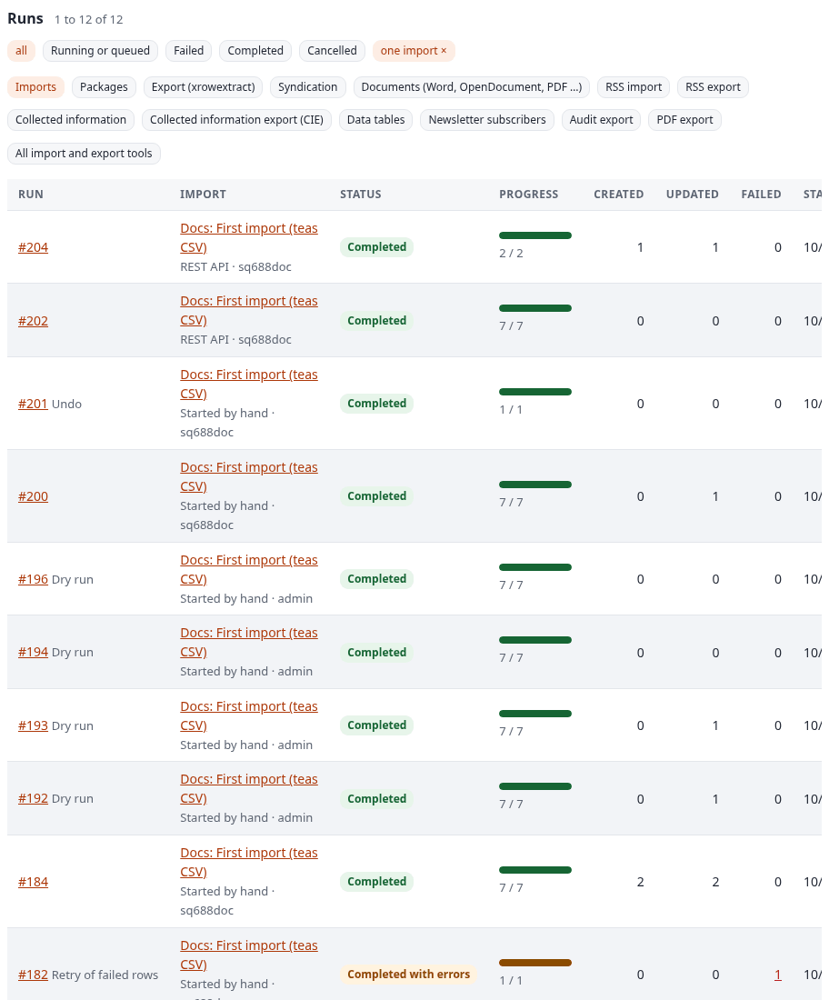

On a run page, **Download results (CSV)** (`sqliimport/report/<run id>`) gives one line per record. The first lines
of run #184:

```text
run_id,row,ref,outcome,status,object_id,node_id,remote_id,version_before,version_after,changed_fields,message,time
184,0,101,unchanged,ok,56612,54991,docs-tea-101,1,1,,,2026-10-23T01:23:02Z
184,1,102,updated,ok,56613,54992,docs-tea-102,1,2,,,2026-10-23T01:23:03Z
```

`changed_fields` is filled for dry runs (the fields that would change); a real run keeps the versions before and
after instead. The same file comes from `./console ext:sqliimport:report 184` ([cli.md](cli.md)). Charts of the
run history are on the Statistics page ([statistics.md](statistics.md)).

## Notifications

Who hears of a run that ended is set per import, in the editor's step Processing, under **Notifications**:

| Setting | What it does |
|---|---|
| Tell when a run | `failed or had errors` (the default), `failed`, `ended (every run)` or `never` |
| A notice for the user who started the run | the user sees it on the Imports dashboard (**New since you last looked**) until the run's page is opened or **Mark all as read** is used (default: on) |
| E-mail addresses | one per line; they get a mail with the counts, the first errors and the link to the run |

Dry runs and undo runs give their starter a notice, never a mail. The addresses of a schedule (2.0.0-alpha.1) still
get a mail when a scheduled run fails or ends with errors. The link in a mail uses `[AdminSettings] AdminURL` of
`sqliimport.ini` when it is set (e.g. `https://edit.example.org/admin`), else a path.

**Worked example.** "Docs: First import (teas CSV)" with **Tell when a run** set to `ended (every run)` and the notice
for the starter checked:

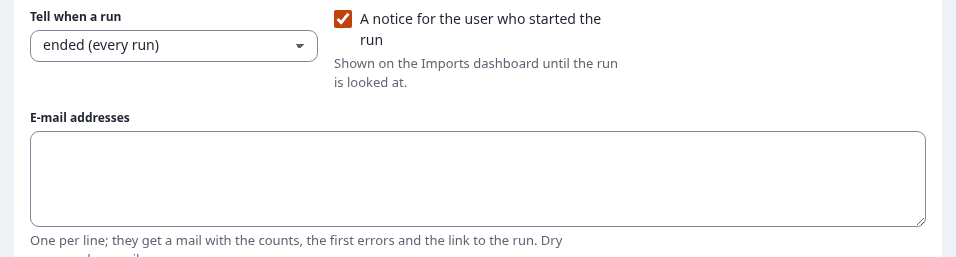

After its run #215 ended, the bell in the header showed a count of 1, and its panel the run with its outcome:

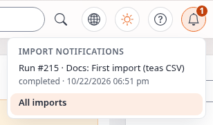

Opening the run's page marks the notice as read, and the count goes away.

**The bell in the header.** From Exponential 6.0.15 on, admin4 and admin4l have a slot for header tools of
extensions (`design.ini [AdminHeaderSettings] HeaderItems[]`), and the extension puts a bell there
(`design/admin4/templates/sqliimport/header_bell.tpl`) for every user who may see the imports. Its count is the
number of the user's unread notices and part of its name ("Import notifications: 3 new"); its panel lists the newest
eight with their run and outcome, and **All imports** opens the dashboard. The header is cached per user, so the
bell loads its count and entries from the ezjscore call `sqliimport::notices` (a GET with the user's own notices,
checked against the policy sqliimport/view) when the page is drawn and each time it opens. Without the script it is
a link to the dashboard. To leave it out, set `HeaderItems[]` empty in a siteaccess's `design.ini.append.php`.

On an older kernel, a page can show the notices with the template fetch function, e.g.:

```
{def $sq_bell = fetch( 'sqliimport', 'notices', hash( 'limit', 5 ) )}
{if $sq_bell.count}<a href={'/sqliimport/list'|ezurl}>{$sq_bell.count}</a>{/if}
```

The notices live in the table `sqliimport_notice` and go with their run when it is purged.

## Retention

Ended runs older than `[RunSettings] KeepDays` (90 by default) are removed with their rows, log and files by the
cron part, or with `./console ext:sqliimport:purge`. Removing an import keeps its runs until they are purged.
