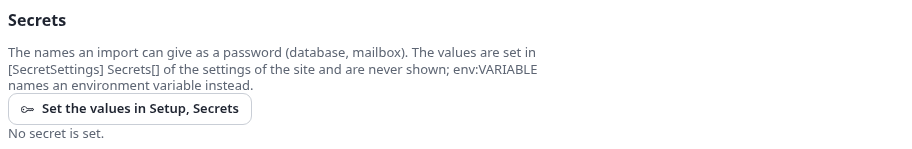
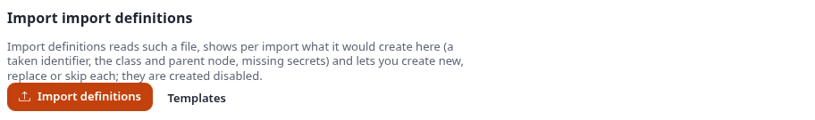
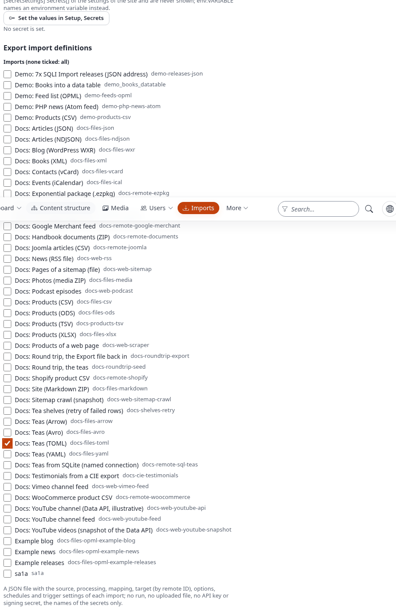
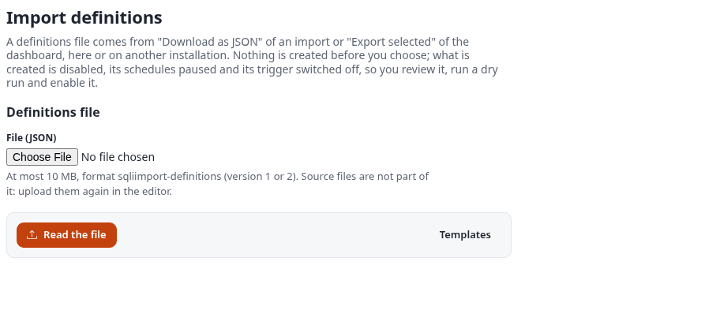
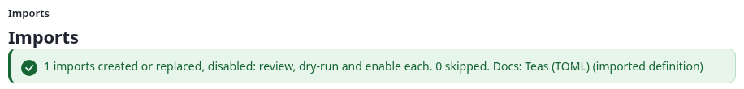

# Settings

All settings are in `sqliimport.ini`. Never edit `extension/sqliimport/settings/sqliimport.ini`; override it in
`settings/override/sqliimport.ini.append.php`, a siteaccess directory, or your own extension.

German: [ger-de/settings.md](ger-de/settings.md).

## Contents

- [[SourceSettings]](#sourcesettings)
- [[HandlerSettings]](#handlersettings)
- [[RunSettings]](#runsettings)
- [[TriggerSettings]](#triggersettings)
- [[AdminSettings]](#adminsettings)
- [Settings of 1.x that still apply](#settings-of-1x-that-still-apply)
- [Other settings files](#other-settings-files)
- [The Settings page](#the-settings-page)
  - [sqliimport.ini](#sqliimportini)
  - [Secrets](#secrets)
  - [Export import definitions](#export-import-definitions)
  - [Import import definitions](#import-import-definitions)
- [Example: export a docs import and import it back as a copy](#example-export-a-docs-import-and-import-it-back-as-a-copy)

## [SourceSettings]

| Setting | Default | Meaning |
|---|---|---|
| `Sources[]` | `csv`, `xml`, `rss`, `json`, `spreadsheet` | The source types of the catalogue; each has a `[Source_<id>]` block |
| `AllowedPaths[]` | empty | The directories on the server a source may read a file from (origin `path`). Empty: none, only uploads and URLs. Relative to the installation. |
| `MaxSourceMegabytes` | `200` | The largest upload or download of a source, in megabytes |
| `AllowPrivateHosts` | `disabled` | `enabled` lets a URL source (and the `image` and `file` transforms) read addresses of private or reserved networks |

```ini
[SourceSettings]
AllowedPaths[]
AllowedPaths[]=var/import
```

### `[Source_<id>]`

| Setting | Meaning |
|---|---|
| `Class` | The class, implementing `expImportSourceInterface` |
| `Status` | `enabled`; `example` (shown, but not offered for a new import); `disabled` |

## [HandlerSettings]

| Setting | Default | Meaning |
|---|---|---|
| `Handlers[]` | empty | The 2.x handlers besides `mapping`, which is always there; each has a `[Handler_<id>]` block |

### `[Handler_<id>]`

| Setting | Meaning |
|---|---|
| `Class` | The class, implementing `expImportHandlerInterface` |
| `Status` | `enabled`, `example` or `disabled` |

The 1.x handlers of `[ImportSettings] AvailableSourceHandlers[]` are listed in the catalogue too, marked legacy.

## [RunSettings]

| Setting | Default | Meaning |
|---|---|---|
| `ChunkSize` | `200` | Records per chunk (one job of the job queue each). An import can set its own `chunk_size`. |
| `DryRunRows` | `20` | Records a dry run reads |
| `LogLevel` | `info` | The lowest severity kept in a run's log: `debug`, `info`, `notice`, `warning`, `error` |
| `KeepDays` | `90` | Ended runs older than this many days are removed with their rows, log and files (`0` = never) |

## [TriggerSettings]

The webhook / API trigger of imports ([triggers.md](triggers.md)).

| Setting | Default | Meaning |
|---|---|---|
| `Trigger` | `enabled` | `disabled` answers 404 for every import; each import switches its own trigger on in the editor |
| `SignatureWindowSeconds` | `300` | How far a signed call's timestamp may be from the server's time |
| `RequestsPerMinute` | `6` | Calls per import and minute that start a run (`0` = no limit) |
| `StatusRequestsPerMinute` | `60` | Status requests per import and minute |
| `FailedRequestsPerMinute` | `20` | Refused calls per import and minute before every call of the import is refused for the rest of the minute |
| `MaxBodyMegabytes` | `20` | The largest body a call may bring as the data of its run |
| `ServerKeySecret` | empty | The name of a secret (at least 32 characters) used as the server key; empty: a random key in `var/<site>/storage/sqliimport/trigger.key` |

## [AdminSettings]

| Setting | Default | Meaning |
|---|---|---|
| `ListLimit` | `25` | Rows per page of the lists (at least 5) |

## Settings of 1.x that still apply

| Setting | Meaning in 2.x |
|---|---|
| `[ImportSettings] AvailableSourceHandlers[]` and `[<id>-HandlerSettings]` | The 1.x handlers and their settings, unchanged |
| `[ImportSettings] StreamTimeout` | The time limit of a download (URL sources, `image` and `file` transforms), in seconds |
| `[ImportSettings] RobotUserID`, `DefaultParentNodeID`, `ViewCaching`, `ObjectIndexing` | As in 1.x, for 1.x handlers. `DefaultParentNodeID` is also the parent node the editor proposes for a new import. |
| `[ContentSettings]` | The diff handlers of the content API, used by the `mapping` handler and by 1.x handlers |

## Other settings files

| File | What the extension sets |
|---|---|
| `cronjob.ini` | The cron part `[CronjobPart-sqliimport]`, and the deprecated 1.x parts `sqliimport_run` and `sqliimport_cleanup` |
| `expqueue.ini` | The job types `[JobType_sqliimport.run]`, `[JobType_sqliimport.chunk]`, `[JobType_sqliimport.finish]` |
| `kernelservices.ini` | The service `sqliimport.registry` |
| `audit.ini` | The audit branch `sqliimport` (`system.import.*`) |
| `menu.ini` | The tab `sqliimport` (named Imports) and the left menu of the tab |
| `dashboard.ini` | The block "Imports" of the admin dashboard, `[DashboardBlock_sqliimport]` (`Priority=40`, `NumberOfItems=5`) |
| `ezjscore.ini` | The server function `sqliimport::runstatus` of the live run page, `[ezjscServer_sqliimport]` |
| `design.ini` | The stylesheet and the scripts of the Imports tab in the administration |

A siteaccess that resets `[TopAdminMenu] Tabs[]` in its own `menu.ini.append.php` must list `Tabs[]=sqliimport` there
itself ([install.md](install.md)).

After changing a setting, clear the INI cache: `php bin/php/ezcache.php --clear-tag=ini`. The job queue's workers
read the catalogue again when they meet a handler they do not know yet; restart long-running workers after other
changes.

## The Settings page

**Settings** in the left menu of the Imports tab (`sqliimport/settings`) needs the policy `manage`
([permissions.md](permissions.md)). It has four parts.

### sqliimport.ini

The settings as they stand for the administration, after every override: `[RunSettings]`, `[SourceSettings]`,
`[TriggerSettings]`, the `AllowedHosts`, limits and time-outs of every database and service source
(`[SqlSourceSettings]`, `[MongoDbSourceSettings]` ... `[RestApiSourceSettings]`), `[YouTubeSettings]` and
`[ImportSettings]`, each line as `[Section] Setting` and its value. The page only shows them. They are changed in
`settings/override/sqliimport.ini.append.php` or a siteaccess, as described above.

![The section sqliimport.ini of the Settings page: [RunSettings] ChunkSize 200, DryRunRows 20, LogLevel info, KeepDays 90, [SourceSettings] MaxSourceMegabytes 200, AllowPrivateHosts disabled, AllowedPaths empty, the trigger settings and the first source settings](images/set-ini.png)

### Secrets

The names an import can give for a password, key or token (a database, a mailbox, an API), from
`[SecretSettings] Secrets[]`. The values are never shown; `env:VARIABLE` names an environment variable. They are set
in **Setup, Secrets** of the administration. On the documentation server no secret is set:



### Export import definitions

Tick the imports to export (none ticked: all) and choose **Export**. The browser saves a JSON file: for one import
`sqliimport-import-<identifier>.json`, for several `sqliimport-definitions-<date>-<time>.json`. The same file comes
from **Download as JSON** of an import, or **Export selected** of the dashboard.

The file (format version 2) holds, per import, its name, description, whether it is enabled, the source, handler,
options, target, behavior, mapping, schedules, trigger and the **names** of the secrets and connections it uses.
Parent nodes are written with their remote IDs and paths as well, so another installation finds the same place. It
holds no runs, no API keys, no secret values and no file content: **uploaded source files are not part of an
export**, only their original name. The example below is a real export.

### Import import definitions

The section links to **Import definitions** (`sqliimport/transfer`) and to **Templates**. Import definitions reads
an exported file (at most 10 MB) and shows, per import, what it would create here before anything is created:

- **new**, or **identifier taken** when an import with that identifier exists;
- the source and handler, the class and the parent node it resolves to (by remote ID and path, else the node ID);
- what to check in the editor: a file to upload again, a secret or connection this site lacks.

Per import you choose **Create a new import** (when the identifier is taken, it gets a suffix: `_2`), **Replace the
existing import** (its runs and API keys stay) or **Skip it**. **Create the chosen imports (disabled)** creates them
**disabled**, with their schedules paused and their trigger switched off, so you review each, upload a file it needs,
run a dry run and enable it. The dashboard then says how many were created or replaced and skipped.

This is how imports move from a staging installation to the live one. The export contains the addresses and
options of the sources, so keep the file as safe as the settings of the site. See also [transfer.md](transfer.md).



## Example: export a docs import and import it back as a copy

**Goal:** a copy of "Docs: Teas (TOML)" (import #126) made through its definitions file, as when an import is moved
to another installation.

**1. Export.** On the Settings page, under *Export import definitions*, tick "Docs: Teas (TOML)" and choose
**Export**:



The browser saved `sqliimport-import-docs-files-toml.json`. An excerpt (the mapping lines shortened):

```json
{
    "format": "sqliimport-definitions",
    "version": 2,
    "exported": "2026-10-23T01:52:14Z",
    "generator": "7x SQLI Import",
    "secrets": [],
    "imports": [
        {
            "identifier": "docs-files-toml",
            "name": "Docs: Teas (TOML)",
            "description": "The same teas as an array of tables.",
            "enabled": true,
            "source_type": "toml",
            "source": {
                "origin": "upload",
                "original_name": "teas.toml",
                "format": "toml",
                "record_path": "teas",
                "key": "id"
            },
            "handler": "mapping",
            "options": [],
            "target": {
                "parent_node_id": 54984,
                "section_id": 0,
                "language": "",
                "owner_id": 0,
                "parent": {
                    "node_id": 54984,
                    "remote_id": "250095e14b516fc6e9db1ce8e89260ab",
                    "object_remote_id": "sq688doc-docs-files-toml",
                    "path": "media/sqli_import_docs_examples/teas_toml"
                },
                "section": null,
                "owner": null
            },
            "behaviour": {
                "chunk_size": 200,
                "update_policy": "update",
                "trash_policy": "skip",
                "max_rows": 0,
                "conflict_policy": "overwrite",
                "undo_days": "",
                "notify_when": "errors",
                "notify_starter": true,
                "notify_emails": []
            },
            "mapping": {
                "class": "folder",
                "language": "",
                "match": { "type": "remote_id", "pattern": "sq688doc-toml-{id}" },
                "fields": [
                    { "source": "name", "attribute": "name", "transforms": [ { "name": "trim" } ], "default": "", "required": true, "language": "" },
                    ...
                ],
                "location": { "parent_node_id": 54984, "parent": { ... } }
            },
            "schedules": [],
            "trigger": null,
            "secrets": [],
            "connections": []
        }
    ]
}
```

The source keeps `original_name` but not the stored upload (`file`). An import that reads a secret lists its name,
never its value: the export of "Docs: YouTube channel (Data API, illustrative)" has `"api_key":
"sq-demo-youtube-key"` in its source and `"secrets": [ "sq-demo-youtube-key" ]` at the top and in the import, and
nothing else of the key.

**2. Rename.** To tell the copy apart, the name in a copy of the file was changed to "Docs: Teas (TOML) (imported
definition)". The identifier stayed, to show what happens when it is taken.

**3. Import.** **Import definitions**, choose the file, upload:



The plan says: the identifier `docs-files-toml` is taken, the source is TOML with the mapping to `folder`, the parent
node #54984 was found, a new import would be `docs-files-toml_2`, and *To check in the editor: upload the file
teas.toml again in the editor (files are not part of an export)*. The choice is **Create a new import
(docs-files-toml_2)**:


**4. Result.** **Create the chosen imports (disabled)** returned to the dashboard with "1 imports created or replaced,
disabled: review, dry-run and enable each. 0 skipped. Docs: Teas (TOML) (imported definition)":



The new import `docs-files-toml_2` is disabled and has no file yet: in its source step, upload `teas.toml`, then run
a dry run (3 teas would be created into the same folder, matched by the same remote IDs as the original, so a real
run would update the original's objects rather than make new ones) and enable it in the review step.
