# Worked examples: platforms, commerce and documents

This page shows one complete import for the sources that read other systems: another Exponential site over REST,
a Drupal site through JSON:API, a Joomla export, an Exponential package (`.ezpkg`); the shop formats (a Google
Merchant feed, a Shopify or WooCommerce product CSV); an IMAP mailbox; and the document sources of the extension
ezodf (documents as one file or a ZIP, from addresses, of a feed, in WebDAV or Nextcloud, Google Drive, OneDrive or
SharePoint, and attached to e-mails). Each example names its goal, the secret it needs, the values to type into the
import editor, an excerpt of what the source reads, the mapping lines and the result.

The options are described in [sources.md](sources.md) and, for the document sources, in ezodf's own manual; each
example links to its section. The other worked examples: [APIs and hosted services](source-examples-apis.md) and
[databases](source-examples-databases.md).

**What ran on the documentation server.** The file examples ran as imports of the hidden folder "SQLI Import docs
examples", each with a dry run that published nothing: Joomla (#157), the package (#158), Google Merchant (#159),
Shopify (#160) and WooCommerce (#161). The documents ZIP ran for real into its own hidden folder (#163, after the dry
run #162). Their screenshots show what really happened. The sources that read another site, a mailbox or a cloud
drive are **illustrative: not run against a live service**; their excerpts are the catalogue's snapshots in
`share/examples/` and every address and secret name is a placeholder.

## Contents

- [Before you start](#before-you-start)
- [Platforms](#platforms)
  - [Another Exponential site over REST (`exponential_site`)](#another-exponential-site-over-rest-exponential_site)
  - [Drupal JSON:API (`drupal`)](#drupal-jsonapi-drupal)
  - [Joomla articles, CSV or XML (`joomla`)](#joomla-articles-csv-or-xml-joomla)
  - [Exponential packages (`ezpkg`)](#exponential-packages-ezpkg)
- [Commerce](#commerce)
  - [Google Merchant feed (`google_merchant`)](#google-merchant-feed-google_merchant)
  - [Shopify product CSV (`shopify`)](#shopify-product-csv-shopify)
  - [WooCommerce product CSV (`woocommerce`)](#woocommerce-product-csv-woocommerce)
- [A mailbox over IMAP, with its attachments (`imap`)](#a-mailbox-over-imap-with-its-attachments-imap)
- [Documents (ezodf)](#documents-ezodf)
  - [Documents, one file or a folder as ZIP (`documents`)](#documents-one-file-or-a-folder-as-zip-documents)
  - [Documents from URLs (`document_urls`)](#documents-from-urls-document_urls)
  - [Documents of a feed (`document_feed`)](#documents-of-a-feed-document_feed)
  - [WebDAV or Nextcloud (`webdav`)](#webdav-or-nextcloud-webdav)
  - [Google Drive (`google_drive`)](#google-drive-google_drive)
  - [OneDrive or SharePoint (`onedrive`)](#onedrive-or-sharepoint-onedrive)
  - [Documents attached to e-mails (`mailbox_documents`)](#documents-attached-to-e-mails-mailbox_documents)

## Before you start

- **Steps.** **Imports, Catalogue**, the card of the format, **New import**; step **Source** (a name, the file or
  the options, **Test connection** where the format has it); **Mapping**; **Preview** (sample and dry run); then
  **Run** or a schedule ([editor.md](editor.md)).
- **Secrets.** A password, token or key is never an option value: the option holds the **name** of a secret, whose
  value is typed into **New value** under it (stored in **Setup, Secrets** of Exponential 6.0.15, scope
  `sqliimport`, never shown again), or set in Setup, Secrets, in `sqliimport.ini [SecretSettings] Secrets[]` of
  `settings/override/`, or as `env:<VARIABLE>` ([sources.md, Secrets](sources.md#secrets)). The screenshots show
  filled forms that were not saved.
- **Catalogue groups.** The site readers and exports are in *Platforms*, the shop formats in *Commerce*, IMAP and
  the ezodf document sources in *Content*, the documents attached to e-mails in *Other*.

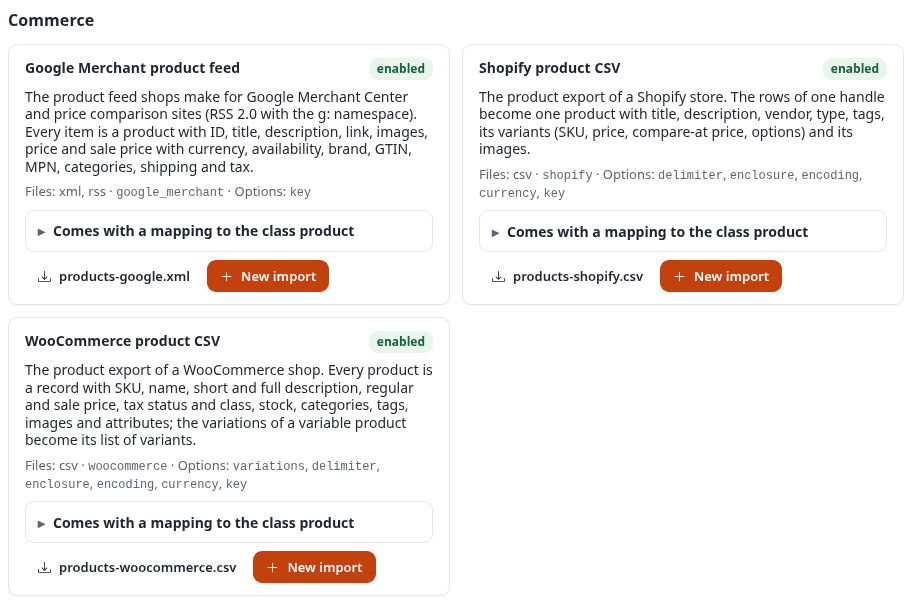

## Platforms

### Another Exponential site over REST (`exponential_site`)

Options: [sources.md, Another Exponential site](sources.md#another-exponential-site-exponential_site).
Illustrative: not run against a live service.

**Goal:** copy the news of another Exponential site (the children of its node 120, two levels deep) and keep the
copy in step at every run.

**Secret:** `partner_site_api_key`, a personal API key of a user of the other site who may only read that part of
the tree (`bearer`). With OAuth instead: `oauth_refresh` with `client_id`, `client_secret` and
`refresh_token_secret` (the names of two secrets).

| Option | Value |
|---|---|
| Address (`base_url`) | `https://partner.example.invalid` |
| Parent node | `120` |
| Depth | `2` |
| Class | `article` |
| Translation | `eng-GB` |
| Page size | `50` |
| Most nodes | `1000` |
| Authentication | `bearer`, token secret `partner_site_api_key` |
| Key field | `remote_id` |

The source requests `https://partner.example.invalid/api/ezp/v1/content/node/120/list/offset/0/limit/50?ResponseGroups=Metadata,Fields`
page by page and the children of every node down to the depth. Excerpt of `share/examples/exponential-site.ndjson`:

```json
{"node_id":120,"object_id":118,"remote_id":"example-article-harbour","class_identifier":"article","name":"The harbour festival","published":1790500000,"url":"https://www.example.org/News/The-harbour-festival","parent_node_id":2,"depth":1,"fields":{"title":"The harbour festival","short_title":"Harbour festival","intro":"Boats, music and food at the harbour.","body":"The festival starts on Friday evening. Entry is free.","image":"https://www.example.org/var/site/storage/images/news/the-harbour-f..."}}
```

The mapping is made from the first record when the import is saved:

| Source field | Attribute (`article`) | Transforms |
|---|---|---|
| `fields.title` | `title` | |
| `fields.short_title` | `short_title` | |
| `fields.intro` | `intro` | `richtext` |
| `fields.body` | `body` | `richtext` |
| `fields.image` | `image` | `image` |

Match: remote ID `{remote_id}`, so the copy has the remote IDs of the original. **Expected result:** two articles;
an article changed on the other site is updated at the next run.

### Drupal JSON:API (`drupal`)

Options: [sources.md, Drupal](sources.md#drupal-drupal). Illustrative: not run against a live service.

**Goal:** the published articles of a Drupal 10 site, newest first, with their image and tags.

**Secret:** none for public content; `drupal_reader` with `basic` (module basic_auth) or an OAuth access token with
`bearer`.

| Option | Value |
|---|---|
| Address | `https://drupal.example.invalid` |
| Resource | `node--article` |
| Include | `field_image,uid,field_tags` |
| Filter | `filter[status]=1&sort=-created` |
| Authentication | `none` |
| Key field | `id` |

The source requests `/jsonapi/node/article?include=...&filter[status]=1&sort=-created&page[limit]=50` and follows
`links.next`. The raw answer is the shape of `share/examples/drupal-jsonapi.json`:

```json
{"type": "node--article", "id": "6f1c2a3e-1111-4c1d-9e6a-0a1b2c3d4e01",
 "attributes": {"drupal_internal__nid": 11, "status": true, "title": "Planting trees in the example park",
                "created": "2026-04-01T09:30:00+00:00", "changed": "2026-04-02T11:00:00+00:00", "...": "..."}}
```

and a record gets `id`, `title`, `body`, `intro`, `created`, `image_url`, `image_alt`, `tags` and the rest by name.
The preset mapping: `title` to `title`, `intro` to `intro` and `body` to `body` (both `richtext`), `created` to
`publish_date` (`date`), `image_url` to `image` (`image`), `tags` to `tags`; match `drupal-{id}`. **Expected
result:** one article per node, its image downloaded as an image object.


### Joomla articles, CSV or XML (`joomla`)

Options: [sources.md, Joomla articles](sources.md#joomla-articles-joomla). **Ran on the documentation server**
(import "Docs: Joomla articles (CSV)", dry run #157).

**Goal:** move the articles of a Joomla site into Exponential, from its CSV export of the articles table (or J2XML).

**Secret:** none (a file).

Steps: format **Joomla articles (CSV or XML export)**; *An uploaded file*: `joomla-articles.csv` (the catalogue's
example); options:

| Option | Value |
|---|---|
| Variant | `auto` (detected from the first bytes; `xml` for J2XML such as `joomla-articles.xml`) |
| Site address | `https://joomla.example.invalid` (so `images/...` become addresses) |
| Status | `not_trashed` (published, unpublished, archived) |
| Key field | `id` |

The file (excerpt):

```
id,title,alias,introtext,fulltext,catid,category_title,state,featured,created,...
101,Welcome to the example club,welcome-to-the-example-club,"<p>The example club meets every Tuesday.</p>","<p>Bring a friend, the first visit is free.</p>",8,Club news,1,1,2026-03-02 09:00:00,...
102,A summer trip to the lake,a-summer-trip-to-the-lake,"<p>Our trip to the lake is booked.</p>",,8,Club news,1,0,2026-05-10 14:30:00,...
103,Old minutes,old-minutes,"<p>The minutes of the last year.</p>",,9,Archive,-2,0,2025-01-01 12:00:00,...
```

| Source field | Attribute (`article`) | Transforms |
|---|---|---|
| `title` | `title` | (required) |
| `intro` | `intro` | `richtext` |
| `body` | `body` | `richtext` (intro and full text joined, as Joomla shows the article) |

Match: `joomla-{id}`. **Result:** the preview reads two records; article 103 has the state -2 (trashed) and is left
out by *Status*. The dry run: 2 would be created.

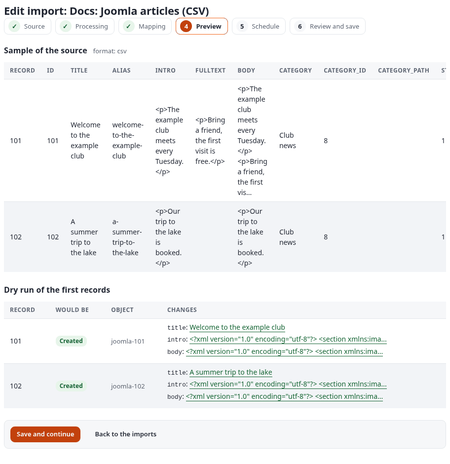

### Exponential packages (`ezpkg`)

Options: [sources.md, Exponential packages](sources.md#exponential-packages-ezpkg). **Ran on the documentation
server** (import "Docs: Exponential package (.ezpkg)", dry run #158).

**Goal:** bring the articles of a content package exported on another Exponential site (Setup, Packages) into this
one, and import it again later to update them.

**Secret:** none.

Steps: format **Exponential package (.ezpkg)**; upload `exponential-package.ezpkg`; *Class* `article`; *Key field*
`remote_id`:

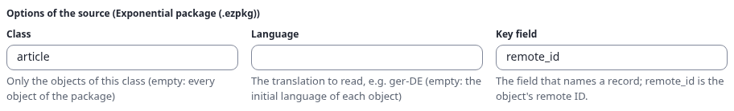

The package holds a folder and three articles (`ezcontentobject/object-exp-example-article-garden.xml` ...) and a
picture (`simplefiles/1a2b3c4d.jpg`); the archive is read with PharData and never extracted. A record:
`remote_id`, `name`, `class_identifier`, `fields.title`, `fields.intro` (rich text as its XML) ... An image is named
`source:<path in the package>`, for the transform `image`.

| Source field | Attribute (`article`) |
|---|---|
| `fields.title` | `title` (required) |
| `fields.intro` | `intro` |
| `fields.body` | `body` |

Match: remote ID `{remote_id}` (the package's own remote IDs). **Result:** 3 would be created ("A garden in the
city", "Bicycles for everyone", "The Saturday market"); importing the same package again finds them by their remote
IDs and updates instead of duplicating.

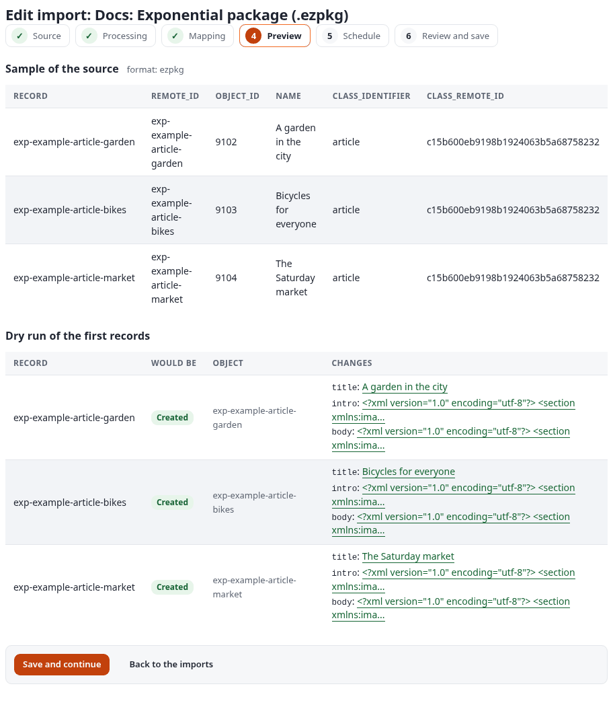

## Commerce

The three shop formats start from the [product preset](sources.md#the-product-preset) of the webshop class
`product`: `title` to `name` (`strip_tags | trim`), the product number to `product_number`, `description` to
`description` (`richtext`), `price` to `price` through `template(text="{price}|1|1")` and `tags` to `tags`
(`join(separator=", ")`). The price text `amount|VAT type|includes VAT` is what the datatype `ezprice` reads:
`|1|1` is VAT type 1, the price includes VAT; `|1|0` is VAT type 1, the price excludes VAT. Change it to your
shop's VAT type. Images are not in the preset (the webshop's `image` is an object relation).

### Google Merchant feed (`google_merchant`)

Options: [sources.md, Google Merchant feed](sources.md#google-merchant-feed-google_merchant). **Ran on the
documentation server** (dry run #159).

**Goal:** the products of a shop's Merchant Center feed as products of the site, read every night from the feed's
address (here an upload of the example `products-google.xml`).

**Secret:** none (a public feed; a protected one is an address the server may read).

Options: only *Key field* `id`. The feed (excerpt):

```xml
<item>
  <g:id>EX-1001</g:id>
  <title>Example travel mug</title>
  <description><![CDATA[<p>Keeps coffee warm for <strong>six hours</strong>.</p>]]></description>
  <g:price>24.90 EUR</g:price>
  <g:sale_price>19.90 EUR</g:sale_price>
  <g:availability>in_stock</g:availability>
  <g:product_type>Home &gt; Kitchen &gt; Mugs</g:product_type>
  ...
</item>
```

Mapping: the preset (match `gmc-{id}`, product number from `id`). **Result:** 3 would be created. The price is
read as a decimal (`24.90 EUR` gives `24.90`, `1,299.00 USD` gives `1299.00`), so `price` becomes `24.90|1|1`; the
custom labels become the tags (`Bestseller, Winter`).

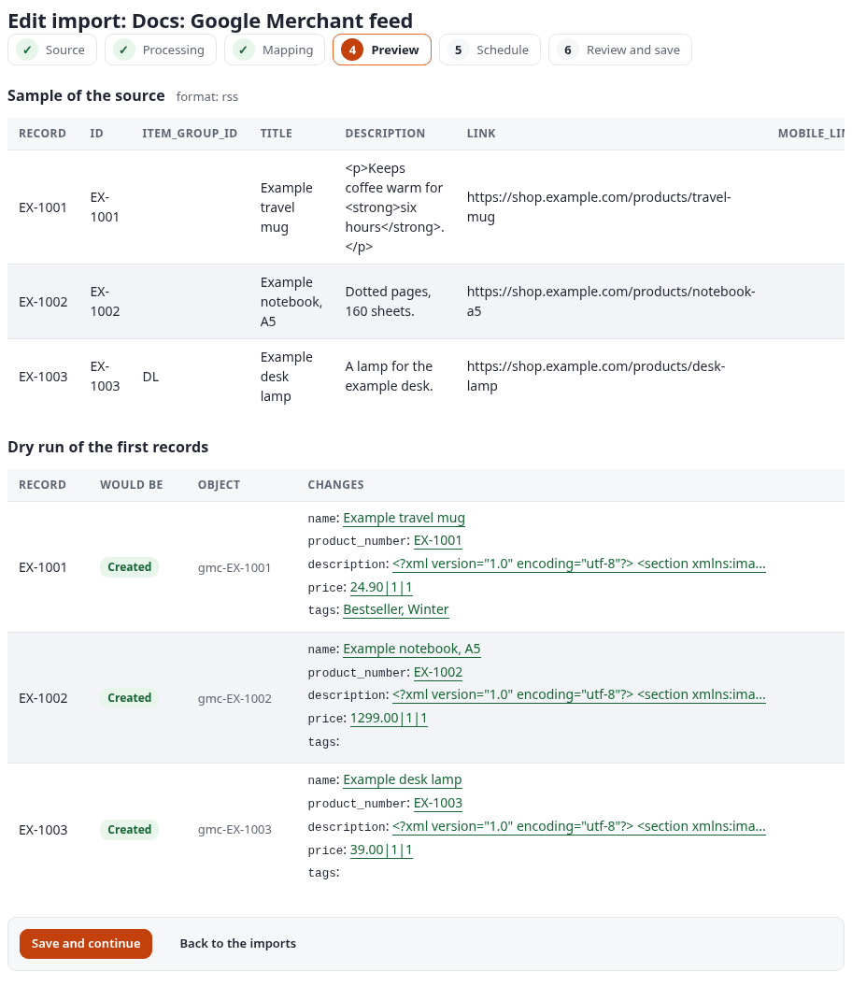

### Shopify product CSV (`shopify`)

Options: [sources.md, Shopify product CSV](sources.md#shopify-product-csv-shopify). **Ran on the documentation
server** (dry run #160).

**Goal:** the products of a Shopify store from its product export (Products, Export), with prices in euros.

**Secret:** none.

| Option | Value |
|---|---|
| Delimiter, Encoding | `auto`, `auto` |
| Currency | `EUR` (the export does not name it) |
| Key field | `id` (the Handle) |

The rows that share a Handle are one product: `example-hoodie` has a row per size and image.

```
Handle,Title,Body (HTML),Vendor,...,Option1 Name,Option1 Value,...,Variant SKU,...,Variant Price,Variant Compare At Price,...
example-hoodie,Example hoodie,"<p>A warm hoodie, made of <em>organic</em> cotton.</p>",Example Apparel,...,Size,Small,...,HOODIE-S,...,49.00,59.00,...
example-hoodie,,,,,,,,,Medium,,,,,HOODIE-M,...,49.00,59.00,...
```

Mapping: the preset with the product number from `sku` (the first variant's), match `shopify-{id}`. **Result:** 2
would be created, `example-hoodie` (with its variants in `variants`) and `example-gift-card`:

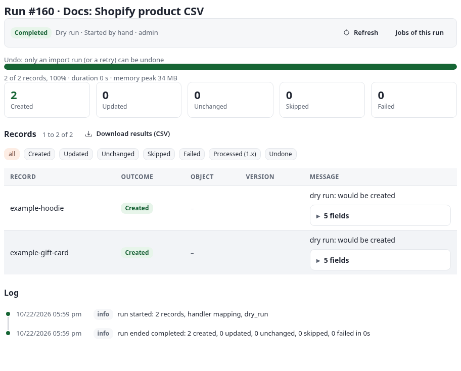

### WooCommerce product CSV (`woocommerce`)

Options: [sources.md, WooCommerce product CSV](sources.md#woocommerce-product-csv-woocommerce). **Ran on the
documentation server** (dry run #161).

**Goal:** the products of a WooCommerce shop whose prices are entered **without VAT**, with their short description.

**Secret:** none.

| Option | Value |
|---|---|
| Variations | `nested` (the variations of a variable product go into its `variants`) |
| Delimiter, Encoding | `auto`, `auto` |
| Currency | `EUR` |
| Key field | `id` |

The export (excerpt): a simple product, a variable product and its variations:

```
ID,Type,SKU,Name,Published,...,Short description,Description,...,Tax status,Tax class,...,Regular price,Categories,Tags,...
101,simple,WC-MUG,Example mug,1,...,A sturdy mug.,"Holds 350 ml.\nDishwasher safe.",...,taxable,,...,12.50,"Kitchen > Mugs, Gifts","mug, ceramic",...
102,variable,WC-TEE,Example T-shirt,1,...,An example T-shirt.,Soft cotton.,...,taxable,reduced-rate,...
103,variation,WC-TEE-S,Example T-shirt - S,1,...,taxable,parent,...,18.00,...
```

Mapping: the preset, with `short_description` to `short_description` (`richtext`) and the price line changed to
`template(text="{price}|1|0")`, VAT type 1 **excluding** VAT. A variable product's `price` is the lowest price of its
variations. The mapping step as saved:

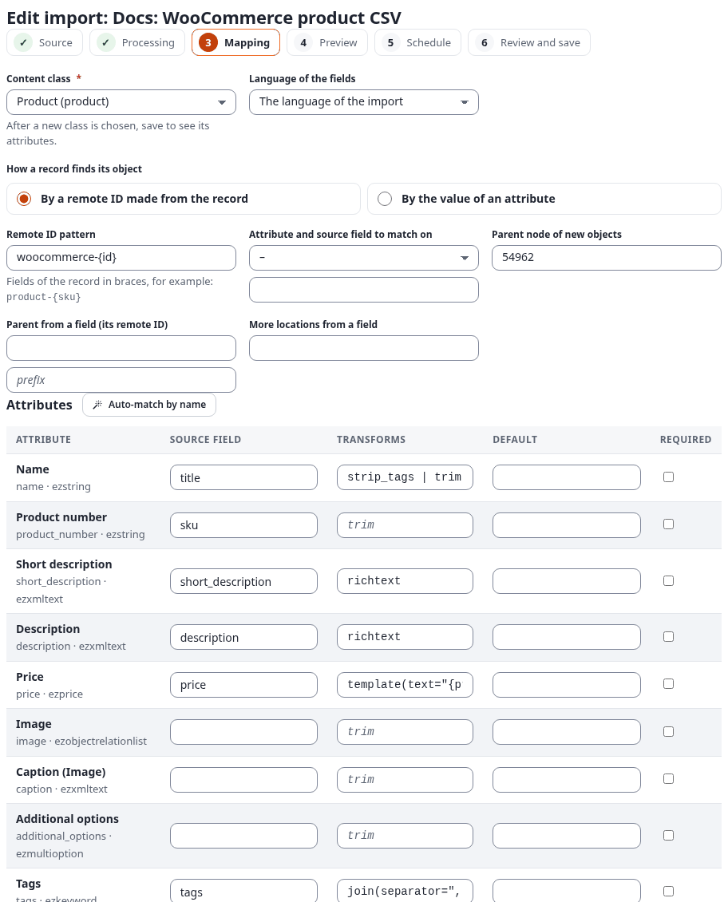

**Result:** 3 would be created, 0 failed. WooCommerce's export has the tax class (`tax_class`, here
`reduced-rate`) but no rate. A shop with several VAT types gives each tax class its own price line with a
[class per record](mappings.md#a-class-per-record): `class_from` `tax_class`, and a variant `reduced-rate` of the
class `product` whose lines have `template(text="{price}|2|0")` (VAT type 2); the other products keep the lines of
the grid.

## A mailbox over IMAP, with its attachments (`imap`)

Options: [sources.md, E-mail inbox via IMAP](sources.md#e-mail-inbox-via-imap-imap). Illustrative: not run
against a live service.

**Goal:** the press releases sent to a press address, as articles, with the names of their attachments.

**Secret:** `press_inbox`, the mailbox password (or an app password).

| Option | Value |
|---|---|
| Host, Port | `imap.example.invalid`, `993` |
| Encryption | `ssl` |
| User | `press@example.invalid` |
| Password | `press_inbox` |
| Mailbox | `INBOX/Press` |
| Search | `UNSEEN SUBJECT "Press release"` |
| Days | `14` |
| Mark as seen | off (the mailbox is opened read-only) |
| Attachments | on (names, types and sizes) |
| Key field | `message_id` |

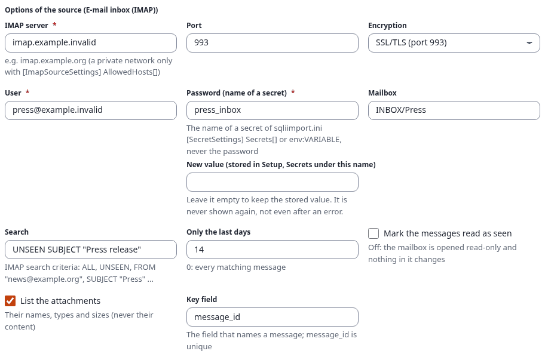

A record (illustrative):

```json
{"message_id":"20261013091500.4711@example.invalid","from.name":"Example Press Office","from.address":"office@example.invalid","subject":"Press release: the autumn tasting","date":"2026-10-13T09:15:00+02:00","summary":"The autumn tasting takes place on 24 October.","body":"<p>The autumn tasting takes place on 24 October.</p>","attachments":[{"name":"programme.pdf","mime":"application/pdf","size":48213}],"attachment_count":1}
```

The preset: `subject` to `title`, `summary` to `intro` and `body` to `body` (`richtext`), `date` to `publish_date`;
match `mail-{message_id}`. **Expected result:** one article per matching message. The attachments are listed, not
read; to import their content, use [Documents attached to e-mails](#documents-attached-to-e-mails-mailbox_documents).

## Documents (ezodf)

The extension ezodf adds seven document formats to the catalogue (group *Content*, the mailbox one in *Other*).
ezodf converts each Word, OpenDocument, PDF, RTF, spreadsheet or presentation file; 7x SQLI Import maps it. A
document record has `title`, `summary`, `html` (the body with its images), `text`, `keywords`, `author`, `created`,
`modified`, `kind` (document or folder), `path`, `parent_path`, `folder` and `source_url`. The preset of the formats:

| Source field | Attribute (`article`) | Transforms |
|---|---|---|
| `title` | `title` | |
| `summary` | `intro` | `richtext` |
| `html` | `body` | `richtext` |
| `modified` | `publish_date` (where the class has it) | `date` |
| `keywords` | `tags` (where the class has it) | `join(separator=", ")` |

Location: `parent_from` `parent_path` with the prefix of the format (`doc-`, `webdav-`, `onedrive-` ...), so the
folders of a ZIP or a drive rebuild the tree.


### Documents, one file or a folder as ZIP (`documents`)

**Ran on the documentation server:** import "Docs: Handbook documents (ZIP)", dry run #162 and run #163.

**Goal:** a staff handbook kept as a folder of Word, OpenDocument and RTF files, uploaded as one ZIP, as a tree of
articles.

**Secret:** none.

Steps: format **Documents (one file or a folder as ZIP)**; upload `docs-handbook.zip`; options *Folders as records*
on, *Leave out* empty, *Key field* `id`. The ZIP:

```
Handbook/Welcome.odt
Handbook/Policies/Travel policy.docx
Handbook/Policies/Notes.rtf
```

The source gives five records, the folders before their documents: `Handbook`, `Handbook/Policies` (kind folder)
and the three documents (kind document), each with its `parent_path`:

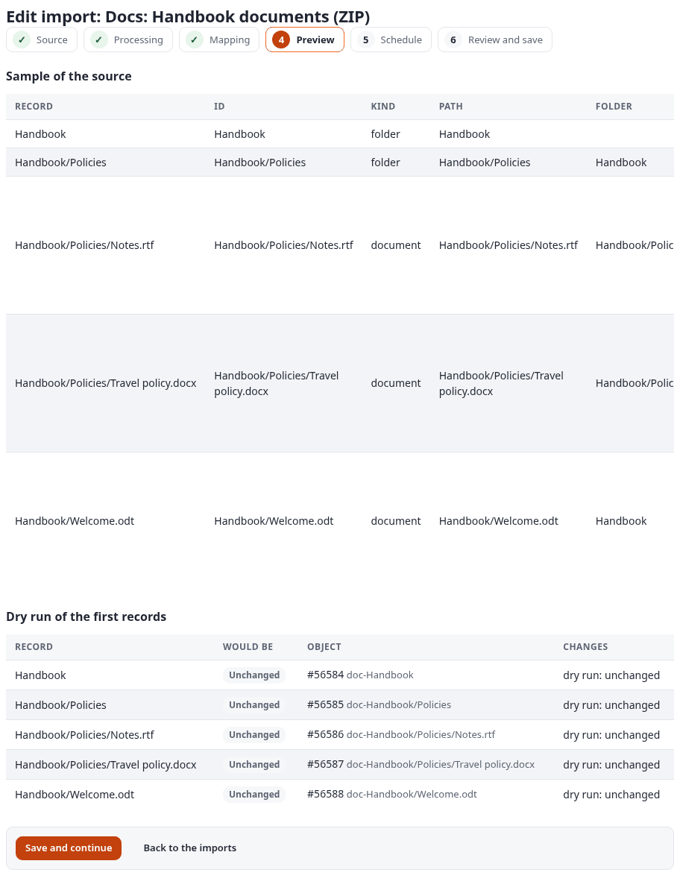

Mapping: the preset above (`title`, `summary`, `html`), match `doc-{id}`, parent from `parent_path` with the prefix
`doc-`. **Result:** the real run #163 created 5 objects, the two folders and the three documents below them:

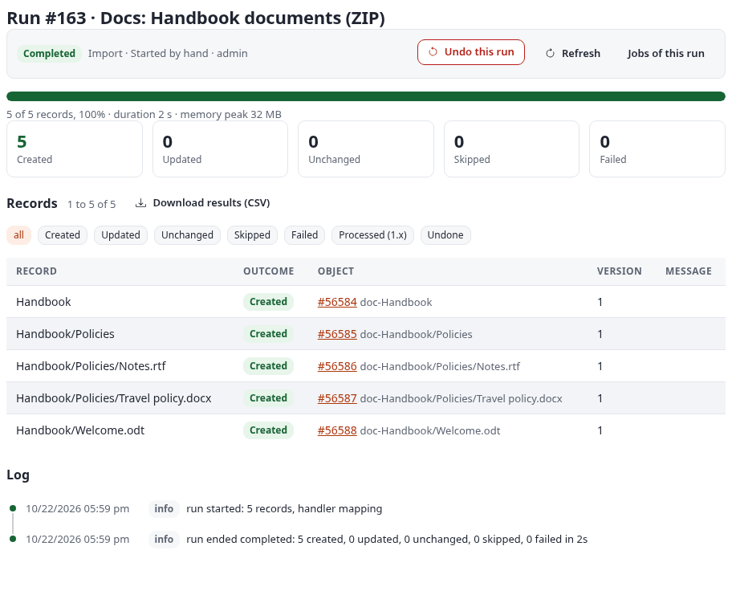

**A dry run before the first run counts the folders it would create.** A dry run publishes nothing, so the folders
it would create do not exist yet; it remembers them, and the four records below `Handbook` say "would be created
below <the folder's remote ID>, which this run would create". The picture is a dry run of a fresh copy of the import
with new remote IDs (`sq688-drycheck-` instead of `doc-`), run #269, made for this page and removed again; all five
records would be created:

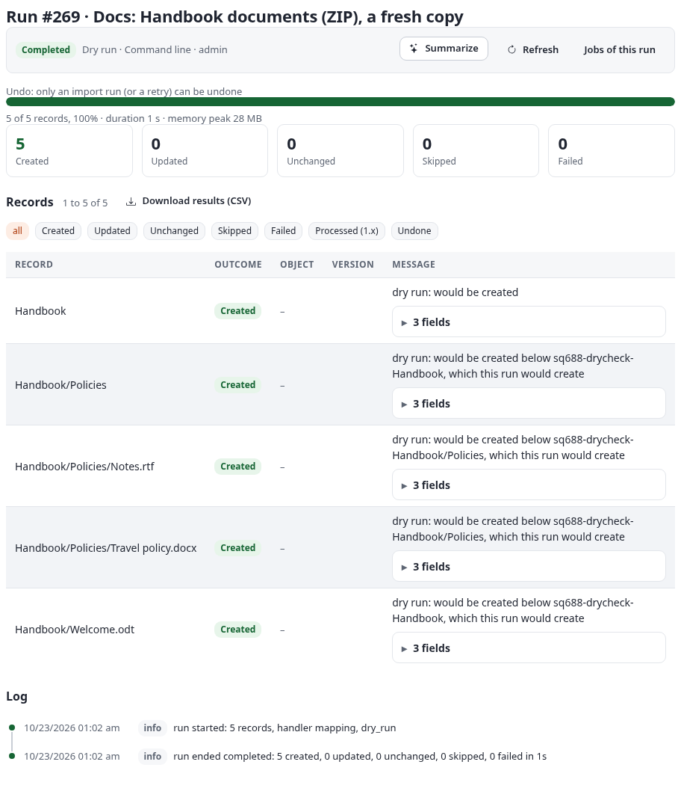

Before 2.0.0 the dry run #162 failed those four records with "the parent of the record does not exist (yet)". The
real run places them all. To give folders their own class, add a class per record: `class_from` `kind` with the
variant `folder` to the class `folder` ([mappings.md](mappings.md#a-class-per-record)).

### Documents from URLs (`document_urls`)

Illustrative: not run against a live service.

**Goal:** three public documents of a partner (a brochure, a price list, a report) imported and refreshed weekly.

| Option | Value |
|---|---|
| Addresses | `https://partner.example.invalid/files/brochure-2026.pdf`<br>`https://partner.example.invalid/files/price-list.docx`<br>`https://partner.example.invalid/files/annual-report.odt` |
| Key field | `id` |

Each address is downloaded once per run (public addresses only, with size and time limits). Mapping: the preset,
match `docurl-{id}`, no tree. **Expected result:** three articles, each with `source_url`; a changed document is
imported again by the weekly schedule.

### Documents of a feed (`document_feed`)

Illustrative: not run against a live service.

**Goal:** the documents a publications feed links to (each item of the feed links a PDF or DOCX).

| Option | Value |
|---|---|
| Feed address | `https://publications.example.invalid/feed.rss` |
| Items | `20` (the newest per run) |

A record adds the item's title, link, date and summary to the fields of the document. Mapping: the preset, with the
item's date as the publish date. **Expected result:** one article per linked document of the newest twenty items.

### WebDAV or Nextcloud (`webdav`)

Illustrative: not run against a live service.

**Goal:** the Documents folder of a Nextcloud user, three levels deep, as a tree.

**Secret:** `cloud_documents`, an **app password** of the Nextcloud user (Settings, Security).

The card of the format, with its example configuration:

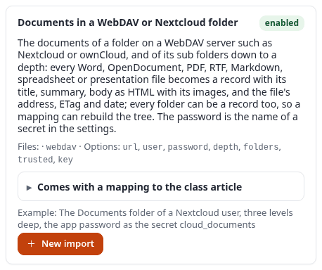

| Option | Value |
|---|---|
| Folder address | `https://cloud.example.invalid/remote.php/dav/files/editor/Documents/` |
| User | `editor` |
| Password | `cloud_documents` |
| Depth | `3` |
| Folders as records | on |
| Trust this server | off (on only for an intranet server you run) |

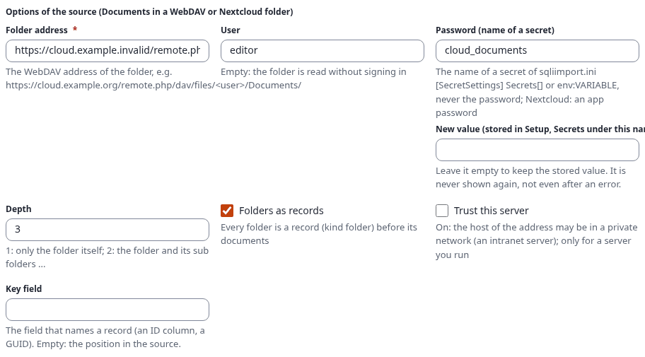

Mapping: the preset, match `webdav-{id}`, parent from `parent_path` with the prefix `webdav-`. **Expected result:**
the folders and documents of the tree; a file changed in Nextcloud (its ETag changes) is imported again at the next
run. ownCloud and other WebDAV servers work the same.

### Google Drive (`google_drive`)

Illustrative: not run against a live service.

**Goal:** a Drive folder of guides, including Google Docs, as articles.

**Secret:** `drive_reader_key`, the JSON key of a service account; share the folder with that account's address
(as Viewer).

| Option | Value |
|---|---|
| Folder ID | `1ExampleDriveFolderIdREPLACE` (the last part of `https://drive.google.com/drive/folders/<ID>`) |
| Service account key | `drive_reader_key` |
| Depth | `3` |
| Folders as records | on |
| Google Docs, Sheets and Slides | on (exported as DOCX, XLSX, PPTX, at most 10 MB each) |

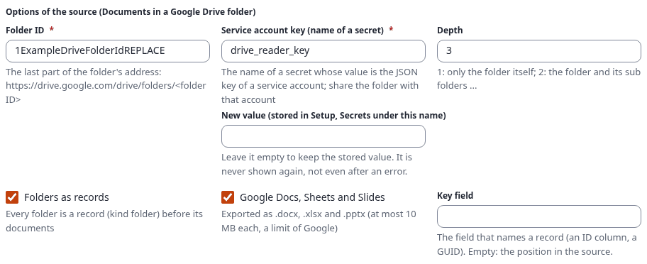

**Expected result:** one record per folder and document, with its Drive ID and link; the preset places them as a tree.

### OneDrive or SharePoint (`onedrive`)

Illustrative: not run against a live service.

**Goal:** the press folder of a SharePoint document library.

**Secret:** `graph_documents`, the client secret of an app registration with the application permission
`Sites.Selected` (granted read on that site) or `Files.Read.All`.

| Option | Value |
|---|---|
| Tenant | `example.onmicrosoft.com` |
| Application (client) ID | `00000000-0000-0000-0000-000000000000` |
| Client secret | `graph_documents` |
| Drive | `sites/<site id>/drive` (or `users/<user principal name>/drive`, `drives/<drive id>`) |
| Folder | `Documents/Press` |
| Depth | `3` |

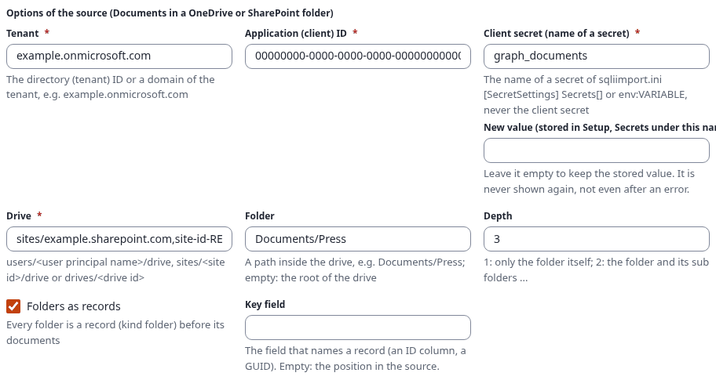

Mapping: the preset, match `onedrive-{id}`, parent prefix `onedrive-`. **Expected result:** the folders and
documents of `Documents/Press` and below.

### Documents attached to e-mails (`mailbox_documents`)

Illustrative: not run against a live service.

**Goal:** a submissions address receives articles as Word files; each attachment becomes an article.

**Secret:** `submissions_inbox`.

The options are those of [IMAP](#a-mailbox-over-imap-with-its-attachments-imap): host `imap.example.invalid`, user
`submissions@example.invalid`, password `submissions_inbox`, mailbox `INBOX`, search `UNSEEN`, *Mark as seen* on
(so an attachment is imported once), key field `id` (the message ID and the attachment name). A record has the
document's fields and the message's ID, subject, sender address and date.

Mapping: the preset without a tree, match `mail-{id}`. **Expected result:** one article per Word, OpenDocument, PDF
or RTF attachment of the new messages. The sender addresses are personal data: map them only if the site needs them.

## See also

- [Worked examples: APIs and hosted services](source-examples-apis.md)
- [Worked examples: databases](source-examples-databases.md)
- [Sources](sources.md), [The import editor](editor.md), [Mappings](mappings.md), [Runs](runs.md)
