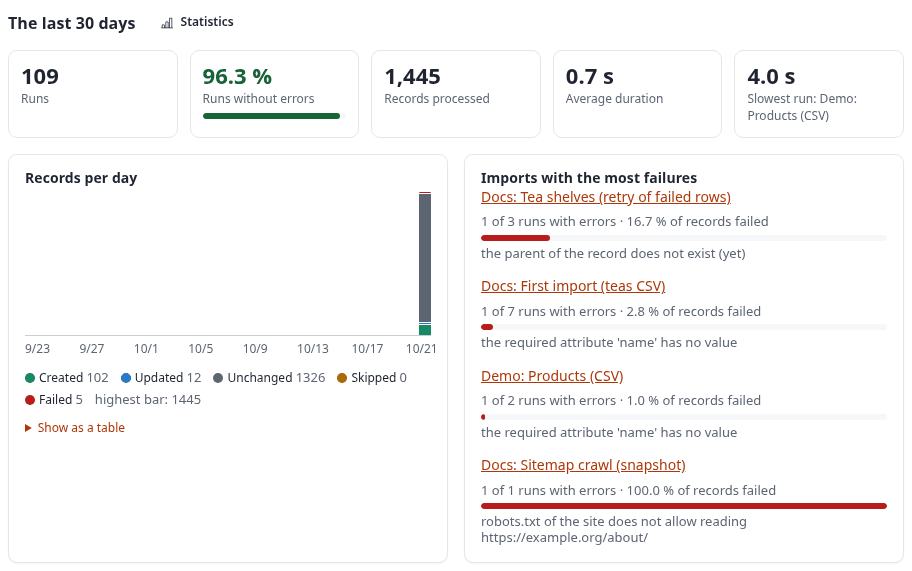
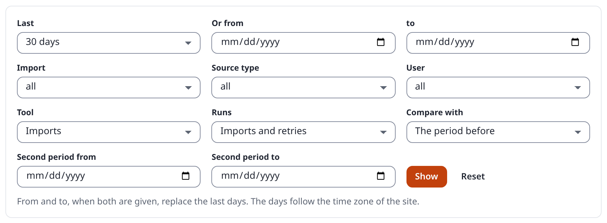
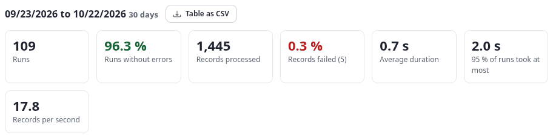
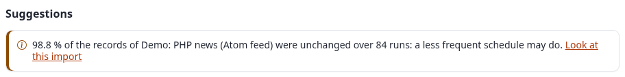
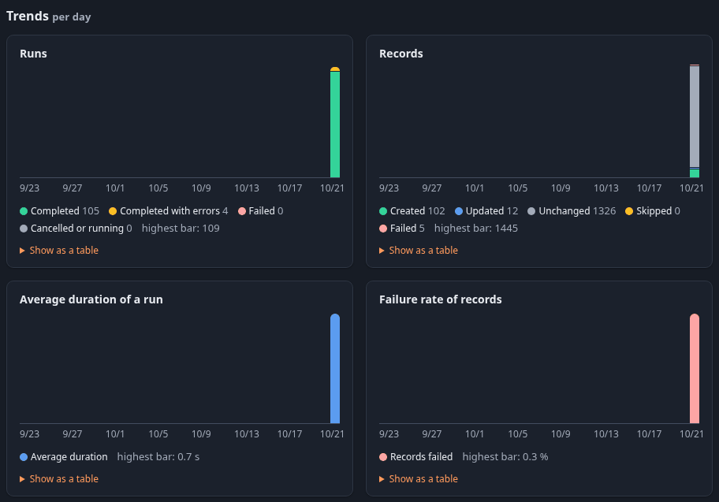
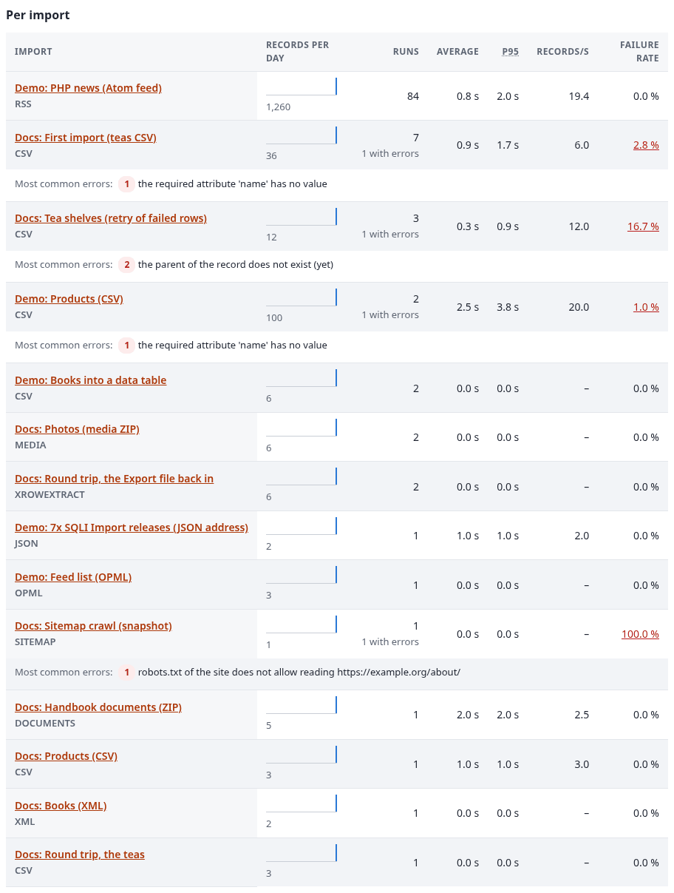
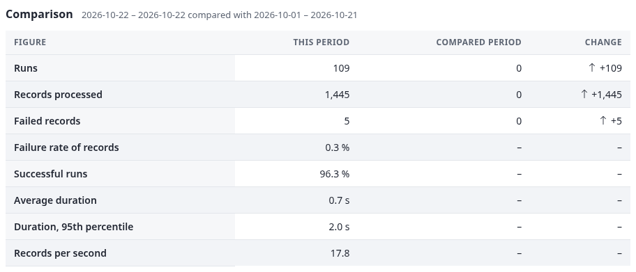
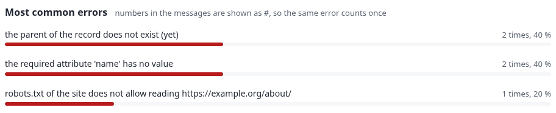
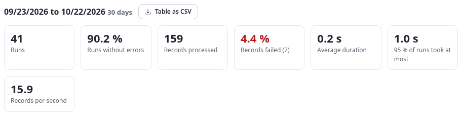
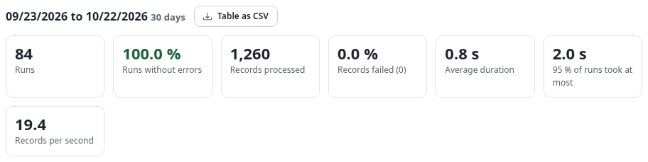

# Statistics

7x SQLI Import keeps every run with its counters, its timings and a row per failed record
([runs.md](runs.md)). Two pages read that history: the dashboard shows the last 30 days at a glance, and the
Statistics page lets you look back over any period and compare it with another one.

German: [ger-de/statistics.md](ger-de/statistics.md).

The screenshots and numbers on this page are from the documentation server on 22 October 2026, the day the demo
and documentation imports first ran, so every chart has its bars on that one day. The php.net demo runs every ten
minutes, so figures read a few minutes apart differ by a few runs.

## Contents

- [The dashboard (sqliimport/list)](#the-dashboard-sqliimportlist)
- [The Statistics page (sqliimport/statistics)](#the-statistics-page-sqliimportstatistics)
  - [Period and filters](#period-and-filters)
  - [What the page shows](#what-the-page-shows)
- [Example: reading the Statistics page](#example-reading-the-statistics-page)
  - [The key figures](#the-key-figures)
  - [The suggestions](#the-suggestions)
  - [The trend charts](#the-trend-charts)
  - [Per import, comparison and most common errors](#per-import-comparison-and-most-common-errors)
- [Example: one address per filter](#example-one-address-per-filter)
- [Example: the CSV download](#example-the-csv-download)
- [How it is computed](#how-it-is-computed)

## The dashboard (sqliimport/list)

Under the key figures, the block "The last 30 days" shows:

- **Runs**, the share of **runs without errors** (with a bar), the **records processed**, the **average
  duration** and the **slowest run** (a link to it).
- **Records per day**: one bar per day, stacked by outcome (created, updated, unchanged, skipped, failed). Hover
  a bar for its numbers; **Show as a table** lists them.
- **Imports with the most failures**: up to five imports with the runs that had errors, the share of failed
  records and the most common error. Each name opens the import in Statistics.

Dry runs and undo runs are not counted.

**Example.** On the documentation server the block read 109 runs, 96.3 % without errors, 1,445 records, 0.7 s on
average, and the slowest run 4.0 s (Demo: Products (CSV), 50 records). The bar of 22 October is mostly grey: 1,326
of the 1,445 records were unchanged, because the php.net demo runs every ten minutes and finds the same 15 entries.
On the right, "Docs: Tea shelves (retry of failed rows)" leads with 1 of 3 runs with errors and 16.7 % of its records
failed, its most common error "the parent of the record does not exist (yet)":



## The Statistics page (sqliimport/statistics)

Open it from the left menu of the Imports tab (**Statistics**), or with the link **Statistics** next to "The last 30
days" on the dashboard. Who may see the Imports tab may see it (the same policies as the other pages that only
show: Manage imports, Run imports, or the 1.x policies).

### Period and filters

The form at the top is a plain GET form, so every view has an address you can bookmark or send:

| Field | Parameter | Values |
|---|---|---|
| Last | `days` | 7, 30 (default), 90, 365 |
| Or from / to | `from`, `to` | dates (YYYY-MM-DD); both together replace `days` |
| Import | `import` | the ID of an import (the list shows each import with its number of runs) |
| Source type | `source` | csv, xml, rss, json, spreadsheet ... (each with its number of runs) |
| User | `user` | the ID of the user who started the runs |
| Tool | `tool` | empty: the imports of 7x SQLI Import (default); `transfer.package`, `transfer.datatable` ...: one tool of the Import and export menu; `all`: every tool ([transfer.md](transfer.md)) |
| Runs | `scope` | `production` (imports and retries, default), `dry_run`, `all` (with dry runs and undo) |
| Compare with | `compare` | `previous` (the period before, default), `custom` (with `cfrom`, `cto`), `none` |

The same parameters work as view parameters, for example `sqliimport/statistics/(days)/90/(import)/3` or
`sqliimport/statistics/(from)/2026-08-01/(to)/2026-08-31/(compare)/custom/(cfrom)/2026-07-01/(cto)/2026-07-31`.
Days follow the time zone of the site; a run counts on the day it started.


The same form at 960 pixels and double scale:



### What the page shows

- **Key figures**: runs, runs without errors, records processed, failure rate of records, average duration, the
  duration 95 % of the runs stayed under (95th percentile), records per second.
- **Suggestions**, where the history points at something to tune:
  - *fails on the field X in N % of its records*: the failed records of an import name one field (an attribute,
    field or column in the error message) often enough;
  - *slow since DATE*: the time per record of an import stepped up for good (at least 1.5 times, clear of the
    noise) at a run; the date is the first slow run;
  - *N % of the runs ended with errors*, with the most common error;
  - *nearly every record was unchanged*: the import may run less often.
- **Trends** per day (periods up to 62 days), per week (up to 200 days) or per month: runs by result, records by
  outcome, the average duration of a run and the failure rate of records. Every chart has a legend and **Show as
  a table** with its numbers.
- **Per import**: a sparkline of the records per day, week or month, runs and runs with errors, average and 95th
  percentile duration, records per second, failure rate (a link to the failed runs) and the three most common
  errors. An import whose time per record stepped up carries the badge *slow since*.
- **Comparison**: every key figure of this period next to the compared one, with the change; green is better,
  red is worse.
- **Most common errors** of all imports. Numbers in the messages are shown as `#`, so the same error with another
  row number counts once.

**Table as CSV** downloads the per-import table (`(format)/csv`), one line per import, in UTF-8 with a byte order
mark. Cells that a spreadsheet would read as a formula get a leading apostrophe, as in the report of a run.

## Example: reading the Statistics page

The address `sqliimport/statistics` with no parameter: the last 30 days, imports and retries, compared with the 30
days before.

### The key figures



Read them as: 109 runs, of which 4 ended *completed with errors* (96.3 % without errors); 1,445 records, 5 of them
failed (0.3 %); a run took 0.7 s on average and 95 % of the runs took at most 2.0 s; the imports handled 17.8 records
per second while they ran. The line above names the period (`09/23/2026 to 10/22/2026 30 days`) and offers **Table
as CSV**.

### The suggestions



"98.8 % of the records of Demo: PHP news (Atom feed) were unchanged over 84 runs: a less frequent schedule may do."
The feed changes a few times a day, so a schedule every hour would find the same news with a sixth of the runs.
Earlier the same day the page also showed *slow since*: "Demo: PHP news (Atom feed) is slow since 2026-10-22: 2.0
times the time per record of before (9.5 s instead of 4.8 s per 100 records). Look at what changed then: the source,
the mapping or the server." It disappeared when later runs were fast again, because the step has to hold to count.
**Look at this import** opens the same page filtered to that import.

### The trend charts


- **Runs**: one bar per day, by result. Green is *completed*, amber *completed with errors*, red *failed*, grey
  *cancelled or running*.
- **Records**: the records of the day by outcome; the grey part (unchanged) is what a run read and left alone.
- **Average duration of a run** and **Failure rate of records**: one value per day; a step up in either is what
  the suggestions look for.

Each chart names its highest bar (`highest bar: 1445`) and opens **Show as a table** with the numbers per day, such
as "10/22/2026: Completed 102, Completed with errors 4, Failed 0, Cancelled or running 0, Total 106". The same charts
in the dark theme:



### Per import, comparison and most common errors



The row of "Docs: First import (teas CSV)": 7 runs, 1 with errors, 0.9 s on average, a failure rate of 2.8 % (a
link to its failed runs) and, below it, the most common error with its count: "the required attribute 'name' has no
value". The failure rate of "Docs: Sitemap crawl (snapshot)" is 100 %: its only production run was the retry of the
one row robots.txt refused.

**Comparison** of one day with the three weeks before (the last address of the next section):



Rates cannot be compared with a period without runs, so their change is a dash.

**Most common errors** of all imports, folded (a row number in a message is `#`):



## Example: one address per filter

Each address follows `/admin/`; next to it, what the key figures said on the documentation server, read one after
the other within two minutes (30 days unless the address sets the period).

| Address | What changes |
|---|---|
| `sqliimport/statistics` | The default: `09/23/2026 to 10/22/2026 30 days`, 109 runs, 1,445 records, 5 failed. |
| `sqliimport/statistics/(days)/7` | The period is `10/16/2026 to 10/22/2026 7 days`; as every run was in the last week, the figures are those of the 30 days (112 runs by then). The trends stay per day. |
| `sqliimport/statistics?from=2026-10-01&to=2026-10-22` | A period of its own, `10/01/2026 to 10/22/2026 22 days`: `from` and `to` together replace `days`, and the comparison takes the 22 days before. |
| `sqliimport/statistics/(import)/2/(days)/30` | Only the php.net demo: 84 runs, 100.0 % without errors, 1,260 records, 0 failed, 19.4 records per second; the suggestions and the per-import table show only that import. |
| `sqliimport/statistics/(source)/csv` | Only imports with the source type CSV: 22 runs, 86.4 % without errors, 173 records, 4 failed (2.3 %). |
| `sqliimport/statistics/(user)/56534` | Only the runs started by that user (here the documentation account): 9 runs, 88.9 % without errors, 43 records, 1 failed. |
| `sqliimport/statistics/(user)/10` | User 10 is *anonymous*: the runs started on the command line (`./console ext:sqliimport:run`) are recorded with it, 2 runs here. |
| `sqliimport/statistics/(tool)/all` | The runs of every import and export tool of the Import and export menu, not only the imports: 116 runs. |
| `sqliimport/statistics/(scope)/dry_run` | Only dry runs: 44 runs, 168 records, 8 failed (4.8 %), 0.3 s on average: how often mappings were tried before they ran. |
| `sqliimport/statistics/(scope)/all` | Imports, retries, dry runs and undo runs together: 163 runs, 1,637 records, 13 failed (0.8 %). |
| `sqliimport/statistics/(compare)/none` | The same figures without the Comparison section. |
| `sqliimport/statistics/(from)/2026-10-22/(to)/2026-10-22/(compare)/custom/(cfrom)/2026-10-01/(cto)/2026-10-21` | One day compared with the three weeks before: the Comparison section shown above. |

The dry-run scope and the php.net demo alone, as the key figures showed them (the dry runs a few minutes earlier, before three more were made):





## Example: the CSV download

**Table as CSV** (address `sqliimport/statistics/(format)/csv/(days)/30`) saved the file
`sqliimport-statistics-2026-09-23-2026-10-22.csv`. Its first lines (the file starts with a UTF-8 byte order mark,
so a spreadsheet program reads accents right):

```csv
import_id,identifier,name,source_type,runs,completed,with_errors,failed_runs,success_rate,records,created,updated,unchanged,skipped,failed_records,failure_rate,avg_duration_s,p95_duration_s,max_duration_s,records_per_second,top_error,top_error_count,failing_field,failing_field_share,slow_since
2,demo-php-news-atom,Demo: PHP news (Atom feed),rss,83,83,0,0,100.0,1245,15,0,1230,0,0,0.0,0.8,2.0,3,19.2,,,,,2026-10-22
132,docs-first-import,Docs: First import (teas CSV),csv,6,5,1,0,83.3,29,8,4,16,0,1,3.4,1.0,1.8,2,4.8,the required attribute 'name' has no value,1,name,3.4,
1,demo-products-csv,Demo: Products (CSV),csv,2,1,1,0,50.0,100,50,5,44,0,1,1.0,2.5,3.8,4,20.0,the required attribute 'name' has no value,1,name,1.0,
```

One line per import, with the columns of the per-import table and three more: `failing_field` and
`failing_field_share` (the field of the *fails on the field* suggestion: `name` in 3.4 % of the records of
"Docs: First import") and `slow_since` (the date of the *slow since* badge, here 2026-10-22 for the php.net demo).
The download keeps the filters of the page: `(format)/csv/(source)/csv` downloads the CSV imports only.

## How it is computed

The class `expImportStatistics` (classes/exp/expimportstatistics.php) reads the runs of the period once (one
narrow row per run, from `sqliimport_run`) and the messages of their failed records (`sqliimport_run_row`, the
newest 20,000; for runs that failed as a whole the errors of `sqliimport_run_log`). The queries are generic SQL
for MySQL, PostgreSQL, SQLite and Oracle; long message texts are never grouped in SQL. Days, weeks and months are
built in PHP in the site's time zone, so daylight saving time is right. A period reads at most 50,000 runs; a page
says so when it hits that limit.

The computing parts are pure functions on plain arrays (percentiles, rates, deltas, buckets, the change point,
the folding of messages, the suggestions) and are covered by `tests/unit/StatisticsTest.php`.
