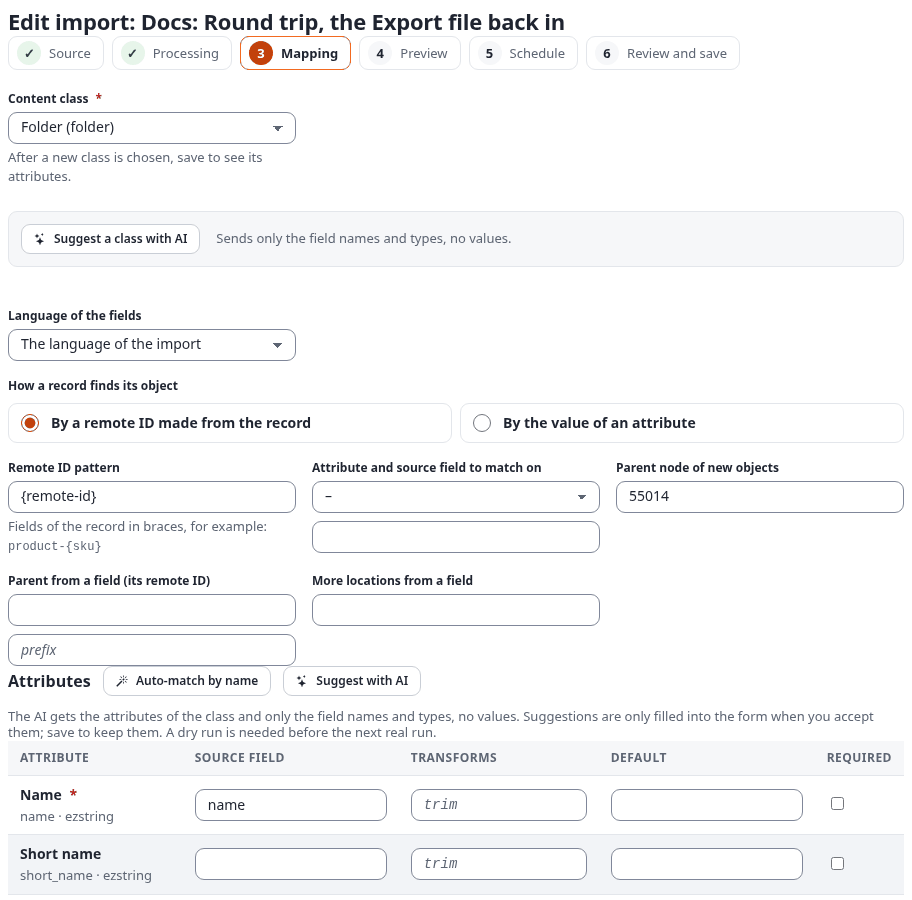
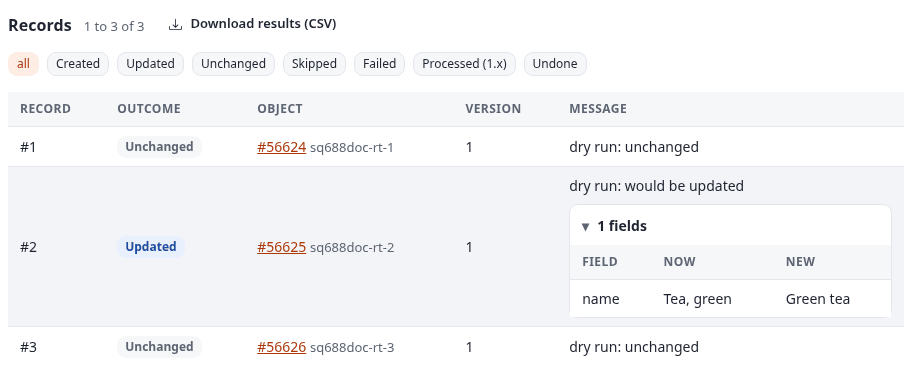
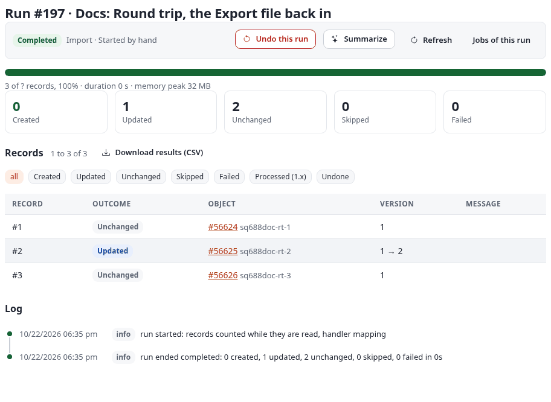
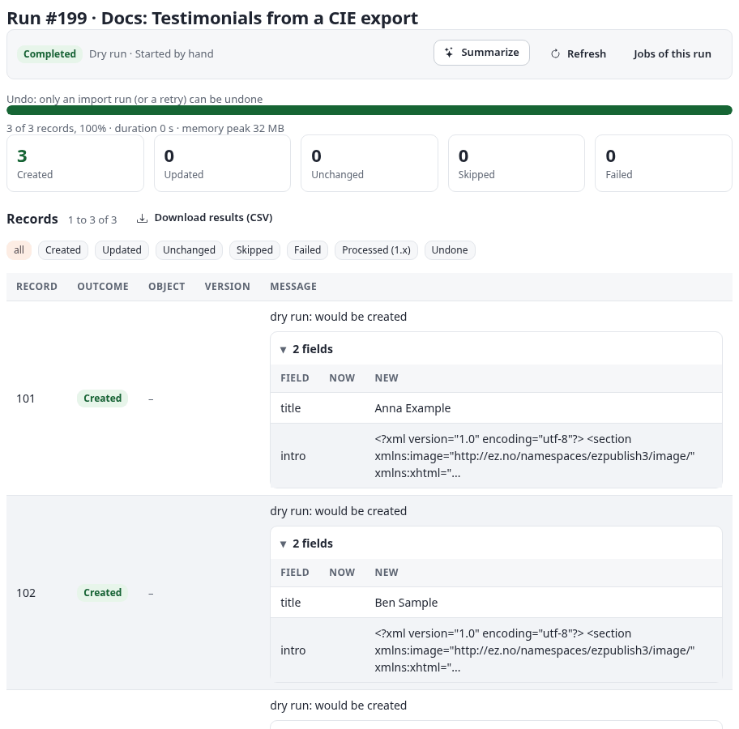

# Imports among the import and export tools

Exponential 6.0.15 and later list their import and export tools in one transfer registry (Setup, Import and export).
7x SQLI Import declares itself there as **Imports (7x SQLI Import)** (`settings/kernelservices.ini.append.php`,
block `[Service_transfer.sqliimport]`, tag `transfer.tool`). From that entry the administration offers Imports
where it fits: in a folder's menu, on a class page, in the **Looking for…?** boxes, and in one shared run history.
This page shows each of those places, then a full round trip with Export (xrowextract), form submissions from CIE,
and the results of a run as CSV. An older kernel ignores the block, and the boxes below are not shown.

Deutsch: [ger-de/transfer.md](ger-de/transfer.md).

## Table of contents

- [Where Imports is offered](#where-imports-is-offered)
  - [The Looking for…? box](#the-looking-for-box)
  - [Import into this folder…](#import-into-this-folder)
  - [Import objects of this class…](#import-objects-of-this-class)
- [Opening a file another tool made](#opening-a-file-another-tool-made)
- [Round trips](#round-trips)
- [Worked example: a round trip with Export (xrowextract)](#worked-example-a-round-trip-with-export-xrowextract)
- [Worked example: CIE form submissions into articles](#worked-example-cie-form-submissions-into-articles)
- [The shared run history](#the-shared-run-history)
- [The results of a run as CSV](#the-results-of-a-run-as-csv)

## Where Imports is offered

### The Looking for…? box

Every tool's main page ends with a box **Looking for another import or export?**. It lists the other tools you may
use, each with its direction (Import, Export, Import and export), and marks with **Works with this tool** the tools
whose files this one reads or that read its files. On the Imports dashboard those are Export (xrowextract), RSS export,
Collected information export (CIE) and Data tables. The last link opens the help page "Which import or export tool do
I need?".


The partners come from the registry (`RoundTrip[]` in each tool's block): Export names `transfer.sqliimport`, Imports
names Export, CIE and Data tables, so each appears in the other's box.

### Import into this folder…

On a folder in the content structure, the button **Import/Export** lists everything that can be done with that item.
**Import into this folder…** is the entry of Imports (shown when you may create content in that folder):


It opens `sqliimport/edit/new/(parent)/<node id>`: a new import whose objects are created below that folder. The
source step says so at the top ("The objects will be created in Media"), and the folder becomes the **Parent node of
new content** of the step Processing. Everything else is chosen as for any new import ([editor.md](editor.md)).

Do not mix it up with **Import into this item…** in the same menu: that is the import of Export (xrowextract), for
files that Export made.

### Import objects of this class…

On a class page (**Setup > Classes**, a class), the box **Import and export** lists the tools that work on objects of
that class:


**Import objects of this class…** opens `sqliimport/edit/new/(class)/<class identifier>`: the mapping of the new
import starts with that class, and once a source is saved, **Auto-match by name** fills its lines from the sample.

A value these parameters do not accept (a node you may not create in, a class that does not exist) is ignored: the
form opens as a plain new import.

## Opening a file another tool made

A tool can hand one of its files to Imports by linking to
`sqliimport/edit/new/(from)/<tool>/(job)/<job id>` (optionally `(preset)/<format>`). Imports asks the tool for the
job's file and gets it only when you may download that job there:

| Tool | Rule | Format |
|---|---|---|
| Export (`xrowextract`) | a finished CSV, JSON or XML class export you may see on its Jobs page, and the policy xrowextract/import or sqliimport/manage | `xrowextract`, with the export's column manifest |
| CIE (`bccie`) | your own background export, while you can still read the form, and the policy bccie/read | `cie` |

The file is copied into the uploads of Imports, with the manifest when the tool has one; the source step shows **Use
the file … from … (job …)**. Nothing is imported before you go through the steps. A file you may not have gives a
notice, not an error.

Where the link is: CIE shows **Open in Imports** next to a finished CSV export. Export's Jobs and History pages offer
**Re-import this file**, which opens Export's own import, not Imports; to open an Export job in Imports, type the
address above with the job's id.

Another tool joins with `sqliimport.ini [HandoverSettings] Tools[]=<tool id>;<class>`, the class having a static
`fileOf( $jobID, eZUser $user )` that returns `array( 'path', 'name', 'manifest' )` or null.

## Round trips

- **Export (xrowextract) files** (format `xrowextract`): with the column manifest the mapping is exact, and the remote
  ID column makes a re-import update the objects instead of creating new ones. The manifest comes inside a JSON or XML
  export, with a handed-over job, or as the sidecar file `<file>.manifest.json` next to a file on the server. The
  upload field of the editor takes one file, so a CSV you upload there has no manifest: set the mapping as in the
  example below. Without a manifest, the option *Class* names the class, and columns named after its attribute
  identifiers are mapped.
- **CIE form submissions** (format `cie`): UTF-8, UTF-16 or Windows-1252, `;` or `,`; choose the class a submission
  becomes, and the columns are matched to its attributes by identifier or name.
- **RSS export of another Exponential site** (format `exponential_rss`): the articles of the other site's feed.
- **What an import did**: the run page offers **Download results (CSV)** ([below](#the-results-of-a-run-as-csv)).
- **Mappings between installations**: the mapping step offers **Download mapping (JSON)** (`sqliimport/mapping/<id>`)
  and **Load a mapping…**; a new import's source step takes a mapping file too. A mapping file names the class, the
  language, the match rule and the lines, not the location; loading it checks that this site has the class and its
  attributes.
- **Data tables**: an import fills a data table, makes a new one from its fields, or opens a synchronisation between
  a table and content ([datatables.md](datatables.md)).

## Worked example: a round trip with Export (xrowextract)

Three folders are exported with Export, one name is changed in the file, and the file goes back in with Imports, so
that the folder is **updated**, not created again. This was run on the test installation, below the hidden docs folder
"Round trip (Export)" (node 55002). Its three folders were made by a small import of the catalogue's `products.csv`:
"Café crème", "Tea, green" and "Hot chocolate", with the remote IDs `sq688doc-rt-1` to `sq688doc-rt-3`.

**1. Export the folders with their remote IDs.** In the **Export** tab choose the class *Folder* below that node, the
columns *Name* and *Summary*, and the column set **identity**, which adds the object ID and the remote ID. From the
command line it is the same export:

```bash
./console ext:xrowextract:csv --class=folder --node=55002 --depth=list \
    --columns=name,short_description --sets=identity --format=csv --output=teas.csv
```

Export writes `teas.csv` and its column manifest `teas.csv.manifest.json`:

```text
"name","short-description","object-id","remote-id","class","object-name","language"
"Café crème","<p>9.50</p>","56624","sq688doc-rt-1","folder","Café crème","eng-US"
"Tea, green","<p>4.20</p>","56625","sq688doc-rt-2","folder","Tea, green","eng-US"
"Hot chocolate","<p>5.00</p>","56626","sq688doc-rt-3","folder","Hot chocolate","eng-US"
```

**2. Change a value.** In a spreadsheet or a text editor, rename "Tea, green" to "Green tea" in the column `name`, and
save the file as CSV (UTF-8).

**3. Import it back.**

1. **Imports > New import** (or **Import into this folder…** on the folder). Source type **Export (xrowextract)
   file** (group Platforms), **An uploaded file**: `teas.csv`. Option *Class*: `folder`. Save and continue.
2. Step **Processing**: keep **Create new, update existing**. Save and continue.
3. Step **Mapping**: the CSV came without its manifest, so check the match rule and the lines:
   - **How a record finds its object**: **By a remote ID made from the record**, pattern `{remote-id}` (the column
     the identity set wrote). This is what makes the import update the three folders.
   - The grid: `name` for *Name*. Leave every other line empty, *Summary* too: Export writes rich text as HTML
     (`<p>4.20</p>`), which is stored back as rich text XML written slightly differently from the stored one, so every
     row would count as **Updated** although its text did not change. Import only the columns you changed.

   

   With a JSON export (`--format=json`, the manifest is inside the file) the editor fills the match rule and the
   lines by itself when the source step is saved: pattern `{remote-id}`, `name` for *Name*, `short-description` for
   *Summary*. Empty the *Summary* line there too.
4. **Dry run**. One row would be updated, field by field; the others are unchanged:

   

5. **Save and run**. The run (#197 on the test installation) ends with **0 created, 1 updated, 2 unchanged**:

   

The folder `sq688doc-rt-2` is "Green tea" now, as version 2; the other two kept version 1, so nothing was duplicated
and nothing else got a new version. Running the same file again gives **3 unchanged** (run #198). If the result is
wrong, **Undo this run** on the run page publishes version 1 again ([runs.md](runs.md)).

If you leave the match rule as the editor proposes it for a CSV without manifest (`xrowextract-folder-{name}`), the
import does not find the exported folders and creates three new ones. Always check the dry run: it must say
**Updated** or **Unchanged**, never **Created**, for objects you exported.

## Worked example: CIE form submissions into articles

CIE (Collected information export) downloads what a form collected, as a CSV file in the character set your
spreadsheet needs. Imports reads such a file with the format **CIE form submissions (bccie CSV)** and makes each
submission a content object, for example to publish testimonials after a review.

The catalogue's example file `cie-testimonials.csv` (UTF-16, `;`, three invented submissions):

```text
Name;E-mail;Testimonial;Rating;Created;ID
Anna Example;anna@example.org;Lovely tea, fast delivery.;5;2026-04-02 10:12;101
Ben Sample;ben@example.com;"Good; the sencha is great";4;2026-04-03 08:40;102
Cara Test;cara@example.org;Friendly shop.;5;2026-04-05 17:03;103
```

1. In **CIE**, export the form as CSV in the background, and press **Open in Imports** next to the finished job. Or
   upload the file in a new import with the format **CIE form submissions (bccie CSV)**.
2. Source options: **Key field** `ID` (the submission's number), *Class* `article`.
3. Mapping: **By a remote ID made from the record**, pattern `cie-testimonial-{ID}`, so a submission is imported once
   however often the export is imported; `Name` for *Title*, `Testimonial` with the transform `richtext` for
   *Summary*. Leave out `E-mail`: it is personal data and does not belong on a public page.
4. **Dry run**: 3 would be created.



Illustrative: this example was run as a dry run only (run #199), so nothing was published. Put the new articles in a
hidden folder, or a section that needs approval, when the submissions should be read before they are shown.

## The shared run history

Every run of Imports, Export, CIE and the synchronisations of Data tables is recorded in the kernel's run history
(table `exp_transfer_run`): who ran it, when, how long it took, how many records it handled and how it ended. The run
list of the Imports dashboard and the **Statistics** page have a tool filter: **Imports**, any other tool, or **All
import and export tools** (`sqliimport/list/(tool)/<tool id>`, for example `transfer.datatable`):


A run of another tool links to its own page (the job with its file); each tool's own pages keep their lists and link
**All import and export runs** back here. You see your own runs, and every user's runs of a tool when your role allows
it (for Export, the policy xrowextract/all_jobs). The history keeps finished runs `[TransferSettings] KeepDays` days
(365); the runs of Imports themselves follow `[RunSettings] KeepDays` ([runs.md](runs.md#retention)). In the picture
no synchronisation had run yet, so **Data tables** has no runs.

## The results of a run as CSV

**Download results (CSV)** on a run page (`sqliimport/report/<run id>`), or `./console ext:sqliimport:report <run id>`,
gives one line per record. For the round trip run #197:

```text
run_id,row,ref,outcome,status,object_id,node_id,remote_id,version_before,version_after,changed_fields,message,time
197,0,#1,unchanged,ok,56624,55003,sq688doc-rt-1,1,1,,,2026-10-23T01:35:10Z
197,1,#2,updated,ok,56625,55004,sq688doc-rt-2,1,2,,,2026-10-23T01:35:10Z
197,2,#3,unchanged,ok,56626,55005,sq688doc-rt-3,1,1,,,2026-10-23T01:35:10Z
```

`version_before` and `version_after` show which objects got a new version. `changed_fields` is filled for dry runs
(the fields that would change); in a real run it stays empty. `--outcome=failed` writes only the failed records, and
the file opens in a spreadsheet to hand to whoever corrects the source ([cli.md](cli.md#report)).
