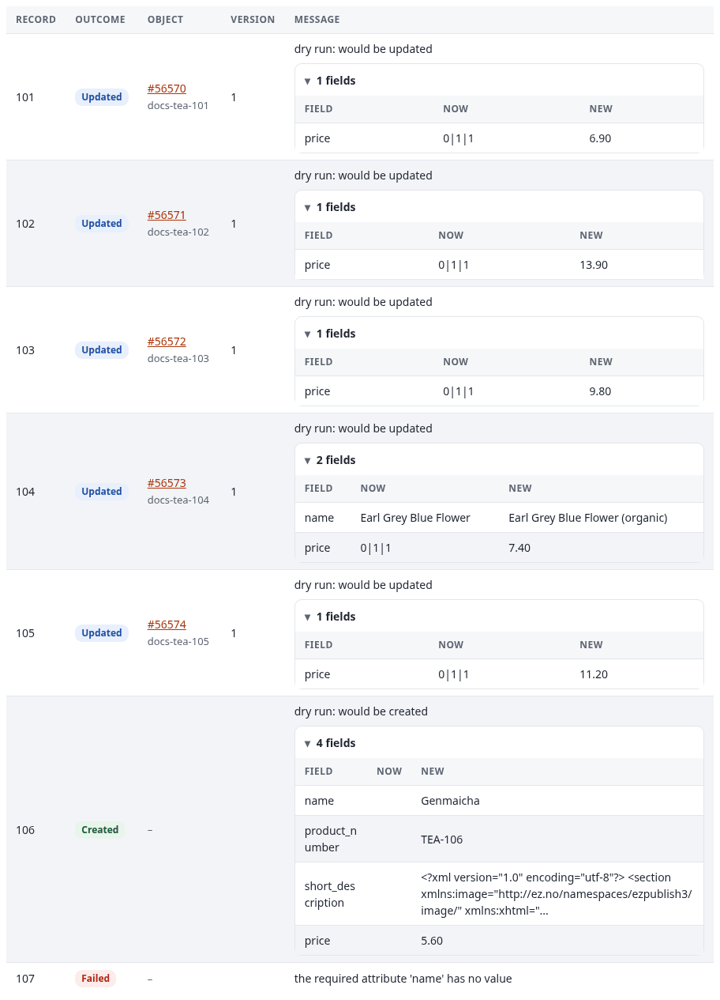
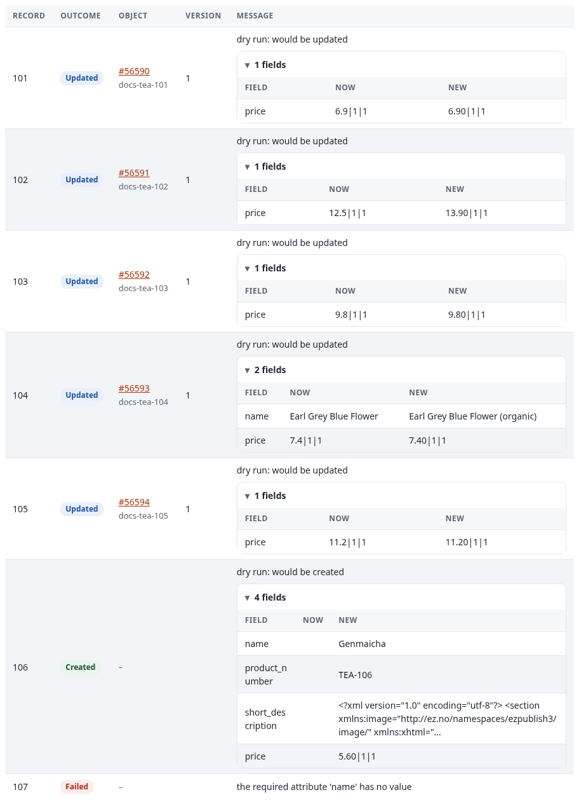

# Troubleshooting

This page has two parts. **Problems** lists what can go wrong, with the message you see and what to do. **Frequently
asked questions** explains behavior that looks like a fault but is how the engine works, with what to expect.

## Contents

- [Problems](#problems)
  - [The Imports tab is missing](#the-imports-tab-is-missing)
  - [New import, Edit or Settings is missing](#new-import-edit-or-settings-is-missing)
  - [The editor](#the-editor)
  - [A spreadsheet cannot be read](#a-spreadsheet-cannot-be-read)
  - ["The tables of 7x SQLI Import are missing"](#the-tables-of-7x-sqli-import-are-missing)
  - ["The job queue (expqueue) is not installed"](#the-job-queue-expqueue-is-not-installed)
  - [A run stays queued](#a-run-stays-queued)
  - ["The import already runs (run #12)"](#the-import-already-runs-run-12)
  - [Schedules do not start](#schedules-do-not-start)
  - [The run failed at once](#the-run-failed-at-once)
  - [Records fail](#records-fail)
  - [Records are missing from a run](#records-are-missing-from-a-run)
  - [Nothing is updated](#nothing-is-updated)
  - [A 1.x handler](#a-1x-handler)
  - [Memory and time](#memory-and-time)
  - [Velocity or PHP-FPM still run the old code](#velocity-or-php-fpm-still-run-the-old-code)
  - [A database driver is missing in the editor, or only in the runs](#a-database-driver-is-missing-in-the-editor-or-only-in-the-runs)
- [Frequently asked questions](#frequently-asked-questions)
  - [Is the live run page cached by Velocity or a response cache?](#is-the-live-run-page-cached-by-velocity-or-a-response-cache)
  - [Why does a dry run of a folder tree fail the children?](#why-does-a-dry-run-of-a-folder-tree-fail-the-children)
  - [I fixed the file, but Retry failed rows fails again](#i-fixed-the-file-but-retry-failed-rows-fails-again)
  - [Prices are 0, or every run updates every price](#prices-are-0-or-every-run-updates-every-price)
  - [Why can an import not read this site's own database?](#why-can-an-import-not-read-this-sites-own-database)
  - [Oracle: oci8, pdo_oci or ezoracle?](#oracle-oci8-pdo_oci-or-ezoracle)

## Problems

### The Imports tab is missing

- The extension is not active in this siteaccess: check `ActiveExtensions[]` or `ActiveAccessExtensions[]`.
- The siteaccess resets `[TopAdminMenu] Tabs[]` in its own `menu.ini.append.php`. The empty `Tabs[]` throws away
  the tabs the extensions added, including the extension's own `Tabs[]=sqliimport`. Add it to that list, for example
  in `settings/siteaccess/<admin siteaccess>/menu.ini.append.php`:

  ```ini
  [TopAdminMenu]
  Tabs[]
  Tabs[]=dashboard
  Tabs[]=content
  Tabs[]=media
  Tabs[]=users
  Tabs[]=setup
  Tabs[]=sqliimport
  ```

  The tab itself (`[Topmenu_sqliimport]`: its name, icon and navigation part) comes from the extension's
  `menu.ini.append.php` and needs nothing in the siteaccess.
- The INI cache is stale: `php bin/php/ezcache.php --clear-tag=ini`.
- The user has neither `sqliimport/run` nor `sqliimport/manage` (nor a 1.x policy): [permissions.md](permissions.md).
  A role made for 2.0.0-alpha.1 with `sqliimport/view` or `sqliimport/edit` grants nothing any more; give it `run`
  or `manage`.

### New import, Edit or Settings is missing

These need `sqliimport/manage` (or `sqliimport/manageimports` of 1.x). With `sqliimport/run` alone, a user sees the
imports and runs them, but cannot change them. With a handler limitation, Edit and the actions under More are shown
only for imports of the allowed handlers.

### The editor

- **The mapping step shows no attributes:** save the step after choosing the content class.
- **"The sample of the source could not be read":** the source is not reachable or not valid yet. Check the source
  step (the file, the address, the options such as the sheet of a spreadsheet), then open the step again.
- **Auto-match filled no lines:** no field of the sample has a name like an attribute. Fill the lines by hand.
- **A transforms line is reported:** the one-line text of the chain could not be read, for example a value with a
  comma that is not in quotes ([mappings.md](mappings.md#the-one-line-text-of-a-chain)).
- **The import cannot be enabled in the review step:** the review lists what is still missing; fix it in the step
  named there.
- **An imported definition fails at once:** its uploaded file is not part of the export. Upload it again in the
  source step ([settings.md](settings.md#import-import-definitions)).

### A spreadsheet cannot be read

- "reading spreadsheets needs the PHP extension zip": install `ext-zip` for the PHP of the job queue's workers and
  of the web server.
- "the spreadsheet has no sheet ...": the option `sheet` names a sheet that is not in the file. Give its exact name
  or its number.
- Dates arrive as numbers such as `45231`: add `date(format=excel)` to the line ([mappings.md](mappings.md#dates-from-spreadsheets)).

### "The tables of 7x SQLI Import are missing"

Run `./console ext:sqliimport:install-schema`. `--check` lists what is missing.

### "The job queue (expqueue) is not installed"

Activate the extension expqueue and run `./console ext:expqueue:install-schema`.

### A run stays queued

The workers of the job queue process the runs, not the page. A run that stays *Queued* has not been taken by a
worker yet. Check that the cron part `expqueue` runs every minute (or that its systemd service runs), and look at the
job queue's dashboard (`expqueue/dashboard`, linked from the Imports tab). To process a run at once from the command
line:

```bash
./console ext:sqliimport:run my_import --wait
```

The run page is never the reason: it asks the server for the run's state every two seconds and shows what it gets
([see the FAQ](#is-the-live-run-page-cached-by-velocity-or-a-response-cache)).

### "The import already runs (run #12)"

One import runs once at a time. Wait for the run to end, or cancel it:
`./console ext:sqliimport:cancel 12`. A run that stays `running` although its job failed every attempt is ended by
the cron part `sqliimport`; check that it runs every minute, or run `./console ext:sqliimport:tick`.

### Schedules do not start

- The cron part `sqliimport` must run every minute: `php runcronjobs.php -q sqliimport`.
- The schedule may be inactive (a `once` schedule switches itself off after its run).
- With `catch_up` = `skip`, a run late by more than ten minutes waits for the next time.
- If the import is disabled, its scheduled run is skipped; `tick` prints the reason.

### The run failed at once

Look at the run's log (`./console ext:sqliimport:status <run id>` or the run page). Common messages:

| Message | Cause |
|---|---|
| `the uploaded source file is missing; upload it again` | The upload was removed from the storage directory |
| `the path is outside the directories ... AllowedPaths[] allows` | Add the directory to `[SourceSettings] AllowedPaths[]` |
| `the host ... is in a private or reserved network` | An intranet address; see `[SourceSettings] AllowPrivateHosts`, or the `AllowedHosts[]` of the source's own section |
| `only http and https addresses can be read` | Another scheme was used |
| `the download is larger than [SourceSettings] MaxSourceMegabytes` | Raise the limit, or deliver the file in parts |
| `the mapping is not valid: ...` | The mapping names a class or an attribute that does not exist, or lacks a match rule or a parent |
| `unknown handler '...'` or `unknown source type '...'` | The handler or format is not registered, its class is not autoloaded, or a long-lived worker started before it was added ([Velocity or PHP-FPM still run the old code](#velocity-or-php-fpm-still-run-the-old-code)) |
| `SQL: only a SELECT (or WITH ... SELECT) query is allowed` | The query of an SQL source writes or holds a second statement ([sources.md](sources.md#sql-database-or-query-sql)) |

### Records fail

Filter the run page by **Failed** (`sqliimport/run/<id>/(outcome)/failed`) to see each message. Typical causes:

- `the remote ID needs id, which the record does not have`: the pattern names a field the record lacks. Check the
  field names; CSV headers are case sensitive.
- `the required attribute '...' has no value`: give a default, or let the record fail on purpose.
- `the parent of the record does not exist (yet)`: the parent comes later in the source, or not at all. Sort the
  source so parents come first. In a dry run this message is expected for the children of new folders
  ([see the FAQ](#why-does-a-dry-run-of-a-folder-tree-fail-the-children)).
- `lookup: no object with the remote ID '...'`: the related object was not imported yet.

What to do depends on where the cause is ([see the FAQ](#i-fixed-the-file-but-retry-failed-rows-fails-again)):

- **The cause is outside the record** (a parent or a lookup target imported since, a class attribute added since, a
  temporary server error): **Retry failed rows** (or `./console ext:sqliimport:retry <run id>`) processes the failed
  records again.
- **The cause is in the record** (a missing name, a bad date in the file): fix the source, then **Run now**.

### Records are missing from a run

Two records with the same key are processed once: the second is not processed. Make the source's `key` field unique,
or leave it empty so records are named by their position.

### Nothing is updated

- `update_policy` = `create_only` skips existing objects.
- Objects in the trash are skipped.
- The rows say `unchanged`: no field differs from the published version, so no version was made. A dry run shows the
  compared values.

### A 1.x handler

- Its rows have the outcome `processed`; the engine does not know what the handler did. Read its progression notes
  in the run's log ([migration-1x.md](migration-1x.md#worked-example-a-1x-handler-in-the-2x-engine)).
- "Retry failed rows" is not available. Run the import again.
- 1.x import requests (the dashboard's **Request import**, or a POST to `sqliimport/addimport`) wait until the cron
  part `sqliimport` (or the deprecated `sqliimport_run`) hands them to the job queue. If one stays pending, check
  that a cron part runs.

### Memory and time

A chunk processes `[RunSettings] ChunkSize` records (200 by default) and may take up to 1800 seconds
(`expqueue.ini [JobType_sqliimport.chunk] Timeout`). Lower the import's `chunk_size` for heavy records, such as
records with images to download.

### Velocity or PHP-FPM still run the old code

After an upgrade of the extension, a new source, handler or transform, or new kernel classes, the change is on disk
but a long-lived PHP process may not have it yet:

- **Exponential Velocity** loads the classes and settings in its warm-up, and every worker inherits them. A worker
  keeps the classes of its warm-up for its whole life, so a new class, a new `[Source_<id>]` block or a changed
  service is unknown to it ("unknown source type", "unknown handler", a transform that is not offered). Restart
  Velocity after the deploy:

  ```bash
  php bin/php/ezpgenerateautoloads.php -e
  php bin/php/ezcache.php --clear-tag=ini
  ./console exp:velocity restart
  ```

  Where the installation has it, `./console exp:velocity deploy` does these steps and the others of a deploy in
  order. Velocity's own PHP settings set `opcache.file_update_protection=0` (`settings/velocity.ini`,
  `[PHPSettings] IniOptions[]`): with PHP's default of 2 seconds, every file written after a worker started (the INI
  cache, the compiled templates, the classes a deploy regenerates) counted as too new for the worker's whole life and
  was never kept in OPcache. Keep it at 0.
- **PHP-FPM** keeps a changed file in its OPcache until it revalidates it (`opcache.revalidate_freq`). Reload the
  pool that serves the site after a deploy (`systemctl reload <its PHP-FPM service>`).
- **The job queue's workers** run in the PHP of their cron job or service. The cron part `expqueue` starts a new PHP
  process every minute, which reads the new code; a worker that runs as a systemd service needs a restart.

### A database driver is missing in the editor, or only in the runs

The editor (Test connection, the sample and the preview) runs in the **web server's PHP**; the runs run in the **PHP
of the job queue's workers** (the PHP of the cron job, or of Velocity). These are often different binaries with
different extensions: on a Plesk server the administration may be served by Plesk's PHP-FPM while the cron job
starts the system's `php`.

- The catalogue card and the source step's *What this server can connect with* show the drivers of the web server's
  PHP and, once a run has reported them, those of the workers ("in the workers"). The workers note their PHP and its
  drivers at every run.
- A test in the editor that says a driver is missing, while the list says the workers have it, is no fault: runs
  still work. Install the driver in the web server's PHP only if you want the test and the preview there too.
- A run that fails with a missing driver needs it in the workers' PHP: `php -m` of that binary lists its extensions.

On the documentation server, for example, the web server's PHP reads SQL Server through `PDO_ODBC` with FreeTDS,
while the command line's PHP has no SQL Server driver at all.

## Frequently asked questions

### Is the live run page cached by Velocity or a response cache?

No. The run page (`sqliimport/run/<id>`) loads once, then asks the server for the run's status, progress, counters
and new log lines **every two seconds** through the server function `sqliimport::runstatus` (ezjscore, called through
expui's `Exp.io`). The call is a **POST** with the form token, so neither Velocity's response cache nor any other HTTP
cache answers it. When the run ends, the page loads again to show the records. A missed answer (a restart, the
network) is tried again up to five times, five seconds apart; then the page stays as it is, and **Refresh** loads it.

A run that stays *Queued* on this page is waiting for a worker of the job queue
([A run stays queued](#a-run-stays-queued)); reloading the page does not change that.

### Why does a dry run of a folder tree fail the children?

A dry run publishes nothing. When an import builds a tree in one run (folders before their documents: the documents
of a ZIP, the folders of a drive, a CSV with parent IDs), the folders the dry run would create do not exist for the
records below them, and those records fail with "the parent of the record does not exist (yet)".

What to expect: in a dry run before the first real run, the top records say "would be created" and every record
below a new folder fails. The worked example in
[source-examples-platforms.md](source-examples-platforms.md#documents-one-file-or-a-folder-as-zip-documents) shows
it: the dry run #162 had 1 created and 4 failed, and the real run #163 created all 5. The real run places them,
because records are processed in their order and a parent is published before its children. Once the tree exists, a
dry run shows the true picture (unchanged, or would be updated).

### I fixed the file, but Retry failed rows fails again

**Retry failed rows** does not read the source again. It processes the **stored records** of that run's failed rows,
as they were read then. A record whose own data was wrong fails again with the same message, however the file was
fixed meanwhile.

- The cause was in the record (an empty name, a bad date, a price that is not a number): fix the source (upload the
  corrected file, fix the row in the database), then **Run now**. The import reads the source again; the rows that
  were fine before come out unchanged, so this costs little.
- The cause was outside the record: a parent or a lookup target that was missing then and has been imported since,
  an attribute added to the class, a temporary error of a server. Then **Retry failed rows** is right: the same
  records, the new circumstances.

A 1.x handler stores no records, so its runs have no Retry; run the import again.

### Prices are 0, or every run updates every price

The datatype `ezprice` (the attribute `price` of the webshop's class `product`) reads a value in its text form
`amount|VAT type|includes VAT`, for example `6.90|1|1`.

**A plain number is stored as 0.** A mapping line that gives `ezprice` only `6.90` gets the price `0|1|1`. The dry
run of such an import shows it: every object has the price `0|1|1`, and every run would set the bare amount again:



Give the price line the text form: `template(text="{price}|1|1")` (VAT type 1, the price includes VAT), or
`template(text="{price}|1|0")` for a price without VAT. The product preset of the shop formats does this
([sources.md](sources.md#the-product-preset)).

**Every run reports the price as changed.** With the text form, a price such as `6.90` is stored, and given back by
`ezprice`, as `6.9|1|1`. The engine compares the text it would write with the stored text, so `6.90|1|1` and
`6.9|1|1` count as different, and every run updates every product whose price ends in a zero, although nothing
changed:



This is a known issue. Until the comparison treats amounts as numbers, write the amount the way PHP writes the
number (`6.9`, `12.5`, `7`): with a transform of your own that formats it as `(string)(float)$amount`, as the `vat`
transform of [handlers.md](handlers.md#writing-your-own-transform) does, or by delivering prices from the source
without trailing zeros.

### Why can an import not read this site's own database?

The SQL source can read the installation's own database (the driver or connection `site`) only with

```ini
[SqlSourceSettings]
SiteDatabase=enabled
```

in `settings/override/sqliimport.ini.append.php`. It is off by default because those tables hold every user account
with its password hash, the roles and the sessions, and every person who may edit imports could read them with a
query. Even read-only, over a connection of its own, that is more than most editors should see. Enable it only when
the people who edit imports may see all of it. Otherwise, make a database view or a separate read-only user with
only the tables the import needs, and a named connection for it (Setup, Data tables, Connections).

### Oracle: oci8, pdo_oci or ezoracle?

Two places read Oracle, with different drivers:

- **The options of the SQL source** (host, service name, user, secret) connect through the PHP extension `oci8`, or
  `pdo_oci` when `oci8` is missing (`[SqlSourceSettings] OracleDriver=auto`, `oci8` or `pdo_oci`). They need the
  Oracle Instant Client in the PHP of the workers.
- **A named connection** of the engine Oracle (Setup, Data tables, Connections, Exponential 6.0.15) is opened by the
  kernel: through the extension **ezoracle** and its handler `eZOracleDB` when ezoracle is active, else PDO `oci`.
  The import then names only the connection.

The catalogue's SQL card lists both, for example "Oracle: oci8, eZOracleDB (ezoracle) for named connections"
([source-examples-databases.md](source-examples-databases.md#oracle-oci8-and-ezoracledb)). If the card shows
Oracle in grey, that PHP has neither driver. ezoracle is not needed for imports: `oci8` alone is enough for the
source's own options.
